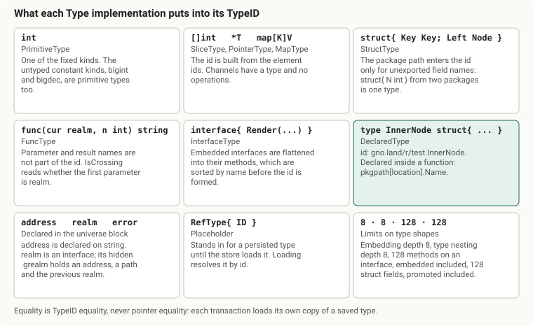
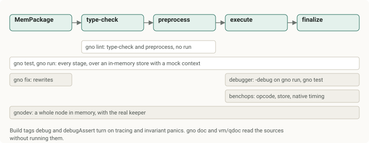

# How the GnoVM works

Measured against [gnolang/gno at 5a51b55f4][gno-tree], 2026-10-30. Every code
link points at that commit, so the line numbers hold.

## TLDR

Gno is Go without goroutines, generics and a few other features, made for smart
contracts: programs stored on the gno.land blockchain that anyone can call by
sending a transaction. The GnoVM is the Go program that runs them. It
type-checks `.gno` source with Go's own type checker, parses it with a copy of
Go's parser into a syntax tree of its own, and rewrites that tree once so that
every name is a numbered slot and every constant is computed. It then runs the
tree on a stack machine: an interpreter that keeps its pending work and its
values on stacks and carries out one small instruction, an opcode, at a time.
Every value carries its type. A realm is a package whose variables outlive the
transaction: when a call into one returns, the VM saves to the chain's key-value
store every object the call created or changed that the realm's package
variables still reach. Parsing, type-checking, every opcode, every allocation
and every store access cost gas, the unit of work the transaction's sender pays
for.

## Who this is for

A reader who knows Go and has never looked inside a blockchain, Gno or the
GnoVM. The vocabulary gives each term that more than one section uses a short
meaning and a link to the section that explains it. A later section that needs
the term again reminds the reader of it in a few words.

Read the vocabulary once, then the sections in order, because each builds on the
one before it. Inside a section the rule comes first in plain words and the
detail after it, so a reader who stops at the end of any paragraph still holds
something true. Each code link lands on the line its sentence is about, so every
claim can be checked in one click.

## Vocabulary

The terms come from three places: the chain the VM runs on, the Gno language,
and the VM's own machinery. Each term links to the section that explains it in
full. The gno documentation keeps a longer [glossary][a-glossary].

**The chain.**

| Term | Meaning |
| --- | --- |
| [node](#sending-a-transaction) | A computer running [`gnoland`][a-gnoland-cmd], the gno.land program. It keeps a full copy of the chain's state, takes transactions in and answers queries. |
| [transaction](#sending-a-transaction) | A signed request to change the chain's state: [one or more messages, a fee, the signatures and a memo][a-tx-struct]. Each account that signs it is a signer, and [the first signer pays the fee][a-ante-fee]. Its messages [succeed or fail together][a-runtx-commit]. |
| [message](#the-five-vm-messages) | One action inside a transaction, such as calling one realm function. Every message [names a route and the accounts that must sign it][a-msg-iface]. |
| [account, address](#the-baseapp-and-the-ante-handler) | An account holds [coins, an account number and a sequence number under an address][a2-account], a `g1...` string [derived from a public key][a2-pubkey-addr]. A package also has an address, [derived from its path][a-pkg-addr], so a realm can hold coins. |
| [sequence number](#the-baseapp-and-the-ante-handler) | A per-account counter that [every signature covers][a-ante-sig] and [every transaction increments][a-ante-seq], so the same signed transaction cannot run twice. |
| [coin, `ugnot`](#gas-and-memory) | A coin is [an amount and a denomination][a-coin]. `ugnot` is the denomination of gno.land's own coin, GNOT: [one GNOT is a million `ugnot`][a-ugnot]. |
| [gas](#gas-and-memory) | The unit work is counted in, [one gas standing for one nanosecond of work on reference hardware][a-gas-ns]. A transaction states the most gas it may use, its gas wanted, and [a flat fee][a-fee-struct] that is paid up front. |
| [chain block](#consensus-and-tendermint2) | A batch of transactions the validators agree on, numbered by its height and stamped with a time. It is not a block in the VM's sense, and "block height" and "block time" always mean the chain block's. |
| [validator](#consensus-and-tendermint2) | A node that takes part in consensus: it proposes chain blocks and votes on them, with a weight called its voting power. |
| [consensus](#consensus-and-tendermint2) | The protocol by which validators agree on the next chain block. A chain block is final once [validators holding more than two thirds of the voting power have signed it][a-quorum]. |
| [Tendermint2, tm2](#consensus-and-tendermint2) | [A minimal version of the Tendermint consensus engine][a-glossary-tm2], together with the libraries the chain is built from, in [`tm2`][a-tm2-dir]. |
| [mempool](#consensus-and-tendermint2) | A node's queue of transactions that [passed `CheckTx`][a-mempool-checktx] and wait for a chain block. |
| [ABCI](#abci-how-the-consensus-engine-calls-the-application) | The Application BlockChain Interface: [the Go interface][a-abci-app] through which the consensus engine hands transactions and queries to the application. |
| [genesis](#abci-how-the-consensus-engine-calls-the-application) | The chain's starting state at height 0, built from its genesis file: [the first balances and parameters][a-init-genesis] and [the transactions that deploy the first packages][a-init-txs]. |
| [application, `BaseApp`](#the-baseapp-and-the-ante-handler) | The program that gives transactions their meaning. gno.land's is [a tm2 `BaseApp`][a-baseapp-new], set up in [`gno.land/pkg/gnoland`][a-gnoland-dir]. |
| [ante handler](#the-baseapp-and-the-ante-handler) | [The function the `BaseApp` runs on every transaction before its messages][a-runtx-ante]: gas limits, the fee, signatures and sequence numbers. |
| [route, handler](#routes-and-handlers) | A route is the string a message names, [`vm`][a-router-key] for the VM's messages. The router [maps each route to a handler][a-routes], the object that [executes that route's messages and answers its queries][a-handler-iface]. |
| [module, keeper](#routes-and-handlers) | A module is one area of the application: [accounts, coins, the gas price, chain parameters or the VM][a-keepers]. A keeper is the object that owns one module's slice of the chain's state and the only code allowed to change it. [The vm keeper][a-keeper-struct] owns the GnoVM's store. |
| [chain parameter, governance](#the-baseapp-and-the-ante-handler) | A chain parameter is a setting kept in the chain's state, such as the vm parameters that decide who may upload code. Genesis sets the first values. Governance, the chain's on-chain vote, changes them through [a proposal built by `gno.land/r/sys/params`][a-params-gov]. `gnokey query params/vm:p:<name>` reads a vm parameter. |
| [query](#reading-state-without-a-transaction) | A read of the chain's state that one node answers [from a committed height][a2-query-snapshot], with no transaction and no fee. |
| [Merkle tree](#abci-how-the-consensus-engine-calls-the-application) | A tree in which every node stores the hash of its children, so the root hash changes whenever any key or value under it does. |
| [B+32 tree](#the-store) | The Merkle tree that holds gno.land's committed state: a B+ tree, a search tree that keeps its keys sorted with every key in a leaf, [whose nodes have up to 32 children][a-bptree-b], in [`tm2/pkg/bptree`][a-bptree-dir]. |
| [application hash](#abci-how-the-consensus-engine-calls-the-application) | The hash of the chain's state after a chain block. [The next chain block's header carries it][a-header-apphash], so validators can confirm they all computed the same state. |
| [amino](#serialization) | tm2's deterministic binary encoding. [Transactions are decoded with it][a-runtx-decode], and [the VM saves objects with it][a-store-amino]. |
| [storage deposit](#storage-deposit) | Coins [locked from the sender for each byte a message adds to a realm's stored state][a-deposit-lock], and [released in proportion when a later message frees bytes][a-deposit-refund]. |

**The language.**

| Term | Meaning |
| --- | --- |
| [Gno](#why-it-is-deterministic) | A dialect of Go for smart contracts. It [targets the Go 1.17 specification][a-compat-target], which has no generics, and it also leaves out goroutines and channels. [`reflect` is not yet available][a-compat-reflect], and [`os` and `net` are left out][a-compat-os], because reaching the machine or the network would not be deterministic. It [adds two builtin types][a-compat-builtin], `address` and `realm`, and builtin functions such as [`cross`][a-uv-cross] and the test-only [`revive`][a-uv-revive]. |
| GnoVM | The interpreter, the Go package [`gnovm/pkg/gnolang`][gnolang-dir]. The `gnoland` node and the `gno` command both build it in. |
| [package path](#mempackage-and-package-paths) | The import path of a Gno package, such as `gno.land/r/demo/counter`. [The single letter after the domain][a-pkgpath-regex] says what kind of package it is. |
| [realm](#realms-and-persistence) | [A package whose path has the letter `r`][a-isrealm], like `gno.land/r/demo/counter`. Its package-level variables keep their values from one transaction to the next, and its address can hold coins. |
| [pure package](#mempackage-and-package-paths) | [A package whose path has the letter `p`][a-isppkg], like `gno.land/p/nt/avl/v0`. Its package-level values [cannot change once it is deployed][a-p-immutable], and [only its test files may import a realm][a-p-imports-r]. |
| [ephemeral package](#the-five-vm-messages) | [A package whose path has the letter `e`][a-isephemeral]. `MsgRun`, the message that runs a one-off script, [places the script at `gno.land/e/<caller>/run`][a-run-path], runs its `main` once and [never saves it][a-run-nosave]. |
| [standard library](#standard-library-and-native-functions) | [The packages whose path has no domain][a-isstdlib], like `strings` or `chain/runtime`, kept in [`gnovm/stdlibs`][stdlibs-dir]. |
| [native function](#native-functions) | A function declared in a `.gno` file without a body, whose body is a Go function instead. [A bodyless function with no Go body on record fails to compile][a2-native-missing], and only the standard library has Go bodies on record. |
| [inert package](#deploying-through-approval) | A package uploaded while the vm parameter `code_submission_policy` is `inert`: [stored without being type-checked or run][a-policy] until an approver enables it. |
| [crossing function](#crossing-functions-and-cur) | A function or method whose first parameter has the builtin type `realm`, [named `cur` or left blank][a-cur-name]. Called as `f(cross(cur), ...)`, it runs as the realm that declares it. A `MsgCall`, the message that calls one realm function, [can call no other kind][a-call-noncrossing]. |
| [realm value](#crossing-functions-and-cur) | A value of the builtin type `realm`: [a hidden struct holding an address, a package path and a link to the realm value of its caller][a2-grealm]. Only the VM builds one, and [none is ever saved][a2-realm-nosave]. |
| [`cur`](#crossing-functions-and-cur) | The realm value a crossing function receives: the realm it runs as. [`cur.Previous()` is the realm that crossed into it][a-cross-prev]. The binding is fixed for the call: `cur` [cannot be reassigned][a-cur-assign] or [have its address taken][a-cur-addr]. |
| [storage realm, identity](#storage-borrow) | The storage realm, also called the active realm, is the realm whose objects the running code may write. The VM keeps it in [the Machine's `Realm` field][a2-machine-realm]. The identity is the realm the code acts as, the one `cur` names. A crossing call moves both to the callee's realm. |
| [borrow](#storage-borrow) | A switch of the storage realm that [a plain call makes without changing the identity][a-borrow]: code declared in a realm runs with that realm's storage, and a pure package's method runs with the storage of the realm that owns its receiver. |

**Inside the VM.**

| Term | Meaning |
| --- | --- |
| [MemPackage](#mempackage-and-package-paths) | A package as [a name, a path, a list of files and a type tag saying which files it holds][a-mempackage-struct], each file a name and a body: the unit that is uploaded, type-checked, run and stored. |
| [AST](#parsing-into-the-gno-syntax-tree) | The syntax tree. Gno keeps its own node types, [built from the output of its copy of Go's parser][a-go2gno]. |
| [preprocess](#preprocessing-the-compile-step) | [The one-time pass over the AST][a-preprocess-fn] that resolves every name to a numbered slot, folds constants, computes static types and checks the crossing rules. It is the GnoVM's compiler. |
| [Machine](#the-machine) | [The interpreter's state for one run][a-machine-struct]: its stacks, the package whose code runs, the storage realm, the allocator and the gas meter. |
| [stage](#the-machine) | The phase a Machine runs in: [`StagePre`, `StageAdd` or `StageRun`][a2-stage], for constants evaluated during preprocessing, a package's initialization, or an ordinary call. |
| [opcode](#the-run-loop) | One instruction of the Machine, [a single byte][a-op-type] such as [`OpAdd`][a-opadd]. The Go function that carries one out is called its handler, which has nothing to do with a route's handler. |
| [block](#values-and-the-memory-model) | One scope at runtime: a function call, a loop body, an `if` arm. [It holds one typed value per name declared in that scope][a-block-struct]. It is not a chain block. |
| [typed value](#values-and-the-memory-model) | The universal value cell: [a type, a value and eight bytes that hold a fixed-size number or a bool inline][a-typedvalue]. |
| [heap item](#values-and-the-memory-model) | [A one-slot box][a2-heapitem] for a variable that outlives its scope: [every package-level variable][a2-heap-pkg], a local [whose address is taken][a2-heap-ref] or [that a closure captures][a2-heap-capture], and the target of a pointer made by `new(T)` or `&T{}`. |
| [object](#identities) | A value with identity that can be saved on its own: [array, struct, function, bound method, map, package, block or heap item][a-objects]. |
| [real, unreal](#identities) | A real object [has a finalized id][a-isreal]: finalization gave it a number from its realm's counter, and it is saved or about to be. An unreal object exists only in memory, and finalization makes it real only if a saved object points at it. |
| [realm record](#identities) | The VM's record of one realm: [its id, path, object counter, deposit and stored byte count][a2-realm-struct], saved [under the key `oid:<pkgid>:1#realm`][a2-realm-key]. A pure package or a standard library package gets [a frozen record that is never saved][a2-frozen-realm], so that its writes can still be checked. |
| [store](#the-store) | [The layer between the interpreter and the database][a-defaultstore]. It caches objects, types and syntax trees, and [each transaction works on its own fork of it][a-begintx]. The key-value stores under it, which hold the bytes, are tm2's. |
| [allocator](#allocation-and-the-memory-cap) | [The byte counter][a-alloc-struct] that caps the memory Gno code holds, [at 500 MB][a-maxalloc], and [charges allocation gas][a-alloc-gas]. Each transaction gets its own, and [its count restarts at zero][a2-alloc-reset] [at the start of each message][a2-alloc-per-msg]. |
| [finalize](#finalization) | The step at the end of a realm call that [walks the objects the call created or changed, assigns ids, saves them and deletes the unreferenced ones][a-finalize]. |
| [filetest](#the-same-vm-without-a-chain) | A Gno program whose expected results sit in comments at its end, [under directives][a2-directives] such as `// Output:` and `// Realm:`. The VM's own suite is [`gnovm/tests/files`][tests-files]. |

## Where the VM sits

On gno.land the GnoVM is the last of several layers. A wallet signs a
transaction, the consensus engine gets every node to agree on where it goes in
the chain, the application checks it and hands each message to the code for its
kind, and only then does the VM run Gno code. Each layer hands the next one
thing. The consensus engine never looks inside a transaction, and the
interpreter imports no consensus code, so the same VM also runs with no chain at
all, under `gno test`.


### Sending a transaction

gno.land is a blockchain: many computers, called nodes, each keep a full copy of
the same state, the data the chain holds, and they change it only by applying
the same transactions in the same order. A transaction is a signed request to
change that state. It carries [one or more messages, a fee, the senders'
signatures and a memo][a-tx-struct], and a message is one action, such as
calling one function of a realm.

Users build transactions with [`gnokey`][a-gnokey-dir], the command-line wallet,
whose [`maketx` subcommands][a-maketx] each build one kind of message. This
command calls `Increment` on the example realm
[`gno.land/r/demo/counter`][a-counter], signed with the key named `alice`:

```sh
FLAGS="-gas-fee 1000000ugnot -gas-wanted 5000000 -chainid dev"
gnokey maketx call $FLAGS -pkgpath gno.land/r/demo/counter -func Increment alice
```

The `gnokey` commands of these subsections show the shape of each message, not
a recorded session: they assume a local node with the chain id `dev`, and the
gas amounts are placeholders. `FLAGS` holds the options every transaction
carries, and the examples that follow reuse it. `-gas-wanted` is the most gas
the transaction may use, gas being the unit work is counted in. `-gas-fee` is
[the whole fee][a-fee-struct], one flat amount in `ugnot`, the smallest unit of
gno.land's coin. `-chainid` names the chain, and [the signature covers that
name][a-ante-sig], so the transaction cannot be replayed on another chain.
`gnokey` signs the transaction, [tries it through the node's `.app/simulate`
query][a-simulate], then [sends it to a node][a-broadcast], by default [the one
at `127.0.0.1:26657`][a-remote], and [waits for the result of running it in a
chain block][a-broadcast-commit].

The realm being called is this one file:

```go
package counter

import "strconv"

var counter int

func Increment(_ realm) int {
	counter++
	return counter
}

func Render(_ string) string {
	return strconv.Itoa(counter)
}
```

`Increment` takes a `realm` as its first parameter, which makes it a crossing
function, the only kind of function a `MsgCall`, the message that
`maketx call` builds, [may name][a-call-noncrossing]. `counter` is a
package-level variable of a realm, so the VM saves the value it ends with when
the call returns. `Render` returns the realm's state as text, for anyone who
asks through a query, a read that needs no transaction.

### Consensus and Tendermint2

The node that receives the transaction first asks the application whether it
could run at all, through [a call named `CheckTx`][a-checktx-fn]. If it passes,
the node [adds it to its mempool][a-mempool-checktx], its queue of transactions
waiting for a chain block, and [passes it on to the other
nodes][a-mempool-gossip].

A chain block is a batch of transactions, numbered by its height and stamped
with a time. Some nodes are validators: each has a voting power, its weight in
a vote, and together they decide which chain block comes next. That decision is
consensus. On gno.land it is run by Tendermint2, tm2 for short, [a minimal
version of the Tendermint consensus engine][a-glossary-tm2] kept in
[`tm2/pkg/bft`][a-bft-dir]. [One validator is the proposer][a-proposer] and
[builds a chain block from its mempool][a-propose-block], up to the chain
block's byte and gas limits. The others vote on it in two rounds, [a
prevote][a-prevote] and [a precommit][a-precommit], and the chain block is final
once [validators holding more than two thirds of the total voting power have
signed it][a-quorum].

Consensus settles only the order of the transactions. Every node then runs them
itself, in that order, and must reach the same state as every other node. A
program that gave different results on two machines would split the network,
which is why the VM is built to give the same result on every machine.

### ABCI: how the consensus engine calls the application

The consensus engine never looks inside a transaction: to it [a transaction is a
string of bytes][a-tx-bytes]. It hands those bytes to the application, the
program that gives them a meaning, through ABCI, the Application BlockChain
Interface: [a Go interface with one method per event][a-abci-app]. For every
committed chain block a node calls [`BeginBlock`, then `DeliverTx` once per
transaction in order, then `EndBlock`][a-exec-block], then `Commit`. Each call,
and what gno.land's application does with it:

| Call | When | What the application does |
| --- | --- | --- |
| `InitChain` | Once, when the chain starts from its genesis file, the file listing its first accounts, parameters and transactions | Sets [the genesis balances and parameters][a-init-genesis], loads [the standard library][a-init-stdlib] and [runs the genesis transactions][a-init-txs] that deploy the first packages. |
| `CheckTx` | When a transaction reaches a node | Runs [the checks and the ante handler only][a-checktx], never the messages, to keep a transaction that cannot pay out of the mempool. |
| `BeginBlock` | At the start of each chain block | Opens the chain block's working state, with [a gas meter that caps the gas of all its transactions together][a-begin-block]. |
| `DeliverTx` | Once per transaction of the chain block, in order | Runs the whole transaction, its messages included. |
| `EndBlock` | After the last transaction | [Updates the gas price][a-end-gasprice] and [applies changes to the validator set][a-end-valset]. |
| `Commit` | After `EndBlock` | Writes the chain block's changes to disk and [returns the application hash][a-commit-hash], a fingerprint of the state that results. |
| `Query` | Whenever a client asks | Answers a read from a committed state, with no transaction. |

The application hash is computed from the root of a Merkle tree, a tree in which
every node stores the hash of its children, so the root changes whenever any key
or value under it does. That tree holds the chain's state, and [the next chain
block's header carries the hash][a-header-apphash], so a node that computed a
different state sees at once that it disagrees with the others.

### The BaseApp and the ante handler

gno.land's application is [a `BaseApp`][a-baseapp-new], the generic application
from tm2's application toolkit in [`tm2/pkg/sdk`][a-sdk-dir], configured in
[`gno.land/pkg/gnoland`][a-gnoland-dir]. `CheckTx` and `DeliverTx` both hand the
transaction to the same function, [`runTx`][a-runtx], which:

1. [decodes the bytes][a-runtx-decode] with amino, tm2's deterministic binary
   encoding;
2. [runs `ValidateBasic` on every message][a-runtx-validate], a check that needs
   no state, such as refusing a missing package path;
3. [runs the ante handler][a-runtx-ante];
4. for `DeliverTx`, [runs the messages][a-runtx-msgs]. A simulation runs them
   too, then [throws away everything it wrote][a2-simulate-discard].

The ante handler is the function that runs on every transaction before any of
its messages. Its main steps, in order:

- [refuse a transaction whose gas wanted is above the chain block's
  limit][a-ante-maxgas];
- under `CheckTx`, [refuse a fee that is too low][a-ante-minfee] for the node's
  minimum gas price or for the chain's current gas price, a gas price being the
  fee divided by the gas wanted;
- [install a gas meter][a-ante-gasmeter] that stops the transaction as soon as
  it has used its gas wanted;
- refuse [more signatures than the chain allows][a2-ante-sigcount];
- [charge gas for the transaction's size in bytes][a-ante-txsize], then refuse
  [a memo longer than the chain allows][a2-ante-memo];
- [take the whole fee from the first signer's account][a-ante-fee], before any
  message runs;
- [check each signature][a-ante-sig], [charging gas for it][a2-ante-siggas],
  over bytes that include the chain id, the account's number and its sequence
  number, a counter of the transactions the account has sent, then [increment
  that counter][a-ante-seq], so the same signed bytes cannot run twice.

gno.land [adds two checks of its own after the ante handler][a-gno-ante]. A
session key, a limited key an account can hand out, [may never upload a
package][a-session-deny] and may only send the messages it was allowed. A
transaction that uploads or runs code must come from [an address the vm
parameters allow][a-code-policy]. The vm parameters are [settings of the vm
module kept in the chain's state][a-vm-params]. Governance, the chain's on-chain
vote, changes them through [a proposal built by the realm
`gno.land/r/sys/params`][a-params-gov].

Everything a transaction writes goes into [a cache over the
stores][a-runtx-ante]. If any message fails, `runTx` [throws away the messages'
writes and keeps only the ante handler's][a-runtx-commit]: the fee stays paid and
the sequence number stays incremented. One gas meter covers the whole
transaction, the ante handler, [the gno store][a-tx-gasmeter] and [the
VM][a-call-gasmeter] alike, and [its total then counts against the chain block's
meter][a-block-gas].

### Routes and handlers

Every message names a route, a short string: [the VM's messages all name
`vm`][a-router-key]. The router maps each route to a handler, the object that
executes that route's messages, and gno.land [registers four][a-routes]:
`auth`, `bank`, `params` and `vm`. `runMsgs` [looks up each message's handler by
its route and calls its `Process` method][baseapp-runmsgs], one message after
the other, and [stops at the first failure][a-runmsgs-stop]. A handler [also
answers the queries for its route][a-handler-iface], through a second method,
`Query`.

The application is split into modules, one per area, and [gno.land builds a
keeper for each][a-keepers]: accounts, coins, the gas price, chain parameters
and the VM. A keeper is the object that owns one module's slice of the chain's
state, and the only code allowed to change it. The `vm` route's handler,
`vmHandler`, [is a switch over the five VM message types][handler-process], and
it hands each one to the vm keeper.

### The five VM messages

Each VM message is a Go struct that `gnokey` fills from its flags. Once a
message's code has run, the keeper [locks coins from the sender for each byte
the message added to a realm's stored state][a-deposit-lock], the storage
deposit, and [releases them in proportion when a later message frees
bytes][a-deposit-refund]. `MsgAddPackage`, `MsgCall` and `MsgRun` share two
flags. `-send` attaches coins, which [move to the package's address before its
code runs][a-call-send]; for a `MsgRun` [that address is the caller's
own][a2-run-addr]. `-max-deposit` caps the storage deposit, and [the vm
parameter `default_deposit` stands in when the flag is
absent][a-deposit-default].

**`MsgAddPackage`** [uploads a package][msg-addpkg]: its path, its files, the
coins to send and the deposit cap. The keeper [type-checks it][a-add-typecheck],
[checks that the signer may publish under the path's
namespace][a-add-namespace], the segment after `/r/` or `/p/`, then [runs its
package-level declarations and `init` functions and saves it][a-add-run]. A path
[holds one package for good][a-add-exists], unless its manifest, the
`gnomod.toml` file that names the package, marks it `private`. Then [its
creator may upload it again][a-redeploy].

```sh
gnokey maketx addpkg $FLAGS -pkgpath gno.land/r/alice/app -pkgdir ./app alice
```

**`MsgCall`** [calls one function of a realm][msg-call], with its arguments
written as strings, one `-args` flag each. The path [must be a
realm's][a-call-realm-only], and the keeper [refuses a function that is not
crossing][a-call-noncrossing]. It [converts each string to its parameter's
type][a-call-convert], which works for booleans, numbers, strings, [the types
declared on them][a2-convert-base] such as `address`, and byte arrays and
slices written in base64. It [refuses every other type][a-call-convert-other].
It then runs the call and returns the results as text.

**`MsgRun`** [uploads a throwaway `main` package and runs it][msg-run]. The
keeper [places it at `gno.land/e/<caller>/run`][a-run-path], runs its `main`
[without ever saving the package][a-run-nosave], and [returns what it
printed][a-run-output]. A script can do what one `MsgCall` cannot: call several
functions, call functions that are not crossing, and pass values of any type.

```go
package main

import "gno.land/r/demo/counter"

func main(cur realm) {
	println(counter.Increment(cross(cur)))
}
```

```sh
gnokey maketx run $FLAGS alice ./script.gno
```

`main` takes `cur realm` here so that it can cross into the counter realm with
`cross(cur)`. The vm parameter `run_submitters` [can limit who sends
`MsgRun`][a-run-submitters]; an empty list lets anyone.

**`MsgEnablePackage` and `MsgRejectPackage`** serve the vm parameter
`code_submission_policy`, which decides what `MsgAddPackage` does:
[`permissionless` lets any address upload, `permissioned` only the addresses in
`code_submitters`, and `inert` stores any upload without type-checking or
running it][a-policy]. An inert package does nothing until [an address in
`pkg_approvers`][a-pkg-approvers] sends `MsgEnablePackage` [naming the hash of
the source it reviewed][a-msg-enable]. The keeper then [type-checks and
initializes it the way an upload would][a-enable]. `MsgRejectPackage` [deletes
an inert package instead][a-msg-reject], and [only an approver, its creator or
the owner of a live package at that path may send it][a-reject]. The policy in
force is read with `gnokey query params/vm:p:code_submission_policy`.

```sh
gnokey maketx enablepkg $FLAGS -pkgpath gno.land/r/bob/app -pkgdir ./app carol
gnokey maketx rejectpkg $FLAGS -pkgpath gno.land/r/bob/app carol
```

Here `carol` is an approver, and `./app` is her local copy of the source she
reviewed, which [`gnokey` hashes][a-enablepkg-help] into the approval.

### Reading state without a transaction

A read needs no transaction, no fee and no consensus. A client sends an ABCI
`Query` to one node, with a path and some data. The `BaseApp` [hands a path such
as `vm/qrender` to the handler named by its first segment][a-query-custom],
[over a read-only snapshot of a committed height][a2-query-snapshot], and the
`vm` handler [answers fourteen paths][handler-query]. Two of them:

```sh
gnokey query vm/qrender -data "gno.land/r/demo/counter:"
gnokey query vm/qeval -data 'gno.land/r/demo/counter.Render("")'
```

`vm/qrender` [calls the realm's `Render` function][a-qrender] with the text after
the colon, empty here, and `vm/qeval` evaluates any expression in the package.
Both [run on a Machine with a gas limit of its own, over a store that is thrown
away afterwards][a-query-machine], so a query cannot change the chain's state.
The other paths return the same evaluation as JSON, a package's function
signatures, files, documentation, variables and storage use, a stored object or
type, the list of package paths, a path's status, and the packages awaiting
approval.

### The keeper, the store and the Machine

[`VMKeeper`][a-keeper-struct] is the vm module's keeper. It holds the keys of the
two stores the VM writes, and the keepers of the modules it calls: accounts, the
bank that moves coins, and the chain parameters. It is the only code in
`gno.land/pkg` that builds a Machine.

The keeper owns [one long-lived `gno.Store`][keeper-store], the GnoVM's store:
the layer that caches objects, types and syntax trees and turns them into
key-value writes. Before a transaction runs its messages, [a hook the `BaseApp`
calls forks that store][a-tx-hooks], [giving the transaction empty caches of
its own][a-tx-fork]. Everything the messages save [reaches the database
through the `BaseApp`'s cache][a-runtx-commit]. After the transaction, a second
hook [passes the syntax trees the transaction built back to the long-lived
store, only if every message succeeded][a-tx-hooks], [and nothing
else][a2-tx-write]. So when a message fails, nothing the messages did is left
behind, in the database or in the VM's caches.

Under the gno store sit [two tm2 key-value stores][a-mounts]. One is a B+32
tree, [an immutable Merkle tree][a-bptree-readme] whose nodes have [up to 32
children][a-bptree-b]. The other is [a plain database adapter whose commit
carries no hash][a-dbadapter-commit], so [only the tree's contents feed the
application hash][a-rootmulti-hash]. The VM writes [package
sources][a-store-mempkg], [inert packages][a2-store-inert] and [the hashes of
objects that more than one object references][a-store-escaped] into the tree.
It writes [the objects themselves][a2-store-object], [types][a2-store-type] and
[realm records][a2-store-realm] into the plain store. [The gno store's code
names the tree `iavlStore`][a-store-fields], after IAVL, [the Merkle tree the
B+32 tree replaced][a-bptree-readme].

The keeper builds a fresh Machine for each run of Gno code a message needs:
[one for a `MsgCall`][a-call-machine], [two for a `MsgRun`][a-run-machines], one
to load the script and one to call its `main`. A Machine is [the interpreter's
state for one run][a-machine-struct]: stacks of pending opcodes, values,
expressions, statements, scopes and frames, the running package and the storage
realm, the allocator, the gas meter, and a `Context`. The keeper [fills the
`Context` from the transaction][a-call-ctx]: the chain id, the block height and
time, the caller, the coins sent, a banker that moves coins, the chain
parameters and [an event log][a2-ctx-events]. [The standard library reads
it][a-execctx-get], as [`chain/runtime` does for the block
height][a-runtime-height]. The keeper also [hands the Machine the transaction's
own gas meter][a-call-gasmeter], so the VM's work counts against the same gas
wanted as the ante handler's. Machines [come from a pool][a-machinepool] and
[go back to it when the message ends][a-call-release].

### The same VM without a chain

[`gno test`][a-gno-test], [`gno run`][a-gno-run] and [the filetest
runner][a-filetest-runner] run the same interpreter with no node, no consensus
and no keeper. A filetest is a Gno program whose expected output sits in
comments at its end. Each of the three builds a gno store over [an in-memory
database][a-memdb], with [a package getter][a-pkggetter] that loads an import
from disk the first time it is needed:

1. for the filetests, [a `filetests/extern/` path][a2-getter-extern], read from
   `gnovm/tests/files/extern`;
2. [a standard library][a-getter-stdlib] from `gnovm/stdlibs`, overlaid by
   [`gnovm/tests/stdlibs`][tests-stdlibs] [while testing][a-getter-overlay];
3. [a package the command loaded before starting][a-getter-pkgs]. `gno test`
   loads [the packages it was given and their dependencies][a2-test-deps], each
   found in the workspace or [downloaded from the chain its path
   names][a2-dep-download];
4. [a package under the repository's `examples/`][a-getter-examples], for
   [`gno run`][a-prodstore] and [the filetests][a-filetest-store].

The Machine's `Context` is [a mock][test-context] with the chain id `dev`, [the
height 123 and the timestamp 1234567890][a-test-defaults], and a banker whose
in-memory table of balances [starts with the coins sent, credited to the package
being run][a2-mock-banker]. `gno test` and the filetests turn the overlay on,
which [gives them a `testing` package][tests-stdlibs], and [`gno run` leaves it
off][a-prodstore].

## Source tree

| Path | What it holds |
| --- | --- |
| [`gnovm/pkg/gnolang`][gnolang-dir] | The VM: syntax tree, types, values, preprocessor, machine, opcodes, realms, store. |
| [`gnovm/pkg/parser`][a-parser-dir] | A copy of Go's `go/parser`, [patched to call back on every token][a-parser-patch] so that [parsing is charged gas][a-parse-gas], more for deeper nesting. |
| [`gnovm/stdlibs`][stdlibs-dir] | The standard library as `.gno` source, plus Go files for the native functions. |
| [`gnovm/tests/files`][tests-files] | [2536 filetests][a-filetest-walk] at 5a51b55f4: Gno programs with their expected output in trailing comments. |
| [`gnovm/tests/stdlibs`][tests-stdlibs] | The `testing` package, and overrides of standard library packages that exist only while testing. |
| [`gnovm/pkg/test`][pkg-test] | The test harness: store construction, filetest directives, package loading. |
| [`gnovm/cmd/gno`][cmd-gno] | The `gno` command: [`bug`, `clean`, `doc`, `env`, `fix`, `fmt`, `list`, `lint`, `mod`, `repl`, `run`, `test`, `tool` and `version`][a-gno-subcmds]. |
| [`gnovm/pkg/transpiler`][transpiler-dir] | Gno to Go source translation, [behind `gno tool transpile`][a-transpile-cmd]. |
| [`gnovm/pkg/doc`][doc-dir] | The `gno doc` engine and the JSON documentation served by `vm/qdoc`. |
| [`gnovm/pkg/gnofmt`][a2-gnofmt-dir], [`gnovm/pkg/repl`][a2-repl-dir], [`gnovm/pkg/gnoenv`][a2-gnoenv-dir] | The engines behind `gno fmt` and `gno repl`, and the lookup of the gno root and home directories the tools read from. |
| [`gnovm/pkg/packages`][packages-dir], [`gnovm/pkg/gnomod`][gnomod-dir] | Package discovery on disk and the `gnomod.toml` manifest. |
| [`gnovm/pkg/benchops`][benchops-dir] | Timing of opcodes, store calls and native functions, compiled in only under [the build tags `benchmarkingops`, `benchmarkingstorage` and `benchmarkingnative`][a2-benchops-tag]. |
| [`gnovm/cmd/calibrate`][calibrate-dir], [`gnovm/cmd/benchstore`][benchstore-dir] | The benchmarks behind the gas constants: [allocation][a-calibrate-alloc], [opcode][a-calibrate-op] and [native function][a-calibrate-native] costs in `calibrate`, [store costs][a-benchstore-doc] in `benchstore`. |
| [`gnovm/adr`][adr-dir] | Design records: the reasons behind a design, merged beside the code. |
| [`gno.land/pkg/sdk/vm`][vm-dir] | The keeper that connects the VM to the chain. |
| [`gno.land/pkg/gnoland`][a-gnoland-dir] | The node application: it [mounts the stores][a-mounts], [installs the ante handler][a-gno-ante] and [registers the routes][a-routes]. |

Inside `gnovm/pkg/gnolang`, the files group by stage:

| Stage | Files |
| --- | --- |
| Source to AST | [`go2gno.go`][go2gno], [`nodes.go`][nodes], [`nodes_location.go`][nodes-location], [`mempackage.go`][mempackage] |
| Type-check | [`gotypecheck.go`][gotypecheck] |
| Preprocess | [`preprocess.go`][preprocess], [`transcribe.go`][transcribe], [`transcribe_b.go`][transcribe-b], [`static_analysis.go`][static-analysis], [`type_check.go`][type-check] |
| Types and values | [`types.go`][types], [`values.go`][values], [`values_conversions.go`][values-conversions], [`uverse.go`][uverse] |
| Execution | [`machine.go`][machine], [`frame.go`][frame], `op_*.go` |
| Native functions | [`gonative.go`][gonative] |
| Persistence | [`ownership.go`][ownership], [`realm.go`][realm], [`store.go`][store], [`package.go`][package-go], [`seal.go`][a-seal] |
| Limits | [`alloc.go`][alloc], [`garbage_collector.go`][gc], [`native_gas.go`][native-gas], [`bounded_strings.go`][bounded-strings], [`values_string_stream.go`][a-string-stream] |
| Tooling | [`debugger.go`][debugger], [`values_export.go`][values-export] |


## The life of a package

A Gno program is a package, as in Go: one directory of `.gno` files that share
a `package` clause. What Gno adds is that the package lives on the chain.
Someone uploads it once, in a transaction, and from then on other packages
import it and users call it.

Take the [`counter` realm][b-counter-dir] from the repository's examples. It
is [one file][b-counter-gno]: a package variable `counter`, a crossing function
`Increment` that adds one to it and returns it, and `Render`, which prints it.
Five steps run between the upload and the first call to `Increment`:

1. The files are read into a MemPackage: the package's name, its path and its
   files, each a name and a body. The path, `gno.land/r/demo/counter`, says it
   is a realm.
2. Go's own type checker checks the code, so a typo stops the upload before
   any of it runs.
3. Each file is parsed into the Gno syntax tree.
4. The tree is preprocessed: every name becomes a numbered slot and every
   constant is computed, so `counter` inside `Increment` becomes "two scopes
   up, slot 0".
5. The package runs once. `var counter int` sets `counter` to 0, any `init`
   function runs, and the package's state is saved.

What is saved is the package's values, its variables and functions, the types
it declares, and its source. A later call loads the saved values and goes
straight to execution: the package is not type-checked, parsed or preprocessed
again. The syntax tree is the one thing not saved. Every node keeps it in
memory only, and rebuilds it by running steps 3 and 4 again when it restarts.


On gno.land the five steps run inside one `MsgAddPackage`, and [the vm
keeper's `AddPackage`][b-keeper-addpackage] handles it: it validates the
upload, runs the type check, then [hands the package to a
Machine][b-keeper-run] for steps 3 to 5.

When the vm parameter `code_submission_policy` reads [`inert`][b-inert-policy],
an upload [only stores the files][b-inert-branch], under a key of their own.
The five steps run later, inside the approver's
[`MsgEnablePackage`][b-enable]. [The inert-package record][b-adr-inert] gives
the reasons.

### MemPackage and package paths

A [`MemPackage`][mempackage-std] is the unit that is uploaded, type-checked,
run and stored. It is a package name, a path, a list of files and a type tag
saying what kind of package it is and which files it holds. [A
file][b-memfile] is a name and a body. The struct has a fifth field, `Info`,
which validation [refuses unless it is empty][b-info-nil]. Here is the counter
realm once the keeper has tagged it, test file and manifest included:

```go
&std.MemPackage{
	Name: "counter",
	Path: "gno.land/r/demo/counter",
	Files: []*std.MemFile{
		{Name: "counter.gno", Body: "package counter\n..."},
		{Name: "counter_test.gno", Body: "package counter\n..."},
		{Name: "gnomod.toml", Body: "module = ...\ngno = \"0.9\"\n"},
	},
	Type: gno.MPUserAll,
}
```

The struct holds [no timestamps or owners][b2-memfile-note] and [no
subdirectories][b2-no-subdirs], so the same files encode to the same bytes on
every node. The chain records who deployed a package, and at which chain block
height, inside its files instead. The keeper [adds an `[addpkg]`
section][b-stampgnomod] holding the creator's address and the height to
`gnomod.toml`, and [replaces its `module` line][b-keeperowned] with the path
the package was deployed at.

Before anything else reads a MemPackage, [the keeper passes
it][b2-keeper-validate] to the VM's [`ValidateMemPackageAny`][b-validate-any].
That check [runs][b2-validate-basic-call] the generic
[`ValidateBasic`][b-validatebasic] of tm2, the chain framework: at least one
file, the files sorted by name, every file name, the package name and the path
at most [256 bytes][b-limits] long, and each file name [matching a fixed
pattern][b-filename-re]. The VM's own rules follow. It [accepts
only][b-goodfiles] `.gno` source, `.toml` and `.md` files and a licence file,
plus `.go` files [in the standard library alone][b-stdlib-go]. For an upload,
the package name [must equal the path's last element][b-name-match]:
`gno.land/r/demo/counter` declares `package counter`. A last element that is a
version, `v0`, `v1` and up, [is skipped][b-version-suffix], so
[`gno.land/p/nt/avl/v0`][b-avl-v0] declares `package avl`.

The path decides the kind of package:

| Path | Kind | What it is |
| --- | --- | --- |
| `gno.land/r/demo/counter` | realm | A package whose variables persist between transactions. It [has an address][b-pkgaddr] and can hold coins. |
| `gno.land/p/nt/avl/v0` | pure package | A library other packages import. Its variables [are frozen][b-p-immutable] once its upload finishes. |
| `gno.land/e/g1.../run` | ephemeral package | The throwaway package built for a `MsgRun` script. It runs once and [is never stored][b-run-nosave]. |
| `strings`, `chain/runtime` | standard library | Packages built into the VM. Their source ships with the node and [is loaded at genesis][b-loadstdlib], the chain's first state. |

The [regular expression for user paths][pkgpath-regex] is
`<domain>/<letter>/<user>[/<repo>...]`, all lower case, and the letter is what
the predicates test. [`IsRealmPath`][isrealmpath] wants `r`,
[`IsPPackagePath`][isppkgpath] wants `p`, and [`IsGnoRunPath`][isgnorunpath]
wants `e`, an account address, `g1...`, for the user and `run` for the repo. A
path with no domain and no dots [is a standard library path][isstdlib].

An upload [must name an `r` or `p` path][b-keeper-pathcheck] [under the chain's
own domain][b-keeper-domain]. [No path may contain `#`][b2-hash-refused], which
[is reserved][b-subrealm-sep] for sub-realms, the identities a realm derives
from its own with `Sub`. A path ending in `_test` is a [test
overlay][b-istestoverlay], the package `gno test` builds from a package's
`package xxx_test` files. It exists only while testing, and the keeper [refuses
to deploy it][b-keeper-test-suffix].

Every package carries a `gnomod.toml`, its manifest, naming its module path
and the Gno language version, which is [`0.9` at 5a51b55f4][gnover]. Two
optional flags in it [change what others may do with the
package][b-gnomod-file]:

- `draft` marks a package that [only a genesis transaction may
  deploy][b-draft-genesis]. [No package uploaded later may import a
  draft][b-import-draft].
- `private` [is allowed on realms only][b-private-realm]. No package [may
  import a private realm][b-import-private], and no other realm may store [its
  objects][b-private-objects] or [values of its types][b-private-types]. Its
  creator, the address in the `[addpkg]` section, [may redeploy it][b-redeploy]
  at the same path, as long as the replacement [stays private][b-stay-private].
  A public package [can never be replaced][b-public-final]. `MsgRun` scripts
  [are always private][b-msgrun-private].

The type tag is a [`MemPackageType`][mptype]. It says whether the package is a
standard library or a user package, and which of its files it holds: every
file, production files only, production and `_test.gno` files, only the
`xxx_test` files, or only filetests. The keeper [tags an upload
`MPUserAll`][keeper-mpuserall], a user package with every file. When the
package runs, [it is demoted to production][b-asrunnable], so `_test.gno` and
`_filetest.gno` files are stored but never executed on chain.

The store, the layer between the VM and the database, [keeps the two halves
under two keys][b-split-blobs]. For the counter realm, `counter.gno` and
`gnomod.toml` go under `pkg:gno.land/r/demo/counter`, and `counter_test.gno`
goes under [`pkg:gno.land/r/demo/counter#allbutprod`][b-allbutprod-key].
Type-checking a package that imports the counter realm reads [the first key
only][b-getmempackage], so a package's tests add nothing to what its importers
pay. A package with no production `.gno` file [is refused][b-hasprod].

### Type-checking with Go's type checker

The interpreter is deliberately lax: [the comment at the top of
`go2gno.go`][go2gno-comment] says that running invalid Go code may or may not
fail. On a chain that is too late, so a static check comes first.
[`TypeCheckMemPackage`][typecheck] hands the `.gno` files to `go/types`, the
type checker in Go's standard library. Imports go through [an
importer][b-importfrom] that asks the store for each imported package, [keeps
its production files][b-import-prodfilter] and checks it in turn. An [import
cycle][b-import-cycle] is an error, and so is importing [a draft into an upload
after genesis][b-import-draft] or [any private package][b-import-private].

Go's checker does not know Gno's builtins, so three shims make it accept Gno
source:

- A generated file, `.gnobuiltins.gno`, [is added to every
  package][gnobuiltins]. It declares `cross`, `revive` and `istypednil` as stub
  functions, and makes `realm` and `address` aliases of the types in the next
  shim.
- The import path `gnobuiltins/gno0p9` [is served from
  memory][gnobuiltins-pkg] and exists only for the type check. It declares
  `address` as a `string` type and `realm` as an interface listing the methods
  of a realm value: `Address`, `PkgPath`, `Previous`, the classifiers `IsCode`,
  `IsUser`, `IsUserCall`, `IsUserRun`, `IsEphemeral` and `IsCurrent`, then
  `Sub`, `Subpath` and `String`.
- Go forbids parameters on `main` and `init`, and Gno allows one, `cur realm`.
  In the copy Go checks, [that parameter is removed][b-prepare-go] and `var cur
  realm; _ = cur` opens the function body instead.

Every validator must reach the same verdict, or the chain splits. The checker
[accepts Go 1.18 syntax and no later][b-goversion], whatever Go version built
the validator. So [`for range 1000`][b-range9], a Go 1.22 form, is refused
everywhere with `requires go1.22 or later`. A `//go:build go1.N` line [is
ignored][b-strip-goversion], because it would otherwise raise that limit for
its file. Every validator also hashes each transaction's result, and Go's error
messages differ between Go versions. So a failed check records [one fixed
error][b-errtypecheck] in the result, [`invalid gno package; type check
failed`][b2-errtypecheck-text], and Go's messages reach the user through the
transaction's log, which is not hashed.

The check runs in [three modes][tcmode]. Strict, for uploads after genesis,
requires a `gnomod.toml` declaring the current Gno version. Genesis-strict,
used at height zero, also lets a package import a draft. Relaxed, for `MsgRun`
scripts, [lets the manifest be left out][b-relaxed].

At upload the keeper [checks production files only][b-keeper-prodonly]. Test
files are still parsed, so a syntax error anywhere refuses the upload, but they
are not type-checked. The chain never runs them, and their standard library
imports would resolve against a testing version of the library read from each
node's own disk. `counter_test.gno` [imports `testing`][b-counter-test],
which exists only there. [The production-only record][b-adr-prodonly] gives the
reasoning.

The keeper type-checks the standard library [when the node
starts][b-tc-stdlib-init] or [loads genesis][b-tc-stdlib-genesis], and keeps
the results in a [`TypeCheckCache`][tccache] keyed by path. [Each transaction
works on a copy][b-tccache-clone], so uploading the counter realm does not
check `strconv` again. A user package checked during a transaction is reused
within it and dropped at its end.

The type check and most of the preprocess run as plain Go code that [charges no
gas as it goes][b-preprocess-gas-default]. So before checking, the keeper
[charges a fixed price per byte][b-chargepreprocess] of `.gno` source and
manifest. The price is the chain parameter `preprocess_gas_per_byte`, read with
`gnokey query params/vm:p:preprocess_gas_per_byte`. [Its default in the
code][b-preprocess-gas-default] is 1,250, measured on example packages.

### Parsing into the Gno syntax tree

[`ParseFile`][b-parsefile] parses one file with
[`gnovm/pkg/parser`][b-parser-dir], a copy of Go's `go/parser` [patched to
report every token][b-parser-patch] to a callback. The callback [charges one
gas per token, plus one per level of nesting][b-parser-cb], so deeply nested
code costs more to parse. [`Go2Gno`][go2gno-fn] then walks the resulting
`go/ast` tree and builds Gno nodes. This is where Go syntax with no meaning in
Gno is refused: [goroutines, send and `select` statements, and generic
instantiations with several type arguments][b-go2gno-reject], [channel
types][b-go2gno-chan] and [the `~` operator][b-go2gno-tilde].

The Gno node types mirror the shapes Go's parser produces, all declared in
[`nodes.go`][nodes-node], plus three additions that matter:

- [`ConstExpr`][constexpr] replaces any expression the preprocessor could
  evaluate. It carries the finished typed value, the VM's cell holding a type
  and a value.
- [`constTypeExpr`][consttypeexpr] does the same for type expressions.
- [`RefNode`][refnode] stands in for a syntax node inside a saved value, such
  as the body a saved function points at. It carries only the node's
  [`Location`][location], which is the package path, the file name and the
  line and column span, and the store looks the real node up by that location.

Every node embeds [`Attributes`][attributes]: its span, a label, and a private
map of preprocessing flags such as `ATTR_PREPROCESSED`. The span is set once
and [becomes the node's identity][span-once], which is why a node whose
position must change is parsed again rather than edited.

Nodes that open a scope embed a [`StaticBlock`][staticblock] and satisfy
[`BlockNode`][blocknode]. They are [the package, a file, a function
declaration, a function literal, a block statement, `for`, `range`, an `if` arm
and a `switch` clause][b-blocknode-impls]. An `if` or `switch` statement is a
block node too, holding only the names its init clause declares, which [each
arm][b-faux] or [each clause][b2-switch-copy] copies. A static block is the
compile-time picture of a scope: the names declared in it, their static types,
the declaration each name comes from, and which of them must live on the heap.
At runtime the VM builds a block from it, the slice of values one scope holds.

### Preprocessing, the compile step

[`Preprocess`][preprocess-fn] takes a parent block node and a syntax tree and
returns the same tree, rewritten so that running it never searches for a name
or recomputes a constant. It is the GnoVM's compiler. None of the package's
code runs before it finishes, apart from the constant expressions it evaluates
itself. A node it has finished [is skipped if met again][b-preprocessed-skip].

Here is `Render` from the counter realm before preprocessing:

```go
func Render(_ string) string {
	return strconv.Itoa(counter)
}
```

And after, as the filetest directive `Preprocessed:` prints it, split onto
lines:

```
func Render(.arg_0 (const-type string)) .res.0 (const-type string) {
	return (const (ref(strconv) package{})).Itoa(counter<~VPBlock(3,0)>)
}
```

The blank parameter and the unnamed result get hidden names, `.arg_0` and
`.res.0`. The package name `strconv` is a constant holding a reference to the
package. `counter` carries a path, `VPBlock(3,0)`: climb two parent blocks,
from the function through the file to the package, and take slot 0. The `~`
says that slot holds a heap item, the one-value box every package variable
lives in.

The work takes five steps. [`PredefineFileSet`][predefine] runs the first three
over all files of the package at once, because a declaration in one file can
use a name declared later in another. `Preprocess` then runs the last two on
each file:

1. **Loop variable renaming.** [`initStaticBlocks1`][initsb1] appends
   `.loopvar` to every name declared in a three-clause `for` init, and to its
   uses in the loop, so it cannot collide with a same-named declaration in the
   body. The dot makes the name unspellable from source: `for i := 0; ...`
   declares `i.loopvar`.
2. **Name reservation.** [`initStaticBlocks2`][initsb2] walks every scope and
   reserves a slot for each declared name, in declaration order. A slot is the
   name's index in its scope's block, fixed from then on. Hidden names get dots
   too: [unnamed and blank parameters become `.arg_0`, `.arg_1` and so
   on][hidden-args], unnamed results `.res.0`, blank results `.res_0`, [each
   `init` becomes `init.<n>`][init-suffix], `n` being the slot it takes, so a
   package can have many, a blank function becomes `._<n>`, and [an unnamed or
   blank method receiver becomes `.recv`][b-recv]. A [dot
   import][b-dot-import], `import . "strings"`, is refused here: a later export
   of the imported package could collide with a name in a package already
   deployed.
3. **Predefinition.** Imports, then types, then functions, then values, [each
   with its dependencies resolved recursively][predefine-order]. [Imports load
   the package value from the store][import-load], under three rules. A pure
   package [may not import a realm][p-imports-r] outside its test files. A path
   containing `internal` [is importable only from under its
   parent][b-internal]. An import with no name of its own [must point at a
   package whose name its path implies][b-import-name]. A `var a, b = 1, a`
   declaration [is split into one declaration per name][split-vardecl], so `b`
   can depend on `a`. A type [is created empty][b-type-empty] and [filled and
   sealed][b-type-seal] once its body is known, so recursive types work.
4. **The main walk.** [`preprocess1`][preprocess1] uses
   [`Transcribe`][transcribe-fn], a generic visitor that calls back on entering
   a node, on entering its block, and on leaving. On leave, each node is
   finished:
   - A [`NameExpr` gets a `ValuePath`][nameexpr-leave]: the number of scopes to
     climb and the slot index there. A name that resolves to a constant or a
     builtin [becomes a `ConstExpr`][nameexpr-const], and `iota` [becomes the
     index of its line][b-iota] in its `const` block. A name that refers to a
     package [is only legal in a selector][pkg-selector-only]. A declaration
     may not reuse a builtin's name, [inside a
     function][b-builtin-shadow-local] or [at package
     level][b-builtin-shadow], so `len := 3` does not compile in Gno.
   - A [`CallExpr`][callexpr-leave] has its function type evaluated. A call to
     a type is a conversion. A call to a crossing function, one whose first
     parameter is a `realm`, [must pass `cur` or `cross(cur)`
     first][crossing-arg-check]. `cur` keeps the caller's realm identity, and
     `cross(cur)` makes the call switch to the callee's. `defer
     f(cross(cur))` [is rejected][defer-cross].
   - A [`SelectorExpr`][selector-leave] is resolved through embedded fields
     into a trail of value paths, and a method on a pointer receiver called on
     a value [gets an address-of inserted][selector-addr].
   - [A literal becomes a `ConstExpr`][b-basiclit], and an operation [on two
     constants][b-fold] or [on one][b-fold-unary] is folded into one constant,
     so `x := 2 + 3` compiles to `x<!VPBlock(1,0)> := (const (5 int))`. An
     untyped constant is converted to the type its context needs, or else to
     its default type, which is how the `5` becomes an `int`.
   - A function declaration with results, on entry rather than on leave, [is
     checked to terminate][analyze] the way Go's compiler checks it.
5. **The codas.** Four closing passes, which the code calls codas, finish the
   tree once every name has its path. [`codaInitOrderDeps`][coda-initorder]
   records which package-level names each declaration reads, following [the
   methods it calls and the method expressions it names][b-initorder-methods],
   such as `T.M`, into their bodies. [`codaHeapDefinesByUse`][coda-heap] finds
   every local that is captured by a closure or has its address taken and
   marks its slot as a heap item, and [every package variable gets
   one][b-toplevel-heap].
   [`codaHeapUsesDemoteDefines`][b-demote] then routes every use of such a
   name through the item and drops the marks no use needed.
   [`codaPackageSelectors`][coda-pkgsel] [replaces each package name with a
   constant reference][b-pkgref], the `ref(strconv)` of the `Render` dump,
   and [rewrites a package-level name used inside a function
   literal][b-pkgdecl-closure] into a selector on the package itself, so a
   closure never depends on the block it was created in.

Static evaluation runs the interpreter itself. [`evalConst`][evalconst] pushes
a constant expression on a Machine and [runs it][b-evalstatic] in
[`StagePre`][stage], the Machine's stage for static evaluation and the only one
in which [a variable may receive a still-untyped value][b-stagepre-untyped].
`len` and `cap` of an array are the exception: [they are read off the array's
type][b-evalconst-len]. [`evalStaticType`][evalstatictype] [builds a composite
type straight from the syntax tree][b-statictype-ast] when it can, a slice,
array, pointer, map, function, struct or interface type, and runs a Machine
only for the rest, such as a type named by an identifier. During an upload,
these Machines [charge the transaction's gas meter][b2-prealloc], through an
allocator the keeper installs for preprocessing.

When the walk ends, [`SaveBlockNodes`][saveblocknodes] stores every block node
in the store's cache, keyed by its location. Queries read those nodes from many
goroutines at once. So before any query can reach a node, every lazily computed
cache on the node and on its types [is filled][b-seal], a step the code calls
sealing, and a reader then never writes to them. Block nodes [are not written
to the database][setblocknode-nodb]. When a node restarts, the keeper rebuilds
them: it [parses and preprocesses][b-keeper-init] the production files of
[every stored package][preprocess-all] again, each path once, [in the order of
its latest upload][b-indexed-paths].


### Running the package once

[`runMemPackage`][runmempackage] ties the steps together. It [sorts the files
and parses them][b-sort-parse], then creates the [`PackageNode`][packagenode],
the syntax node for the whole package, and its
[`PackageValue`][packagevalue], the object holding the package block and one
block per file. [`runFileDecls`][runfiledecls] then predefines and preprocesses
the files, [gives each file its block][b-fileblock], and executes the
package-level variable declarations.

The order follows the Go specification: a variable is initialized once every
variable it reads has been, and among those ready, the one declared first goes
first. The code does this with [Kahn's topological sort over the recorded
dependencies, breaking ties by declaration order with a min-heap][kahn]. A
function declaration is not a step of its own, so a variable whose initializer
calls a function [inherits that function's reads][b-collapse]. A dependency
cycle [panics with the chain of names][b-cycle]. In [the `closure.gno`
filetest][b-cycle-filetest], the function stored in `a` calls `b` and the one
stored in `b` calls `a`, and the error reads `main/closure.gno:7:5: circular
dependency: a -> b -> a`. The design is in [the initialization-order
record][adr-initorder].


An initializer that panics [has no call to unwind into][b-pushpanic-noframe],
so the run stops at once with an unhandled panic carrying the runtime error. In
[this filetest][b-initpanic-filetest], `A = a[0]` on an empty string ends the
run with `runtime error: index out of range [0] with length 0`, and [an upload
doing the same fails][b2-upload-panic] with that panic as its error. [The
package-initialization record][b-adr-initpanic] covers the case.

Then the package [is saved for the first time][b-save-first]. Realm
finalization, the save step that ends every call into a realm, gives an id to
every object reachable from the package and writes it. A realm also has a
realm record, the small entry where the store keeps [the realm's object
counter, its storage deposit and its stored byte count][b2-realm-record]. A
pure package or a standard library has none, so [a temporary realm does the
saving][b-throwaway]. Types declared by the package [are stored under their
type id][settype-own], skipping aliases of types that belong elsewhere.

Next, [every `init.<n>` function runs][runinit], in file order. An
`init(cur realm)` [is called with `.cur`][b-runfunc-cur], [a realm
value][b-dot-cur] whose previous realm is the transaction's signer, the
deployer here. The package is saved again, and [its source goes into the
store last][b-addmempackage].

Redeploying a private realm [hands the run the realm record already stored at
the path][b-overrealm], in place of a blank one. The ids of the objects the
replacement saves continue after those the path already holds, and the storage
deposit stays accounted in one record. [The redeploy record][b-adr-redeploy]
gives the reasons.

A later transaction that calls or imports the package loads its `PackageValue`
from the store, [with its file blocks left unread][b-fillpackage]. A file's
block [is read the first time a function from that file runs][b-getparent], so
a call into one file of a large package does not pay to load the others. A
package with a single file still loads it up front. [The lazy-loading
record][b-adr-lazy] gives the reasons.

## Types

When a call into a realm returns, its values are saved together with their
types, and a later transaction, on any node, loads those types back as fresh Go
values. So the GnoVM represents every Gno type as a Go value it can save, load
and compare.

[`Type`][type-iface] is the Go interface every such value implements, and
[seventeen Go types implement it][c2-type-impls]. Its main methods report:

- `Kind`, the category Go's `reflect` package would name, such as `StructKind`
  or `MapKind`. A declared type, one introduced by `type T U`, [reports the kind
  of its base `U`][c-kind].
- `TypeID`, the type's identity, a string.
- `Elem`, the element type of a pointer, slice, array, map or channel.
- `GetPkgPath`, the path of the package that declared the type.

Two types are the same type when their type ids are equal. A declared type's id
is built from its package path and its name, and any other type's id from its
structure, so every node computes the same id. [Type equality is never pointer
equality][typeid-comment], because each transaction loads its own copy of a
saved type. A type switch case naming a concrete type, for one, [matches when
the type ids are equal][c-typeswitch-tid]. Take this realm, one file `ids.gno`
saved at `gno.land/r/demo/ids`:

```go
package ids

type Int = int
type Stringer interface{ String() string }
type Counter struct {
	n    int
	Name string
}
type Wrap struct{ Int }
type A interface{ Stringer }
type B interface{ String() string }

var (
	p *Counter
	m map[string][]int
	b [4]byte
)

func F(cur realm, n int) string { return "" }

func G() any {
	type T int
	return T(1)
}
```

Running this package at 5a51b55f4 and calling `TypeID` on each of its types
prints these ids:

| Type | Type id |
| --- | --- |
| `Counter` | `gno.land/r/demo/ids.Counter` |
| `Counter`'s base, `struct{ n int; Name string }` | `struct{gno.land/r/demo/ids.n int;Name string}` |
| `*Counter`, the type of `p` | `*gno.land/r/demo/ids.Counter` |
| `Wrap`'s base, `struct{ Int }` | `struct{Int int}` |
| The bases of `Stringer`, `A` and `B` | `interface{String func()(string)}`, one id for all three |
| `F`'s type, `func(cur realm, n int) string` | `func(.uverse.realm;int)(string)` |
| `map[string][]int`, the type of `m` | `map[string][]int` |
| `[4]byte`, the type of `b` | `[4]uint8` |
| `T`, declared inside `G` | `gno.land/r/demo/ids[gno.land/r/demo/ids/ids.gno:21:1-24:2].T` |
| `Int` | `int`, because an alias is the type it names |

`.uverse` is [the package path of the universe block][c2-uverse-path], the
outermost scope where every name lookup ends and where `realm` is declared.
Each id comes from a rule of the `Type` implementation behind it:

| Type | Go equivalent | Notes |
| --- | --- | --- |
| [`PrimitiveType`][primitivetype] | `bool`, `string`, the integers, `float32`, `float64` | [The id is the Go name][c-primitive-id], `int` or `uint8`. The untyped constant kinds are primitive types too: untyped bool, rune and string as in Go, and `bigint` and `bigdec`, which hold untyped integer and decimal constants whatever their size, with ids such as `<untyped> bigint`. `DataByteType` is an internal view into one byte of a byte array and [has no id][c-databyte-noid]. |
| [`ArrayType`][arraytype], [`SliceType`][slicetype], [`PointerType`][pointertype], [`MapType`][maptype], [`ChanType`][chantype] | the same | The id wraps the element ids in Go syntax. An array type whose bytes would not fit in an `int64` [is rejected by the preprocessor][c-array-len] with Go's `larger than address space` error. Channels have a type and no operations: [the opcode building a channel type panics][c-opchantype]. |
| [`StructType`][structtype] | `struct{...}` | Carries the declaring package path. The id lists each field as a name and a type id, and [qualifies a name with the package path only when the name is unexported][structtype-id], so `struct{ N int }` declared in two packages is one type and `struct{ n int }` is two. [An embedded field is named as it is written][c-embed-name], so `struct{ Int }` has a field `Int` even though `Int` is an alias of `int`. |
| [`InterfaceType`][interfacetype] | `interface{...}` | [Embedded interfaces are flattened into their methods when the type is built][c-iface-flatten], and [the methods are sorted by name before the id is formed][c-iface-id], so the id is the method set and `Stringer`, `A` and `B` share one. [`checkImplementedBy`][c-implementedby] is the test behind [a type assertion][c-typeassert-check] and [a type switch][c-typeswitch-check] on an interface type, and it [charges gas per method][c-implementedby-gas]. |
| [`FuncType`][functype] | `func(...)` | Parameter and result names are [not part of the id][functype-id]. [`IsCrossing`][functype-iscrossing] reports whether the first parameter has type `realm`, which makes the function a crossing function. |
| [`DeclaredType`][declaredtype] | `type T U` | Name, package path, base type and method list. The id is [`pkgpath.Name`][declaredtypeid], or `pkgpath[location].Name` for a type declared inside a function, where the location is [the file's path and the line and column span of that function][c2-declarewith], so two functions can each declare a `T`. |
| [`TypeType`][typetype], [`PackageType`][packagetype] | none | The type of a type used as a value, such as `[]int` in `make([]int, 3)`, and the type of [an imported package name][c-import-pkgtype] such as `strings`, whose value is the package itself. |
| [`blockType`][blocktype], [`heapItemType`][heapitemtype], [`tupleType`][tupletype], [`RefType`][reftype], [`FieldType`][c-fieldtype] | none | Internal. `blockType` is the type of a block, the storage of one scope, and `heapItemType` the type of a heap item, a box holding a variable that outlives its scope. A `tupleType` is the type of a call returning several results. A `RefType` is a type id standing in for a saved type until the store loads it. A `FieldType` is one struct field, interface method or parameter. |

Three declared types come predeclared in the universe block.
[`error`][gerror] is Go's error interface. [`address`][gaddress] is a declared
type on `string` that holds the address of an account or a realm, a string such
as `g1...`. [`realm`][grealm] is an interface whose only implementation is a
pointer to the hidden struct [`.grealm`][gconcreterealm]. A `.grealm` holds a
realm's address, its package path and a pointer to the previous realm value,
the one `Previous()` returns, plus two fields only a sub-realm fills. The
`realm` interface lists [a method named `.seal`][c-realm-seal], and no source
can declare a name that starts with a dot, so no user type satisfies `realm`,
not even a struct that [embeds `realm`][c-seal-promoted].

Four limits bound the type shapes an attacker could build to make the VM's walks
over types slow, each checked when the type is built: [embedding depth
8][maxembeddepth]; [nesting depth 8][maxtypedepth] for composite types such as
`*[]map[int]string`, where a reference to a named type ends the count; [128
methods on an interface][maxinterfacemethods], embedded ones included; and [128
fields on a struct][maxstructfields], promoted fields included.



The preprocessor gives every name and every selector a
[`ValuePath`][valuepath], the address of a value relative to the code that
reads it, made of a kind, a depth, an index and the name. A name declared in
any scope of the program has the kind `VPBlock`: [climb `Depth - 1` parent
blocks, then take slot `Index`][c-vpblock], and the depth is one byte [capped
at 127][c-maxvpdepth]. A name only the universe block declares, such as `len`,
[has the kind `VPUverse`][c2-vpuverse] and depth 0. As the filetest directive
`Preprocessed:` prints it, `func add(n, m int) int { return n + m }` reads
`n<VPBlock(1,0)>` and `m<VPBlock(1,1)>`: no climb, slots 0 and 1 of `add`'s own
block. In a method, the receiver takes slot 0, ahead of the parameters.

For a selector, [the kind][c2-vptypes] says what the index counts. `VPField`
indexes a struct's fields, `VPValMethod` and `VPPtrMethod` index a declared
type's methods with a value or a pointer receiver, `VPInterface` names a method
to find on the value's concrete type when the code runs, and each `Deref`
variant follows a pointer first. A selector can also reach through embedded
structs: `w.F`, where `F` is a field of a struct `Inner` that `w`'s type
embeds. [`findEmbeddedFieldType`][findembedded] resolves it by [walking the
embedded fields breadth first and taking the shallowest match][c-embed-bfs],
and two matches at the same depth make the selector ambiguous, the rule of Go's
specification. The preprocessor then [rewrites `w.F` into
`w.Inner.F`][c-selector-trail], one selector per hop, so at runtime [each
`OpSelector` follows a single path][c-opselector]. The same search runs at
runtime for a method called through an interface, [on the concrete type the
interface holds][c-vpinterface].

## Values and the memory model

Every slot in the VM holds a [`TypedValue`][typedvalue]: every variable, struct
field, array element, map key and map value. The one exception is a byte array,
whose elements [are plain bytes][c-bytearray]. A `TypedValue` has three cells,
a type `T`, a value `V` and eight bytes `N`. A fixed-size number or a bool [is
written straight into `N`][c-setint], so arithmetic on it allocates nothing and
`V` stays nil. Anything else, a string, a pointer, a struct, goes in `V` as a
Go value that implements [`Value`][value-iface].

`T` holds the concrete type of what the slot holds, even when the variable has
an interface type. An interface has no box of its own: [converting a value to
an interface type leaves it as it is][c-convert-iface], so `var e any = 7`
fills its slot exactly as `x := 7` does, with `T` set to `int`. [The zero
interface is the empty `TypedValue{}`][c-zero-iface], with no type at all.


[`Value`][value-iface] has [seventeen implementations][c-value-impls]: the
sixteen in the table, and [`ExportRefValue`][c-exportrefvalue], which appears
only in the JSON a query returns, to point back at an object printed earlier in
the same answer. Every implementation [reports its size and lists the values it
references][c2-value-size]. Both serve the VM's garbage collector: when the
allocator, the memory counter, runs out, [the collector
recounts the reachable memory][c-gc-trigger], following those lists and adding
up those sizes.

Eight of them are also an [`Object`][object-iface]: once saved, an object has an
id, and other saved values refer to it by that id instead of holding a copy.
Every object also [records the realm it belongs to when it is
allocated][c-stamppkgid]: the realm that declared its type when a realm did,
otherwise the active realm, the one whose storage the running code writes. [A
write into an object of another realm is refused][c-readonly-gate].

| Value | Object | Holds |
| --- | --- | --- |
| [`StringValue`][stringvalue] | no | A Go string. It is saved inside whatever holds it. |
| [`BigintValue`][bigintvalue], [`BigdecValue`][bigdecvalue] | no | The value of an untyped integer or decimal constant, such as `1 << 100`, which can exceed every fixed-size type until it is converted. A `BigdecValue` is [an exact fraction until its numerator or denominator passes 4096 bits, then a 512-bit float][c-bigdec-switch], the switch Go's own constant package makes. |
| [`DataByteValue`][databytevalue] | no | A view of one byte inside a byte array, made only when code needs a pointer to that byte, to assign `b[i] = 1` or to take `&b[i]`. [A read such as `x := b[i]` makes none][c-bytefast]. |
| [`PointerValue`][pointervalue] | no | The address of a slot, in three parts: the object holding the slot, which is an array, a struct, a block, a map or a heap item; the slot's index in it; and a Go pointer to the slot. |
| [`ArrayValue`][arrayvalue] | yes | Either a `List` of typed values, or `Data` bytes [when the element type is `byte`][c-bytearray]. |
| [`SliceValue`][slicevalue] | no | A window onto an array: the base array, an offset, a length and a capacity. The array is the object. |
| [`StructValue`][structvalue] | yes | The fields, in declaration order. |
| [`FuncValue`][funcvalue] | yes | A function: its type, its syntax node, its parent block, the heap items it captured, and either Gno statements or a body written in Go. |
| [`BoundMethodValue`][boundmethodvalue] | yes | A method value such as `f := c.Inc`: the method and its receiver. [Formed through an interface][c-bmv-lazy], it keeps the operand and the method name, and finds the concrete method only when it is called, as Go does. |
| [`MapValue`][mapvalue] | yes | [A doubly linked list of entries][maplist] in insertion order, plus a Go map from encoded key to entry. A `range` follows the list, so iteration order is the same on every node. |
| [`TypeValue`][typevalue] | no | A type used as a value. |
| [`PackageValue`][packagevalue] | yes | A package: its package block, one block per file, and for a realm its realm record. |
| [`Block`][block] | yes | One scope's slots, its syntax node and its parent block. |
| [`RefValue`][refvalue] | no | A saved object's id, standing in for the object until it is loaded. A `RefValue` holding only a package path is how the preprocessor names a package. |
| [`HeapItemValue`][heapitemvalue] | yes | A one-slot box. It holds a local variable that outlives its block, and it is the base of every pointer made by `new(T)` or `&T{}`. |

Two of these, the block and the heap item, carry the memory model: the rules for
how long a value lives, which [the memory model document][memory-model-doc]
also sets out.

A **block** holds the variables of each scope the code enters: [a function
call][c2-block-call], [a `for` loop][c2-block-for], [an `if`
statement][c2-block-if]. It has [one slot per name the preprocessor counted in
that scope][newblock] and a pointer to the block of the enclosing scope, which
is what `VPBlock` climbs. When the scope ends, [the block is popped off the
machine's block stack][c-popblock], and nothing can reach it any more. The
machine relies on that: it [zeroes the popped block and keeps it in a
pool][c-releaseblock] of [up to 32 blocks][c-blockpoollimit] for the next scope
that needs one. Package and file blocks live as long as their package, so [they
never enter the pool][c-pool-exclude].

A **heap item** is what keeps a local variable alive after its block is gone.
The preprocessor marks [every package-level variable][c-heapuse-pkg], every
variable [whose address is taken][c-heapuse-ref], and every variable [a closure
captures][c-heapuse-capture]. A block [starts with a heap item in each marked
slot][c-initheapitems], [each `:=` of a marked name puts a fresh heap item
there][c-heapdefine], and an assignment [writes into the item rather than over
it][assigntoblock]. So `&x` is [a pointer whose base is the heap
item][c-ptr-heapitem], never the block.

A closure [copies the heap items it uses][c-funclit-captures] into
[`FuncValue.Captures`][funcvalue-captures] when it is created, and [puts the
same items into its block on every call][docall-captures]. A closure [has no
parent block][c-closure-noparent]: it reaches its captures, its own locals, and
package-level names, which the preprocessor [rewrote into selectors on the
package][c-pkgsel]. So a closure saved in a realm never references the block it
was born in. Take this function:

```go
func newCounter() func() int {
	n := 0
	return func() int { n++; return n }
}
```

The closure captures `n`, so `n`'s slot in `newCounter`'s block holds a heap
item, and the closure copies that item into `Captures`. When `newCounter`
returns, its block goes back to the pool, while the heap item lives on inside
the closure. Each call of the closure increments that same `n`, so two calls
return 1, then 2.


A loop gives each iteration its own variables, as Go 1.22 does, by the same
mechanism. At the end of each iteration of a three-clause `for`, before the post
statement runs, [the VM replaces every heap item in the init slots with a fresh
one holding the current value][loopvar-hiv], so each closure created in the body
keeps a different item: in `for i := 0; i < 3; i++`, three closures that each
read `i` give 0, 1 and 2. A `range` loop and a `:=` inside the body get the
same result from [the fresh heap item each definition makes][c-heapdefine].

Copying a value [copies a struct or an array into a fresh object, and copies the
cell for everything else][copy]. That is Go's value semantics: a struct copy has
fields of its own, while a pointer, a slice, a map or a function still refers to
the same object after the copy. The copy is stamped as a freshly allocated
object would be, [with the realm that declared its type when a realm
did][c-copy-stamp] and otherwise with the active realm: a copy never inherits
the realm of the original.

A map finds its entries through a Go map indexed by a byte string that
[`ComputeMapKey`][computemapkey] encodes: [the key's type id and a
colon][c-mapkey-typeid], then the value, so the string key `"a"` encodes as
`string:a`. A number or a string contributes its bytes. An array or a struct
contributes each element or field, length-prefixed, [skipping blank `_`
fields][c-mapkey-blank], which Go ignores when comparing. A pointer contributes
[the memory address of the slot it points to][c-mapkey-ptr]. Only the linked
list of entries is saved: [the index is rebuilt each time the map is
loaded][c-vmap-rebuild], so no memory address leaves the node. Encoding a key
charges [a flat gas price][c2-mapkey-flat] plus [a price per
byte][c-mapkey-gas].

Using a slice held in an `any` as a key [panics with
`hash of unhashable type`][c-mapkey-unhashable], as in Go, because a slice
cannot be compared. Because `NaN` is not equal to itself, a `NaN` key [gets a
fresh entry on every assignment][c-map-nan-set] and [is never found by a
lookup][c-map-nan-get], also as in Go: two assignments to `m[NaN]` leave two
entries, and `m[NaN]` finds neither.

## The Machine

A [`Machine`][machine-struct] holds everything the interpreter needs while Gno
code runs. It is a stack machine: the work still to do waits on a few Go slices
used as stacks, chiefly a stack of opcodes, one-byte instructions such as
"evaluate this expression" or "add the top two values", and a stack of the
values they work on. One loop pops the top opcode, does it, and may push more.
A Gno function call [pushes the callee's body as more
work][d-call-pushbody] instead of calling a Go function, so a Gno program that
recurses ten thousand times grows those slices and never the Go call stack.

Each run of Gno code gets a Machine of its own: the keeper builds one for each
run a message needs, and [the filetest runner one per test
file][d-filetest-machine]. Its fields, grouped by job:

| Field | Role |
| --- | --- |
| `Ops` | Opcodes waiting to run, one byte each. The loop pops from the end. |
| `Values` | Operands and results, each a typed value. |
| `Exprs`, `Stmts` | The syntax nodes the waiting opcodes work on, each node one expression or statement of the parsed program. `OpEval` finds its expression on `Exprs`, `OpExec` its statement on `Stmts`. |
| `Blocks` | The blocks entered and not yet left, with [the package block at the bottom][d-setactivepackage]. Name lookup starts at the top block and [climbs parent pointers][d2-eval-climb], not this stack: a top-level function's block has its file block as parent, never its caller's block. |
| `Frames` | One [`Frame`][frame-struct] per function call, `for`, `range` and `switch`. It records how tall each stack was when the construct began, and for a call also the callee, the receiver, the deferred calls, the `cur` of a crossing call, and the package and realm to restore. |
| `Package`, `Realm` | The package whose code is running, and the realm whose storage that code may write. The two fields can differ. |
| `Alloc` | The allocator, the byte counter that caps memory and bills allocation gas. [The keeper resets its count][d2-alloc-reset] [at the start of each message][d2-alloc-per-msg]. |
| `GasMeter`, `Cycles` | The gas meter, and [the total CPU gas this Machine charged][d-incrcpu], reported as telemetry. |
| `GCCycle` | How many times the allocator has recounted live memory. |
| `Exception` | The panic being unwound, or nil. |
| `NumResults` | How many results the last return left on `Values`, so [a call used as a statement can drop them][d-popresults]. |
| `Stage` | [`StagePre`, `StageAdd` or `StageRun`][stage]: static evaluation during preprocessing, package initialization, or a normal call. |
| `Lastline` | The source line running, for stack traces. |
| `ReviveEnabled` | Whether the test-only `revive` builtin works. Test harnesses set it. |
| `Output`, `Store`, `Context` | Where `print` writes, the store, and a value whose type the VM does not know, from which [the standard library reads the transaction's details][d-getcontext]. |
| `BoundedPanicRender` | True on [every Machine the gno.land keeper builds][d-keeper-machine]: panic messages go through the bounded printer, which caps their size. |
| `Debugger`, `blockPool` | The step debugger behind `gno run -debug`, and the recycled blocks. |

`Package` and `Realm` are kept apart because a realm can call code it does not
own. When the realm `gno.land/r/demo/counter` calls `strings.ToUpper`,
[`Package` becomes `strings`][d-frame-package] while that function runs and
`Realm` stays `counter`, so every object the call allocates [is stamped as
belonging to `counter`][d-setrealm].

Building a Machine allocates its stacks, so a finished Machine goes back to [a
`sync.Pool`][machinepool]: the constructor takes one from the pool, and
[`Release`][d-release] empties it and puts it back. The preprocessor, the
one-time compile pass, also starts short-lived Machines to evaluate constants.
Such a Machine [picks up from the store the allocator the keeper installed for
the message, and the transaction's gas meter with it][preprocess-alloc], so
folding constants is billed to the same transaction as running the code.

Code needs a block each time it enters a scope: every call, loop, `if`,
`switch` and braced block. To spare Go's garbage collector, each Machine keeps
[up to 32 dead blocks][d-blockpool-limit] for reuse.
[`acquireBlock`][d-acquireblock] reuses the most recently released block when
it has room for the scope's names, and allocates otherwise, giving a fresh
block [room for at least 14 slots][d-blockpool-cap] so it can serve later
scopes. Both paths charge [100 gas][d-cpu-acquireblock] to set the block up,
and only the allocating path charges allocation gas, because reuse allocates
nothing. [`releaseBlock`][d-releaseblock] refuses package and file blocks, any
block already saved or about to be saved, any block whose capacity is not the
pool's 14 slots, anything released while a panic unwinds, and every block once
the pool holds 32. Reuse is safe because nothing keeps a pointer into a popped
block: a closure holds the heap items it captured, never the block, and `&x`
points at a heap item. `Release` [drops the pool][d-release-pool], so every
Machine starts with an empty one and the same code charges the same gas on
every validator. The reasoning is in [the block pool record][d-adr-blockpool].

### The run loop

[`Run`][run] executes until the work is done. A caller first pushes `OpHalt`,
then the work itself: [`Eval` pushes `OpHalt`, the expression and an
`OpEval`][d-eval-push]. `Run` calls [`runOnce`][runonce], which [pops an
opcode][d-runonce-pop] and [dispatches it in one large switch][d-runonce-switch]
until it pops `OpHalt` and returns.

Each opcode bills gas, [one gas per nanosecond][d-gas-ns] the operation took on
the reference hardware. Most cases charge a fixed price before calling their
handler: [`OpEval` charges 82][d-runonce-eval]. An opcode whose price depends on
its operands [charges inside its handler][d-runonce-add]: [`doOpAdd`][doopadd]
has one price for integers, one for floats and one for strings. When the gas
runs out, the meter [panics][d-outofgas] and the run stops.

Code that must stop at once, deep in the value layer or inside a native
function, [raises a Go panic][mpanic] carrying an [`Exception`][exception], the
VM's record of a Gno panic: the value passed to `panic`, a stack trace and a
link to the panic before it. `runOnce` [recovers such a panic and returns
it][d-runonce-recover]. `Run` attaches a stack trace if it has none, [hands the
value to `pushPanic`][d2-run-pushpanic], the unwinding code the `panic` builtin
calls directly, and calls `runOnce` again. Each such panic costs one more turn
of this outer loop and no Go stack frame, which is why [500,000 deferred calls
that each dereference a nil pointer][d2-defer11] run to the end, as [the
iterative-recovery record][adr-iter] explains. Any other Go panic [is raised
again][d-runonce-recover], running out of gas or [exceeding the allocation
limit][d-alloc-limit] among them, so no Gno code can recover it and the whole
message fails. Before its loop, `runOnce` notes how many buffers the allocator
tracks as still being filled, and any panic [drops the ones the failed opcode
left behind][d-runonce-anchors], so a panic recovered inside a loop cannot grow
that list forever.

Opcodes are one byte each, [declared in families][opcodes]:

| Range | Family | Examples |
| --- | --- | --- |
| `0x01`..`0x1D` | control | `OpExec`, `OpPrecall`, `OpCall`, `OpReturn`, `OpDefer`, `OpPanic2`, `OpIfCond`, `OpSwitchClause`, `OpPopBlock` |
| `0x20`..`0x38` | unary and binary | `OpAdd`, `OpEql`, `OpShl`, `OpUneg` |
| `0x40`..`0x52` | expressions | `OpEval`, `OpIndex1`, `OpSelector`, `OpSlice`, `OpRef`, `OpTypeAssert1`, `OpStructLit`, `OpFuncLit`, `OpConvert` |
| `0x70`..`0x78` | type construction | `OpStructType`, `OpFuncType` |
| `0x80`..`0x8E` | assignment | `OpAssign`, `OpDefine`, `OpAddAssign`, `OpInc` |
| `0x90`, `0x91` | declarations | `OpValueDecl`, `OpTypeDecl` |
| `0xD1`..`0xD7` | sticky, kept on the stack when popped | `OpBody`, `OpForLoop`, `OpRangeIter`, `OpReturnCallDefers` |

The list declares 104 constants, and `runOnce` has a case for 100 of them. Five
of those cases only panic: `OpPanic1` is retired, and `OpGo`, `OpSelect`,
`OpUrecv` and `OpChanType` belong to goroutines and channels, which Gno does not
support. The four constants without a case are `OpInvalid` at `0x00`, the
`OpSticky` boundary at `0xD0`, `OpVoid` at `0xFF`, which no code pushes and
whose comment reserves it for profiling, and `OpPointerType`, whose work
[`OpStar` does][d-opstar-type] when its operand is a type.

A sticky opcode, any opcode at `0xD0` or above, [stays on the stack when
popped][sticky]. `OpForLoop` is pushed once when a loop starts and is dispatched
again each time the work above it finishes, until the loop removes it. A loop is
therefore a state machine re-entered from the top of `Ops`, not a recursive Go
call. A function body under `OpBody` and the deferred calls under
`OpReturnCallDefers` run the same way.

### How one statement runs

Take this function, called as `f(2, 3)`:

```go
func f(a, b int) int {
	x := a + b
	return x
}
```

When the call starts, [`doOpCall`][doopcall] pushes the sticky `OpBody`, which
walks the function's statements one per turn through a cursor stored in the
block. On its first turn it takes `x := a + b` and hands it to the statement
switch in [`doOpExec`][doopexec]. For a define, the switch [pushes `OpDefine`,
then an `OpEval` for the right-hand side][exec-assign], and leaves the statement
in the cursor, where `OpDefine` will find it. Pushes go in reverse order of
execution, because the last push runs first. Each snapshot lists a stack from
bottom to top, so the next opcode to run is the last one on the `Ops` line, and
leaves out whatever the caller queued beneath `OpBody`:

```
Ops:     OpBody, OpDefine, OpEval
Exprs:   a + b
Values:  f
```

The function value `f` sits at the bottom of `Values` for the whole call, and
the return writes the result over it. [`doOpEval`][doopeval] reads `a + b` from
the top of `Exprs`, sees a binary expression and [pushes the operator, then an
eval for each side][eval-binary], the right side first so that the left side
runs first:

```
Ops:     OpBody, OpDefine, OpAdd, OpEval, OpEval
Exprs:   a + b, b, a
Values:  f
```

`&&` and `||` are the exception: [`OpBinary1`][d-binary1] evaluates the left
side alone and pushes the right side only when the result is still undecided,
which is Go's short-circuit rule.

A name [is the fast path][eval-name]. The preprocessor has already turned each
name into a depth and a slot index: depth 1 is the current block, depth 2 its
parent, and depth 0 the universe block of builtins. `doOpEval` pops the name,
climbs `Depth - 1` parents, reads slot `Index` and pushes the value, here 2,
then 3:

```
Ops:     OpBody, OpDefine, OpAdd
Exprs:   a + b
Values:  f, 2, 3
```

[`doOpAdd`][doopadd] pops `a + b` and the 3, adds 3 into the 2 beneath it [with
a switch on the operand type][addassign], and leaves 5 on `Values`. Floats go
through [software floating point][softfloat], so every node computes the same
bits whatever its processor. Finally [`doOpDefine`][doopdefine] pops 5 and the
statement and writes 5 into `x`'s slot, or into the heap item in that slot when
a closure captured `x`:

```
Ops:     OpBody
Exprs:
Values:  f
```

`OpBody` is on top again and takes `return x`. A statement that sits in no
body, such as the init of a `for` loop, runs under `OpExec` instead, which
[costs 130][d2-cpu-exec].

The statement costs 601 gas: [`OpBody` 73][d-cpu-body], [`OpEval`
82][d-cpu-eval] for `a + b`, 82 plus [4 per unit of depth][d-cpu-evalname] for
each name, [81 for the integer add][d-cpu-addint], and [`OpDefine`
114][d-cpu-define] plus [79 per name defined][d-cpu-slopedefine]. That is 73 +
82 + 2 × 86 + 81 + 114 + 79.

A number literal such as `42` never reaches a running Machine as text. The
preprocessor [replaces it with a `ConstExpr`][d2-lit-const], a syntax node
carrying the finished value, by running a short-lived Machine on it, and there
`doOpEval` [parses the digits into an untyped big integer or big
decimal][eval-lit], [billed by the square of the literal's length][d-biglit] so
that a huge literal runs out of gas before it is parsed. At run time `doOpEval`
[just pushes the constant's value][eval-const].


### Control flow

A frame lets a construct end by cutting every stack back to the heights it
recorded when the construct began. Every `for`, `range` and `switch` [pushes
such a frame][pushframebasic], and so does every function call, so that
`break`, `continue` and `return` know how far to unwind. An `if` pushes none,
because no branch statement ever targets an `if`. It [acquires a block and
pushes `OpPopBlock`, `OpIfCond` and an eval of the condition][d-exec-if]. The
condition runs first, then [`doOpIfCond`][doopifcond] grows the block with the
names of the arm it takes and runs the arm, and `OpPopBlock`, pushed first so
it runs last, releases the block.

Take this loop:

```go
sum := 0
for i := 0; i < 3; i++ {
	sum += i
}
```

[The `for` case][d-exec-for] of the statement switch pushes a frame, acquires a
block for `i`, and stores in it a [`bodyStmt`][bodystmt], the cursor every
block carries: the statements, the index of the next one, the stack heights to
return to, and for a loop the condition and the post statement. It then pushes
the sticky `OpForLoop`, an eval of `i < 3`, and the init statement `i := 0`.
Each turn of [`OpForLoop`][opforloop] acts on the cursor's index:

1. At `-1`, it pops the condition's value. False ends the loop: the frame is
   popped and every stack is cut back to the heights it recorded, which also
   removes `OpForLoop`.
2. From `0`, it runs one body statement per turn.
3. Past the last statement, it queues the condition again, moves each init
   variable that lives in a heap item into a fresh one, runs `i++`, and goes
   back to `-1`.

The fresh heap item is how each iteration gets its own `i`, as in Go 1.22.

`range` has one sticky opcode per kind of subject:

- [arrays and slices][oprangeiter], one element per turn, with pointers to
  arrays running the same code under an opcode of their own;
- [strings][oprangeiterstring], one rune decoded per turn;
- [maps][oprangeitermap], one entry per turn, following the map's list in
  insertion order.

The range's frame records the height of `Values` just before the subject is
evaluated, so [the subject sits at exactly that index][d-rangeframe] for the
whole loop, whatever the body pushes above it. A range over an array or slice
[copies the subject once][d-range-copy], so an array's elements are fixed when
the loop starts as in Go, and [charges][d-range-gas] [15 gas per
element][d2-range-slope] before the first iteration.

A `switch` [pushes a frame and one block][d-exec-switch] that all its clauses
share. A value switch keeps two counters on `Values`, the clause index and the
case index, and [tries one case expression at a time][doopswitchclause]:
`OpSwitchClause` picks the next clause and `OpSwitchClauseCase` evaluates one
case and compares it with the tag. A `default` clause runs only once every
other clause has failed, wherever it is written. The matching clause's names
are appended to the shared block, and `fallthrough` [drops them and appends the
next clause's][d-fallthrough].

A type switch is a single opcode, [`doOpTypeSwitch`][dooptypeswitch], because
the preprocessor has already turned every case into a type. It compares the
value's type id, the string that names a type exactly, with each concrete case,
and checks each interface case against the value's methods. It then binds the
switch variable and runs the clause. Each clause and each case it examines [is
billed][d-typeswitch-gas].

`break` and `continue` [pop frames until they reach a loop with the right
label][branchstmt]. `break` then cuts the stacks back to that frame, which may
be a `switch`. `continue` keeps the loop's opcode and cursor and moves the
cursor past the last statement, so a `for` runs its post statement and a
`range` moves to the next element. `goto` uses [three numbers the preprocessor
computed][d2-branchstmt]: how many frames and how many blocks lie between the
`goto` and its label, and the label's statement index.
[`GotoJump`][d-gotojump] pops that many frames and blocks, then [the stacks are
cut back to the heights the target body recorded and its cursor moves to the
label][gotojump].


### Function calls

Take `y := f(a, b)`. A call takes three opcodes. `OpEval` on the call
expression [pushes `OpPrecall`, an eval per argument in reverse, then an eval of
the callee][eval-call], so the callee is evaluated first and the arguments left
to right. `Values` then holds `f`, `a`, `b`.

[`doOpPrecall`][doopprecall] looks at the callee beneath the arguments:

- A type means a conversion such as `int64(x)`: it pushes `OpConvert` and no
  frame.
- A function or a bound method, a method with its receiver attached such as
  `c.Inc` used as a value, means a call: it [pushes a call frame][pushframecall]
  and `OpCall`.
- A nil function [panics][d-precall-nil] with `call of nil function`.

A bound method formed through an interface, `g := i.M`, has kept only the
interface value and the method name, so [`resolveLazyBound`][d-resolvelazy]
finds the concrete method [when `g` is called][d-precall-lazy].

For a crossing callee, one whose first parameter has type `realm`, `doOpPrecall`
also pushes `OpEnterCrossing`, which runs before `OpCall` and [checks that the
call is allowed][d-entercrossing]. A call written `f(cross(cur), ...)` enters
the callee's realm, so `doOpPrecall` [gives the callee a fresh
`cur`][d2-precall-cross] from [`installCrossingCur`][installcrossingcur], whose
`Previous()` is the caller's `cur`. That value goes into the argument slot and
onto the frame. A call written `f(cur, ...)` keeps the caller's identity, and
[`installInheritedCur`][d-inheritedcur] panics unless the value passed is the
caller's own `cur`, or a sub-realm minted from it, rather than a stale one
captured in another frame.

[The call frame][d-frame-call] records the stack heights beneath the callee and
the caller's package and realm, and [`Package` switches][d-frame-package] to the
callee's package. The frame also picks the realm whose storage the call may
write. A call written with `cross` [switches to the callee's
realm][d-frame-cross]. Without `cross`, a crossing function [may run only while
its own realm is already the storage realm][d-frame-curcall]. Any other call
follows [the borrow rules][d-borrow]. Code declared in a realm or an `/e/`
package runs with that package's storage. [Any other method][d2-borrow-recv]
runs with the storage of the realm that owns its receiver, and [any other
closure][d2-borrow-closure] with the realm that was active when it was created.
A receiver or closure that the standard library owns keeps the caller's
storage.

[`doOpCall`][doopcall] then sets up the callee:

1. It [acquires the callee's block][d-call-block], whose parent is the file
   block for a top-level function, and copies a closure's captured heap items
   into the last slots.
2. A Gno function with results [gets them set to their zero
   values][d-call-results]; one without results gets a synthetic empty
   `return` queued beneath its body. The body then runs under `OpBody`.
3. A native function, one whose body is Go code, [pushes `OpReturn` and
   `OpCallNativeBody`][docall-native] instead. A standard library native that
   was loaded from storage finds its Go body [in the store by package path and
   name][d-resolvenative] on its first call.
4. It [pops the arguments][popcopyargs], packing any extra variadic ones into a
   slice, and [writes them into the first slots][d-call-args], a method's
   receiver in slot 0.

A return takes one of four forms, [chosen by the return statement and the
frame][exec-return]:

| Opcode | When |
| --- | --- |
| `OpReturn` | The plain case: the results are on `Values`. |
| `OpReturnAfterCopy` | The results are named and `return` lists values. The values are also written into the named slots, where a closure holding them can see them. |
| `OpReturnFromBlock` | A bare `return` with named results. The results are read from the block. |
| `OpReturnCallDefers` | The frame holds deferred calls. When `return` lists values, `OpReturnToBlock` first writes them into the block, where a deferred call can change them. The deferred calls run, and `OpReturnFromBlock` finishes. |

Each return [pops the frame, cuts every stack back to the frame's heights,
releases the call's blocks to the pool, moves the results down over the callee
and restores the caller's package and realm][popframeandreturn]. Before that,
[`maybeFinalize`][maybefinalize] asks whether the frame is [a realm
boundary][isrealmboundary]: a call written with `cross`, a call that switched
the storage realm, or the outermost call of the Machine outside package
initialization. At a boundary the realm is finalized: every created or changed
object that its package variables reach is written to the store. A pure
package or the standard library is never finalized, because its realm is
frozen.

Around the body, the call `f(a, b)` pays [178 for `OpPrecall`][d2-cpu-precall],
[40 for `OpCall`][d2-cpu-call] plus [53 per parameter and 34 per captured
variable][d2-cpu-callslope], [100 for the block][d-cpu-acquireblock] plus its
allocation gas when the pool has no block to reuse, and [137 for
`OpReturn`][d2-cpu-return].

`defer f(x)` [evaluates `f` and `x` immediately][doopdefer] and pushes a
[`Defer`][defer-struct] onto the current call frame. A `Defer` holds the
callable, copies of the arguments and the statement, nothing else, so [the block
where `defer` ran can be recycled][d-adr-defer] once it is popped. At return,
[`doOpReturnCallDefers`][doopreturncalldefers] pops the deferred calls, last
deferred first, and runs each like a call in a frame marked as deferred. A
deferred crossing function [takes the identity of the frame that deferred
it][d-defer-cur]. A deferred nil function [panics only when its turn
comes][d-defer-nil], as in Go.


### Panics

Panics behave as in Go within one realm. Take this function:

```go
func get(s []int, i int) (v int) {
	defer func() {
		if r := recover(); r != nil {
			v = -1
		}
	}()
	return s[i]
}
```

`get([]int{1, 2}, 5)` returns -1, in these steps:

1. Reading `s[5]` fails in the value code, which [panics with an
   `Exception`][d-index-panic] holding a runtime error.
2. `runOnce` recovers it and `Run` hands the value to [`pushPanic`][pushpanic],
   which stores the exception in `Machine.Exception`, drops any loop frames
   above `get`'s call frame, and pushes `OpPanic2` and `OpReturnCallDefers`.
3. `OpReturnCallDefers` runs `get`'s deferred function.
4. The deferred function calls `recover`. [`Recover`][recover] returns the
   exception only when `recover` was called directly by a deferred function,
   Go's rule, and clears `Machine.Exception`.
5. The deferred function writes -1 into `v`, a named result that lives in
   `get`'s block.
6. With no deferred call left and no exception, `OpReturnCallDefers` pushes
   `OpReturnFromBlock`, which returns `v`. Cutting the stacks back to `get`'s
   frame also drops the waiting `OpPanic2`.

Opcode handlers and the `panic` builtin call `pushPanic` directly. A Go panic
carrying an `Exception`, raised by the value layer or by
[`Machine.Panic`][mpanic], reaches the same code through the run loop. The
VM's own runtime errors, such as an index out of range, a nil pointer
dereference, a division by zero or an oversized `make`, carry a value of type
[`.runtimeError`][d-runtimeerror], a string with an `Error` method whose
leading dot keeps source from naming it, so `recover().(error)` works as in Go.

When the deferred calls finish with the exception still set,
`OpReturnCallDefers` [pops the frame and pushes `OpPanic2`][panic-propagate],
which finds the caller's frame and runs its deferred calls in turn. A deferred
call that panics again [chains the second exception to the
first][exception-previous].

When the unwinding reaches a realm boundary, the panic [stops
there][panic-boundary]. If a call to `revive`, a test-only builtin that runs a
function and returns the exception that escaped it, is waiting further up the
frames, `revive` returns the exception. Otherwise the message fails with an
[`UnhandledPanicError`][unhandledpanic], and the transaction with it. A caller
never recovers a panic that crossed a realm boundary, so [code in one realm
cannot catch another realm's refusal and retry it a different
way][d-interrealm-panic]. A panic while package-level variables initialize,
before any function has been called, [has no frame to unwind
to][d-pushpanic-noframe] and fails the message the same way.

The message is rendered in one of two ways. On the Machines gno.land builds,
[a bounded printer][bounded] [renders the latest exception
alone][d2-bounded-head], without ever calling its `String` or `Error` method,
and stops at 1024 bytes, so a hostile value cannot make the error message the
expensive part. In tests and `gno run`, the message [lists every chained
exception, oldest first][d-unhandled-render], [calls those methods as Go
would][d-stringer] and is [billed 4 gas per byte][d-streamgas] as it is
written. A [`Stacktrace`][stacktrace] is built from the frames, keeping [at
most 128 calls][d2-maxstack-const] with [the middle elided][d-maxstack], and
its bounded rendering [keeps 16][d-maxstack-bounded].


## Builtins

The universe block is the scope that holds the names a Gno program uses without
declaring or importing them. [`makeUverseNode`][d-makeuverse] builds it as a
package whose path is the hidden `.uverse`. A name no enclosing scope declares
[resolves to it with depth 0][d-uverse-fallback], and the preprocessor
[replaces each such name with a constant][d2-uverse-const] holding the
builtin's value, so running code never looks a builtin up. `doOpEval` [reads
depth 0 straight from the universe block][eval-name] when the preprocessor
evaluates that name.

It [defines the basic types, `any`, `error`, `true`, `false`, `nil` and
`iota`][uverse-defs], then the builtin functions: [`append`][uv-append],
[`cap`][uv-cap], [`copy`][uv-copy], [`delete`][uv-delete], [`len`][uv-len],
[`make`][uv-make], [`new`][uv-new], [`print`][uv-print],
[`println`][uv-println], [`panic`][uv-panic] and [`recover`][uv-recover]. Each
is a `FuncValue` whose body is a Go closure over the Machine, installed by
[`DefineNative`][definenative], and [`DefineNativeMethod`][d-definenativemethod]
gives a builtin type its methods the same way. Calling a builtin [charges a
flat][d-nativegas-flat] [2205 gas][d-cpu-nativebody], plus whatever its body
charges for its own work. [`print` and `println`][d-uverseprint]
[charge][d2-print-charge] [a further 1376 gas][d2-print-init] to start, format
their arguments [into a 1 KiB buffer][d-meteredbuf], and [pay 4 gas per
byte][d-streamgas] each time it is flushed.

Gno adds four functions and two types:

- [`cross`][uv-cross] [checks][cross-body] that its argument is [the `cur` of
  the innermost crossing call still running, or a sub-realm minted from
  it][d2-cross-current], and returns it.
- [`attach`][uv-attach] is reserved and always panics.
- [`istypednil`][uv-istypednil] reports whether a value is [a nil pointer,
  slice, map, function or interface][d2-istypednil-body] that still carries a
  type.
- [`revive`][uv-revive] runs a function and returns the panic that escaped it
  across a realm boundary, in tests only.
- [`address`][d-uv-address] is a string with `String` and `IsValid` methods.
- [`realm`][d-uv-realm] is an interface whose only implementation is [a
  pointer to the hidden struct `.grealm`][d2-grealm-ptr].

The other hidden names are [`.cur` and `.origin`][uverse-hidden], placeholders
the compiler substitutes for the realm argument of `main(cur realm)` and
`init(cur realm)` and of the call that a `MsgCall` builds, and the type
`.runtimeError`. The leading dot means user source cannot spell any of them.


## Realms and persistence

A realm keeps the values of its package-level variables from one transaction to
the next, and nothing in its code asks for a save. The VM records which stored
values each write changes. When the call into the realm returns, it writes every
created or changed object to a database and deletes every object that nothing
points at any more. Every validator does the same work and must reach the same
bytes.

One filetest runs through every step of this section.
[`zrealm1.gno`][zrealm1] runs as the realm `gno.land/r/test`, the path its
[`PKGPATH:` line][e-pkgpath] names:

```go
// PKGPATH: gno.land/r/test
package test

var root Node

type (
	Node any
	Key  any
)

type InnerNode struct {
	Key   Key
	Left  Node
	Right Node
}

func main(cur realm) {
	key := "somekey"
	root = InnerNode{
		Key:   key,
		Left:  nil,
		Right: nil,
	}
}
```

The test runner [deploys the package first][e-filetest-deploy], which saves its
package-level variables. Then it
[calls `main` inside the realm][e-filetest-main]. `main` builds one struct and
stores it in `root`. When `main` returns, the VM writes the struct and updates
the two objects above it. The test's [`// Realm:` block][e-zrealm1-realm] lists
those three writes.

### Identities

Every saved value needs a database key, and every validator must derive the same
key from the program alone. Two identifiers build those keys. A
[`PkgID`][pkgid] names a package, and an [`ObjectID`][objectid] names one object
inside it. An object is one of [the eight kinds of value][e-object-kinds] the
VM saves under a key of its own, such as a struct, a map or a heap item,
[the one-slot box][e-heapitem] around a variable that outlives its scope.

A `PkgID` is 20 bytes computed from the package path.
[`HashBytes`][hashbytes] takes the SHA-256 hash of the path and keeps its first
20 bytes. [`PkgIDFromPkgPath`][pkgid-flags] then clears the top four bits and
sets flags in their place. For the realm of the example:

```
path       gno.land/r/test
SHA-256    a8ada09dee16d791fd406d629fe29bb0ed084a30ea122b1318d9a6ce59dad84c
20 bytes   a8ada09dee16d791fd406d629fe29bb0ed084a30
flags      none for a realm, so the top four bits become 0
PkgID      08ada09dee16d791fd406d629fe29bb0ed084a30
```

Every id in the zrealm1 trace starts with that last line. The four bits are:

- [`0x80`, standard library][e-flag-stdlib]: a package with no domain in its
  path, such as `strings`.
- [`0x40`, immutable][e-flag-immutable]: the standard library, every pure
  package, the `_test` package that overlays a realm or a pure package while
  testing, and `.uverse`, the universe block of builtins.
- [`0x20`, internal][e-flag-internal]: a path with an `/internal` segment.
- [`0x10`][e-flag-reserved]: reserved, always 0.

The flags let the VM classify an object from its id alone, with no database
read. For one, a write [tests the immutable bit][e-didupdate-immutable-child]
before it counts a reference to another package's object. The `PkgID` of each
path is [cached for the life of the process][e-pkgid-cache].

An `ObjectID` is a `PkgID` and a counter named `NewTime`,
[written `<pkgid>:<newtime>`][e-objectid-string] with the `PkgID` in
hexadecimal. The struct of the example gets
`08ada09dee16d791fd406d629fe29bb0ed084a30:6`. Each realm keeps its counter in
the `Time` field of its [realm record][e-realm-struct], a small entry the store
keeps for each realm. The counter gives its next value to each object of the
realm that becomes real. A package value
[always takes `NewTime` 1][pkg-newtime], so its id follows from its path alone.

An `ObjectID` passes through [three states][objectid-states]:

1. Empty: both parts are zero. The object has not been through the allocator,
   [the component][e-allocator] that builds every value and counts its
   bytes, its count starting again at every message.
2. Allocated: the allocator [stamped a `PkgID`][stamppkgid] on the object when
   it built it. `NewTime` is still 0.
3. Finalized: [`assignNewObjectID`][assignnewobjectid] gave the object a
   `NewTime`. The object is real, meaning saved or about to be saved when the
   call returns, and [`GetIsReal`][e-getisreal] tests exactly this.

An unreal object lives only in memory, and [it is dropped][ownership-doc] when
the transaction ends unless a saved object points at it.

The stamped `PkgID` names the package the object belongs to, and only code
running with that package's realm active may write the object.
[`stampPkgID`][stamppkgid] looks at the object's type first. A named
type or a struct type records the package that declared it. If that package is
a realm, the object belongs to it, wherever the object was built:
[`var x a.T` in realm `b`][e-stamp-example] builds a struct stamped with `a`
when `T` is a struct type of realm `a`. Code running in `b` then cannot write
its fields. Every other object belongs to the active realm, the one whose
storage the running code may write. That covers a heap item, a block, a closure,
an anonymous array or map, and the array behind a slice. In the example,
`InnerNode` is declared in `gno.land/r/test` and `main` runs there, so both
rules give the same `PkgID`.

Finalization takes `NewTime` from the counter of the realm the object belongs
to, [even when another realm is finalizing][e-assign-foreign]. It then
[saves that realm's record][e-foreign-record] as well. Before that, three kinds
of unreal object are [stamped again with the finalizing realm][e-assign-adopt],
so they belong to it:

- one with no `PkgID`;
- one built in an ephemeral `/e/<address>/run` package, which is never stored;
- one built inside a standard library function, such as the buffer
  `base64.DecodeString` returns.

An unreal object built while a pure package's own realm is active, as in a
method called on an object that package created, is stamped with the pure
package. It [is not adopted][e-incref-skip-pure], and saving a reference to it
[panics][e-unreal-panic].


### Ownership, reference counts, escape

The objects of a realm form a graph: a struct field points at a map, the map
holds slices, each slice points at an array. The VM saves that graph
[as a tree wherever it can][ownership-doc]. Each object records its reference
count, the number of saved slots that point at it. It also records its owner,
the one object holding it while the count is 1. [`ObjectInfo`][objectinfo],
embedded in every object, carries both. The count decides how the object is
saved:

- **One reference: owned.** The owner's saved bytes
  [carry the object's id and hash][e-ref-owned]. So the hash of the object at
  the top of a chain of owners covers every byte below it, and a change
  anywhere changes every hash on the way up. Hashes linked this way form a
  Merkle chain. In the example, the struct `:6` has one holder, the heap item
  `:3`. [The bytes of `:3`][e-zrealm1-u3] carry the hash of `:6`, `9b6e58b7…`.
- **Two or more references: escaped.** No single owner can carry the hash.
  [The owner is cleared][e-escape-owner], and each parent's bytes carry
  [the id alone][e-ref-escaped]. Each time the object is saved,
  [its hash is written][setobject-iavl] to the chain's Merkle tree under its
  id. In the example, the package block `:2` holds the package-level
  variables and has [two holders][e-pkgblock-escaped], the package value and
  the file block. So the trace shows it with
  [`RefCount` 2 and `IsEscaped`][e-zrealm1-u2]. No code path clears the escaped
  flag: once escaped, always escaped.
- **Zero references: deleted.** [The object is deleted][e-decref-deleted], and
  so is every child whose count falls to zero in turn. A child with another
  holder loses one count and stays.

Two limits apply. An object of an immutable package, such as a pure package or
the standard library, is [never counted][e-didupdate-immutable-child] when
another package's object points at it. No realm can delete it or make it
escape. Cycles are not supported for persistence, as [the comment at the top
of `ownership.go`][ownership-doc] states.

Escape keeps an update local. [`markDirtyAncestors`][e-ancestors-stop] stops its
walk up the owners at an escaped object. A change inside an escaped object
therefore saves again the objects up to it and its Merkle tree entry, and none
of the objects that hold it.

Besides the id, `ObjectInfo` holds:

- the hash of the object's last saved bytes;
- the owner's id;
- `ModTime`, the realm counter's value when the object last changed, and 0
  until its first change after creation;
- the reference count and the escaped flag;
- `LastObjectSize`, the byte length of the last save, from which the next save
  computes a size change;
- five marks that record, until the next finalization, what was done to the
  object: dirty, deleted, new-real, new-escaped and new-deleted;
- a pointer to the owner, and the last garbage-collection pass that reached the
  object.

The marks and the pointer are unexported fields, and the encoder skips them.
[`Hash`, `OwnerID` and `IsEscaped` are left out while empty][e2-omitempty]. The
hash is empty in what a save encodes: a new object has none yet, marking an
object dirty [clears it][e-setisdirty], and the save
[computes the new one from the encoded bytes][setobject-hash]. So the creation
of `:6` [prints exactly][e-zrealm1-c6] `ID`, `LastObjectSize`, `ModTime`,
`OwnerID` and `RefCount`, and the escaped `:2` prints `IsEscaped` and no
`OwnerID`.


### Every write reports itself

The VM never compares memory before and after a call. Each write into a saved
object reports itself instead, by calling [`Realm.DidUpdate`][didupdate] with
three objects. The parent holds the slot written. The child before is what the
slot held, and the child after is what it holds. A child is
[the first object the value reaches][e-firstobject]: a struct, a map or an array
itself, the object a pointer points into, the array behind a slice. A number or
a string has none.

Every write path reports:

- `=` and `:=` [both end in][e-assign-paths]
  [`PointerValue.Assign2`][assign2]. It reads the child before, writes, reads
  the child after, then reports both.
- `+=`, `++` and the other compound forms
  [report the parent alone][e-report-compound], because they change a number or
  a string in place.
- A map write [reports the key object][e-report-mapkey] when it adds a key.
- [`append`][e-report-append], [`copy`][e-report-copy] and
  [`delete`][e-report-delete] report each element, key and value they replace or
  remove.

In the example, `root = InnerNode{...}` writes into the heap item `:3` that
holds `root`. `Assign2` finds no child before, because `root` was nil, and the
struct after. It calls `DidUpdate(:3, nil, struct)`.

`DidUpdate` then works in this order:

1. [A parent that is not real is skipped][e-didupdate-unreal]. Its children are
   counted later, when finalization makes the parent real.
2. The parent [is marked dirty][e-markdirty]:
   [its hash is cleared and its `ModTime` set][e-setisdirty] to
   [the realm's counter][e-markdirty-time]. Here `:3` gets `ModTime` 5, the
   counter's value once deployment finished.
3. The child after [gains a reference][e-didupdate-child]. At two references or
   more, a child not yet escaped is marked new-escaped. A real child is marked
   dirty. An unreal child takes the parent as owner and is marked new-real.
   Here the struct reaches one reference, gets owner `:3` and is marked
   new-real.
4. The child before [loses a reference][e-didupdate-old]. At zero, a real child
   is marked new-deleted. Above zero, a real child is marked dirty. Here there
   is no child before.

Two checks on the parent run between steps 1 and 2. The first keeps each
realm's objects to that realm. The write path refuses a write into another
realm's object [before the write happens][e-write-panic], with the error
`cannot directly modify readonly tainted object`. It does so by
[comparing the object's `PkgID` with the active realm's][e-write-compare]. A
parent of another realm that reaches `DidUpdate` is therefore a broken
invariant, and it [panics][didupdate-pkgid]. Standard library code is the one
exception. It may write its own package-level state, such as the generator of
`math/rand`, while the caller's realm is active. `DidUpdate` then
[returns without marking anything][e-didupdate-stdlib], so the change is never
saved.

The second check keeps a pure package unchanged after its initialization. Pure
packages and the standard library carry a [frozen realm][e-frozen-realm]: a
realm record that exists only so their writes can be checked, and is never
saved. A method called on an object of a pure package runs with that frozen
realm active. In a normal call, the stage named `StageRun`, a write there to one
of the package's saved objects [panics][e-didupdate-pure] with
`cannot mutate <path>: package is immutable post-init`. With no realm active, a
write to a saved object of a pure package
[panics the same way][didupdate-immutable]. Package initialization, the stage
named `StageAdd`, may write freely.

### Finalization

A realm transaction is the work done inside one realm, from the call that enters
it to the return that leaves it. One chain transaction can hold many.
[`FinalizeRealmTransaction`][finalize] ends one: it turns the marks `DidUpdate`
left into saved records.

It runs [when a call returns across a realm boundary][e-maybefinalize].
[`isRealmBoundary`][isrealmboundary] sees a boundary in three cases:

- The call was an explicit cross, written `f(cross(cur))`, which switches the
  callee to its own realm.
- The active realm differs from the caller's. A function or method declared in
  a realm runs with that realm's storage active even when another realm calls
  it without `cross`, a switch the VM calls a borrow.
- [The Machine's outermost call returns][e2-boundary-outer], except while a
  package is initializing. In the example, the runner
  [calls `main` as the Machine's outermost call][e2-main-call], so its return
  finalizes `gno.land/r/test`.

Finalization is skipped when the active realm is a pure package or the standard
library, whose frozen realm is never saved. Deploying a package
[finalizes twice][e-deploy-finalize]. The first pass runs after its
package-level variables are set, the second after its `init` functions run. A
pure package or a standard library package uses
[a throwaway realm][e-throwaway] for those two passes.

The steps, with what each does to the example:

1. [`processNewCreatedMarks`][processnewcreated] walks the objects marked
   new-real, depth first. It [gives each its id][e-incref-assign] and counts a
   reference to each child. A child reaching one reference becomes new-real in
   turn. Here the struct gets `:6`, the counter's next value. Its fields hold a
   string and two nils, none of them objects, so nothing else becomes real.
2. [`processNewDeletedMarks`][processnewdeleted] deletes each object still at
   zero references and takes one reference from each of its children,
   recursively. Here nothing is deleted.
3. [`processNewEscapedMarks`][processnewescaped]
   [demotes][e-escape-demote] an object marked new-escaped that ended with one
   reference, and confirms the others. A confirmed object
   [loses its owner][e-escape-confirm]. The former owner is marked dirty, so it
   is saved again without the hash. Here nothing escapes.
4. [The realm record is saved][e-save-realm-record] if the counter moved. Here
   it moved from 5 to 6.
5. [`markDirtyAncestors`][markdirtyancestors] walks up from each created or
   dirty object through its owners and marks each owner dirty. Each owner then
   stores a fresh hash of its child. The walk stops at an escaped object, whose
   hash lives in the Merkle tree, and at the package value. An object loaded
   from the database knows its owner only by id, so [`getOwner`][e-getowner]
   loads the owner by that id, the case [the owner record][adr-owner] explains.
   Here the walk from `:3` marks the package block `:2` dirty with `ModTime` 6.
   It stops there, because `:2` is escaped.
6. [`saveUnsavedObjects`][saveunsaved] saves the created objects,
   [children before parents][e-children-first], then the dirty ones. It refuses
   [an object from another package marked private][assertpublic], one whose
   `gnomod.toml` sets `private`, and
   [a value of a type from one][e-assert-type].
   It also refuses [a realm value][e-refuse-realm], such as `cur`, except
   [the signer's realm value at the root of every `cur`
   chain][e2-origin-exempt], which captured values reach and which is saved
   with them. Here it
   writes `:6`, then `:3`, then `:2`.
   [`saveNewEscaped`][savenewescaped], called next to index escaped hashes, is
   an empty stub: the save already wrote them.
7. [`removeDeletedObjects`][removedeleted] deletes each dead object's bytes.
   [For an escaped one][e-delobject-escaped], it deletes the Merkle tree entry
   too.
8. Each save and delete returns its change in bytes. The change
   [counts against the realm the object belongs to][saveobject-route], even when
   another realm's code did the saving. The totals go into
   [a per-realm map][e-storage-diffs] on the store. Here the three writes add
   269, 156 and 5 bytes, 430 in all, to `gno.land/r/test`.

After the message, the keeper turns each realm's total into a storage deposit.
It [locks coins from the caller][e-deposit-lock] for the bytes a realm gained,
and [refunds part of the deposit][e-deposit-refund] when the realm frees bytes.


### Serialization

[`Store.SetObject`][setobject] turns one object into bytes. The live Go object
points at other objects in memory, so it cannot be encoded as it is.
`SetObject` encodes a persist copy instead, made by
[`copyValueWithRefs`][copyvaluewithrefs].
In that copy, every pointer to another saved thing becomes a small reference:

- A [`RefValue`][refvalue] stands for an object. It carries the object's id,
  plus [its hash when the object is owned][e-ref-owned]. For an escaped object
  it [carries the id alone][e-ref-escaped], and for a package
  [only the path][e-ref-package].
- A [`RefType`][reftype] stands for a declared type, by its type id, the string
  that names it, such as `gno.land/r/test.InnerNode`. Each type is
  [saved once under its own key][e-settype]. A declared type used as a value,
  as in the package block that declares it,
  [is written as a `RefType` too][e-typevalue-ref]. Any other type
  [is copied in place][e2-reftype-declared], each declared type inside it
  again a `RefType`.
- A [`RefNode`][refnode] stands for a syntax node by its location in the
  source. Syntax nodes are never written to the database, and each node
  [rebuilds them when it starts][e-restart].

The copy is then [encoded][e-setobject-encode] with [amino][amino-readme],
tm2's binary encoding. Amino supports neither
[floats][e-amino-floats], whose results can differ between machines, nor
[Go maps][e-amino-maps], which iterate in random order, so the same value gives
the same bytes everywhere. A Gno map is saved as
[its list of entries in insertion order][e-map-list], and loading
[rebuilds the Go map index][e-map-reindex] from that list. Every Go type the
store encodes is
[registered under a name such as `/gno.StructValue`][amino-register], the
`@type` the trace prints. Encoding charges gas per byte. The first 20 bytes of
the encoding's SHA-256 [become the object's hash][setobject-hash]. The hash
followed by the encoding is
[written under the key `oid:<pkgid>:<newtime>`][e-setobject-write] in the base
store.

A filetest's [`Realm:` directive][realm-directive] prints these writes as
readable JSON. Each finalization opens with
[a `finalizerealm["<path>"]` line][e2-finalize-log], then
[one entry per write][e-opslog]. `c[id](size)` is a creation and `u[id](size)`
an update, shown as a diff against the previous save, or
[`u[id]=(noop)`][e2-opslog-noop] when no byte changed.
[`d[id](size)`][e-opslog-delete] is a deletion. The size is the change in
stored bytes, [the 20-byte hash included][e2-size-hash], so `:6` takes 269
bytes in all. [The update of `:3`][e-zrealm1-u3], trimmed to its changed lines:

```
u[08ada09dee16d791fd406d629fe29bb0ed084a30:3](156)=
    -        "ModTime": "0",
    +        "ModTime": "5",
    -    "Value": {}
    +    "Value": {
    +        "T": {
    +            "@type": "/gno.RefType",
    +            "ID": "gno.land/r/test.InnerNode"
    +        },
    +        "V": {
    +            "@type": "/gno.RefValue",
    +            "Hash": "9b6e58b7899427bb12c0faab3866ee328b4537d0",
    +            "ObjectID": "08ada09dee16d791fd406d629fe29bb0ed084a30:6"
    +        }
    +    }
```

The heap item holds a reference to `:6` with its hash, and the value's type by
its id.

Loading is the reverse, and it is lazy. [`GetObject`][e-getobject] returns the
cached copy when there is one. Otherwise
[`loadObjectSafe`][loadobjectsafe] reads the key, splits the hash from the
bytes, charges decode gas per byte and decodes. It
[charges the allocator][e-load-alloc] for the object's size and caches the
object. It then [replaces each `RefType` with the type][filltypes]. For a
package value it also [attaches the realm record][e-fillpackage]. A `RefValue`
stays in place until its slot is read. Then [`fillValueTV`][fillvaluetv]
[loads the object and swaps it in][e-fillvaluetv-ref]. When a later call reads
`root.Key`, the slot of `root` is filled from `:3`, then the value in `:3` from
`:6`, each at the moment it is read. Reading one field of a large realm loads
one path through the graph, not the graph. A package's file blocks
[wait the same way][e-lazy-fileblocks], each until
[a function of its file is first called][e-getparent].

The stored hash is [compared with the bytes][e-hash-check] only in builds with
the `debugAssert` tag. A normal build trusts the bytes it reads, and the hashes
serve only to build the application hash.


### The store

[`Store`][store-iface] is the interface the interpreter uses for everything it
saves or loads, and [`defaultStore`][defaultstore] is its only implementation.
It sits over two key-value stores from tm2, which map byte keys to byte values:

- `baseStore` holds objects, types, realm records and the package index. In
  gno.land it is [a plain database adapter mounted on `baseKey`][app-mounts].
- `iavlStore` holds package source files, the hashes of escaped objects and
  inert packages. In gno.land it is the chain's Merkle tree,
  [the B+32 tree mounted on `mainKey`][e-mount-bptree]. The account, bank,
  gas-price and parameter keepers [write to the same tree][e-mainkey-keepers].

Off-chain, the test harness [passes one in-memory store as both][e-test-store].

Once per chain block the `BaseApp` commits, and the commit
[returns the application hash][e-apphash]. The adapter
[commits with no hash][dbadapter-commit], so the application hash moves only
when the Merkle tree's contents do. Object bytes reach consensus only through
hashes. An owned object's hash sits in its owner's bytes, up to an escaped
object whose hash sits in the tree. A realm's package block
[always has at least two holders][e-pkgblock-escaped], so it is always escaped.
The package-level variables therefore always reach the application hash through
its entry. The one Merkle tree write the example makes is the entry for `:2`,
the only escaped object it saves.

The B+32 tree keeps its keys sorted with every key in a leaf, and its
[32-way nodes][e-bptree-b] keep it
[about six levels deep at 100 million keys][e-bptree-readme]. The VM's field is
named after IAVL, [the other Merkle tree tm2 offers][e-iavl-dir]. gno.land
mounts the B+32 tree [with a fast index][e-fastindex]: a flat copy of
each key's latest value, so a read takes one database lookup instead of a walk
down the tree. The index is not part of the Merkle tree, so the application
hash is [the same with it or without it][e-fastindex-hash].
[The gas a read costs does not depend on it][e-fastindex-gas] either.

The keys, by the store that holds them:

| Key | Store | Holds |
| --- | --- | --- |
| [`oid:<pkgid>:<newtime>`][e-key-oid] | base | An object: its 20-byte hash, then its amino bytes. |
| [`oid:<pkgid>:1#realm`][e-key-realm] | base | A realm record: [id, path, counter, deposit and stored byte count][e-realm-struct]. |
| [`tid:<typeid>`][e-key-tid] | base | A declared type. |
| [`pkgidx:counter`, `pkgidx:<index>`][e-key-pkgidx] | base | The number of package uploads, and the path of each upload under its 20-digit index, [one entry per upload][e-pkgidx-count]. |
| [`pkg:<path>`, `pkg:_/<path>`][e-key-pkg] | Merkle tree | The production files of a package, or of a standard library package. |
| [`pkg:<path>#allbutprod`][e-key-allbutprod] | Merkle tree | The test and filetest files, [split from the production files][e-mempkg-split] at upload. |
| [`inert_pkg:<path>`][e-key-inert] | Merkle tree | An inert package: [stored without type-checking or running, and invisible to imports][e-inert] until it is enabled. |
| [`<pkgid>:<newtime>`][setobject-iavl] | Merkle tree | The hash of an escaped object. |

An import reads `pkg:<path>` alone, so it
[pays decode gas on the production files only][e-import-prod].

The keeper owns one long-lived `defaultStore`,
[built at node start][e-keeper-newstore], and each transaction works on a fork
of it. A transaction's writes pass two layers of cache, tm2's and the fork's,
before they reach the database:

1. The `BaseApp` [opens a cached view][e-cachetx] of every tm2 store for the
   transaction. The view holds the transaction's writes in memory.
2. Its begin hook [calls the keeper][app-hooks], which
   [forks the long-lived store][e-keeper-fork] over those views with
   [`BeginTransaction`][begintransaction]. The fork gets
   [empty object, type and realm caches][e-fork-caches], a forked allocator,
   the transaction's gas meter, and a write log around the shared syntax-node
   cache.
3. The messages run. Every database write lands in the cached views, and
   tm2's cache layer [bills its I/O gas][e-io-gas-comment], the price of each
   database read and write, [to the transaction's gas meter][e-io-gas].
4. If the transaction succeeded, the end hook calls [`Write`][txstore-write],
   which publishes the syntax nodes in the log. The `BaseApp` then
   [writes the cached views][e-multiwrite] into the chain block's working
   state, which [reaches the database at the block's commit][e2-commit-db]. If
   the transaction failed, both are dropped, except what the ante handler
   wrote, the fee among them. [A simulation][e-simulate] stops before either
   and keeps nothing.

Every fork shares the syntax-node cache, queries included, and queries run
alongside each other. So `Write` first [seals][e-seal] each node it publishes,
filling the fields a node computes on first read while one goroutine still owns
it, so no two readers ever race to write them.

Each cache has its own lifetime:

- The object and realm caches live for one message.
  [`ClearObjectCache`][clearobjectcache] runs
  [each time the keeper takes the transaction's store][e-clear-per-message],
  which it does at the start of every message. It
  [sets the allocator's byte count back to zero][e2-alloc-reset], empties both
  caches and clears the per-realm byte totals, so nothing leaks from one
  message to the next.
- Within a message, [`GarbageCollectObjectCache`][gcobjectcache]
  [runs after each garbage-collection pass][e-gc-call], the recount the
  allocator makes when its byte budget runs out. It drops every cached object
  that pass did not reach.
- Each transaction keeps [its own type cache][e-fork-caches]. Decoded types
  also sit in
  [a 128 MB cache shared by the process][e-amino-cache-size],
  [keyed by the SHA-256 of their bytes][e-amino-cache], so a type decoded once
  is copied rather than decoded again.
- Standard library objects and [types][e-stdlib-types] are
  [read into memory at node start][e-stdlib-populate]. Later reads take
  [the objects][stdlib-cache] and [the types][e-stdlib-type-read] from there
  without I/O gas.

Two hooks complete the store. A [`PackageGetter`][packagegetter] loads a package
from disk on its first import. Only off-chain tools set one,
[the test harness][e-test-store] and [`gno lint`][e-lint-getter] among them,
and the keeper never does. A [`NativeResolver`][nativeresolver] finds the Go
body of a native function by package path and name, because that body is never
saved. The store asks it [when the preprocessor meets the
function][e2-native-pre] and [when a loaded `FuncValue` is first
called][e2-native-call]. [The keeper sets it][e-keeper-resolver], and so does
the harness.


## Interrealm: identity and authority

Many users deploy code to one chain, and their realms call each other. When
one realm calls another, the VM tracks two things separately: who is acting,
and whose saved state may be written. [The interrealm
specification][interrealm-doc] calls them the [realm-context and the
realm-storage-context][f-spec-contexts]. This section calls them the identity
and the storage realm.

Two small realms show the difference:

```go
// gno.land/r/demo/tally
package tally

type Stats struct{ Resets int }

var Count int

var Info Stats

func Inc(cur realm) { Count++ }

func Reset() {
	Count = 0
	Info.Resets++
}
```

```go
// gno.land/r/demo/app
package app

import "gno.land/r/demo/tally"

func Bump(cur realm) {
	tally.Inc(cross(cur)) // tally acts and writes its own Count
	tally.Reset()         // app acts, the writes land in tally
	tally.Info.Resets = 0 // panics: app may not write tally's state
}
```

`Inc` is a crossing function, one whose first parameter has the type `realm`,
so the call written with `cross(cur)` makes tally both the acting realm and
the storage realm. `Reset` is a plain function. App is still the acting realm,
but the writes land in tally's storage because `Reset` is declared in tally.
The last line panics: `Info` belongs to tally, and app's code is writing one
of its fields.

App fails sooner if it writes `tally.Count = 5`. [The preprocessor refuses an
assignment to another package's variable][f2-mutate-static], so app would not
even upload, as [the `access2` filetest][f2-ft-access2] shows.

### Crossing functions and `cur`

A crossing function is a function or method whose first parameter has the
builtin type `realm`. That parameter [must be named `cur` or left
blank][cur-name], as in `Increment(_ realm)`, and
[`zrealm_cur_alias`][f2-ft-cur-alias] is refused for naming it `c`. The name
`cur` belongs to that first parameter alone: in any function,
[`zrealm_cur_alias_second`][f2-ft-cur-alias2] shows a later `realm` parameter
named `cur` refused. A crossing function [may be declared only in a
realm][crossingallowed], in a `_test.gno` file, or as the `main` of the
ephemeral `/e/` package a `MsgRun` script runs in.

The value in `cur` is a realm value: an address, a package path, and a link to
the realm value of the caller. A realm's address [is derived from its package
path][f-newconcreterealm], so it never changes. Inside the VM a realm value is
a pointer to the hidden struct [`.grealm`][f-grealm-struct], which user code
cannot name.

A crossing function is called in one of two ways.

**`f(cross(cur), args...)` is a crossing call.** The identity moves to the
realm that declared `f`, and [so does the storage realm][f-cross-setrealm].
The builtin [`cross`][uv-cross] returns its argument unchanged, and [panics
unless that argument is the live `cur`][cross-body]. The live `cur` is the
`cur` of the most recent crossing call still running. In
[`zrealm_cross_stalerlm`][f2-ft-cross-stale], a realm keeps a `cur` from an
earlier call, passes it to `cross`, and panics. The preprocessor [requires the
argument to be a bare name and the `cross` call to be the first argument of a
crossing call][cross-shape], so [`zrealm_cross_notname`][f2-ft-cross-notname]
is refused for writing `cross(realmHelper(cur))`. When the call runs,
[`installCrossingCur`][installcrossingcur] mints a fresh realm value for the
callee, linked to the value passed to `cross`, and records it on the callee's
frame.

**`f(cur, args...)` is a plain call of a crossing function.** It is legal only
inside one realm. The preprocessor [refuses it when the callee belongs to
another package][f-curcall-static], as in
[`zrealm_crossrealm17b`][f2-ft-xr17b]. The VM [checks again when it
runs][cur-call]: the storage realm must be the callee's own. That catches a
callee the preprocessor could not resolve, such as the method called through
an interface in [`zrealm_crossrealm16b`][f2-ft-xr16b]. Nothing is minted: the
callee [takes the `cur` it is handed as its own][f-inherit], so the identity
and the storage realm stay where they were. The VM [refuses a value that is
not the caller's own live `cur`][f-inherit-check], such as one a closure
captured in another frame, as in [`zrealm_cur_backstop`][f2-ft-backstop].

Because a plain call hands the callee its identity through `cur`, `cur` is a
fixed binding. The preprocessor rejects [assigning to `cur`][f-cur-reassign],
[taking its address][f-cur-addr] and [using it as a `range`
target][f-cur-range] wherever its type is `realm`.
[`zrealm_cur_reassign`][f2-ft-reassign], [`zrealm_cur_addr`][f2-ft-addr] and
[`zrealm_cur_range`][f2-ft-range] show the three refusals. In a plain call of
a crossing function, [only the bare name `cur` may come first][f-cur-only],
and it [must be the parameter of an enclosing crossing
function][f-cur-provenance]. So [`zrealm_cur_shadow_call`][f2-ft-shadow-call]
is refused for passing a local `cur := cur.Previous()` that shadows it.
[`defer f(cross(cur))` is refused][f-defer-cross], as in
[`zrealm_cross_defer`][f2-ft-defer], because a deferred call skips the minting
of a fresh `cur`. A deferred closure can make the call instead, as in
[`zrealm_cross_deferwrap`][f2-ft-deferwrap].

When it sets up a call to a crossing function,
[`doOpPrecall`][f-precall-enter] schedules the opcode
[`OpEnterCrossing`][f-entercrossing] ahead of the body. That opcode [panics
unless the function's package is a realm][f-enter-realm], with exceptions for
test files and `/e/` packages. It then [walks down the call
stack][f-enter-walk] to the nearest crossing call, or to the bottom of the
stack. A call on the way that changed the storage realm without crossing makes
it panic.

Each crossing call adds one realm value, so `cur` is the head of a chain of
them, one per crossing call still running. [`cur.Previous()`][f-previous]
returns the realm that made the crossing call, and no user code can change
that answer. The chain ends at the signer, the account whose key signed the
transaction. [The `zrealm_cur_chain` filetest][f-curchain-test] builds a chain
three realms deep: its `main` crosses into `curchain_a`, which crosses into
`curchain_b`. In `curchain_b`, `cur` is `curchain_b` and `cur.Previous()` is
`curchain_a`. The next step is the test's own realm, the next is the signer
with an empty package path, and one step more panics.

At the root of a transaction there is no caller frame. For a `MsgCall`, the
keeper [writes the call as `pkg.F(.origin, args...)`][call-origin]. User source
cannot contain `.origin`, because a name cannot start with a dot. The
preprocessor [turns it into a crossing call whose first argument is
empty][f-origin-lower]. When the call runs, [the VM builds the last link of the
chain][build-origin]: the signer's address, an empty package path and no link
further. A `main(cur realm)` or `init(cur realm)` [is called with
`.cur`][runfunc-cur], a realm value for its own package made as if it had
already been crossed into. [Its `Previous()` is the signer too][f-origin-swap].
For `init`, that is the account that uploaded the package.

A `MsgRun` script ends the chain another way. Its last link carries the
signer's address with [the script's own package path][f2-msgrun-origin],
`gno.land/e/<signer>/run`, and the script's `cur` has that path too. So when
the script crosses into a realm, that realm sees a `cur.Previous()` for which
`IsUserRun` holds and `IsUserCall` does not, as
[`commondao_new_caller_shapes.txtar`][f2-msgrun-txtar] checks on a running
node. `IsUser` holds under both messages.

Realm values cannot be forged or kept:

- The `realm` interface [carries a method named `.seal`][f-seal]. Source cannot
  declare a name that starts with a dot, so only the VM builds values that
  satisfy `realm`, and [`zrealm_seal_realm`][f2-ft-seal] refuses a struct that
  has every other method.
- Two realm values [compare equal only when they are the same minted
  value][f-identity], because the comparison is on the pointer, not on the
  address.
- A realm value [is never saved][refuse-persist]: finalization panics with
  `cannot persist realm value` when it meets one, as in
  [`zrealm_cur_persist_var`][f2-ft-persist-var]. The one exception is the
  signer's link, which has no link further: it [is exempt][f2-origin-exempt]
  and can be saved. It is never the live `cur`, so `cross` refuses it. To
  remember a caller across transactions, a realm stores
  `cur.Previous().Address()`.

The methods of a realm value answer questions about it:

| Method | Answer |
| --- | --- |
| [`Address()`][f-m-address] | The realm's address. |
| [`PkgPath()`][f-m-pkgpath] | Its package path. Under `MsgCall` the signer's is empty. |
| [`Previous()`][f-previous] | The realm value one link back. It panics on the signer, which has none. |
| [`IsCurrent()`][f-m-iscurrent] | Whether this value is the live `cur`, or a sub-realm minted from it. |
| [`IsUserCall()`][f-m-isusercall] | Whether the package path is empty, meaning the signer of a `MsgCall`. |
| [`IsUserRun()`][f-m-isuserrun] | Whether the path is `<domain>/e/<address>/run` for the value's own address: a user's `MsgRun` script. |
| [`IsUser()`][f-m-isuser] | Whether `IsUserCall` or `IsUserRun` holds. |
| [`IsCode()`][f-m-iscode] | Whether the package path is not empty. |
| [`IsEphemeral()`][f-m-isephemeral] | Whether the path is an `/e/` path. |
| [`Sub(subpath)`][f-sub] | A sub-realm identity minted from this value. |
| [`Subpath()`][f-m-subpath] | The sub-realm's subpath, empty for any other value. |
| [`String()`][f-m-string] | The package path and the address, for printing. |

`IsCurrent` is for a realm value received as an ordinary argument, named `rlm`
by convention. A crossing function's own `cur` is current for as long as its
body runs, so checking it refuses nobody. A value passed in may be left over
from an earlier call, and `rlm.IsCurrent()` tells the two apart. The standard
library's banker depends on it. A banker is the object a realm uses to send
coins, and [`banker.NewBanker` panics unless its realm value is
current][f-newbanker]. So a callee cannot hand it `cur.Previous()` and spend
from its caller's address, as [`zrealm_banker_previous`][f2-ft-banker-prev]
shows.

A second API answers the same questions without a `cur`.
[`PreviousRealm` and `CurrentRealm`][f-unsafe-realm] in `chain/runtime/unsafe`
[read the chain of the most recent crossing frame][getrealm] at the moment they
are called, [walking its links][f-presented]. Inside a function entered with
`cross` they agree with `cur` and `cur.Previous()`, as [the last lines of
`zrealm_cur_chain`][f2-ft-chain-parity] print. Inside a plain function they
answer for the nearest crossing function below it. When realm A calls a plain
function of realm B, `CurrentRealm` in B names A, and `PreviousRealm` names
whoever called A. That is why the package is named `unsafe`.

[`runtime.AssertOriginCall`][f-assertorigin] asks a related question: was the
running function entered straight from a `MsgCall`? It passes only when [the
message is a `MsgCall`][f-origin-msgcall], so it always fails under `MsgRun`.
It fails in [the `std9` filetest][f2-ft-std9] too, which has no message, and
the filetest's `recover` catches the panic. [The first frame's function must
belong to the package the message named][f-origin-entry]. This stops a realm
from claiming a direct call through `var F = other.F`, where the message names
one package and runs another's function. Last, [at most two calls may be on
the stack][f-origin-count]: the entry function and the assertion itself. A
closure counts as a call only when its storage realm differs from its
caller's.


### Sub-realm identities

A realm can give an identity to something it holds inside, such as one account
among many in a ledger, with [`cur.Sub(subpath)`][f-sub]. The result is a realm
value whose package path is the host realm's path, a `#` and the subpath, and
whose address is [derived from that path][f-sub-mint] like any realm's.
[Every package path containing `#` is refused at upload][f-hash-reserved], so
a sub-realm path never names a deployed package.

```go
// in gno.land/r/demo/ledger
sub := cur.Sub("acct/42")  // PkgPath: gno.land/r/demo/ledger#acct/42
target.Pay(cross(sub))     // inside Pay, cur.Previous() is sub
```

`cross` takes only a bare name, so the value is minted into a variable first,
as [`zrealm_sub1`][f2-ft-sub1] does. A sub-realm value is used like `cur`.
Passed to `cross`, it becomes the callee's `cur.Previous()`. Passed to a
banker, it spends from the sub-realm's address. Its own `Previous()` [is the
host's previous link][f-sub-prev], so the host does not appear as an extra
step. It counts as current [exactly while its minting `cur` is
current][f-iscurrent-sub], and `cross` accepts it on the same test.

`Sub` [panics][f-sub-guards] unless all of these hold:

- The subpath is `/`-separated segments of lowercase letters and digits, with
  `_`, `.` and `-` allowed inside a segment, and [the whole path fits in 256
  bytes][f-sub-grammar]. [`zrealm_sub_validation`][f2-ft-sub-validation] tries
  the shapes this refuses.
- The host's path holds no `#`, so a sub-realm cannot mint another, as
  [`zrealm_sub_nested`][f2-ft-sub-nested] shows.
- It is called on the live `cur` itself, not on one left over from an earlier
  call, as [`zrealm_sub_stale`][f2-ft-sub-stale] shows.
- The storage realm is the host. So another realm cannot mint in the host's
  name even when handed the host's `cur`, as
  [`zrealm_sub_foreign`][f2-ft-sub-foreign] shows.
- The host is not an `/e/` package.

A sub-realm [is never a user][f-sub-classify]: `IsCode` answers true and the
three `IsUser` methods answer false. A banker built for one [may only send the
coins it holds][f-banker-sub], never create coins or spend the coins attached
to the message, as [`zrealm_sub_banker`][f2-ft-sub-banker] shows. Other realms
and tools compute a sub-realm's address with
[`chain.DerivePkgSubAddr`][f-derivesub] and split a path with
[`chain.SplitPkgSubPath`][f-splitsub].

### Storage borrow

The storage realm is the realm whose objects may be written, and the VM keeps
it in `Machine.Realm`. A crossing call sets it to the callee's realm, and a
plain call of a crossing function leaves it alone. For every other call,
[`PushFrameCall`][pushframecall] applies [three borrow rules][borrow-rules].
They are named so because they lend a call a storage realm without changing
the identity. Rules 2 and 3 read a stamp: the realm part of an object's id,
written by the allocator as it creates the object. When a realm declared the
object's type, [the stamp][f-stamp] names that realm; otherwise it names the
storage realm at that moment.

1. [A function, method or closure declared in a realm or in an `/e/`
   package][f-rule1] runs with that package's storage, whatever its receiver.
   This is how `tally.Reset()` writes `Count`. It is also why a method another
   realm declared, reached through an interface value, runs with that realm's
   storage and cannot write the caller's.
2. [A method declared anywhere else runs with the storage of its receiver's
   realm][f-rule2]: the stamp on the object the receiver is, or points into.
   So `Set` from the pure package `gno.land/p/nt/avl/v0` writes the tree of
   whichever realm owns it. A receiver [stamped by the standard library is
   skipped][f-rule2-stdlib], so a standard library method runs with its
   caller's storage. That is what lets
   `base64.StdEncoding.Encode(dst, src)` [fill a buffer its caller
   owns][f-b64-test].
3. [Any other closure runs with the realm that was active when it was
   created][f-rule3], which [the VM stamped on the closure][funclit-stamp],
   unless that realm is the standard library's. So when a pure package builds
   a closure during its own initialization, the closure runs with that
   package's realm, and [`zrealm_launder_o_pstamp_closure`][f2-ft-pstamp-closure]
   shows its write to another realm refused.

Every other call leaves the storage realm alone. That covers a top-level
function of a pure package or of the standard library. It also covers a method
whose receiver has no stamp, is already stamped with the storage realm, or is a
plain number or a nil pointer.

The VM gives pure packages and the standard library [a realm of their
own][f-frozen-realm] that is never saved, so a borrow into one never leaves
the storage realm empty. When a pure package creates an object during its own
initialization, a method called on that object runs with this frozen realm.
It can write neither the package's saved objects nor another realm's.

A borrow ends the way a crossing call does. A call is a realm boundary when [it
was written with `cross`, or when its storage realm differs from its
caller's][f-boundary-rule]. When such a call returns, [the VM finalizes the
storage realm][f-maybefinalize], unless that realm is a frozen one. A borrow
never changes the identity: `cur.Previous()` reports the same realm before and
after it.

Rule 2 cuts both ways. Suppose a realm hands out a pointer to an object of a
pure package type. Every caller can then run that type's methods on it, and
the writes land in the realm's storage. [The `zrealm_launder_c_pmethod`
filetest][f-launder-c] changes another realm's saved state this way, with one
call to a getter and one to `Set`. The rules apply when a call runs, not when a
method value is formed. A method value such as `p.Set` therefore keeps that
power wherever it goes, as
[`zrealm_launder_rdata_mv_stored_bound_mv`][f2-ft-bound-mv] shows.

The design is in [the interrealm v2 record][adr-interrealm-v2], and [the
specification's summary table][f-spec-table] lists each call shape with what
it does to identity and storage. That table differs from the code in one row:
for a standard library method on another realm's object, the code keeps the
caller's storage, as rule 2's skip says.

### The write gates

The borrow rules pick a storage realm. Four checks then decide whether a
write, an allocation or a conversion may happen under it.

**Ownership.** Before a write through a field, an index or a pointer, the VM
finds the object that holds the slot being written: the struct for a field,
the array behind a slice, the map for a map entry, the object a pointer points
into. It [refuses the write when that object's stamp names another
realm][f-isreadonlyby]. That is why the last line of `Bump` panics: `Info` is
stamped with tally. The check runs on [assignments][f-assign-ro], [`++` and
`--`][f-incdec-ro], [`range` assignments][f-range-ro] and the
[`append`][f-append-ro], [`copy`][f-copy-ro] and [`delete`][f-delete-ro]
builtins. An assignment's panic reads [`cannot directly modify readonly tainted
object`][readonlypanic], followed by a hint to use a method or a crossing
function. The three builtins name the slice or the map instead, as `cannot
append to readonly tainted slice` in [`append9`][f2-ft-append9] and `cannot
copy to readonly tainted slice` in [`copy5`][f2-ft-copy5]. The words "readonly
tainted" do not describe the test, which reads the stamp alone.

By its bare name, code can write only its own locals and its own package's
variables, so such a write passes this check. Another package's variable takes
a selector such as `tally.Count`, which the preprocessor refuses on the left
of an assignment and [the VM refuses again][f-pkgref] if one ever reaches it.

The stamp follows the type, even for a variable. In
[`zrealm_crossrealm0`][f-crossrealm0-test], a realm declares a variable of a
struct type another realm declared, and its write to a field of that variable
panics. The realm can still replace the value whole.

Three cases pass the ownership check:

- [No storage realm is set at all][f-ro-nil].
- [The pointer leads into a heap item not saved yet][f-ro-hiv], the one-slot
  box the VM makes for `&T{}` or for a local a closure captures. The box is
  judged by what it holds, not by its own stamp.
- [A standard library package writes its own data][f-ro-stdlib], as
  `math/rand` does when it advances its generator in [the `import4`
  filetest][f2-ft-import4].

**Pure package immutability.** Rule 2 sends a method on a pure package's own
object to that package's frozen realm, where the ownership check finds the
stamps equal. A second check closes that path: [a write to one of the
package's saved objects panics][f-immutable] once initialization is over, with
`cannot mutate <path>: package is immutable post-init`, as
[`zrealm_readonly_recv_method`][f2-ft-recv-method] shows. The package's
top-level functions run with their caller's storage instead. Such a function
fails the ownership check when it writes a field of the package's object, and
it [fails a consistency check][f2-invariant] with `invariant violation` when it
writes a package variable by name. The language accepts these assignments, but
the saved state of a pure package is fixed once it is deployed.

**Construction.** The VM [panics][checkconstruction] with `cannot allocate
<type> in realm <path>` when code builds a value of a type another realm
declared, with a [composite literal][f-cons-lit], [`new`][f-cons-new] or
[`make`][f-cons-make]. [`zrealm_v2_construction_composite_fail`][f2-ft-cons-lit]
and [`zrealm_v2_construction_new_fail`][f2-ft-cons-new] show the first two. So
a realm's types can be built with chosen contents only inside that realm's own
functions, which rule 1 runs with its storage.

**Conversion.** [Converting a value another realm owns][f-conv-readonly]
panics with `illegal conversion of readonly or externally stored value`. So a
realm cannot retype another realm's object into a pure package type with
writing methods, which rule 2 would run with the owner's storage.
[`zrealm_launder_g_typepun`][f2-ft-typepun] tries exactly that. The check lets
two conversions through: a value whose type the storage realm declared, and a
`[]byte` or `[]rune` becoming a `string`, which only copies. [Converting to a
type another realm declared][f-conv-foreign] panics with `illegal conversion
to external realm type`, as in
[`zrealm_launder_rdata_conv_external_ptr`][f2-ft-conv-ext]. That conversion
passes when the target type is a number, a string, a bool, a function or a
channel underneath, or when the value is a nil pointer.

The ownership check raises an ordinary Gno panic, which a `recover` in the
same realm can catch. The other three panic in Go, outside the VM's own panic
handling, and so does `cross` when [it refuses a value][f2-cross-gopanic]. [No
`recover` sees these][f-runonce], and the transaction fails.

A panic [aborts the whole transaction][panic-boundary] once it crosses a realm
boundary. The caller's `defer` and `recover` never see it, so [a caller cannot
catch a refusal in another realm and retry][f-spec-panic]. Only
[`revive`][uv-revive] catches such a panic and returns it as a value, as in
[`revive/abort`][f2-ft-revive]. It [works only where the machine enables
it][f-revive-enabled], as tests do.


## Gas and memory

Every step the VM takes costs gas. Gas is a count of work, not money: the
constants that define it were calibrated so that [one gas stands for one
nanosecond on a reference Intel Xeon][opcpu]. A transaction states its gas
wanted, the most gas it may burn, and its gas fee, one flat amount in `ugnot`,
[a millionth of a GNOT][g-ugnot]. A user sets both with [the `-gas-wanted` and
`-gas-fee` flags][g-maketx-flags], and [the gas fees guide][g-gas-fees-doc]
shows how to pick them.

The ante handler [opens one gas meter per transaction, with gas wanted as its
limit][g-ante-meter], and every later charge, the VM's included, lands on that
meter. Before any message runs, the ante handler charges the meter
[`tx_size_cost_per_byte` for each byte of the transaction][g-ante-txsize] and,
[for each signature][g-ante-sig], [`sig_verify_cost_secp256k1` or
`sig_verify_cost_ed25519` by key type][g2-sig-gas]. These are auth chain
parameters with the code defaults [10, 1,000 and 590][g2-auth-defaults]. Read
a network's value with `gnokey query params/auth:p:tx_size_cost_per_byte
-remote <rpc>`, one parameter per query.

The meter [records each charge, then panics with an out-of-gas error once the
total passes the limit][g-consume]. When that happens while the messages run,
[the chain keeps only what the ante handler wrote][g-baseapp-commit]: the fee
stays paid, [in full whatever the transaction used][g-fee-full], and every
write the messages made is dropped. At height zero, the genesis block that
starts the chain, [the meter has no limit][g-genesis-meter].


Past the ante handler, gas pays for four kinds of work: running opcodes,
allocating memory, reading and writing the store, and parsing and checking the
source a message brings. The storage deposit sits beside them. It is paid in
coins per byte of state a realm keeps, never in gas, and it comes back when
the state is freed.

### One call, start to finish

Take the counter realm of [Sending a transaction](#sending-a-transaction):

```go
var counter int

func Increment(_ realm) int {
	counter++
	return counter
}
```

A user calls `Increment` with `gnokey maketx call`. What the call pays lands in
this order:

1. The ante handler charges for the transaction's bytes and its signature, and
   takes the fee.
2. The VM loads the realm's package and the objects `Increment` reads. Each
   object read from the database pays decoding gas per byte, plus a database
   fee when tm2's cache does not hold it, and [each decoded object is counted
   against the memory budget][g-load-alloc], which pays allocation gas.
3. The Machine runs the call and `counter++`. Each opcode pays CPU gas.
4. When `Increment` returns, finalization, the save that ends every call into
   a realm, writes what the call changed: the heap item that holds `counter`,
   and the package block above it. Encoding each object and writing it pay
   store gas.
5. After the message, the VM keeper adds up how many bytes the realm's stored
   state grew, and locks that many bytes times the storage price from the
   caller as a deposit. In a filetest that calls `Increment` once at
   5a51b55f4, each of the two objects grows by 5 bytes, so at the code default
   of 100 `ugnot` per byte the caller locks 1,000 `ugnot`.

If the meter passes gas wanted in steps 2 to 5, the call stops there, and only
the writes of step 1 survive: the fee stays paid and the sequence number stays
incremented.

### CPU gas

Most opcodes have one fixed constant, and [the run loop charges it before it
calls the handler][g-oprun-eval], the Go function that carries the opcode out:
`OpExec`, which starts a statement, [costs 130][g-opexec], and `OpEval`, which
evaluates an expression, [costs 82][g-opeval]. Eleven opcodes cost different
amounts depending on their operands, so [the loop calls their handler without
charging][g-loop-handler-charge], and the handler picks the constant. They are
`+`, `-`, `*`, `/`, `++`, `--`, field and method selection, conversion, the
step before a call, and the two that run a native function. [`+` picks by the
kind of its operands][g-add-kind]: [81 on two ints, 148 on floats, and a flat
186 on two strings][g2-add-consts], plus allocation gas for the joined string.
The five opcodes that [only panic][g-loop-panics], for goroutines, `select`,
channels and one retired opcode, charge nothing.

Work that grows with its input adds a slope, a fixed cost per unit, on top of
the constant. [Each slope is a named constant][opcpu-slopes]: [a
call][g-call-slope] pays [53 per parameter][g-call-slope-const], and a
composite literal pays per element. The preprocessor computes constant
expressions ahead of time, and [its arithmetic on untyped big-number constants
pays by bit length][g-bigint]: an addition per bit of the larger operand, a
multiplication or a division [by the product of the two
lengths][g2-bigint-quad]. Take a struct literal:

```go
type Point struct{ X, Y int }

p := Point{X: 1, Y: 2}
```

The opcode that builds it, `OpStructLit`, has the constant
[326][g-structlit-base] and the slope [51 per element
written][g-structlit-slope], so it pays 326 + 2 × 51 = 428 gas.

Some work runs outside the opcode loop and charges the same meter directly:

- Computing a map key costs [80 per key plus 4 per 10 bytes of
  key][g-mapkey], [also when a map is loaded back from the
  store][g-mapkey-restore].
- Checking that a type implements an interface costs [349 per interface
  method][g-iface-check], [during preprocessing and at run
  time][g-chargecpu].
- Formatting the text that `print` and `println` write costs [4 gas per
  byte][g-output-gas].

The builtins, the functions such as `len` and `append` that every package sees
without an import, [are Go code][g-builtin-flat] and pay [a flat
2205][g-callnativebody] per call, on top of what their own work charges. A
standard library function whose body is Go [pays from a table keyed by package
and function name][nativegas] instead. [`cmd/calibrate`][calibrate-dir] holds
the benchmarks and fits behind the opcode, allocation and native constants.

### Allocation and the memory cap

[The allocator][allocator] counts the bytes Gno code holds in memory and caps
them. [Each transaction gets one allocator][g-tx-alloc], and the keeper [resets
its count][g2-alloc-clear] [at the start of each message][g2-alloc-reset], so
the cap applies to each message on its own. Every value the VM creates is
counted at its Go size: [32 bytes of heap overhead plus the size of its Go
struct, and 40 bytes for each value it holds][alloc-sizes]. [A check at
start-up panics if a recorded size drifts from the real one][g-alloc-check].
The cap is [500,000,000 bytes][maxalloctx], a constant in the keeper's code
rather than a chain parameter.

[Each allocation also pays gas][g-allocate], read from [a table indexed by
the base-2 logarithm of its size and interpolated between
entries][allocgas]. The `Point` literal makes two allocations: [its field
buffer][g-structlit-fields], 2 × 40 = 80 bytes, pays 40 gas, and [the struct
itself][g-structlit-struct], 32 + 176 = 208 bytes, pays 70.

When an allocation would pass the cap, [the allocator calls the Machine's
recount][g-alloc-retry]. The recount [resets the counter and walks every object
still reachable][garbagecollect], adding up their sizes again. If the
allocation then fits, the run continues; otherwise the message fails with
`allocation limit exceeded`. [The walk pays][g-gc-charge] per object visited,
at [a rate set by how many objects it visits, from 29 gas each for fewer than
128 to 700 each from 8,388,608 on][gcvisitgas], plus [4 gas for each value it
scans on the Machine's operand stack and in buffers still being
filled][g-gc-stack]. The recount frees nothing: Go's own garbage collector
frees the memory, and the VM only counts it.

Preprocessing gets [a second allocator of the same size, charged to the same
meter][g-prealloc], which [has no recount and fails as soon as it is
full][g-alloc-nogc].

### Store gas

Reading or writing the store pays two charges, and [the VM store's own gas
settings cover only the first][amino-gas]. That first charge is for the amino
encoding, [3 gas per byte in each direction][g-amino-rates], charged when [an
object is decoded][g-decode-charge] and when [it is encoded for
saving][g-encode-charge].

The second charge is for the database access, made by tm2's cache layer, the
in-memory layer that holds a transaction's reads and writes in front of the
database. [A read that misses the cache pays a flat fee plus a fee per byte
read, and a hit pays nothing][g-cache-get]. [A write pays a flat fee plus a
fee per byte written][g-cache-set], and a key written twice in one
transaction is billed once: the second write refunds the first charge. [A
delete pays like a write, without the per-byte fee][g2-cache-delete]. The
fees are [constants in tm2's code][g-tm2-gasconfig], which [gno.land uses as
they are][g2-app-gascfg], not chain parameters: 59,000 per read plus 17 per
byte, and 24,000 per write plus 14 per byte.

gno.land [mounts two stores][g-mounts]. [Objects go to a plain key-value
store][g2-obj-write], and [package sources][g2-src-write] and [the hashes of
escaped objects][g2-escaped-write] go to the Merkle tree, the B+32 tree, so
saving an escaped object pays for one write in each. The plain store pays each
flat fee once. The Merkle tree multiplies it by how
many tree nodes the access is expected to touch, a count kept in hundredths,
and [a write there also pays the read fee for the nodes it walks
down][g-tree-write]. [The VM chain parameters `fixed_get_read_depth_100`,
`fixed_set_read_depth_100` and `fixed_write_depth_100` set that
count][g-depth-params]. [When one of them is zero, the tree's own estimate
applies instead, floored by the matching `min_` parameter][g-depth-effective].
[The code defaults][g2-depth-defaults] are 100, 200 and 540, [for the fixed
and the `min_` parameters alike][g2-fixed-eq-min]. At those defaults a tree
read pays 59,000 flat like a plain one, and a tree write pays 2 × 59,000 +
5.4 × 24,000 = 247,600 flat, plus 14 per byte. [An iterator step pays
`iter_next_cost_flat`][g-apply-gasconfig], another VM parameter with [the code
default 1,000][g2-iter-default], [plus the per-byte read fee][g2-iter-next].
Read a network's values with `gnokey query
params/vm:p:fixed_write_depth_100 -remote <rpc>`, one parameter per query.

[Standard library objects come from a byte cache filled at node
start][g-stdlib-cache], so they pay the decoding but no database fee.

### Code-size gas at upload

Type-checking and preprocessing run as Go code, outside the opcode loop, so
the keeper prices them by size instead. For `MsgAddPackage` and `MsgRun`, the
keeper [charges `preprocess_gas_per_byte` for every byte of every `.gno` file
and of the manifest, `gnomod.toml`][g-preprocess-gas], test files included,
[before the type-check starts][g-preprocess-site]. An oversized package
therefore runs out of gas before the unpriced work begins.
`preprocess_gas_per_byte` is [a VM chain parameter][g-preprocess-param] whose
[code default is 1,250][g-preprocess-default], so at that default a package of
4,000 source bytes pays 5,000,000 gas for this step. Read a network's value
with `gnokey query params/vm:p:preprocess_gas_per_byte -remote <rpc>`.

Two charges come on top of it. Parsing [pays one gas per token, plus one per
level of nesting][g2-parse-gas]. The constant folding inside preprocessing is
opcode work on helper Machines, and [it pays CPU and allocation gas on the
transaction's meter][g-subm-prealloc].

### Storage deposit

The storage deposit makes the caller whose message grows a realm's state pay
for it up front. It is coins, not gas: they stay locked while the realm holds
its bytes and come back when it frees them.

Every save during finalization [returns how many bytes the object's stored
form grew or shrank][g-setobject-diff], and [the realm that owns the object
adds that to its running total][g-sumdiff]. Writes a realm makes through
`chain/params` [count toward the same total][g-params-diffs]. After each
message, [`processStorageDeposit`][processstoragedeposit] settles every realm
the message touched:

- A realm that grew by `delta` bytes [has `delta` × `storage_price`
  locked][g-deposit-lock] from the caller into its storage deposit address,
  [an address computed from the realm's path][g-deposit-addr]. [The total one
  message locks may not exceed the caller's `-max-deposit`, or the
  `default_deposit` parameter when the caller set none][g-deposit-cap]. A
  message that needs more fails.
- A realm that shrank returns part of its deposit. [The realm's record keeps
  the bytes it stores and the deposit it holds][g-realm-deposit], and [the
  refund is the deposit times the freed bytes over the stored
  bytes][g-refund-ratio], whatever the price is at that moment. [The refund
  goes to the caller, or to the `storage_fee_collector` address when the
  `bank:p:restricted_denoms` parameter lists `ugnot`][g-refund-receiver].

[`storage_price`][storage-price] is a VM chain parameter. Governance sets it
through [a proposal built in `gno.land/r/sys/params`][g-sys-params-realm].
Read a network's value with `gnokey query params/vm:p:storage_price -remote
<rpc>`.

At the code default of [100 `ugnot` per byte][g-storage-price-default], a
realm that stores 1,000 bytes holds a deposit of 100,000 `ugnot`, a tenth of a
GNOT. If governance later doubles the price and a message frees 500 of those
bytes, the refund is 100,000 × 500 / 1,000 = 50,000 `ugnot`. That is half of
the deposit, not 500 × 200 = 100,000.

### Queries

A query reads state without a transaction. `vm/qeval` evaluates an
expression, `vm/qeval_json` does the same with a JSON answer, and `vm/qrender`
calls a realm's `Render`. [These three run under their own meter and
allocator, on a throwaway copy of the store that is never
committed][g-query-machine]. [The meter holds 3,000,000,000 gas and the
allocator 1,500,000,000 bytes][query-limits], both constants in the keeper
rather than chain parameters. [A query that returns a value also refuses a
response estimated above 10,000,000 bytes][g-query-export].

## Standard library and native functions

The standard library is the set of packages whose path has no domain, such as
`strings` or `chain/runtime`. Each is `.gno` source [under
`gnovm/stdlibs`][stdlibs-dir], parsed, type-checked and preprocessed like any
package. [At genesis the keeper loads every one][g-stdlib-load], in [an order
where each package comes after its imports][g2-initorder-doc], and runs and
saves it like an upload. Two things set it apart: some of its functions have
Go bodies, and some of its packages reach into the chain.

### The packages

The [50 packages at 5a51b55f4][g-initorder] fall into five groups:

| Group | Packages | What they give |
| --- | --- | --- |
| Ported from Go | [`bufio`][g-pkg-bufio], [`bytes`][g-pkg-bytes], [`encoding`][g-pkg-encoding], [`encoding/base32`][g-pkg-encoding-base32], [`encoding/base64`][g-pkg-encoding-base64], [`encoding/binary`][g-pkg-encoding-binary], [`encoding/csv`][g-pkg-encoding-csv], [`encoding/hex`][g-pkg-encoding-hex], [`errors`][g-pkg-errors], [`hash`][g-pkg-hash], [`hash/adler32`][g-pkg-hash-adler32], [`html`][g-pkg-html], [`internal/bytealg`][g-pkg-internal-bytealg], [`io`][g-pkg-io], [`math`][g-pkg-math], [`math/bits`][g-pkg-math-bits], [`math/rand`][g-pkg-math-rand], [`net/url`][g-pkg-net-url], [`path`][g-pkg-path], [`regexp`][g-pkg-regexp], [`regexp/syntax`][g-pkg-regexp-syntax], [`sort`][g-pkg-sort], [`strconv`][g-pkg-strconv], [`strings`][g-pkg-strings], [`time`][g-pkg-time], [`unicode`][g-pkg-unicode], [`unicode/utf16`][g-pkg-unicode-utf16], [`unicode/utf8`][g-pkg-unicode-utf8] | Go's own API, whole or in the part [the compatibility table][g-compat-stdlibs] lists for each package. |
| Cryptography | [`crypto/bech32`][g-pkg-crypto-bech32], [`crypto/chacha20`][g-pkg-crypto-chacha20], [`crypto/chacha20/chacha`][g-pkg-crypto-chacha20-chacha], [`crypto/chacha20/rand`][g-pkg-crypto-chacha20-rand], [`crypto/cipher`][g-pkg-crypto-cipher], [`crypto/ed25519`][g-pkg-crypto-ed25519], [`crypto/sha256`][g-pkg-crypto-sha256], [`crypto/subtle`][g-pkg-crypto-subtle] | Hashing, signature checks, address encoding and ciphers. |
| Light-client proofs | [`crypto/bn254`][g-pkg-crypto-bn254], [`crypto/cometbls`][g-pkg-crypto-cometbls], [`crypto/cometblszk`][g-pkg-crypto-cometblszk], [`crypto/keccak256`][g-pkg-crypto-keccak256], [`crypto/merkle`][g-pkg-crypto-merkle], [`crypto/modexp`][g-pkg-crypto-modexp] | The curve arithmetic, hashes and proof checks that an IBC light client needs. IBC, Inter-Blockchain Communication, lets one chain act on another's state, and a light client is the code that follows the other chain by checking its block headers instead of re-running its transactions. |
| Chain access | [`chain`][g-pkg-chain], [`chain/banker`][g-pkg-chain-banker], [`chain/markdown`][g-pkg-chain-markdown], [`chain/params`][g-pkg-chain-params], [`chain/runtime`][g-pkg-chain-runtime], [`chain/runtime/unsafe`][g-pkg-chain-runtime-unsafe], [`sys/params`][g-pkg-sys-params] | Coins, events, identities, parameters and the current block. Gno only. |
| Gno additions | [`math/overflow`][g-pkg-math-overflow] | [Integer arithmetic that reports overflow][g-overflow-doc] instead of wrapping. |

### Native functions

Some functions are not written in Gno: [a proof check does its heavy arithmetic
in Go][g2-native-why], and reading the block time needs the chain. Such a
function is declared in a `.gno` file with no body, by convention marked
`// injected`, and a Go function in the same directory supplies the body.
[`time.Now` gets the time from one][g-time-gno-now]:

```go
// gnovm/stdlibs/time/time.gno
func now() (sec int64, nsec int32, mono int64) // injected
```

```go
// gnovm/stdlibs/time/time.go
func X_now(m *gno.Machine) (sec int64, nsec int32, mono int64) {
	if m == nil || m.Context == nil {
		return 0, 0, 0
	}

	ctx := execctx.GetContext(m)
	return ctx.Timestamp, int32(ctx.TimestampNano),
		ctx.Timestamp*int64(time.Second) + ctx.TimestampNano
}
```

[`misc/genstd`][genstd-dir], a code generator in the repository, pairs the two
halves. It [collects every function declared without a body][g-genstd-bodyless]
and [looks for a Go function of the same name, prefixed `X_` when the Gno name
is unexported][g-genstd-xname]. [A first Go parameter of type `*gno.Machine` is
left out of the signature match][g-genstd-machine]: it hands the Go code the
running Machine. The pairs go into [`generated.go`][generated], [72 bindings at
5a51b55f4][generated-count], each a package path, a function name, the parameter
and result types, and a Go closure. [Each closure reads the arguments out of the
call's block, converts them to Go values with reflection, calls the `X_`
function and converts its results back][g-binding-example]. The generator [runs
under `go generate`][g-go-generate], never on chain.

The binding reaches the function at two moments. When the preprocessor meets a
bodyless function, [it asks the store's native resolver for the closure and
records the package path and function name on the
`FuncValue`][g-preprocess-native], the object that represents a function. The
native resolver is [the lookup the node hands the store][g-set-resolver], and
[it scans the generated table][g-findnative] [by package path and
name][nativeresolver]. [The closure itself is never saved][g-funcvalue-native],
so after a function is loaded back from the store, [its first call looks the
closure up again from the recorded names][g-resolve-native]. [A bodyless
function the table does not know fails
preprocessing][g-preprocess-native-panic], and that keeps user packages from
declaring natives: the table holds only standard library paths.

At the call, the call opcode's handler, [`doOpCall`, pushes
`OpCallNativeBody`][g-docall-native] where a Gno function would push its
statements. [That opcode charges the native's gas, runs the closure, then
charges any gas priced on the results][g-callnative].


### Native gas

[Every binding has a row in `gnovm/stdlibs/native_gas.go`][g-native-table],
keyed by package and function name. [A row charges a base, plus up to two
slopes per 1,024 units of an argument's length, before the call, and
optionally a base and slopes on a result's length after it][g-native-formula].
[The row for `crypto/sha256.sum256`][g-sha256-row] has the base 226 and the
slope 8,906 on the input's length, so hashing 1,024 bytes pays 226 + 8,906 =
9,132 gas. [The row for `bankerGetCoins`][g-getcoins-row] charges a base of
349 before the call and its slope after it, 36,206 per 1,024 coins returned,
because the count is known only once the call has run.

[A native with no row panics on its first metered call][g-native-panic], so a
binding cannot ship unpriced. The test-only natives [register rows of their
own that charge nothing][g-test-gas]. Unlike the opcode constants, [the rows
were measured on an Apple M2 and an Intel Xeon Silver 4114, and the table's
header asks for a re-run on the reference Xeon before any consensus
use][g2-native-provenance].

### Reaching chain state

A native that takes the Machine reads its `Context` field. In gno.land that
field holds [an `ExecContext`][execctx] that [the keeper fills for every
message][g-keeper-execctx]:

| Field | What it holds |
| --- | --- |
| `ChainID` | The chain's identifier. |
| `ChainDomain` | The domain package paths start with, [the `chain_domain` VM parameter][g-chaindomain-param]. |
| `Height`, `Timestamp` | The current block's number and time. |
| `OriginCaller` | The address that signed the transaction. |
| `OriginSend` | The coins the transaction sent along with the call. |
| `OriginSendSpent`, `OriginSendRecipient`, `OriginSendRecipientPath`, `OriginSendObserved` | [What the realm has spent of those coins, the one realm they were credited to, and whether that realm read them][g2-execctx-origin]. |
| `Banker` | Reads and moves coins in the chain's bank. |
| `Params` | Reads and writes chain parameters. |
| `EventLogger` | Collects the events the transaction reports. |
| `SessionAccount` | [The account of the session key that signed, or nil when the main key signed][g-session]. A session key is a secondary key the account authorized with its own limits. |

[`time.Now` returns the block time][time-now] by reading `Timestamp`, so every
call in one block returns the same time.

### The chain packages

Seven packages give Gno code its view of the chain:

- [`chain`][g-pkg-chain] holds [coins][g-coins], address derivation such as
  [`PackageAddress`][g-chain-pkgaddr], and [`Emit`][emit]. `Emit` reports an
  event, [a type, key-value pairs and the emitting package's
  path][g-emit-event], in the transaction's result. [An event takes at most 64
  pairs, and its type, each key and each value at most 4,096 bytes; past
  either limit `Emit` panics][g-emit-caps] rather than cut the data.
- [`chain/runtime`][g-pkg-chain-runtime] answers [`AssertOriginCall`,
  `ChainID`, `ChainDomain`, `ChainHeight` and the session
  info][runtime-gno].
- [`chain/runtime/unsafe`][g-pkg-chain-runtime-unsafe] holds
  [`PreviousRealm` and `CurrentRealm`][g2-unsafe-realm], which walk the call
  stack, and [`OriginCaller` and `OriginSend`][g2-unsafe-origin], the
  transaction's signer and coins. [All four are easy to misuse to
  authenticate a caller][g2-unsafe-doc]: a realm the signer calls can act as
  the signer toward any realm that trusts `OriginCaller`. That is why the
  package is named `unsafe`.
- [`chain/banker`][g-pkg-chain-banker] gives a realm [four privilege levels
  over coins][banker]: read only, spend what this message sent to the realm,
  spend all the realm's coins, and issue or remove the realm's own coins.
- [`chain/params`][g-pkg-chain-params] lets a realm [set and read parameters
  of its own][g-params-api]. [Each key is stored under `vm:<realm
  path>:`][g-params-key], so a realm reaches only its own keys, and [the
  bytes count toward its storage deposit][g-params-diffs].
- [`sys/params`][g-pkg-sys-params] writes chain-wide parameters, [keys of the
  form `<module>:<submodule>:<name>`][g-sysparams-key] such as
  `vm:p:storage_price`, and [only `gno.land/r/sys/params` may call
  it][g-sysparams-gate].
- [`chain/markdown`][g-pkg-chain-markdown] [cleans user text before it reaches
  markdown output][g-markdown], every function of it native.

### Under test

`gno test` runs a package's tests and its filetests. For both it lays [the
packages of `gnovm/tests/stdlibs`][tests-stdlibs] over the standard library.
[For each package, the files of both directories are read
together][g-test-overlay], and [a function declared in both takes its test
version][g-test-readme]. The overlay's [`testing`
package][testing-overrides] adds `SetRealm`, `SetOriginCaller`,
`SetOriginSend`, `SetHeight`, `SkipHeights`, `IssueCoins` and realm
constructors, which rewrite the mock context the tests run in.
[`fmt`][g-test-fmt], [`os`][g-test-os] and [`runtime`][g-test-runtime] exist
only in the overlay and are missing on chain. [Test natives are looked up
first, then the standard ones][g-test-resolver].

## How gno.land drives the VM

The `vm` handler [hands each VM message to one method of
`VMKeeper`][h-handler-process], the vm keeper. Every method that runs Gno code
takes the same steps. It [reads the chain parameters once][h-params-snapshot],
before anything runs, so a parameter changed while the message runs cannot
fail that same message. It validates the message and fills an
[`ExecContext`][h-execctx], the transaction's view of the chain that the
standard library reads. It builds a Machine over the transaction's store and
gas meter and runs it. Last, it settles the storage deposit for the bytes the
message added to realms or freed. When any message fails, the base app
[discards the writes of every message][h-runtx-checkpoint] and keeps the fee.


The steps follow one realm, saved at `gno.land/r/alice/counter`. Its
`Increment` takes an argument, so the call shows how a string typed on the
command line becomes an `int`:

```go
package counter

var count int

func Increment(cur realm, n int) int {
	count += n
	return count
}

func Count() int {
	return count
}
```

`Increment` is a crossing function, so a `MsgCall` may name it. `Count` is
not: a query or a `MsgRun` script reads it.

### Uploading a package

`FLAGS` holds the gas, the fee and the chain id every transaction carries, and
`P` holds the realm's path:

```sh
P=gno.land/r/alice/counter
gnokey maketx addpkg $FLAGS -pkgpath $P -pkgdir . alice
```

The last command sends the current directory as a `MsgAddPackage` signed by
the key `alice`. [`AddPackage`][keeper-addpackage] then works in this order:

1. **Checks that need no code.** The creator's [account must
   exist][h-addpkg-account], and the package [must hold a production `.gno`
   file][h-addpkg-prodfile], one that is not a test. The path must [start with
   the chain's domain][h-addpkg-domain], `gno.land` by default, and [name a
   realm or a pure package][h-addpkg-pathkind]. The keeper [refuses coins sent
   to a pure package][h-addpkg-psend]: it has no realm identity, so nothing
   could ever spend them.
2. **A taken path.** The keeper [refuses a path that holds a public
   package][h-addpkg-exists], so a public package is deployed once. A private
   package, one whose `gnomod.toml` says `private = true`, [may be deployed
   again by the address recorded as its creator][h-addpkg-redeploy], and by no
   other.
3. **Type-check.** The keeper [charges
   `preprocess_gas_per_byte`][h-preprocess-gas] for every source byte, then
   [type-checks][keeper-typecheck] [the production files
   only][h-addpkg-prodonly], in strict mode, or genesis-strict at height 0.
4. **Manifest rules** the type checker cannot express: [no `replace` lines,
   `private` only on a realm, a private package replaced only by another
   private one, `draft` only at genesis, no old `gno.mod` file, and the one Gno
   version this chain compiles][h-gnomod-constraints]. The keeper then [stamps
   the creator and the height][h-stampgnomod] into the `gnomod.toml` it
   stores.
5. **Two system realms.** The keeper runs Gno code to settle two questions,
   in the realms the parameters `sysnames_pkgpath` and `syscla_pkgpath`
   [name][h2-sys-params], [`gno.land/r/sys/names` and `gno.land/r/sys/cla` by
   default][h2-sys-defaults]. It [asks the first whether the creator owns the
   namespace][h-namespace], `alice` here, and [asks the second whether the
   creator signed the contributor license agreement][h-cla], a licence a
   deployer signs once in that realm. The namespace check [passes while its
   realm is not deployed][h-namespace-skip], and [so does the licence
   check][h-cla-skip], so a fresh chain can deploy those realms first.
6. **Coins.** The keeper [moves the coins sent with the message to the
   package's address][h-addpkg-send], which is [derived from its
   path][h-addpkg-pkgaddr]. `init` may spend them through an origin-send
   banker, the banker [allowed to spend from that one
   address][h-addpkg-recipient] in this message.
7. **Run.** The keeper [installs a second allocator for
   preprocessing][keeper-prealloc], charged to the transaction's gas meter,
   then [runs the package with saving on][keeper-runmempackage]. A private
   redeploy [runs over the realm record already at the path][h-addpkg-prior].
8. **Deposit.** The keeper [settles the storage deposit][h-addpkg-deposit] for
   the bytes just saved.

### Calling a function

```sh
gnokey maketx call $FLAGS -pkgpath $P -func Increment -args 5 alice
```

This sends a `MsgCall`. A message can only name a function and carry strings,
so [`Call`][keeper-call] writes the call as Gno source and evaluates it:

1. It [refuses a function that is not crossing][keeper-crossing-check].
   `-func Count` fails with `function Count is non-crossing and cannot be
   called with MsgCall; query with vm/qeval or use MsgRun`.
2. It [binds the realm to the name `pkg`][h-call-mainpkg] in a throwaway
   `main` package and [writes the call as text][keeper-expr]:
   `pkg.Increment(cross,arg0)`.
3. It [moves the coins sent][h-call-send] to the realm's address and [puts
   `.origin` in place of `cross`][call-origin], the hidden name that makes the
   signer the callee's `cur.Previous()`.
4. It [checks the argument count][h-call-argcount] and [turns each string into
   a constant][h-call-convert] of its parameter's type, `5` into an `int`.
   Only [booleans, strings, numbers and types built on them, such as
   `address`, plus byte arrays and slices written in base64][h-convert-types],
   can be passed this way.
5. It [evaluates the call and joins the results][h-call-results] as text, one
   per line: `(5 int)`, the value and its type. Anything the function prints
   goes to the node's own output, [discarded unless the operator sets
   one][h-vmoutput].
6. When coins were sent, it [fails the message unless the called realm read
   them][h-call-unobserved], through `unsafe.OriginSend` from
   `chain/runtime/unsafe` or by spending them with an origin-send banker.
   Without this check, coins would sit in a realm's address with nothing
   aware of them. A read through `unsafe.OriginSend` [counts only while the
   called realm itself runs][h2-observed-by], so a realm deeper in the call
   cannot read the coins on its behalf.
7. It [settles the storage deposit][h-call-deposit], as `AddPackage` does.

### Running a script

```sh
gnokey maketx run $FLAGS alice script.gno
```

This sends a `MsgRun` whose package is a `main` program:

```go
package main

import "gno.land/r/alice/counter"

func main(cur realm) {
	println(counter.Increment(cross(cur), 2))
}
```

[`Run`][keeper-run] places the package at
[`gno.land/e/<caller>/run`][keeper-runpath], charges the same gas per source
byte, and [type-checks it in relaxed mode][h-run-typecheck], [where the
manifest may be left out][h-tcmode]. It runs the package [without saving
it][h-run-nosave], so the script's types [are never
stored][h-run-types-unsaved] either, and a realm that kept a value of one
could not load it again. The keeper therefore [writes a manifest that marks
the package private][keeper-runprivate], and finalization refuses any such
value. It then
[calls `main` in a second Machine][keeper-runmain]. A `main(cur realm)` is
called as already crossed, which is what lets it pass `cross(cur)` to
`Increment`.

Everything the script prints [becomes the message's result][h-run-output],
`7` here, after the earlier call added 5. The realms it calls save their
writes as usual, and only the script itself is never stored. Coins sent with
a `MsgRun` [go from the caller to the caller][h-run-send], because the
ephemeral package's address is the caller's own.

### Who may send code

Two vm parameters decide who may send code, and both are checked [in the ante
handler][h-ante-code], so a refused transaction runs no Gno code:

- `code_submission_policy` governs `MsgAddPackage` and takes [one of three
  values][h-policy-consts]. `permissionless`, [the default in the
  code][h-policy-default], lets anyone deploy. `permissioned` [admits only the
  addresses listed in `code_submitters`][h-policy-check]. `inert` admits
  anyone and parks the package without running it.
- `run_submitters` [lists who may send `MsgRun`][h-run-submitters], whatever
  the policy, because a script runs as soon as it arrives. An empty list
  switches the check off.

Every transaction delivered from the genesis file [skips both
checks][h-codepolicy-genesis].

### Deploying through approval

Under `inert`, one deploy takes two messages, so a person can read the code
before the chain runs any of it:

1. `MsgAddPackage` runs the checks of steps 1 and 2, the manifest rules and
   the two system realms, then [parks the source][h-inert-park] [under the
   store key `inert_pkg:<path>`][h-inert-key], with no type-check and no run.
   The submitter still pays [the gas per source byte][h-inert-gas], because
   the work is deferred rather than avoided, and [a flat
   charge][h-inert-charge] when the parameter `inert_submission_charge` sets
   one. Coins sent along [are refused][h-inert-send]: `init` will run in a
   later message that carries none. The deposit cap, `-max-deposit` or else
   the parameter `default_deposit`, [is stamped into the parked
   manifest][h2-inert-declared]. Only the original submitter [may replace a
   parked package][h-inert-replace]. At genesis [nothing is
   parked][h-inert-branch], and the package deploys at once.
2. An address listed in `pkg_approvers` reviews the source and sends
   `MsgEnablePackage`, naming the path and the source's [content
   hash][h-pkghash]: a SHA-256 over every file's name and body, with the
   fields the keeper stamps into `gnomod.toml` reset first. `gnokey maketx
   enablepkg -pkgdir` [computes it from the approver's own
   copy][h-cli-enablepkg-hash]. The message may also [name the height of the
   submission][h-enable-height], so a later re-submission voids the approval.
3. [`EnablePackage`][h-enablepackage] [refuses to run unless the policy is
   still `inert`][h2-enable-policy], and [unless the parked bytes still hash
   to the approved value][h-enable-hash], so the source cannot change after
   review. It then applies the upload's checks, [type-checks the production
   files][h-enable-tc], [runs the package][h-enable-run] [with the submitter
   as the origin caller and no coins sent][h-enable-ctx], and [locks the
   storage deposit from the submitter][h-enable-deposit], [up to the stamped
   cap][h2-enable-maxdeposit].
4. [`MsgRejectPackage`][h-rejectpackage] [deletes a parked
   package][h-reject-auth] instead.

A parked package is [invisible to `vm/qpaths`][h-inert-key] and to every
query that loads a live package, so two [queries exist for
it][h-inert-queries]: `vm/qinertpaths` lists parked paths, and
`vm/qpkgmeta_json` reports a path's status.

### Reading state with queries

Once the call and the script have run, this query returns `(7 int)`:

```sh
gnokey query vm/qeval -data "$P.Count()"
```

The handler [splits the data at the first dot after the first
slash][h-qeval-parse], so `gno.land/r/alice/counter.Count()` names the package
and then the expression. [`withQueryEvalMachine`][keeper-query] loads the
package into a throwaway store and parses `Count()` in the package's scope.
When the expression calls a crossing function of the package, the keeper
[puts `.cur` in front of the arguments][h2-injectcur], so a realm may declare
`Render(cur realm, path string)` and still be queried. The result prints the
way a call's does, and every write and event the evaluation made is dropped
with the store.

Queries run beside block processing [rather than waiting for
it][h-query-conn]. Each reads [a snapshot of a committed
height][h-query-snapshot], the latest unless the request names one, and [as
many run at once as the Go runtime's `GOMAXPROCS`][h-query-limit], the number
of CPU cores it may use.

The handler's [other paths][h-query-list]:

- `vm/qrender` [calls `Render(path)`][h-qrender], the function a realm
  declares to describe itself as a Markdown page. gnoweb, the chain's web
  viewer, [fetches a realm's page through it][h-gnoweb-qrender].
- `vm/qeval_json` runs the same evaluation as `vm/qeval` and returns JSON.
- `vm/qfile` returns source, `vm/qdoc` documentation, `vm/qfuncs` a realm's
  exported function signatures and `vm/qpaths` the package paths under a
  prefix.
- `vm/qobject_json` and `vm/qobject_binary` return a stored object,
  `vm/qpkg_json` a package's variables, `vm/qtype_json` a type and
  `vm/qstorage` a realm's stored bytes and deposit.

### When a message panics

The keeper [turns a Go panic that escapes a Machine into the message's
error][dorecover], a Gno panic that nothing recovered included. When a realm
function runs `panic("boom")`, the failed message carries two texts. [The
error itself keeps only the panic's value][h2-error-cause], `boom`, rendered
by the bounded printer, and it is the part every validator hashes into the
block's results. [The log][h2-result-from-error], which is not hashed, reads
`VM panic: boom`, then the Gno stack trace, then the Go frames that tm2's
error wrapper recorded. Out-of-gas [is raised again][h-dorecover-oog] for the
base app to report, and [a query returns it as an ordinary
error][h-dorecover-query] instead.

## Tooling

`gno test`, `gno run` and `gno lint` run the same interpreter with no chain.
Their Machine gets [a mock context][h-test-context] in place of the keeper's,
whose bank credits the coins sent to the package under test and nothing else.



### `gno test`

[`gno test`][test-help] runs three kinds of test in each package it is given,
`gno test ./...` for a whole tree:

- `Test` functions in `_test.gno` files, [picked by name as in
  Go][h-test-funcs], with the [`testing` package][h-tests-testing] of the test
  standard library.
- `Example` functions. The last comment in the body, `// Output:` or
  `// Unordered output:`, [is the expected output][h-example-output], and what
  the function prints [must match it][h-example-match], line for line or in
  any order.
- Filetests, `_filetest.gno` files: a program with a `main` function whose
  comments state its inputs and its expected results.

A filetest from the VM's own suite, [`storage/struct2b.gno`][h-struct2b], cut
before its last block:

```go
// PKGPATH: gno.land/r/storage
package storage

type foo struct {
	field string
}

var somevalue foo

func init() {
	somevalue.field = "hello"
}
func main() {
	somevalue.field = "h2"
	print(somevalue)
}

// Output:
// (struct{("h2" string)} gno.land/r/storage.foo)

// Storage:
// gno.land/r/storage: -3
```

`PKGPATH:` runs the file as the realm `gno.land/r/storage`, so `somevalue`
persists and finalization saves it. `Output:` is what `main` printed.
`Storage:` is the realm's change in stored bytes, three fewer after `"hello"`
became `"h2"`. The file goes on with a `Realm:` block listing the three
objects finalization rewrote: the struct, three bytes shorter, then the heap
item holding `somevalue` and the package block, each saved again because the
hash it stores of the object below changed.

The directives are [defined in one block of the code][h-directives]:

- Inputs, one line each: `PKGPATH:` the package path, `main` by default;
  `MAXALLOC:` an allocation ceiling in bytes, [none by
  default][h-maxalloc-default]; `SEND:` the coins sent, such as
  `1000000ugnot`.
- Expected results, each a comment block: `Output:`; `Error:`, the panic or
  the compile error; `Realm:`, the objects finalization created, updated and
  deleted; `Events:` as JSON; `Preprocessed:`, the syntax tree after
  preprocessing; `Stacktrace:`; `Gas:`; `Storage:`; `Types:`, the stored form
  of every type the package declares; and `TypeCheckError:`, [accepted only in
  the VM's own suite][h-tcerror-internal] under
  [`gnovm/tests/files`][tests-files].

`gno test -update-golden-tests` rewrites the expected blocks from the actual
run. Each filetest runs in [its own transaction store, with an unlimited gas
meter and `revive` enabled][h-filetest-machine], and its result line [reports
the gas used and each realm's storage change][h-test-resultline].
`gno test -p 4` [tests four packages at once][h-test-parallel], each worker on
its own store. The default and the ceiling are the number of CPU cores, and
`-debug` [sets it to one and refuses a larger `-p`][h2-test-debug-p].

### The other tools

- [`gno run`][h-gno-run] evaluates `-expr`, [`main()` by
  default][h-run-expr-default], over [the production store][prodstore]: the
  standard library without the test overrides, plus `examples/`. The package
  path [comes from `-pkgpath`, a `// PKGPATH:` line, or
  `gnomod.toml`][h-run-pkgpath]. Realm packages persist state, so [a realm path
  runs in a transaction store][h-run-realmmode] with [the default test caller
  as origin][h-run-caller], and a crossing `main(cur realm)` [gets `.cur` as on
  chain][h-run-injectcur].
- `gno lint` [type-checks][h-lint-tc] and [preprocesses][h2-lint-pp-all] every
  file, tests included, without running anything, per [the lint and transpile
  record][adr-lint]. Its store [preprocesses imports instead of running
  them][h-lint-store]. Where a package has no `gnomod.toml`, `gno lint`
  [writes one][h2-lint-gnomod] unless `-auto-gnomod=false` is given.
- `gno fmt` lays out source and [resolves its imports][h2-fmt-resolve],
  adding the missing ones and pruning the unused.
- `gno fix` [applies named rewrites][h-fix-list] to source written against an
  older API. The one rewrite at 5a51b55f4, `stdsplit`, moves uses of the old
  `std` package onto the packages that replaced it.
- `gno tool transpile` [translates Gno into Go source][h-transpile] through
  [the transpiler][transpiler-dir].
- [`gno doc`][h-gno-doc] prints a package's documentation, from the engine
  `vm/qdoc` serves, and [`gno repl`][h-repl] evaluates Gno line by line.
- `gnodev` [runs a whole gno.land node in memory][h-gnodev] over the current
  workspace, a directory of packages, and [loads `examples/` packages on first
  use][h-gnodev-examples]. When a file changes it [reloads the package and
  replays past transactions][h-gnodev-reload], so state survives the edit.
  Unlike `gno test` and `gno run`, it runs the real keeper.
- The [debugger][h-debugger-cmds] stops at breakpoints and steps by source
  line or by single opcode. `gno run -debug` and `gno test -debug` attach it
  to the terminal, and `gno run` [`-debug-addr`][h-debug-addr] serves it over
  TCP.
- [benchops][benchops-dir] times opcodes, store calls and natives when the
  binary is built with [the tag `benchmarkingops`, `benchmarkingstorage` or
  `benchmarkingnative`][h-benchops-tags].
- The build tags `debug` and `debugAssert` [turn on tracing and invariant
  panics][debug-tags].

## Why it is deterministic

Every validator runs every transaction itself, and all of them must end with
byte-identical results. Each block header carries [a hash of the state after
the previous block and a hash over the previous block's transaction
results][h-block-hashes]. [A result is one transaction's error, returned data
and events][h2-abci-result], so a failed transaction's error is hashed too. A
validator whose hashes differ cannot agree with the others on the next block.
So the VM rules out, in the language itself, the ways two machines could
compute differently:


- **Concurrency.** The parser [refuses `go`, `select` and send
  statements][h2-go2gno-reject] and [channel types][h2-go2gno-chan], and [the
  goroutine and `select` opcodes panic][opgo] should one ever be reached. No
  scheduler can order work differently on two nodes.
- **Floating point.** Float arithmetic runs in [software][softfloat], a copy
  of the Go runtime's own soft-float code, so the result does not depend on
  the CPU.
- **Map order.** Ranging over a map follows [insertion order][maplist], where
  [Go leaves the order unspecified][h-go-spec-maprange].
- **Time and randomness.** `time.Now` returns [the block's
  timestamp][time-now], the same on every node. The global generator of
  `math/rand` [starts from a fixed zero seed][h-rand-seed], so every node draws
  the same numbers. There is no clock, no network and no file system to read.
- **Slice capacity.** Converting a string to `[]byte` [yields a capacity equal
  to its length][h-bytes-cap], and [so does a conversion to
  `[]rune`][h-runes-cap]. Go leaves that capacity to the implementation, and
  `cap` or an `append` that reuses the array would expose it. [The
  compatibility table][h-compat-cap] states the rule.
- **Gas.** An opcode's gas comes from [constants measured once on reference
  hardware][h-opcpu-table], picked by its operands' kind and scaled by their
  size where the work varies. It is never the time the opcode took on the
  node, so every node charges the same gas and runs out at the same opcode.
- **The type-check verdict.** Go's checker [accepts the Go 1.18
  language][h-tc-goversion] whatever toolchain built the node, and [ignores a
  file's `//go:build go1.N` line][h-tc-stripver]. A rejected package hashes
  [one fixed error, `invalid gno package; type check
  failed`][h-tc-fixed-error], because the wording of Go's messages drifts
  between versions. [The full messages go to the transaction's
  log][h-tc-log], which is not hashed.
- **Panic messages.** A panic's hashed error [is its value
  alone][h2-error-cause], rendered by the bounded printer. The Gno and Go
  stack traces [go to the log][h2-result-from-error].

[The `gnovm` Makefile pins the Go toolchain][makefile-toolchain] to the one in
`go.mod` for a different reason: the `TypeCheckError:` text that filetests
compare then matches the text CI prints.

## What is not built yet

Each of these is marked in the code or its documentation as missing or as
future work:

- The parser [refuses goroutines, `select` and channels][h2-go2gno-reject],
  and [the compatibility table][h-compat-chan] lists channels as missing.
  Generics [are not implemented][h-compat-generics], complex numbers [are
  missing][h-compat-complex], and so is [`reflect`][h-compat-reflect]. [The
  same table][compat-doc] lists the status of each standard library package.
- Without `reflect` there is no `fmt` on chain. [It exists only in the test
  standard library][h-tests-fmt], and realms [format text with
  `gno.land/p/nt/ufmt/v0`][h-compat-fmt].
- Object graphs with cycles [are not supported for
  persistence][h-ownership-cycles].
- [`attach`][uv-attach] is reserved, and calling it panics.
- [`revive`][revive] [works only when the machine enables
  it][h-revive-enabled], which filetests do, and [it does not roll
  back][h-revive-norollback] what the function wrote before it panicked.
- Syntax trees [are not written to the database][h-setblocknode-nodb], so a
  starting node re-preprocesses every stored package, [a step the code marks
  as temporary][h-init-todo].
- `gno test` runs `Test` and `Example` functions, and [benchmarks and fuzz
  tests are not supported][h-test-nobench].

## Where to read next

Start with [`machine.go`][machine] for the run loop and
[`op_exec.go`][op-exec] for statements, then [`realm.go`][realm] for
finalization and [`keeper.go`][h-keeper-file] for the messages. Two test
suites are the executable specification:

- [`gnovm/tests/files`][tests-files] holds the VM's filetests:
  `zrealm*.gno` covers persistence and `zrealm_cross*.gno` covers crossing.
- [`gno.land/pkg/integration/testdata`][h-integration] holds 230 scripts, 228
  of which start a node and drive it with `gnokey`. The `addpkg_*.txtar`
  scripts cover uploads.

The current design is explained in these decision records, the design notes
merged beside the code:

- **Interrealm**: [interrealm v2][adr-interrealm-v2], [explicit
  cross][adr-cross], [sub-realm identities][h-adr-realm-sub] and [the case
  exercises][h-adr-interrealm-cases].
- **Compiling and running**: [initialization order][adr-initorder], [iterative
  exception recovery][adr-iter], [lazy file blocks][h-adr-lazy-fblocks], [the
  block pool][h-adr-block-pool] and [untyped decimals as
  `big.Rat`][h-adr-bigdec].
- **Persistence**: [type persistence by reference][adr-typevalue] and [a
  redeployed realm keeping its object counter][h-adr-redeploy].
- **Gas**: [the gas refactor][gas-refactor], [the B+32 tree that holds the
  chain's state and the gas its depth sets][h-adr-bptree], and [bounds on
  native inputs][h-adr-native-bounds].
- **Deploying and calling**: [inert packages][h-adr-inert], [the `MsgRun`
  allowlist and inert charging][h-adr-msgrun-allowlist], [the package
  hash][h-adr-pkghash], [the creator binding on a private
  redeploy][h-adr-redeploy-creator], [type-checking production files
  only][h-adr-prodonly], [the Go version pin][h-adr-goversion], [refusing
  unread coins][h-adr-payable] and [an origin-send banker's
  lifetime][h-adr-banker-lifetime].
- **Queries**: [concurrent queries][h-adr-concurrent-queries] and [the
  parallel query connection][h-adr-parallel-query].
- **Tooling**: [lint and transpile][adr-lint].

The chain-facing documents are [the interrealm specification][interrealm-doc],
[the memory model][memory-model-doc] and [Go compatibility][compat-doc].

[a-abci-app]: https://github.com/gnolang/gno/blob/5a51b55f4/tm2/pkg/bft/abci/types/application.go#L8-L26
[a-add-exists]: https://github.com/gnolang/gno/blob/5a51b55f4/gno.land/pkg/sdk/vm/keeper.go#L801-L804
[a-add-namespace]: https://github.com/gnolang/gno/blob/5a51b55f4/gno.land/pkg/sdk/vm/keeper.go#L1137
[a-add-run]: https://github.com/gnolang/gno/blob/5a51b55f4/gno.land/pkg/sdk/vm/keeper.go#L1217
[a-add-typecheck]: https://github.com/gnolang/gno/blob/5a51b55f4/gno.land/pkg/sdk/vm/keeper.go#L1113
[a-alloc-gas]: https://github.com/gnolang/gno/blob/5a51b55f4/gnovm/pkg/gnolang/alloc.go#L428-L432
[a-alloc-struct]: https://github.com/gnolang/gno/blob/5a51b55f4/gnovm/pkg/gnolang/alloc.go#L25-L29
[a-ante-fee]: https://github.com/gnolang/gno/blob/5a51b55f4/tm2/pkg/sdk/auth/ante.go#L207
[a-ante-gasmeter]: https://github.com/gnolang/gno/blob/5a51b55f4/tm2/pkg/sdk/auth/ante.go#L91
[a-ante-maxgas]: https://github.com/gnolang/gno/blob/5a51b55f4/tm2/pkg/sdk/auth/ante.go#L66-L79
[a-ante-minfee]: https://github.com/gnolang/gno/blob/5a51b55f4/tm2/pkg/sdk/auth/ante.go#L84-L89
[a-ante-seq]: https://github.com/gnolang/gno/blob/5a51b55f4/tm2/pkg/sdk/auth/ante.go#L343
[a-ante-sig]: https://github.com/gnolang/gno/blob/5a51b55f4/tm2/pkg/sdk/auth/ante.go#L305-L309
[a-ante-txsize]: https://github.com/gnolang/gno/blob/5a51b55f4/tm2/pkg/sdk/auth/ante.go#L133-L134
[a-baseapp-new]: https://github.com/gnolang/gno/blob/5a51b55f4/gno.land/pkg/gnoland/app.go#L112
[a-begin-block]: https://github.com/gnolang/gno/blob/5a51b55f4/tm2/pkg/sdk/baseapp.go#L631-L638
[a-begintx]: https://github.com/gnolang/gno/blob/5a51b55f4/gnovm/pkg/gnolang/store.go#L256-L273
[a-benchstore-doc]: https://github.com/gnolang/gno/blob/5a51b55f4/gnovm/cmd/benchstore/package.go#L1
[a-bft-dir]: https://github.com/gnolang/gno/tree/5a51b55f4/tm2/pkg/bft
[a-block-gas]: https://github.com/gnolang/gno/blob/5a51b55f4/tm2/pkg/sdk/baseapp.go#L906-L912
[a-block-struct]: https://github.com/gnolang/gno/blob/5a51b55f4/gnovm/pkg/gnolang/values.go#L2857-L2861
[a-borrow]: https://github.com/gnolang/gno/blob/5a51b55f4/gnovm/pkg/gnolang/machine.go#L2675-L2689
[a-bptree-b]: https://github.com/gnolang/gno/blob/5a51b55f4/tm2/pkg/bptree/const.go#L6-L8
[a-bptree-dir]: https://github.com/gnolang/gno/tree/5a51b55f4/tm2/pkg/bptree
[a-bptree-readme]: https://github.com/gnolang/gno/blob/5a51b55f4/tm2/pkg/bptree/README.md?plain=1#L1-L4
[a-broadcast]: https://github.com/gnolang/gno/blob/5a51b55f4/tm2/pkg/crypto/keys/client/broadcast.go#L168
[a-broadcast-commit]: https://github.com/gnolang/gno/blob/5a51b55f4/tm2/pkg/bft/rpc/core/mempool.go#L71
[a-calibrate-alloc]: https://github.com/gnolang/gno/blob/5a51b55f4/gnovm/cmd/calibrate/README.md?plain=1#L3
[a-calibrate-native]: https://github.com/gnolang/gno/blob/5a51b55f4/gnovm/cmd/calibrate/native_bench_test.go#L3
[a-calibrate-op]: https://github.com/gnolang/gno/blob/5a51b55f4/gnovm/cmd/calibrate/README.md?plain=1#L64
[a-call-convert]: https://github.com/gnolang/gno/blob/5a51b55f4/gno.land/pkg/sdk/vm/convert.go#L32-L35
[a-call-convert-other]: https://github.com/gnolang/gno/blob/5a51b55f4/gno.land/pkg/sdk/vm/convert.go#L225-L226
[a-call-ctx]: https://github.com/gnolang/gno/blob/5a51b55f4/gno.land/pkg/sdk/vm/keeper.go#L1286-L1304
[a-call-gasmeter]: https://github.com/gnolang/gno/blob/5a51b55f4/gno.land/pkg/sdk/vm/keeper.go#L1317
[a-call-machine]: https://github.com/gnolang/gno/blob/5a51b55f4/gno.land/pkg/sdk/vm/keeper.go#L1310
[a-call-noncrossing]: https://github.com/gnolang/gno/blob/5a51b55f4/gno.land/pkg/sdk/vm/keeper.go#L1255-L1257
[a-call-realm-only]: https://github.com/gnolang/gno/blob/5a51b55f4/gno.land/pkg/sdk/vm/msgs.go#L137-L139
[a-call-release]: https://github.com/gnolang/gno/blob/5a51b55f4/gno.land/pkg/sdk/vm/keeper.go#L1369
[a-call-send]: https://github.com/gnolang/gno/blob/5a51b55f4/gno.land/pkg/sdk/vm/keeper.go#L1322
[a-checktx]: https://github.com/gnolang/gno/blob/5a51b55f4/tm2/pkg/sdk/baseapp.go#L955-L962
[a-checktx-fn]: https://github.com/gnolang/gno/blob/5a51b55f4/tm2/pkg/sdk/baseapp.go#L659-L666
[a-code-policy]: https://github.com/gnolang/gno/blob/5a51b55f4/gno.land/pkg/gnoland/app.go#L1366-L1373
[a-coin]: https://github.com/gnolang/gno/blob/5a51b55f4/tm2/pkg/std/coin.go#L19-L22
[a-commit-hash]: https://github.com/gnolang/gno/blob/5a51b55f4/tm2/pkg/sdk/baseapp.go#L1049-L1063
[a-compat-builtin]: https://github.com/gnolang/gno/blob/5a51b55f4/docs/resources/go-gno-compatibility.md?plain=1#L103-L110
[a-compat-os]: https://github.com/gnolang/gno/blob/5a51b55f4/docs/resources/go-gno-compatibility.md?plain=1#L122-L125
[a-compat-reflect]: https://github.com/gnolang/gno/blob/5a51b55f4/docs/resources/go-gno-compatibility.md?plain=1#L279
[a-compat-target]: https://github.com/gnolang/gno/blob/5a51b55f4/docs/resources/go-gno-compatibility.md?plain=1#L3-L16
[a-counter]: https://github.com/gnolang/gno/blob/5a51b55f4/examples/gno.land/r/demo/counter/counter.gno#L1-L14
[a-cross-prev]: https://github.com/gnolang/gno/blob/5a51b55f4/gnovm/pkg/gnolang/op_call.go#L101-L107
[a-cur-addr]: https://github.com/gnolang/gno/blob/5a51b55f4/gnovm/pkg/gnolang/preprocess.go#L2590-L2591
[a-cur-assign]: https://github.com/gnolang/gno/blob/5a51b55f4/gnovm/pkg/gnolang/preprocess.go#L2896-L2897
[a-cur-name]: https://github.com/gnolang/gno/blob/5a51b55f4/gnovm/pkg/gnolang/preprocess.go#L2833-L2840
[a-dbadapter-commit]: https://github.com/gnolang/gno/blob/5a51b55f4/tm2/pkg/store/dbadapter/store.go#L91-L97
[a-defaultstore]: https://github.com/gnolang/gno/blob/5a51b55f4/gnovm/pkg/gnolang/store.go#L150-L153
[a-deposit-default]: https://github.com/gnolang/gno/blob/5a51b55f4/gno.land/pkg/sdk/vm/keeper.go#L2357-L2360
[a-deposit-lock]: https://github.com/gnolang/gno/blob/5a51b55f4/gno.land/pkg/sdk/vm/keeper.go#L2398-L2407
[a-deposit-refund]: https://github.com/gnolang/gno/blob/5a51b55f4/gno.land/pkg/sdk/vm/keeper.go#L2435-L2456
[a-enable]: https://github.com/gnolang/gno/blob/5a51b55f4/gno.land/pkg/sdk/vm/keeper_inert.go#L43-L46
[a-enablepkg-help]: https://github.com/gnolang/gno/blob/5a51b55f4/gno.land/pkg/keyscli/enablepkg.go#L42
[a-end-gasprice]: https://github.com/gnolang/gno/blob/5a51b55f4/gno.land/pkg/gnoland/app.go#L1148-L1150
[a-end-valset]: https://github.com/gnolang/gno/blob/5a51b55f4/gno.land/pkg/gnoland/app.go#L1170-L1172
[a-exec-block]: https://github.com/gnolang/gno/blob/5a51b55f4/tm2/pkg/bft/state/execution.go#L328-L347
[a-execctx-get]: https://github.com/gnolang/gno/blob/5a51b55f4/gnovm/stdlibs/internal/execctx/context.go#L171-L173
[a-fee-struct]: https://github.com/gnolang/gno/blob/5a51b55f4/tm2/pkg/std/tx.go#L141-L144
[a-filetest-runner]: https://github.com/gnolang/gno/blob/5a51b55f4/gnovm/pkg/gnolang/files_test.go#L26
[a-filetest-store]: https://github.com/gnolang/gno/blob/5a51b55f4/gnovm/pkg/gnolang/files_test.go#L51
[a-filetest-walk]: https://github.com/gnolang/gno/blob/5a51b55f4/gnovm/pkg/gnolang/files_test.go#L78-L85
[a-finalize]: https://github.com/gnolang/gno/blob/5a51b55f4/gnovm/pkg/gnolang/realm.go#L533-L558
[a-gas-ns]: https://github.com/gnolang/gno/blob/5a51b55f4/gnovm/pkg/gnolang/machine.go#L1486
[a-getter-examples]: https://github.com/gnolang/gno/blob/5a51b55f4/gnovm/pkg/test/imports.go#L230-L236
[a-getter-overlay]: https://github.com/gnolang/gno/blob/5a51b55f4/gnovm/pkg/test/imports.go#L277-L280
[a-getter-pkgs]: https://github.com/gnolang/gno/blob/5a51b55f4/gnovm/pkg/test/imports.go#L226-L228
[a-getter-stdlib]: https://github.com/gnolang/gno/blob/5a51b55f4/gnovm/pkg/test/imports.go#L200-L205
[a-glossary]: https://github.com/gnolang/gno/blob/5a51b55f4/docs/resources/glossary.md
[a-glossary-tm2]: https://github.com/gnolang/gno/blob/5a51b55f4/docs/resources/glossary.md?plain=1#L290-L292
[a-gno-ante]: https://github.com/gnolang/gno/blob/5a51b55f4/gno.land/pkg/gnoland/app.go#L241-L249
[a-gno-run]: https://github.com/gnolang/gno/blob/5a51b55f4/gnovm/cmd/gno/run.go#L200
[a-gno-subcmds]: https://github.com/gnolang/gno/blob/5a51b55f4/gnovm/cmd/gno/main.go#L97-L119
[a-gno-test]: https://github.com/gnolang/gno/blob/5a51b55f4/gnovm/cmd/gno/test.go#L229
[a-gnokey-dir]: https://github.com/gnolang/gno/tree/5a51b55f4/gno.land/cmd/gnokey
[a-gnoland-cmd]: https://github.com/gnolang/gno/tree/5a51b55f4/gno.land/cmd/gnoland
[a-gnoland-dir]: https://github.com/gnolang/gno/tree/5a51b55f4/gno.land/pkg/gnoland
[a-go2gno]: https://github.com/gnolang/gno/blob/5a51b55f4/gnovm/pkg/gnolang/go2gno.go#L309
[a-handler-iface]: https://github.com/gnolang/gno/blob/5a51b55f4/tm2/pkg/sdk/types.go#L16-L21
[a-header-apphash]: https://github.com/gnolang/gno/blob/5a51b55f4/tm2/pkg/bft/types/block.go#L246
[a-init-genesis]: https://github.com/gnolang/gno/blob/5a51b55f4/gno.land/pkg/gnoland/app.go#L608-L618
[a-init-stdlib]: https://github.com/gnolang/gno/blob/5a51b55f4/gno.land/pkg/gnoland/app.go#L549-L551
[a-init-txs]: https://github.com/gnolang/gno/blob/5a51b55f4/gno.land/pkg/gnoland/app.go#L627
[a-isephemeral]: https://github.com/gnolang/gno/blob/5a51b55f4/gnovm/pkg/gnolang/mempackage.go#L94-L97
[a-isppkg]: https://github.com/gnolang/gno/blob/5a51b55f4/gnovm/pkg/gnolang/mempackage.go#L141-L151
[a-isreal]: https://github.com/gnolang/gno/blob/5a51b55f4/gnovm/pkg/gnolang/ownership.go#L288-L290
[a-isrealm]: https://github.com/gnolang/gno/blob/5a51b55f4/gnovm/pkg/gnolang/mempackage.go#L81-L91
[a-isstdlib]: https://github.com/gnolang/gno/blob/5a51b55f4/gnovm/pkg/gnolang/mempackage.go#L164-L167
[a-keeper-struct]: https://github.com/gnolang/gno/blob/5a51b55f4/gno.land/pkg/sdk/vm/keeper.go#L136-L150
[a-keepers]: https://github.com/gnolang/gno/blob/5a51b55f4/gno.land/pkg/gnoland/app.go#L124-L143
[a-machine-struct]: https://github.com/gnolang/gno/blob/5a51b55f4/gnovm/pkg/gnolang/machine.go#L28-L64
[a-machinepool]: https://github.com/gnolang/gno/blob/5a51b55f4/gnovm/pkg/gnolang/machine.go#L121
[a-maketx]: https://github.com/gnolang/gno/blob/5a51b55f4/gno.land/pkg/keyscli/maketx.go#L23-L33
[a-maxalloc]: https://github.com/gnolang/gno/blob/5a51b55f4/gno.land/pkg/sdk/vm/keeper.go#L50
[a-memdb]: https://github.com/gnolang/gno/blob/5a51b55f4/gnovm/pkg/test/imports.go#L243-L246
[a-mempackage-struct]: https://github.com/gnolang/gno/blob/5a51b55f4/tm2/pkg/std/memfile.go#L90-L96
[a-mempool-checktx]: https://github.com/gnolang/gno/blob/5a51b55f4/tm2/pkg/bft/mempool/clist_mempool.go#L391-L410
[a-mempool-gossip]: https://github.com/gnolang/gno/blob/5a51b55f4/tm2/pkg/bft/mempool/reactor.go#L250-L253
[a-mounts]: https://github.com/gnolang/gno/blob/5a51b55f4/gno.land/pkg/gnoland/app.go#L116-L120
[a-msg-enable]: https://github.com/gnolang/gno/blob/5a51b55f4/gno.land/pkg/sdk/vm/msgs.go#L287-L294
[a-msg-iface]: https://github.com/gnolang/gno/blob/5a51b55f4/tm2/pkg/std/msg.go#L8-L28
[a-msg-reject]: https://github.com/gnolang/gno/blob/5a51b55f4/gno.land/pkg/sdk/vm/msgs.go#L349-L351
[a-objects]: https://github.com/gnolang/gno/blob/5a51b55f4/gnovm/pkg/gnolang/ownership.go#L160-L167
[a-op-type]: https://github.com/gnolang/gno/blob/5a51b55f4/gnovm/pkg/gnolang/machine.go#L1241
[a-opadd]: https://github.com/gnolang/gno/blob/5a51b55f4/gnovm/pkg/gnolang/machine.go#L1287
[a-p-immutable]: https://github.com/gnolang/gno/blob/5a51b55f4/gnovm/pkg/gnolang/realm.go#L283-L299
[a-p-imports-r]: https://github.com/gnolang/gno/blob/5a51b55f4/gnovm/pkg/gnolang/preprocess.go#L5694-L5695
[a-params-gov]: https://github.com/gnolang/gno/blob/5a51b55f4/examples/gno.land/r/sys/params/params.gno#L66-L71
[a-parse-gas]: https://github.com/gnolang/gno/blob/5a51b55f4/gnovm/pkg/gnolang/go2gno.go#L193-L195
[a-parser-dir]: https://github.com/gnolang/gno/tree/5a51b55f4/gnovm/pkg/parser
[a-parser-patch]: https://github.com/gnolang/gno/blob/5a51b55f4/gnovm/pkg/parser/gno.patch#L7-L8
[a-pkg-addr]: https://github.com/gnolang/gno/blob/5a51b55f4/gnovm/pkg/gnolang/misc.go#L197-L198
[a-pkg-approvers]: https://github.com/gnolang/gno/blob/5a51b55f4/gno.land/pkg/sdk/vm/params.go#L119-L122
[a-pkggetter]: https://github.com/gnolang/gno/blob/5a51b55f4/gnovm/pkg/test/imports.go#L151
[a-pkgpath-regex]: https://github.com/gnolang/gno/blob/5a51b55f4/gnovm/pkg/gnolang/mempackage.go#L49-L54
[a-policy]: https://github.com/gnolang/gno/blob/5a51b55f4/gno.land/pkg/sdk/vm/params.go#L24-L34
[a-precommit]: https://github.com/gnolang/gno/blob/5a51b55f4/tm2/pkg/bft/consensus/state.go#L1127
[a-preprocess-fn]: https://github.com/gnolang/gno/blob/5a51b55f4/gnovm/pkg/gnolang/preprocess.go#L745
[a-prevote]: https://github.com/gnolang/gno/blob/5a51b55f4/tm2/pkg/bft/consensus/state.go#L1044
[a-prodstore]: https://github.com/gnolang/gno/blob/5a51b55f4/gnovm/pkg/test/imports.go#L59-L74
[a-propose-block]: https://github.com/gnolang/gno/blob/5a51b55f4/tm2/pkg/bft/state/execution.go#L105-L108
[a-proposer]: https://github.com/gnolang/gno/blob/5a51b55f4/tm2/pkg/bft/consensus/state.go#L938-L940
[a-qrender]: https://github.com/gnolang/gno/blob/5a51b55f4/gno.land/pkg/sdk/vm/handler.go#L163-L172
[a-query-custom]: https://github.com/gnolang/gno/blob/5a51b55f4/tm2/pkg/sdk/baseapp.go#L556
[a-query-machine]: https://github.com/gnolang/gno/blob/5a51b55f4/gno.land/pkg/sdk/vm/keeper.go#L1872-L1874
[a-quorum]: https://github.com/gnolang/gno/blob/5a51b55f4/tm2/pkg/bft/types/vote_set.go#L272
[a-redeploy]: https://github.com/gnolang/gno/blob/5a51b55f4/gno.land/pkg/sdk/vm/keeper.go#L723-L728
[a-reject]: https://github.com/gnolang/gno/blob/5a51b55f4/gno.land/pkg/sdk/vm/keeper_inert.go#L443-L446
[a-remote]: https://github.com/gnolang/gno/blob/5a51b55f4/tm2/pkg/crypto/keys/client/common.go#L27
[a-rootmulti-hash]: https://github.com/gnolang/gno/blob/5a51b55f4/tm2/pkg/store/rootmulti/store.go#L734-L738
[a-router-key]: https://github.com/gnolang/gno/blob/5a51b55f4/gno.land/pkg/sdk/vm/consts.go#L4-L5
[a-routes]: https://github.com/gnolang/gno/blob/5a51b55f4/gno.land/pkg/gnoland/app.go#L278-L281
[a-run-machines]: https://github.com/gnolang/gno/blob/5a51b55f4/gno.land/pkg/sdk/vm/keeper.go#L1610-L1644
[a-run-nosave]: https://github.com/gnolang/gno/blob/5a51b55f4/gno.land/pkg/sdk/vm/keeper.go#L1623
[a-run-output]: https://github.com/gnolang/gno/blob/5a51b55f4/gno.land/pkg/sdk/vm/keeper.go#L1644-L1645
[a-run-path]: https://github.com/gnolang/gno/blob/5a51b55f4/gno.land/pkg/sdk/vm/keeper.go#L1530
[a-run-submitters]: https://github.com/gnolang/gno/blob/5a51b55f4/gno.land/pkg/sdk/vm/params.go#L123-L132
[a-runmsgs-stop]: https://github.com/gnolang/gno/blob/5a51b55f4/tm2/pkg/sdk/baseapp.go#L751-L758
[a-runtime-height]: https://github.com/gnolang/gno/blob/5a51b55f4/gnovm/stdlibs/chain/runtime/native.go#L53
[a-runtx]: https://github.com/gnolang/gno/blob/5a51b55f4/tm2/pkg/sdk/baseapp.go#L802
[a-runtx-ante]: https://github.com/gnolang/gno/blob/5a51b55f4/tm2/pkg/sdk/baseapp.go#L936-L939
[a-runtx-commit]: https://github.com/gnolang/gno/blob/5a51b55f4/tm2/pkg/sdk/baseapp.go#L999-L1003
[a-runtx-decode]: https://github.com/gnolang/gno/blob/5a51b55f4/tm2/pkg/sdk/baseapp.go#L919-L922
[a-runtx-msgs]: https://github.com/gnolang/gno/blob/5a51b55f4/tm2/pkg/sdk/baseapp.go#L986
[a-runtx-validate]: https://github.com/gnolang/gno/blob/5a51b55f4/tm2/pkg/sdk/baseapp.go#L925-L929
[a-sdk-dir]: https://github.com/gnolang/gno/tree/5a51b55f4/tm2/pkg/sdk
[a-seal]: https://github.com/gnolang/gno/blob/5a51b55f4/gnovm/pkg/gnolang/seal.go
[a-session-deny]: https://github.com/gnolang/gno/blob/5a51b55f4/gno.land/pkg/gnoland/app.go#L1553-L1561
[a-simulate]: https://github.com/gnolang/gno/blob/5a51b55f4/tm2/pkg/crypto/keys/client/broadcast.go#L263-L264
[a-store-amino]: https://github.com/gnolang/gno/blob/5a51b55f4/gnovm/pkg/gnolang/store.go#L677
[a-store-escaped]: https://github.com/gnolang/gno/blob/5a51b55f4/gnovm/pkg/gnolang/store.go#L751-L756
[a-store-fields]: https://github.com/gnolang/gno/blob/5a51b55f4/gnovm/pkg/gnolang/store.go#L150-L153
[a-store-mempkg]: https://github.com/gnolang/gno/blob/5a51b55f4/gnovm/pkg/gnolang/store.go#L1140-L1149
[a-string-stream]: https://github.com/gnolang/gno/blob/5a51b55f4/gnovm/pkg/gnolang/values_string_stream.go
[a-test-defaults]: https://github.com/gnolang/gno/blob/5a51b55f4/gnovm/pkg/test/test.go#L33-L37
[a-tm2-dir]: https://github.com/gnolang/gno/tree/5a51b55f4/tm2
[a-transpile-cmd]: https://github.com/gnolang/gno/blob/5a51b55f4/gnovm/cmd/gno/tool.go#L33
[a-tx-bytes]: https://github.com/gnolang/gno/blob/5a51b55f4/tm2/pkg/bft/types/tx.go#L17
[a-tx-fork]: https://github.com/gnolang/gno/blob/5a51b55f4/gnovm/pkg/gnolang/store.go#L268-L273
[a-tx-gasmeter]: https://github.com/gnolang/gno/blob/5a51b55f4/gno.land/pkg/sdk/vm/keeper.go#L380-L382
[a-tx-hooks]: https://github.com/gnolang/gno/blob/5a51b55f4/gno.land/pkg/gnoland/app.go#L257-L265
[a-tx-struct]: https://github.com/gnolang/gno/blob/5a51b55f4/tm2/pkg/std/tx.go#L23-L28
[a-typedvalue]: https://github.com/gnolang/gno/blob/5a51b55f4/gnovm/pkg/gnolang/values.go#L1268-L1272
[a-ugnot]: https://github.com/gnolang/gno/blob/5a51b55f4/docs/resources/glossary.md?plain=1#L304-L305
[a-uv-cross]: https://github.com/gnolang/gno/blob/5a51b55f4/gnovm/pkg/gnolang/uverse.go#L1831
[a-uv-revive]: https://github.com/gnolang/gno/blob/5a51b55f4/gnovm/pkg/gnolang/uverse.go#L1889
[a-vm-params]: https://github.com/gnolang/gno/blob/5a51b55f4/gno.land/pkg/gnoland/app.go#L148
[a2-account]: https://github.com/gnolang/gno/blob/5a51b55f4/tm2/pkg/std/account.go#L70-L75
[a2-alloc-per-msg]: https://github.com/gnolang/gno/blob/5a51b55f4/gno.land/pkg/sdk/vm/keeper.go#L399-L401
[a2-alloc-reset]: https://github.com/gnolang/gno/blob/5a51b55f4/gnovm/pkg/gnolang/store.go#L1500-L1501
[a2-ante-memo]: https://github.com/gnolang/gno/blob/5a51b55f4/tm2/pkg/sdk/auth/ante.go#L136
[a2-ante-sigcount]: https://github.com/gnolang/gno/blob/5a51b55f4/tm2/pkg/sdk/auth/ante.go#L120
[a2-ante-siggas]: https://github.com/gnolang/gno/blob/5a51b55f4/tm2/pkg/sdk/auth/ante.go#L315
[a2-benchops-tag]: https://github.com/gnolang/gno/blob/5a51b55f4/gnovm/pkg/benchops/ops_enabled.go#L1
[a2-convert-base]: https://github.com/gnolang/gno/blob/5a51b55f4/gno.land/pkg/sdk/vm/convert.go#L34
[a2-ctx-events]: https://github.com/gnolang/gno/blob/5a51b55f4/gno.land/pkg/sdk/vm/keeper.go#L1302
[a2-dep-download]: https://github.com/gnolang/gno/blob/5a51b55f4/gnovm/pkg/packages/load.go#L147-L149
[a2-directives]: https://github.com/gnolang/gno/blob/5a51b55f4/gnovm/pkg/test/filetest.go#L511-L530
[a2-frozen-realm]: https://github.com/gnolang/gno/blob/5a51b55f4/gnovm/pkg/gnolang/nodes.go#L1380-L1395
[a2-getter-extern]: https://github.com/gnolang/gno/blob/5a51b55f4/gnovm/pkg/test/imports.go#L155-L159
[a2-gnoenv-dir]: https://github.com/gnolang/gno/tree/5a51b55f4/gnovm/pkg/gnoenv
[a2-gnofmt-dir]: https://github.com/gnolang/gno/tree/5a51b55f4/gnovm/pkg/gnofmt
[a2-grealm]: https://github.com/gnolang/gno/blob/5a51b55f4/gnovm/pkg/gnolang/uverse.go#L211-L238
[a2-heap-capture]: https://github.com/gnolang/gno/blob/5a51b55f4/gnovm/pkg/gnolang/preprocess.go#L3813-L3821
[a2-heap-pkg]: https://github.com/gnolang/gno/blob/5a51b55f4/gnovm/pkg/gnolang/preprocess.go#L3740-L3753
[a2-heap-ref]: https://github.com/gnolang/gno/blob/5a51b55f4/gnovm/pkg/gnolang/preprocess.go#L3755-L3766
[a2-heapitem]: https://github.com/gnolang/gno/blob/5a51b55f4/gnovm/pkg/gnolang/values.go#L3224-L3235
[a2-machine-realm]: https://github.com/gnolang/gno/blob/5a51b55f4/gnovm/pkg/gnolang/machine.go#L37
[a2-mock-banker]: https://github.com/gnolang/gno/blob/5a51b55f4/gnovm/pkg/test/test.go#L53-L57
[a2-native-missing]: https://github.com/gnolang/gno/blob/5a51b55f4/gnovm/pkg/gnolang/preprocess.go#L5960-L5963
[a2-pubkey-addr]: https://github.com/gnolang/gno/blob/5a51b55f4/tm2/pkg/crypto/secp256k1/secp256k1.go#L122
[a2-query-snapshot]: https://github.com/gnolang/gno/blob/5a51b55f4/tm2/pkg/sdk/baseapp.go#L576
[a2-realm-key]: https://github.com/gnolang/gno/blob/5a51b55f4/gnovm/pkg/gnolang/store.go#L1590-L1591
[a2-realm-nosave]: https://github.com/gnolang/gno/blob/5a51b55f4/gnovm/pkg/gnolang/realm.go#L986-L992
[a2-realm-struct]: https://github.com/gnolang/gno/blob/5a51b55f4/gnovm/pkg/gnolang/realm.go#L166-L172
[a2-repl-dir]: https://github.com/gnolang/gno/tree/5a51b55f4/gnovm/pkg/repl
[a2-run-addr]: https://github.com/gnolang/gno/blob/5a51b55f4/gnovm/pkg/gnolang/misc.go#L189-L195
[a2-simulate-discard]: https://github.com/gnolang/gno/blob/5a51b55f4/tm2/pkg/sdk/baseapp.go#L989-L992
[a2-stage]: https://github.com/gnolang/gno/blob/5a51b55f4/gnovm/pkg/gnolang/context.go#L6-L8
[a2-store-inert]: https://github.com/gnolang/gno/blob/5a51b55f4/gnovm/pkg/gnolang/store.go#L1303
[a2-store-object]: https://github.com/gnolang/gno/blob/5a51b55f4/gnovm/pkg/gnolang/store.go#L733
[a2-store-realm]: https://github.com/gnolang/gno/blob/5a51b55f4/gnovm/pkg/gnolang/store.go#L523
[a2-store-type]: https://github.com/gnolang/gno/blob/5a51b55f4/gnovm/pkg/gnolang/store.go#L912
[a2-test-deps]: https://github.com/gnolang/gno/blob/5a51b55f4/gnovm/cmd/gno/test.go#L203-L210
[a2-tx-write]: https://github.com/gnolang/gno/blob/5a51b55f4/gnovm/pkg/gnolang/store.go#L309-L321
[adr-dir]: https://github.com/gnolang/gno/tree/5a51b55f4/gnovm/adr
[alloc]: https://github.com/gnolang/gno/blob/5a51b55f4/gnovm/pkg/gnolang/alloc.go
[baseapp-runmsgs]: https://github.com/gnolang/gno/blob/5a51b55f4/tm2/pkg/sdk/baseapp.go#L729-L742
[benchops-dir]: https://github.com/gnolang/gno/tree/5a51b55f4/gnovm/pkg/benchops
[benchstore-dir]: https://github.com/gnolang/gno/tree/5a51b55f4/gnovm/cmd/benchstore
[bounded-strings]: https://github.com/gnolang/gno/blob/5a51b55f4/gnovm/pkg/gnolang/bounded_strings.go
[calibrate-dir]: https://github.com/gnolang/gno/tree/5a51b55f4/gnovm/cmd/calibrate
[cmd-gno]: https://github.com/gnolang/gno/tree/5a51b55f4/gnovm/cmd/gno
[debugger]: https://github.com/gnolang/gno/blob/5a51b55f4/gnovm/pkg/gnolang/debugger.go
[doc-dir]: https://github.com/gnolang/gno/tree/5a51b55f4/gnovm/pkg/doc
[frame]: https://github.com/gnolang/gno/blob/5a51b55f4/gnovm/pkg/gnolang/frame.go
[gc]: https://github.com/gnolang/gno/blob/5a51b55f4/gnovm/pkg/gnolang/garbage_collector.go
[gno-tree]: https://github.com/gnolang/gno/tree/5a51b55f4
[gnolang-dir]: https://github.com/gnolang/gno/tree/5a51b55f4/gnovm/pkg/gnolang
[gnomod-dir]: https://github.com/gnolang/gno/tree/5a51b55f4/gnovm/pkg/gnomod
[go2gno]: https://github.com/gnolang/gno/blob/5a51b55f4/gnovm/pkg/gnolang/go2gno.go
[gonative]: https://github.com/gnolang/gno/blob/5a51b55f4/gnovm/pkg/gnolang/gonative.go
[gotypecheck]: https://github.com/gnolang/gno/blob/5a51b55f4/gnovm/pkg/gnolang/gotypecheck.go
[handler-process]: https://github.com/gnolang/gno/blob/5a51b55f4/gno.land/pkg/sdk/vm/handler.go#L26-L42
[handler-query]: https://github.com/gnolang/gno/blob/5a51b55f4/gno.land/pkg/sdk/vm/handler.go#L117-L159
[keeper-store]: https://github.com/gnolang/gno/blob/5a51b55f4/gno.land/pkg/sdk/vm/keeper.go#L146-L147
[machine]: https://github.com/gnolang/gno/blob/5a51b55f4/gnovm/pkg/gnolang/machine.go
[mempackage]: https://github.com/gnolang/gno/blob/5a51b55f4/gnovm/pkg/gnolang/mempackage.go
[msg-addpkg]: https://github.com/gnolang/gno/blob/5a51b55f4/gno.land/pkg/sdk/vm/msgs.go#L19-L24
[msg-call]: https://github.com/gnolang/gno/blob/5a51b55f4/gno.land/pkg/sdk/vm/msgs.go#L102-L109
[msg-run]: https://github.com/gnolang/gno/blob/5a51b55f4/gno.land/pkg/sdk/vm/msgs.go#L192-L197
[native-gas]: https://github.com/gnolang/gno/blob/5a51b55f4/gnovm/pkg/gnolang/native_gas.go
[nodes]: https://github.com/gnolang/gno/blob/5a51b55f4/gnovm/pkg/gnolang/nodes.go
[nodes-location]: https://github.com/gnolang/gno/blob/5a51b55f4/gnovm/pkg/gnolang/nodes_location.go
[ownership]: https://github.com/gnolang/gno/blob/5a51b55f4/gnovm/pkg/gnolang/ownership.go
[package-go]: https://github.com/gnolang/gno/blob/5a51b55f4/gnovm/pkg/gnolang/package.go
[packages-dir]: https://github.com/gnolang/gno/tree/5a51b55f4/gnovm/pkg/packages
[pkg-test]: https://github.com/gnolang/gno/tree/5a51b55f4/gnovm/pkg/test
[preprocess]: https://github.com/gnolang/gno/blob/5a51b55f4/gnovm/pkg/gnolang/preprocess.go
[realm]: https://github.com/gnolang/gno/blob/5a51b55f4/gnovm/pkg/gnolang/realm.go
[static-analysis]: https://github.com/gnolang/gno/blob/5a51b55f4/gnovm/pkg/gnolang/static_analysis.go
[stdlibs-dir]: https://github.com/gnolang/gno/tree/5a51b55f4/gnovm/stdlibs
[store]: https://github.com/gnolang/gno/blob/5a51b55f4/gnovm/pkg/gnolang/store.go
[test-context]: https://github.com/gnolang/gno/blob/5a51b55f4/gnovm/pkg/test/test.go#L49-L81
[tests-files]: https://github.com/gnolang/gno/tree/5a51b55f4/gnovm/tests/files
[tests-stdlibs]: https://github.com/gnolang/gno/tree/5a51b55f4/gnovm/tests/stdlibs
[transcribe]: https://github.com/gnolang/gno/blob/5a51b55f4/gnovm/pkg/gnolang/transcribe.go
[transcribe-b]: https://github.com/gnolang/gno/blob/5a51b55f4/gnovm/pkg/gnolang/transcribe_b.go
[transpiler-dir]: https://github.com/gnolang/gno/tree/5a51b55f4/gnovm/pkg/transpiler
[type-check]: https://github.com/gnolang/gno/blob/5a51b55f4/gnovm/pkg/gnolang/type_check.go
[types]: https://github.com/gnolang/gno/blob/5a51b55f4/gnovm/pkg/gnolang/types.go
[uverse]: https://github.com/gnolang/gno/blob/5a51b55f4/gnovm/pkg/gnolang/uverse.go
[values]: https://github.com/gnolang/gno/blob/5a51b55f4/gnovm/pkg/gnolang/values.go
[values-conversions]: https://github.com/gnolang/gno/blob/5a51b55f4/gnovm/pkg/gnolang/values_conversions.go
[values-export]: https://github.com/gnolang/gno/blob/5a51b55f4/gnovm/pkg/gnolang/values_export.go
[vm-dir]: https://github.com/gnolang/gno/tree/5a51b55f4/gno.land/pkg/sdk/vm
[adr-initorder]: https://github.com/gnolang/gno/blob/5a51b55f4/gnovm/adr/pr5247_initialization_order.md
[analyze]: https://github.com/gnolang/gno/blob/5a51b55f4/gnovm/pkg/gnolang/preprocess.go#L1173-L1180
[attributes]: https://github.com/gnolang/gno/blob/5a51b55f4/gnovm/pkg/gnolang/nodes.go#L151-L155
[b-addmempackage]: https://github.com/gnolang/gno/blob/5a51b55f4/gnovm/pkg/gnolang/machine.go#L486-L489
[b-adr-inert]: https://github.com/gnolang/gno/blob/5a51b55f4/gno.land/adr/pr5888_phase2_inert_packages.md
[b-adr-initpanic]: https://github.com/gnolang/gno/blob/5a51b55f4/gnovm/adr/pr6129_package_init_panic.md
[b-adr-lazy]: https://github.com/gnolang/gno/blob/5a51b55f4/gnovm/adr/pr5902_lazy_file_blocks.md
[b-adr-prodonly]: https://github.com/gnolang/gno/blob/5a51b55f4/gno.land/adr/pr6025_prod_only_typecheck_at_addpackage.md
[b-adr-redeploy]: https://github.com/gnolang/gno/blob/5a51b55f4/gno.land/adr/pr6164_redeploy_continues_realm.md
[b-allbutprod-key]: https://github.com/gnolang/gno/blob/5a51b55f4/gnovm/pkg/gnolang/store.go#L1631-L1637
[b-asrunnable]: https://github.com/gnolang/gno/blob/5a51b55f4/gnovm/pkg/gnolang/machine.go#L435-L438
[b-avl-v0]: https://github.com/gnolang/gno/blob/5a51b55f4/examples/gno.land/p/nt/avl/v0/node.gno#L1
[b-basiclit]: https://github.com/gnolang/gno/blob/5a51b55f4/gnovm/pkg/gnolang/preprocess.go#L1485-L1488
[b-blocknode-impls]: https://github.com/gnolang/gno/blob/5a51b55f4/gnovm/pkg/gnolang/nodes.go#L1634-L1648
[b-builtin-shadow]: https://github.com/gnolang/gno/blob/5a51b55f4/gnovm/pkg/gnolang/preprocess.go#L5568-L5572
[b-builtin-shadow-local]: https://github.com/gnolang/gno/blob/5a51b55f4/gnovm/pkg/gnolang/preprocess.go#L6089-L6092
[b-chargepreprocess]: https://github.com/gnolang/gno/blob/5a51b55f4/gno.land/pkg/sdk/vm/keeper.go#L586-L596
[b-collapse]: https://github.com/gnolang/gno/blob/5a51b55f4/gnovm/pkg/gnolang/preprocess.go#L6420-L6430
[b-counter-dir]: https://github.com/gnolang/gno/tree/5a51b55f4/examples/gno.land/r/demo/counter
[b-counter-gno]: https://github.com/gnolang/gno/blob/5a51b55f4/examples/gno.land/r/demo/counter/counter.gno#L1-L14
[b-counter-test]: https://github.com/gnolang/gno/blob/5a51b55f4/examples/gno.land/r/demo/counter/counter_test.gno#L3
[b-cycle]: https://github.com/gnolang/gno/blob/5a51b55f4/gnovm/pkg/gnolang/preprocess.go#L6431-L6444
[b-cycle-filetest]: https://github.com/gnolang/gno/blob/5a51b55f4/gnovm/tests/files/closure.gno#L7-L16
[b-demote]: https://github.com/gnolang/gno/blob/5a51b55f4/gnovm/pkg/gnolang/preprocess.go#L3966-L3969
[b-dot-cur]: https://github.com/gnolang/gno/blob/5a51b55f4/gnovm/pkg/gnolang/preprocess.go#L2126-L2138
[b-dot-import]: https://github.com/gnolang/gno/blob/5a51b55f4/gnovm/pkg/gnolang/preprocess.go#L486-L493
[b-draft-genesis]: https://github.com/gnolang/gno/blob/5a51b55f4/gno.land/pkg/sdk/vm/keeper.go#L668-L670
[b-enable]: https://github.com/gnolang/gno/blob/5a51b55f4/gno.land/pkg/sdk/vm/keeper_inert.go#L43-L46
[b-errtypecheck]: https://github.com/gnolang/gno/blob/5a51b55f4/gno.land/pkg/sdk/vm/errors.go#L37-L45
[b-evalconst-len]: https://github.com/gnolang/gno/blob/5a51b55f4/gnovm/pkg/gnolang/preprocess.go#L4594-L4610
[b-evalstatic]: https://github.com/gnolang/gno/blob/5a51b55f4/gnovm/pkg/gnolang/machine.go#L1104-L1111
[b-faux]: https://github.com/gnolang/gno/blob/5a51b55f4/gnovm/pkg/gnolang/preprocess.go#L588-L594
[b-fileblock]: https://github.com/gnolang/gno/blob/5a51b55f4/gnovm/pkg/gnolang/machine.go#L783-L790
[b-filename-re]: https://github.com/gnolang/gno/blob/5a51b55f4/tm2/pkg/std/memfile.go#L25
[b-fillpackage]: https://github.com/gnolang/gno/blob/5a51b55f4/gnovm/pkg/gnolang/store.go#L649-L662
[b-fold]: https://github.com/gnolang/gno/blob/5a51b55f4/gnovm/pkg/gnolang/preprocess.go#L1532-L1549
[b-fold-unary]: https://github.com/gnolang/gno/blob/5a51b55f4/gnovm/pkg/gnolang/preprocess.go#L2433-L2441
[b-getmempackage]: https://github.com/gnolang/gno/blob/5a51b55f4/gnovm/pkg/gnolang/store.go#L1201-L1208
[b-getparent]: https://github.com/gnolang/gno/blob/5a51b55f4/gnovm/pkg/gnolang/values.go#L757-L768
[b-gnomod-file]: https://github.com/gnolang/gno/blob/5a51b55f4/gnovm/pkg/gnomod/file.go#L23-L34
[b-go2gno-chan]: https://github.com/gnolang/gno/blob/5a51b55f4/gnovm/pkg/gnolang/go2gno.go#L520-L521
[b-go2gno-reject]: https://github.com/gnolang/gno/blob/5a51b55f4/gnovm/pkg/gnolang/go2gno.go#L707-L717
[b-go2gno-tilde]: https://github.com/gnolang/gno/blob/5a51b55f4/gnovm/pkg/gnolang/go2gno.go#L423-L426
[b-goodfiles]: https://github.com/gnolang/gno/blob/5a51b55f4/gnovm/pkg/gnolang/mempackage.go#L279-L299
[b-goversion]: https://github.com/gnolang/gno/blob/5a51b55f4/gnovm/pkg/gnolang/gotypecheck.go#L207-L218
[b-hasprod]: https://github.com/gnolang/gno/blob/5a51b55f4/gno.land/pkg/sdk/vm/keeper.go#L788-L795
[b-import-cycle]: https://github.com/gnolang/gno/blob/5a51b55f4/gnovm/pkg/gnolang/gotypecheck.go#L289-L297
[b-import-draft]: https://github.com/gnolang/gno/blob/5a51b55f4/gnovm/pkg/gnolang/gotypecheck.go#L370-L376
[b-import-name]: https://github.com/gnolang/gno/blob/5a51b55f4/gnovm/pkg/gnolang/preprocess.go#L5704-L5716
[b-import-private]: https://github.com/gnolang/gno/blob/5a51b55f4/gnovm/pkg/gnolang/gotypecheck.go#L378-L384
[b-import-prodfilter]: https://github.com/gnolang/gno/blob/5a51b55f4/gnovm/pkg/gnolang/gotypecheck.go#L348-L350
[b-importfrom]: https://github.com/gnolang/gno/blob/5a51b55f4/gnovm/pkg/gnolang/gotypecheck.go#L284-L286
[b-indexed-paths]: https://github.com/gnolang/gno/blob/5a51b55f4/gnovm/pkg/gnolang/store.go#L1045-L1067
[b-inert-branch]: https://github.com/gnolang/gno/blob/5a51b55f4/gno.land/pkg/sdk/vm/keeper.go#L1062-L1064
[b-inert-policy]: https://github.com/gnolang/gno/blob/5a51b55f4/gno.land/pkg/sdk/vm/params.go#L30-L33
[b-info-nil]: https://github.com/gnolang/gno/blob/5a51b55f4/gnovm/pkg/gnolang/mempackage.go#L1202-L1206
[b-initorder-methods]: https://github.com/gnolang/gno/blob/5a51b55f4/gnovm/pkg/gnolang/preprocess.go#L6289-L6341
[b-initpanic-filetest]: https://github.com/gnolang/gno/blob/5a51b55f4/gnovm/tests/files/var_init_panic_index.gno#L3-L11
[b-internal]: https://github.com/gnolang/gno/blob/5a51b55f4/gnovm/pkg/gnolang/preprocess.go#L5680-L5690
[b-iota]: https://github.com/gnolang/gno/blob/5a51b55f4/gnovm/pkg/gnolang/preprocess.go#L1378-L1386
[b-istestoverlay]: https://github.com/gnolang/gno/blob/5a51b55f4/gnovm/pkg/gnolang/mempackage.go#L152-L160
[b-keeper-addpackage]: https://github.com/gnolang/gno/blob/5a51b55f4/gno.land/pkg/sdk/vm/keeper.go#L748
[b-keeper-domain]: https://github.com/gnolang/gno/blob/5a51b55f4/gno.land/pkg/sdk/vm/keeper.go#L797-L799
[b-keeper-init]: https://github.com/gnolang/gno/blob/5a51b55f4/gno.land/pkg/sdk/vm/keeper.go#L188-L203
[b-keeper-pathcheck]: https://github.com/gnolang/gno/blob/5a51b55f4/gno.land/pkg/sdk/vm/keeper.go#L832-L834
[b-keeper-prodonly]: https://github.com/gnolang/gno/blob/5a51b55f4/gno.land/pkg/sdk/vm/keeper.go#L1095-L1107
[b-keeper-run]: https://github.com/gnolang/gno/blob/5a51b55f4/gno.land/pkg/sdk/vm/keeper.go#L1217
[b-keeper-test-suffix]: https://github.com/gnolang/gno/blob/5a51b55f4/gno.land/pkg/sdk/vm/keeper.go#L835-L837
[b-keeperowned]: https://github.com/gnolang/gno/blob/5a51b55f4/gno.land/pkg/sdk/vm/pkghash.go#L31-L40
[b-limits]: https://github.com/gnolang/gno/blob/5a51b55f4/tm2/pkg/std/memfile.go#L16-L20
[b-loadstdlib]: https://github.com/gnolang/gno/blob/5a51b55f4/gno.land/pkg/gnoland/app.go#L540-L553
[b-memfile]: https://github.com/gnolang/gno/blob/5a51b55f4/tm2/pkg/std/memfile.go#L46-L49
[b-msgrun-private]: https://github.com/gnolang/gno/blob/5a51b55f4/gno.land/pkg/sdk/vm/keeper.go#L1589-L1594
[b-name-match]: https://github.com/gnolang/gno/blob/5a51b55f4/gnovm/pkg/gnolang/mempackage.go#L1216-L1222
[b-overrealm]: https://github.com/gnolang/gno/blob/5a51b55f4/gnovm/pkg/gnolang/machine.go#L460-L464
[b-p-immutable]: https://github.com/gnolang/gno/blob/5a51b55f4/gnovm/pkg/gnolang/realm.go#L339-L349
[b-parsefile]: https://github.com/gnolang/gno/blob/5a51b55f4/gnovm/pkg/gnolang/go2gno.go#L198-L233
[b-parser-cb]: https://github.com/gnolang/gno/blob/5a51b55f4/gnovm/pkg/gnolang/go2gno.go#L184-L196
[b-parser-dir]: https://github.com/gnolang/gno/tree/5a51b55f4/gnovm/pkg/parser
[b-parser-patch]: https://github.com/gnolang/gno/blob/5a51b55f4/gnovm/pkg/parser/gno.patch#L7-L11
[b-pkgaddr]: https://github.com/gnolang/gno/blob/5a51b55f4/gnovm/pkg/gnolang/misc.go#L183-L185
[b-pkgdecl-closure]: https://github.com/gnolang/gno/blob/5a51b55f4/gnovm/pkg/gnolang/preprocess.go#L3791-L3803
[b-pkgref]: https://github.com/gnolang/gno/blob/5a51b55f4/gnovm/pkg/gnolang/preprocess.go#L4130-L4141
[b-prepare-go]: https://github.com/gnolang/gno/blob/5a51b55f4/gnovm/pkg/gnolang/gotypecheck.go#L402-L439
[b-preprocess-gas-default]: https://github.com/gnolang/gno/blob/5a51b55f4/gno.land/pkg/sdk/vm/params.go#L72-L79
[b-preprocessed-skip]: https://github.com/gnolang/gno/blob/5a51b55f4/gnovm/pkg/gnolang/preprocess.go#L826-L829
[b-private-objects]: https://github.com/gnolang/gno/blob/5a51b55f4/gnovm/pkg/gnolang/realm.go#L1182-L1184
[b-private-realm]: https://github.com/gnolang/gno/blob/5a51b55f4/gno.land/pkg/sdk/vm/keeper.go#L665-L667
[b-private-types]: https://github.com/gnolang/gno/blob/5a51b55f4/gnovm/pkg/gnolang/realm.go#L1318-L1320
[b-public-final]: https://github.com/gnolang/gno/blob/5a51b55f4/gno.land/pkg/sdk/vm/keeper.go#L801-L805
[b-pushpanic-noframe]: https://github.com/gnolang/gno/blob/5a51b55f4/gnovm/pkg/gnolang/machine.go#L3338-L3343
[b-range9]: https://github.com/gnolang/gno/blob/5a51b55f4/gnovm/tests/files/range9.gno#L4-L12
[b-recv]: https://github.com/gnolang/gno/blob/5a51b55f4/gnovm/pkg/gnolang/preprocess.go#L535-L539
[b-redeploy]: https://github.com/gnolang/gno/blob/5a51b55f4/gno.land/pkg/sdk/vm/keeper.go#L723-L729
[b-relaxed]: https://github.com/gnolang/gno/blob/5a51b55f4/gnovm/pkg/gnolang/gotypecheck.go#L464-L471
[b-run-nosave]: https://github.com/gnolang/gno/blob/5a51b55f4/gno.land/pkg/sdk/vm/keeper.go#L1623
[b-runfunc-cur]: https://github.com/gnolang/gno/blob/5a51b55f4/gnovm/pkg/gnolang/machine.go#L970-L980
[b-save-first]: https://github.com/gnolang/gno/blob/5a51b55f4/gnovm/pkg/gnolang/machine.go#L475-L481
[b-seal]: https://github.com/gnolang/gno/blob/5a51b55f4/gnovm/pkg/gnolang/seal.go#L3-L36
[b-sort-parse]: https://github.com/gnolang/gno/blob/5a51b55f4/gnovm/pkg/gnolang/machine.go#L439-L442
[b-split-blobs]: https://github.com/gnolang/gno/blob/5a51b55f4/gnovm/pkg/gnolang/store.go#L1106-L1123
[b-stagepre-untyped]: https://github.com/gnolang/gno/blob/5a51b55f4/gnovm/pkg/gnolang/op_assign.go#L16-L18
[b-stampgnomod]: https://github.com/gnolang/gno/blob/5a51b55f4/gno.land/pkg/sdk/vm/keeper.go#L635-L641
[b-statictype-ast]: https://github.com/gnolang/gno/blob/5a51b55f4/gnovm/pkg/gnolang/preprocess.go#L4236-L4247
[b-stay-private]: https://github.com/gnolang/gno/blob/5a51b55f4/gno.land/pkg/sdk/vm/keeper.go#L662-L664
[b-stdlib-go]: https://github.com/gnolang/gno/blob/5a51b55f4/gnovm/pkg/gnolang/mempackage.go#L1209-L1211
[b-strip-goversion]: https://github.com/gnolang/gno/blob/5a51b55f4/gnovm/pkg/gnolang/gotypecheck.go#L680-L685
[b-subrealm-sep]: https://github.com/gnolang/gno/blob/5a51b55f4/gnovm/pkg/gnolang/uverse.go#L250-L255
[b-tc-stdlib-genesis]: https://github.com/gnolang/gno/blob/5a51b55f4/gno.land/pkg/sdk/vm/keeper.go#L311-L327
[b-tc-stdlib-init]: https://github.com/gnolang/gno/blob/5a51b55f4/gno.land/pkg/sdk/vm/keeper.go#L206-L222
[b-tccache-clone]: https://github.com/gnolang/gno/blob/5a51b55f4/gno.land/pkg/sdk/vm/keeper.go#L385-L389
[b-throwaway]: https://github.com/gnolang/gno/blob/5a51b55f4/gnovm/pkg/gnolang/machine.go#L923-L928
[b-toplevel-heap]: https://github.com/gnolang/gno/blob/5a51b55f4/gnovm/pkg/gnolang/preprocess.go#L3740-L3754
[b-type-empty]: https://github.com/gnolang/gno/blob/5a51b55f4/gnovm/pkg/gnolang/preprocess.go#L5765-L5784
[b-type-seal]: https://github.com/gnolang/gno/blob/5a51b55f4/gnovm/pkg/gnolang/preprocess.go#L3286-L3299
[b-validate-any]: https://github.com/gnolang/gno/blob/5a51b55f4/gnovm/pkg/gnolang/mempackage.go#L1178
[b-validatebasic]: https://github.com/gnolang/gno/blob/5a51b55f4/tm2/pkg/std/memfile.go#L101-L146
[b-version-suffix]: https://github.com/gnolang/gno/blob/5a51b55f4/gnovm/pkg/gnolang/mempackage.go#L231-L250
[b2-errtypecheck-text]: https://github.com/gnolang/gno/blob/5a51b55f4/gno.land/pkg/sdk/vm/errors.go#L67
[b2-hash-refused]: https://github.com/gnolang/gno/blob/5a51b55f4/gnovm/pkg/gnolang/mempackage.go#L1183-L1185
[b2-keeper-validate]: https://github.com/gnolang/gno/blob/5a51b55f4/gno.land/pkg/sdk/vm/keeper.go#L785-L787
[b2-memfile-note]: https://github.com/gnolang/gno/blob/5a51b55f4/tm2/pkg/std/memfile.go#L42-L45
[b2-no-subdirs]: https://github.com/gnolang/gno/blob/5a51b55f4/tm2/pkg/std/memfile.go#L86
[b2-prealloc]: https://github.com/gnolang/gno/blob/5a51b55f4/gnovm/pkg/gnolang/machine.go#L159-L168
[b2-realm-record]: https://github.com/gnolang/gno/blob/5a51b55f4/gnovm/pkg/gnolang/realm.go#L166-L172
[b2-switch-copy]: https://github.com/gnolang/gno/blob/5a51b55f4/gnovm/pkg/gnolang/preprocess.go#L635-L640
[b2-upload-panic]: https://github.com/gnolang/gno/blob/5a51b55f4/gno.land/pkg/sdk/vm/keeper.go#L1448-L1458
[b2-validate-basic-call]: https://github.com/gnolang/gno/blob/5a51b55f4/gnovm/pkg/gnolang/mempackage.go#L1187
[blocknode]: https://github.com/gnolang/gno/blob/5a51b55f4/gnovm/pkg/gnolang/nodes.go#L1591-L1632
[callexpr-leave]: https://github.com/gnolang/gno/blob/5a51b55f4/gnovm/pkg/gnolang/preprocess.go#L1621-L1633
[coda-heap]: https://github.com/gnolang/gno/blob/5a51b55f4/gnovm/pkg/gnolang/preprocess.go#L3715-L3830
[coda-initorder]: https://github.com/gnolang/gno/blob/5a51b55f4/gnovm/pkg/gnolang/preprocess.go#L6210-L6220
[coda-pkgsel]: https://github.com/gnolang/gno/blob/5a51b55f4/gnovm/pkg/gnolang/preprocess.go#L4124-L4170
[constexpr]: https://github.com/gnolang/gno/blob/5a51b55f4/gnovm/pkg/gnolang/nodes.go#L588-L595
[consttypeexpr]: https://github.com/gnolang/gno/blob/5a51b55f4/gnovm/pkg/gnolang/nodes.go#L749-L755
[crossing-arg-check]: https://github.com/gnolang/gno/blob/5a51b55f4/gnovm/pkg/gnolang/preprocess.go#L2083-L2116
[defer-cross]: https://github.com/gnolang/gno/blob/5a51b55f4/gnovm/pkg/gnolang/preprocess.go#L2209-L2211
[evalconst]: https://github.com/gnolang/gno/blob/5a51b55f4/gnovm/pkg/gnolang/preprocess.go#L4591
[evalstatictype]: https://github.com/gnolang/gno/blob/5a51b55f4/gnovm/pkg/gnolang/preprocess.go#L4230
[gnobuiltins]: https://github.com/gnolang/gno/blob/5a51b55f4/gnovm/pkg/gnolang/gotypecheck.go#L75-L92
[gnobuiltins-pkg]: https://github.com/gnolang/gno/blob/5a51b55f4/gnovm/pkg/gnolang/gotypecheck.go#L31-L62
[gnover]: https://github.com/gnolang/gno/blob/5a51b55f4/gnovm/pkg/gnolang/gnomod.go#L43-L45
[go2gno-comment]: https://github.com/gnolang/gno/blob/5a51b55f4/gnovm/pkg/gnolang/go2gno.go#L15-L18
[go2gno-fn]: https://github.com/gnolang/gno/blob/5a51b55f4/gnovm/pkg/gnolang/go2gno.go#L309
[hidden-args]: https://github.com/gnolang/gno/blob/5a51b55f4/gnovm/pkg/gnolang/preprocess.go#L560-L580
[import-load]: https://github.com/gnolang/gno/blob/5a51b55f4/gnovm/pkg/gnolang/preprocess.go#L5698-L5703
[init-suffix]: https://github.com/gnolang/gno/blob/5a51b55f4/gnovm/pkg/gnolang/preprocess.go#L541-L554
[initsb1]: https://github.com/gnolang/gno/blob/5a51b55f4/gnovm/pkg/gnolang/preprocess.go#L354-L372
[initsb2]: https://github.com/gnolang/gno/blob/5a51b55f4/gnovm/pkg/gnolang/preprocess.go#L442-L690
[isgnorunpath]: https://github.com/gnolang/gno/blob/5a51b55f4/gnovm/pkg/gnolang/mempackage.go#L110-L120
[isppkgpath]: https://github.com/gnolang/gno/blob/5a51b55f4/gnovm/pkg/gnolang/mempackage.go#L141-L150
[isrealmpath]: https://github.com/gnolang/gno/blob/5a51b55f4/gnovm/pkg/gnolang/mempackage.go#L81-L90
[isstdlib]: https://github.com/gnolang/gno/blob/5a51b55f4/gnovm/pkg/gnolang/mempackage.go#L164-L167
[kahn]: https://github.com/gnolang/gno/blob/5a51b55f4/gnovm/pkg/gnolang/machine.go#L796-L866
[keeper-mpuserall]: https://github.com/gnolang/gno/blob/5a51b55f4/gno.land/pkg/sdk/vm/keeper.go#L775
[location]: https://github.com/gnolang/gno/blob/5a51b55f4/gnovm/pkg/gnolang/nodes_location.go#L273-L277
[mempackage-std]: https://github.com/gnolang/gno/blob/5a51b55f4/tm2/pkg/std/memfile.go#L90-L96
[mptype]: https://github.com/gnolang/gno/blob/5a51b55f4/gnovm/pkg/gnolang/mempackage.go#L529-L545
[nameexpr-const]: https://github.com/gnolang/gno/blob/5a51b55f4/gnovm/pkg/gnolang/preprocess.go#L1425-L1454
[nameexpr-leave]: https://github.com/gnolang/gno/blob/5a51b55f4/gnovm/pkg/gnolang/preprocess.go#L1413-L1424
[nodes-node]: https://github.com/gnolang/gno/blob/5a51b55f4/gnovm/pkg/gnolang/nodes.go#L209-L224
[p-imports-r]: https://github.com/gnolang/gno/blob/5a51b55f4/gnovm/pkg/gnolang/preprocess.go#L5692-L5696
[packagenode]: https://github.com/gnolang/gno/blob/5a51b55f4/gnovm/pkg/gnolang/nodes.go#L1312-L1322
[packagevalue]: https://github.com/gnolang/gno/blob/5a51b55f4/gnovm/pkg/gnolang/values.go#L1126-L1143
[pkg-selector-only]: https://github.com/gnolang/gno/blob/5a51b55f4/gnovm/pkg/gnolang/preprocess.go#L1459-L1468
[pkgpath-regex]: https://github.com/gnolang/gno/blob/5a51b55f4/gnovm/pkg/gnolang/mempackage.go#L49-L54
[predefine]: https://github.com/gnolang/gno/blob/5a51b55f4/gnovm/pkg/gnolang/preprocess.go#L31-L181
[predefine-order]: https://github.com/gnolang/gno/blob/5a51b55f4/gnovm/pkg/gnolang/preprocess.go#L50-L108
[preprocess-all]: https://github.com/gnolang/gno/blob/5a51b55f4/gnovm/pkg/gnolang/machine.go#L337-L364
[preprocess-fn]: https://github.com/gnolang/gno/blob/5a51b55f4/gnovm/pkg/gnolang/preprocess.go#L745-L804
[preprocess1]: https://github.com/gnolang/gno/blob/5a51b55f4/gnovm/pkg/gnolang/preprocess.go#L806-L825
[refnode]: https://github.com/gnolang/gno/blob/5a51b55f4/gnovm/pkg/gnolang/nodes.go#L1571-L1574
[runfiledecls]: https://github.com/gnolang/gno/blob/5a51b55f4/gnovm/pkg/gnolang/machine.go#L730-L881
[runinit]: https://github.com/gnolang/gno/blob/5a51b55f4/gnovm/pkg/gnolang/machine.go#L889-L907
[runmempackage]: https://github.com/gnolang/gno/blob/5a51b55f4/gnovm/pkg/gnolang/machine.go#L412-L496
[saveblocknodes]: https://github.com/gnolang/gno/blob/5a51b55f4/gnovm/pkg/gnolang/preprocess.go#L6582
[selector-addr]: https://github.com/gnolang/gno/blob/5a51b55f4/gnovm/pkg/gnolang/preprocess.go#L2644-L2662
[selector-leave]: https://github.com/gnolang/gno/blob/5a51b55f4/gnovm/pkg/gnolang/preprocess.go#L2601-L2639
[setblocknode-nodb]: https://github.com/gnolang/gno/blob/5a51b55f4/gnovm/pkg/gnolang/store.go#L1001-L1008
[settype-own]: https://github.com/gnolang/gno/blob/5a51b55f4/gnovm/pkg/gnolang/machine.go#L929-L942
[span-once]: https://github.com/gnolang/gno/blob/5a51b55f4/gnovm/pkg/gnolang/nodes_location.go#L122-L132
[split-vardecl]: https://github.com/gnolang/gno/blob/5a51b55f4/gnovm/pkg/gnolang/preprocess.go#L120-L173
[stage]: https://github.com/gnolang/gno/blob/5a51b55f4/gnovm/pkg/gnolang/context.go#L3-L9
[staticblock]: https://github.com/gnolang/gno/blob/5a51b55f4/gnovm/pkg/gnolang/nodes.go#L1654-L1681
[tccache]: https://github.com/gnolang/gno/blob/5a51b55f4/gnovm/pkg/gnolang/gotypecheck.go#L140-L142
[tcmode]: https://github.com/gnolang/gno/blob/5a51b55f4/gnovm/pkg/gnolang/gotypecheck.go#L127-L133
[transcribe-fn]: https://github.com/gnolang/gno/blob/5a51b55f4/gnovm/pkg/gnolang/transcribe.go#L127
[typecheck]: https://github.com/gnolang/gno/blob/5a51b55f4/gnovm/pkg/gnolang/gotypecheck.go#L193-L239
[arraytype]: https://github.com/gnolang/gno/blob/5a51b55f4/gnovm/pkg/gnolang/types.go#L562-L568
[arrayvalue]: https://github.com/gnolang/gno/blob/5a51b55f4/gnovm/pkg/gnolang/values.go#L361-L365
[assigntoblock]: https://github.com/gnolang/gno/blob/5a51b55f4/gnovm/pkg/gnolang/values.go#L2063-L2069
[bigdecvalue]: https://github.com/gnolang/gno/blob/5a51b55f4/gnovm/pkg/gnolang/values.go#L134-L137
[bigintvalue]: https://github.com/gnolang/gno/blob/5a51b55f4/gnovm/pkg/gnolang/values.go#L90-L92
[block]: https://github.com/gnolang/gno/blob/5a51b55f4/gnovm/pkg/gnolang/values.go#L2857-L2863
[blocktype]: https://github.com/gnolang/gno/blob/5a51b55f4/gnovm/pkg/gnolang/types.go#L2224
[boundmethodvalue]: https://github.com/gnolang/gno/blob/5a51b55f4/gnovm/pkg/gnolang/values.go#L787-L822
[c-array-len]: https://github.com/gnolang/gno/blob/5a51b55f4/gnovm/pkg/gnolang/preprocess.go#L5149-L5150
[c-bigdec-switch]: https://github.com/gnolang/gno/blob/5a51b55f4/gnovm/pkg/gnolang/op_binary.go#L812-L831
[c-blockpoollimit]: https://github.com/gnolang/gno/blob/5a51b55f4/gnovm/pkg/gnolang/machine.go#L2395
[c-bmv-lazy]: https://github.com/gnolang/gno/blob/5a51b55f4/gnovm/pkg/gnolang/values.go#L794-L813
[c-bytearray]: https://github.com/gnolang/gno/blob/5a51b55f4/gnovm/pkg/gnolang/values.go#L3270-L3271
[c-bytefast]: https://github.com/gnolang/gno/blob/5a51b55f4/gnovm/pkg/gnolang/op_expressions.go#L29-L32
[c-closure-noparent]: https://github.com/gnolang/gno/blob/5a51b55f4/gnovm/pkg/gnolang/values.go#L752-L755
[c-convert-iface]: https://github.com/gnolang/gno/blob/5a51b55f4/gnovm/pkg/gnolang/values_conversions.go#L51-L54
[c-copy-stamp]: https://github.com/gnolang/gno/blob/5a51b55f4/gnovm/pkg/gnolang/values.go#L622-L625
[c-databyte-noid]: https://github.com/gnolang/gno/blob/5a51b55f4/gnovm/pkg/gnolang/types.go#L259-L261
[c-embed-bfs]: https://github.com/gnolang/gno/blob/5a51b55f4/gnovm/pkg/gnolang/types.go#L2960-L2968
[c-embed-name]: https://github.com/gnolang/gno/blob/5a51b55f4/gnovm/pkg/gnolang/types.go#L2590-L2608
[c-exportrefvalue]: https://github.com/gnolang/gno/blob/5a51b55f4/gnovm/pkg/gnolang/values_export.go#L127-L145
[c-fieldtype]: https://github.com/gnolang/gno/blob/5a51b55f4/gnovm/pkg/gnolang/types.go#L352-L367
[c-funclit-captures]: https://github.com/gnolang/gno/blob/5a51b55f4/gnovm/pkg/gnolang/op_expressions.go#L756-L773
[c-gc-trigger]: https://github.com/gnolang/gno/blob/5a51b55f4/gnovm/pkg/gnolang/alloc.go#L403-L411
[c-heapdefine]: https://github.com/gnolang/gno/blob/5a51b55f4/gnovm/pkg/gnolang/values.go#L3103-L3122
[c-heapuse-capture]: https://github.com/gnolang/gno/blob/5a51b55f4/gnovm/pkg/gnolang/preprocess.go#L3813-L3821
[c-heapuse-pkg]: https://github.com/gnolang/gno/blob/5a51b55f4/gnovm/pkg/gnolang/preprocess.go#L3740-L3753
[c-heapuse-ref]: https://github.com/gnolang/gno/blob/5a51b55f4/gnovm/pkg/gnolang/preprocess.go#L3755-L3766
[c-iface-flatten]: https://github.com/gnolang/gno/blob/5a51b55f4/gnovm/pkg/gnolang/types.go#L2617-L2619
[c-iface-id]: https://github.com/gnolang/gno/blob/5a51b55f4/gnovm/pkg/gnolang/types.go#L940-L941
[c-implementedby]: https://github.com/gnolang/gno/blob/5a51b55f4/gnovm/pkg/gnolang/types.go#L1027
[c-implementedby-gas]: https://github.com/gnolang/gno/blob/5a51b55f4/gnovm/pkg/gnolang/types.go#L1032
[c-import-pkgtype]: https://github.com/gnolang/gno/blob/5a51b55f4/gnovm/pkg/gnolang/preprocess.go#L5726-L5729
[c-initheapitems]: https://github.com/gnolang/gno/blob/5a51b55f4/gnovm/pkg/gnolang/values.go#L2942-L2952
[c-kind]: https://github.com/gnolang/gno/blob/5a51b55f4/gnovm/pkg/gnolang/types.go#L1568-L1570
[c-map-nan-get]: https://github.com/gnolang/gno/blob/5a51b55f4/gnovm/pkg/gnolang/values.go#L1085-L1089
[c-map-nan-set]: https://github.com/gnolang/gno/blob/5a51b55f4/gnovm/pkg/gnolang/values.go#L1058-L1072
[c-mapkey-blank]: https://github.com/gnolang/gno/blob/5a51b55f4/gnovm/pkg/gnolang/values.go#L2004-L2006
[c-mapkey-gas]: https://github.com/gnolang/gno/blob/5a51b55f4/gnovm/pkg/gnolang/values.go#L1931-L1935
[c-mapkey-ptr]: https://github.com/gnolang/gno/blob/5a51b55f4/gnovm/pkg/gnolang/values.go#L1949-L1971
[c-mapkey-typeid]: https://github.com/gnolang/gno/blob/5a51b55f4/gnovm/pkg/gnolang/values.go#L1936-L1942
[c-mapkey-unhashable]: https://github.com/gnolang/gno/blob/5a51b55f4/gnovm/pkg/gnolang/values.go#L1920-L1924
[c-maxvpdepth]: https://github.com/gnolang/gno/blob/5a51b55f4/gnovm/pkg/gnolang/nodes.go#L2521
[c-opchantype]: https://github.com/gnolang/gno/blob/5a51b55f4/gnovm/pkg/gnolang/machine.go#L2078-L2079
[c-opselector]: https://github.com/gnolang/gno/blob/5a51b55f4/gnovm/pkg/gnolang/op_expressions.go#L83
[c-pkgsel]: https://github.com/gnolang/gno/blob/5a51b55f4/gnovm/pkg/gnolang/preprocess.go#L4119-L4124
[c-pool-exclude]: https://github.com/gnolang/gno/blob/5a51b55f4/gnovm/pkg/gnolang/machine.go#L2497-L2500
[c-popblock]: https://github.com/gnolang/gno/blob/5a51b55f4/gnovm/pkg/gnolang/machine.go#L1937-L1939
[c-primitive-id]: https://github.com/gnolang/gno/blob/5a51b55f4/gnovm/pkg/gnolang/types.go#L231-L279
[c-ptr-heapitem]: https://github.com/gnolang/gno/blob/5a51b55f4/gnovm/pkg/gnolang/values.go#L3015-L3023
[c-readonly-gate]: https://github.com/gnolang/gno/blob/5a51b55f4/gnovm/pkg/gnolang/ownership.go#L548-L553
[c-realm-seal]: https://github.com/gnolang/gno/blob/5a51b55f4/gnovm/pkg/gnolang/uverse.go#L191-L196
[c-releaseblock]: https://github.com/gnolang/gno/blob/5a51b55f4/gnovm/pkg/gnolang/machine.go#L2507-L2526
[c-seal-promoted]: https://github.com/gnolang/gno/blob/5a51b55f4/gnovm/pkg/gnolang/types.go#L1067-L1069
[c-selector-trail]: https://github.com/gnolang/gno/blob/5a51b55f4/gnovm/pkg/gnolang/preprocess.go#L2621-L2638
[c-setint]: https://github.com/gnolang/gno/blob/5a51b55f4/gnovm/pkg/gnolang/values.go#L1506
[c-stamppkgid]: https://github.com/gnolang/gno/blob/5a51b55f4/gnovm/pkg/gnolang/alloc.go#L573-L583
[c-typeassert-check]: https://github.com/gnolang/gno/blob/5a51b55f4/gnovm/pkg/gnolang/op_expressions.go#L256-L258
[c-typeswitch-check]: https://github.com/gnolang/gno/blob/5a51b55f4/gnovm/pkg/gnolang/op_exec.go#L936-L937
[c-typeswitch-tid]: https://github.com/gnolang/gno/blob/5a51b55f4/gnovm/pkg/gnolang/op_exec.go#L938-L939
[c-value-impls]: https://github.com/gnolang/gno/blob/5a51b55f4/gnovm/pkg/gnolang/values.go#L41-L56
[c-vmap-rebuild]: https://github.com/gnolang/gno/blob/5a51b55f4/gnovm/pkg/gnolang/realm.go#L1935-L1946
[c-vpblock]: https://github.com/gnolang/gno/blob/5a51b55f4/gnovm/pkg/gnolang/values.go#L3062-L3065
[c-vpinterface]: https://github.com/gnolang/gno/blob/5a51b55f4/gnovm/pkg/gnolang/values.go#L2321-L2331
[c-zero-iface]: https://github.com/gnolang/gno/blob/5a51b55f4/gnovm/pkg/gnolang/values.go#L3293-L3294
[c2-block-call]: https://github.com/gnolang/gno/blob/5a51b55f4/gnovm/pkg/gnolang/op_call.go#L316
[c2-block-for]: https://github.com/gnolang/gno/blob/5a51b55f4/gnovm/pkg/gnolang/op_exec.go#L574
[c2-block-if]: https://github.com/gnolang/gno/blob/5a51b55f4/gnovm/pkg/gnolang/op_exec.go#L601
[c2-declarewith]: https://github.com/gnolang/gno/blob/5a51b55f4/gnovm/pkg/gnolang/types.go#L1533-L1534
[c2-mapkey-flat]: https://github.com/gnolang/gno/blob/5a51b55f4/gnovm/pkg/gnolang/values.go#L1905-L1907
[c2-type-impls]: https://github.com/gnolang/gno/blob/5a51b55f4/gnovm/pkg/gnolang/types.go#L69-L85
[c2-uverse-path]: https://github.com/gnolang/gno/blob/5a51b55f4/gnovm/pkg/gnolang/uverse.go#L712
[c2-value-size]: https://github.com/gnolang/gno/blob/5a51b55f4/gnovm/pkg/gnolang/values.go#L35-L36
[c2-vptypes]: https://github.com/gnolang/gno/blob/5a51b55f4/gnovm/pkg/gnolang/nodes.go#L2537-L2550
[c2-vpuverse]: https://github.com/gnolang/gno/blob/5a51b55f4/gnovm/pkg/gnolang/nodes.go#L1854-L1856
[chantype]: https://github.com/gnolang/gno/blob/5a51b55f4/gnovm/pkg/gnolang/types.go#L1116-L1121
[computemapkey]: https://github.com/gnolang/gno/blob/5a51b55f4/gnovm/pkg/gnolang/values.go#L1904
[copy]: https://github.com/gnolang/gno/blob/5a51b55f4/gnovm/pkg/gnolang/values.go#L1351-L1366
[databytevalue]: https://github.com/gnolang/gno/blob/5a51b55f4/gnovm/pkg/gnolang/values.go#L243-L247
[declaredtype]: https://github.com/gnolang/gno/blob/5a51b55f4/gnovm/pkg/gnolang/types.go#L1482-L1487
[declaredtypeid]: https://github.com/gnolang/gno/blob/5a51b55f4/gnovm/pkg/gnolang/types.go#L2015-L2021
[docall-captures]: https://github.com/gnolang/gno/blob/5a51b55f4/gnovm/pkg/gnolang/op_call.go#L318-L327
[findembedded]: https://github.com/gnolang/gno/blob/5a51b55f4/gnovm/pkg/gnolang/types.go#L2978-L2983
[functype]: https://github.com/gnolang/gno/blob/5a51b55f4/gnovm/pkg/gnolang/types.go#L1171-L1177
[functype-id]: https://github.com/gnolang/gno/blob/5a51b55f4/gnovm/pkg/gnolang/types.go#L1341-L1344
[functype-iscrossing]: https://github.com/gnolang/gno/blob/5a51b55f4/gnovm/pkg/gnolang/types.go#L1393-L1400
[funcvalue]: https://github.com/gnolang/gno/blob/5a51b55f4/gnovm/pkg/gnolang/values.go#L642-L659
[funcvalue-captures]: https://github.com/gnolang/gno/blob/5a51b55f4/gnovm/pkg/gnolang/values.go#L650
[gaddress]: https://github.com/gnolang/gno/blob/5a51b55f4/gnovm/pkg/gnolang/uverse.go#L102-L108
[gconcreterealm]: https://github.com/gnolang/gno/blob/5a51b55f4/gnovm/pkg/gnolang/uverse.go#L211-L238
[gerror]: https://github.com/gnolang/gno/blob/5a51b55f4/gnovm/pkg/gnolang/uverse.go#L43-L64
[grealm]: https://github.com/gnolang/gno/blob/5a51b55f4/gnovm/pkg/gnolang/uverse.go#L110-L209
[heapitemtype]: https://github.com/gnolang/gno/blob/5a51b55f4/gnovm/pkg/gnolang/types.go#L2253
[heapitemvalue]: https://github.com/gnolang/gno/blob/5a51b55f4/gnovm/pkg/gnolang/values.go#L3224-L3235
[interfacetype]: https://github.com/gnolang/gno/blob/5a51b55f4/gnovm/pkg/gnolang/types.go#L891-L894
[loopvar-hiv]: https://github.com/gnolang/gno/blob/5a51b55f4/gnovm/pkg/gnolang/op_exec.go#L157-L171
[maplist]: https://github.com/gnolang/gno/blob/5a51b55f4/gnovm/pkg/gnolang/values.go#L954-L1008
[maptype]: https://github.com/gnolang/gno/blob/5a51b55f4/gnovm/pkg/gnolang/types.go#L1405-L1410
[mapvalue]: https://github.com/gnolang/gno/blob/5a51b55f4/gnovm/pkg/gnolang/values.go#L945-L950
[maxembeddepth]: https://github.com/gnolang/gno/blob/5a51b55f4/gnovm/pkg/gnolang/types.go#L1578-L1586
[maxinterfacemethods]: https://github.com/gnolang/gno/blob/5a51b55f4/gnovm/pkg/gnolang/types.go#L1702-L1708
[maxstructfields]: https://github.com/gnolang/gno/blob/5a51b55f4/gnovm/pkg/gnolang/types.go#L1710-L1717
[maxtypedepth]: https://github.com/gnolang/gno/blob/5a51b55f4/gnovm/pkg/gnolang/types.go#L1588-L1597
[memory-model-doc]: https://github.com/gnolang/gno/blob/5a51b55f4/docs/resources/gno-memory-model.md
[newblock]: https://github.com/gnolang/gno/blob/5a51b55f4/gnovm/pkg/gnolang/values.go#L2967-L2969
[object-iface]: https://github.com/gnolang/gno/blob/5a51b55f4/gnovm/pkg/gnolang/ownership.go#L115-L168
[packagetype]: https://github.com/gnolang/gno/blob/5a51b55f4/gnovm/pkg/gnolang/types.go#L857-L859
[pointertype]: https://github.com/gnolang/gno/blob/5a51b55f4/gnovm/pkg/gnolang/types.go#L647-L651
[pointervalue]: https://github.com/gnolang/gno/blob/5a51b55f4/gnovm/pkg/gnolang/values.go#L280-L289
[primitivetype]: https://github.com/gnolang/gno/blob/5a51b55f4/gnovm/pkg/gnolang/types.go#L109-L134
[reftype]: https://github.com/gnolang/gno/blob/5a51b55f4/gnovm/pkg/gnolang/types.go#L2338-L2340
[refvalue]: https://github.com/gnolang/gno/blob/5a51b55f4/gnovm/pkg/gnolang/values.go#L3200-L3208
[slicetype]: https://github.com/gnolang/gno/blob/5a51b55f4/gnovm/pkg/gnolang/types.go#L605-L610
[slicevalue]: https://github.com/gnolang/gno/blob/5a51b55f4/gnovm/pkg/gnolang/values.go#L486-L491
[stringvalue]: https://github.com/gnolang/gno/blob/5a51b55f4/gnovm/pkg/gnolang/values.go#L85
[structtype]: https://github.com/gnolang/gno/blob/5a51b55f4/gnovm/pkg/gnolang/types.go#L740-L742
[structtype-id]: https://github.com/gnolang/gno/blob/5a51b55f4/gnovm/pkg/gnolang/types.go#L779-L791
[structvalue]: https://github.com/gnolang/gno/blob/5a51b55f4/gnovm/pkg/gnolang/values.go#L541-L544
[tupletype]: https://github.com/gnolang/gno/blob/5a51b55f4/gnovm/pkg/gnolang/types.go#L2282-L2286
[type-iface]: https://github.com/gnolang/gno/blob/5a51b55f4/gnovm/pkg/gnolang/types.go#L22-L32
[typedvalue]: https://github.com/gnolang/gno/blob/5a51b55f4/gnovm/pkg/gnolang/values.go#L1268-L1272
[typeid-comment]: https://github.com/gnolang/gno/blob/5a51b55f4/gnovm/pkg/gnolang/types.go#L65-L68
[typetype]: https://github.com/gnolang/gno/blob/5a51b55f4/gnovm/pkg/gnolang/types.go#L1448-L1449
[typevalue]: https://github.com/gnolang/gno/blob/5a51b55f4/gnovm/pkg/gnolang/values.go#L1119-L1121
[value-iface]: https://github.com/gnolang/gno/blob/5a51b55f4/gnovm/pkg/gnolang/values.go#L19-L37
[valuepath]: https://github.com/gnolang/gno/blob/5a51b55f4/gnovm/pkg/gnolang/nodes.go#L2512-L2518
[addassign]: https://github.com/gnolang/gno/blob/5a51b55f4/gnovm/pkg/gnolang/op_binary.go#L892-L939
[adr-iter]: https://github.com/gnolang/gno/blob/5a51b55f4/gnovm/adr/pr5439_iterative_exception_recovery.md
[bodystmt]: https://github.com/gnolang/gno/blob/5a51b55f4/gnovm/pkg/gnolang/nodes.go#L973-L996
[bounded]: https://github.com/gnolang/gno/blob/5a51b55f4/gnovm/pkg/gnolang/bounded_strings.go#L11-L44
[branchstmt]: https://github.com/gnolang/gno/blob/5a51b55f4/gnovm/pkg/gnolang/op_exec.go#L699-L741
[cross-body]: https://github.com/gnolang/gno/blob/5a51b55f4/gnovm/pkg/gnolang/uverse.go#L1838-L1844
[d-acquireblock]: https://github.com/gnolang/gno/blob/5a51b55f4/gnovm/pkg/gnolang/machine.go#L2420-L2450
[d-adr-blockpool]: https://github.com/gnolang/gno/blob/5a51b55f4/gnovm/adr/pr5813_block_pool.md
[d-adr-defer]: https://github.com/gnolang/gno/blob/5a51b55f4/gnovm/adr/pr5856_drop_defer_parent.md
[d-alloc-limit]: https://github.com/gnolang/gno/blob/5a51b55f4/gnovm/pkg/gnolang/alloc.go#L403-L413
[d-biglit]: https://github.com/gnolang/gno/blob/5a51b55f4/gnovm/pkg/gnolang/op_eval.go#L18-L33
[d-binary1]: https://github.com/gnolang/gno/blob/5a51b55f4/gnovm/pkg/gnolang/op_binary.go#L16-L44
[d-blockpool-cap]: https://github.com/gnolang/gno/blob/5a51b55f4/gnovm/pkg/gnolang/alloc.go#L766-L773
[d-blockpool-limit]: https://github.com/gnolang/gno/blob/5a51b55f4/gnovm/pkg/gnolang/machine.go#L2393-L2395
[d-borrow]: https://github.com/gnolang/gno/blob/5a51b55f4/gnovm/pkg/gnolang/machine.go#L2675-L2700
[d-call-args]: https://github.com/gnolang/gno/blob/5a51b55f4/gnovm/pkg/gnolang/op_call.go#L369-L378
[d-call-block]: https://github.com/gnolang/gno/blob/5a51b55f4/gnovm/pkg/gnolang/op_call.go#L314-L329
[d-call-pushbody]: https://github.com/gnolang/gno/blob/5a51b55f4/gnovm/pkg/gnolang/op_call.go#L353-L359
[d-call-results]: https://github.com/gnolang/gno/blob/5a51b55f4/gnovm/pkg/gnolang/op_call.go#L335-L351
[d-cpu-acquireblock]: https://github.com/gnolang/gno/blob/5a51b55f4/gnovm/pkg/gnolang/machine.go#L1513
[d-cpu-addint]: https://github.com/gnolang/gno/blob/5a51b55f4/gnovm/pkg/gnolang/machine.go#L1550
[d-cpu-body]: https://github.com/gnolang/gno/blob/5a51b55f4/gnovm/pkg/gnolang/machine.go#L1629
[d-cpu-define]: https://github.com/gnolang/gno/blob/5a51b55f4/gnovm/pkg/gnolang/machine.go#L1617
[d-cpu-eval]: https://github.com/gnolang/gno/blob/5a51b55f4/gnovm/pkg/gnolang/machine.go#L1568
[d-cpu-evalname]: https://github.com/gnolang/gno/blob/5a51b55f4/gnovm/pkg/gnolang/machine.go#L1660
[d-cpu-nativebody]: https://github.com/gnolang/gno/blob/5a51b55f4/gnovm/pkg/gnolang/machine.go#L1514
[d-cpu-slopedefine]: https://github.com/gnolang/gno/blob/5a51b55f4/gnovm/pkg/gnolang/machine.go#L1640
[d-defer-cur]: https://github.com/gnolang/gno/blob/5a51b55f4/gnovm/pkg/gnolang/op_call.go#L800-L806
[d-defer-nil]: https://github.com/gnolang/gno/blob/5a51b55f4/gnovm/pkg/gnolang/op_call.go#L746-L748
[d-definenativemethod]: https://github.com/gnolang/gno/blob/5a51b55f4/gnovm/pkg/gnolang/nodes.go#L1504-L1507
[d-entercrossing]: https://github.com/gnolang/gno/blob/5a51b55f4/gnovm/pkg/gnolang/op_call.go#L237-L305
[d-eval-push]: https://github.com/gnolang/gno/blob/5a51b55f4/gnovm/pkg/gnolang/machine.go#L1081-L1084
[d-exec-for]: https://github.com/gnolang/gno/blob/5a51b55f4/gnovm/pkg/gnolang/op_exec.go#L572-L599
[d-exec-if]: https://github.com/gnolang/gno/blob/5a51b55f4/gnovm/pkg/gnolang/op_exec.go#L600-L612
[d-exec-switch]: https://github.com/gnolang/gno/blob/5a51b55f4/gnovm/pkg/gnolang/op_exec.go#L814-L839
[d-fallthrough]: https://github.com/gnolang/gno/blob/5a51b55f4/gnovm/pkg/gnolang/op_exec.go#L752-L779
[d-filetest-machine]: https://github.com/gnolang/gno/blob/5a51b55f4/gnovm/pkg/test/filetest.go#L81-L90
[d-frame-call]: https://github.com/gnolang/gno/blob/5a51b55f4/gnovm/pkg/gnolang/machine.go#L2576-L2594
[d-frame-cross]: https://github.com/gnolang/gno/blob/5a51b55f4/gnovm/pkg/gnolang/machine.go#L2627-L2648
[d-frame-curcall]: https://github.com/gnolang/gno/blob/5a51b55f4/gnovm/pkg/gnolang/machine.go#L2650-L2673
[d-frame-package]: https://github.com/gnolang/gno/blob/5a51b55f4/gnovm/pkg/gnolang/machine.go#L2615-L2622
[d-gas-ns]: https://github.com/gnolang/gno/blob/5a51b55f4/gnovm/pkg/gnolang/machine.go#L1486-L1487
[d-getcontext]: https://github.com/gnolang/gno/blob/5a51b55f4/gnovm/stdlibs/internal/execctx/context.go#L171-L173
[d-gotojump]: https://github.com/gnolang/gno/blob/5a51b55f4/gnovm/pkg/gnolang/machine.go#L2769-L2800
[d-incrcpu]: https://github.com/gnolang/gno/blob/5a51b55f4/gnovm/pkg/gnolang/machine.go#L1453-L1456
[d-index-panic]: https://github.com/gnolang/gno/blob/5a51b55f4/gnovm/pkg/gnolang/values.go#L526-L533
[d-inheritedcur]: https://github.com/gnolang/gno/blob/5a51b55f4/gnovm/pkg/gnolang/op_call.go#L505-L516
[d-interrealm-panic]: https://github.com/gnolang/gno/blob/5a51b55f4/docs/resources/gno-interrealm-v2.md?plain=1#L625-L629
[d-keeper-machine]: https://github.com/gnolang/gno/blob/5a51b55f4/gno.land/pkg/sdk/vm/keeper.go#L1310-L1319
[d-makeuverse]: https://github.com/gnolang/gno/blob/5a51b55f4/gnovm/pkg/gnolang/uverse.go#L750-L752
[d-maxstack]: https://github.com/gnolang/gno/blob/5a51b55f4/gnovm/pkg/gnolang/machine.go#L593-L600
[d-maxstack-bounded]: https://github.com/gnolang/gno/blob/5a51b55f4/gnovm/pkg/gnolang/bounded_strings.go#L46-L48
[d-meteredbuf]: https://github.com/gnolang/gno/blob/5a51b55f4/gnovm/pkg/gnolang/values_string_stream.go#L22-L26
[d-nativegas-flat]: https://github.com/gnolang/gno/blob/5a51b55f4/gnovm/pkg/gnolang/native_gas.go#L261-L264
[d-opstar-type]: https://github.com/gnolang/gno/blob/5a51b55f4/gnovm/pkg/gnolang/op_expressions.go#L183-L186
[d-outofgas]: https://github.com/gnolang/gno/blob/5a51b55f4/tm2/pkg/store/types/gas.go#L226-L228
[d-popresults]: https://github.com/gnolang/gno/blob/5a51b55f4/gnovm/pkg/gnolang/machine.go#L2355-L2365
[d-precall-lazy]: https://github.com/gnolang/gno/blob/5a51b55f4/gnovm/pkg/gnolang/op_call.go#L28-L37
[d-precall-nil]: https://github.com/gnolang/gno/blob/5a51b55f4/gnovm/pkg/gnolang/op_call.go#L12-L14
[d-pushpanic-noframe]: https://github.com/gnolang/gno/blob/5a51b55f4/gnovm/pkg/gnolang/machine.go#L3338-L3343
[d-range-copy]: https://github.com/gnolang/gno/blob/5a51b55f4/gnovm/pkg/gnolang/op_exec.go#L212-L216
[d-range-gas]: https://github.com/gnolang/gno/blob/5a51b55f4/gnovm/pkg/gnolang/op_exec.go#L221
[d-rangeframe]: https://github.com/gnolang/gno/blob/5a51b55f4/gnovm/pkg/gnolang/op_exec.go#L53-L82
[d-release]: https://github.com/gnolang/gno/blob/5a51b55f4/gnovm/pkg/gnolang/machine.go#L231-L284
[d-release-pool]: https://github.com/gnolang/gno/blob/5a51b55f4/gnovm/pkg/gnolang/machine.go#L272-L283
[d-releaseblock]: https://github.com/gnolang/gno/blob/5a51b55f4/gnovm/pkg/gnolang/machine.go#L2483-L2527
[d-resolvelazy]: https://github.com/gnolang/gno/blob/5a51b55f4/gnovm/pkg/gnolang/values.go#L865-L928
[d-resolvenative]: https://github.com/gnolang/gno/blob/5a51b55f4/gnovm/pkg/gnolang/op_call.go#L396-L404
[d-runonce-add]: https://github.com/gnolang/gno/blob/5a51b55f4/gnovm/pkg/gnolang/machine.go#L1983-L1984
[d-runonce-anchors]: https://github.com/gnolang/gno/blob/5a51b55f4/gnovm/pkg/gnolang/machine.go#L1832-L1848
[d-runonce-eval]: https://github.com/gnolang/gno/blob/5a51b55f4/gnovm/pkg/gnolang/machine.go#L2013-L2015
[d-runonce-pop]: https://github.com/gnolang/gno/blob/5a51b55f4/gnovm/pkg/gnolang/machine.go#L1860
[d-runonce-recover]: https://github.com/gnolang/gno/blob/5a51b55f4/gnovm/pkg/gnolang/machine.go#L1849-L1853
[d-runonce-switch]: https://github.com/gnolang/gno/blob/5a51b55f4/gnovm/pkg/gnolang/machine.go#L1865
[d-runtimeerror]: https://github.com/gnolang/gno/blob/5a51b55f4/gnovm/pkg/gnolang/uverse.go#L31-L41
[d-setactivepackage]: https://github.com/gnolang/gno/blob/5a51b55f4/gnovm/pkg/gnolang/machine.go#L286-L295
[d-setrealm]: https://github.com/gnolang/gno/blob/5a51b55f4/gnovm/pkg/gnolang/machine.go#L297-L314
[d-streamgas]: https://github.com/gnolang/gno/blob/5a51b55f4/gnovm/pkg/gnolang/values_string_stream.go#L42-L47
[d-stringer]: https://github.com/gnolang/gno/blob/5a51b55f4/gnovm/pkg/gnolang/values_string_stream.go#L405-L421
[d-typeswitch-gas]: https://github.com/gnolang/gno/blob/5a51b55f4/gnovm/pkg/gnolang/op_exec.go#L912-L923
[d-unhandled-render]: https://github.com/gnolang/gno/blob/5a51b55f4/gnovm/pkg/gnolang/op_call.go#L923-L943
[d-uv-address]: https://github.com/gnolang/gno/blob/5a51b55f4/gnovm/pkg/gnolang/uverse.go#L1542-L1570
[d-uv-realm]: https://github.com/gnolang/gno/blob/5a51b55f4/gnovm/pkg/gnolang/uverse.go#L1571-L1572
[d-uverse-fallback]: https://github.com/gnolang/gno/blob/5a51b55f4/gnovm/pkg/gnolang/nodes.go#L1854-L1857
[d-uverseprint]: https://github.com/gnolang/gno/blob/5a51b55f4/gnovm/pkg/gnolang/uverse.go#L2004-L2020
[d2-alloc-per-msg]: https://github.com/gnolang/gno/blob/5a51b55f4/gno.land/pkg/sdk/vm/keeper.go#L399-L402
[d2-alloc-reset]: https://github.com/gnolang/gno/blob/5a51b55f4/gnovm/pkg/gnolang/store.go#L1500-L1501
[d2-borrow-closure]: https://github.com/gnolang/gno/blob/5a51b55f4/gnovm/pkg/gnolang/machine.go#L2743-L2755
[d2-borrow-recv]: https://github.com/gnolang/gno/blob/5a51b55f4/gnovm/pkg/gnolang/machine.go#L2709-L2722
[d2-bounded-head]: https://github.com/gnolang/gno/blob/5a51b55f4/gnovm/pkg/gnolang/op_call.go#L918-L922
[d2-branchstmt]: https://github.com/gnolang/gno/blob/5a51b55f4/gnovm/pkg/gnolang/nodes.go#L850-L852
[d2-cpu-call]: https://github.com/gnolang/gno/blob/5a51b55f4/gnovm/pkg/gnolang/machine.go#L1512
[d2-cpu-callslope]: https://github.com/gnolang/gno/blob/5a51b55f4/gnovm/pkg/gnolang/machine.go#L1648-L1649
[d2-cpu-exec]: https://github.com/gnolang/gno/blob/5a51b55f4/gnovm/pkg/gnolang/machine.go#L1496
[d2-cpu-precall]: https://github.com/gnolang/gno/blob/5a51b55f4/gnovm/pkg/gnolang/machine.go#L1498
[d2-cpu-return]: https://github.com/gnolang/gno/blob/5a51b55f4/gnovm/pkg/gnolang/machine.go#L1531
[d2-cross-current]: https://github.com/gnolang/gno/blob/5a51b55f4/gnovm/pkg/gnolang/uverse.go#L595-L614
[d2-defer11]: https://github.com/gnolang/gno/blob/5a51b55f4/gnovm/tests/files/defer11.gno#L18-L25
[d2-eval-climb]: https://github.com/gnolang/gno/blob/5a51b55f4/gnovm/pkg/gnolang/op_eval.go#L61-L67
[d2-grealm-ptr]: https://github.com/gnolang/gno/blob/5a51b55f4/gnovm/pkg/gnolang/uverse.go#L257-L259
[d2-istypednil-body]: https://github.com/gnolang/gno/blob/5a51b55f4/gnovm/pkg/gnolang/values.go#L1300-L1304
[d2-lit-const]: https://github.com/gnolang/gno/blob/5a51b55f4/gnovm/pkg/gnolang/preprocess.go#L1485-L1488
[d2-maxstack-const]: https://github.com/gnolang/gno/blob/5a51b55f4/gnovm/pkg/gnolang/frame.go#L10
[d2-precall-cross]: https://github.com/gnolang/gno/blob/5a51b55f4/gnovm/pkg/gnolang/op_call.go#L25-L27
[d2-print-charge]: https://github.com/gnolang/gno/blob/5a51b55f4/gnovm/pkg/gnolang/uverse.go#L2005
[d2-print-init]: https://github.com/gnolang/gno/blob/5a51b55f4/gnovm/pkg/gnolang/uverse.go#L25
[d2-range-slope]: https://github.com/gnolang/gno/blob/5a51b55f4/gnovm/pkg/gnolang/machine.go#L1651
[d2-run-pushpanic]: https://github.com/gnolang/gno/blob/5a51b55f4/gnovm/pkg/gnolang/machine.go#L1824
[d2-uverse-const]: https://github.com/gnolang/gno/blob/5a51b55f4/gnovm/pkg/gnolang/preprocess.go#L1426-L1439
[defer-struct]: https://github.com/gnolang/gno/blob/5a51b55f4/gnovm/pkg/gnolang/frame.go#L113-L121
[definenative]: https://github.com/gnolang/gno/blob/5a51b55f4/gnovm/pkg/gnolang/nodes.go#L1483-L1502
[docall-native]: https://github.com/gnolang/gno/blob/5a51b55f4/gnovm/pkg/gnolang/op_call.go#L360-L368
[doopadd]: https://github.com/gnolang/gno/blob/5a51b55f4/gnovm/pkg/gnolang/op_binary.go#L204-L236
[doopcall]: https://github.com/gnolang/gno/blob/5a51b55f4/gnovm/pkg/gnolang/op_call.go#L307-L394
[doopdefer]: https://github.com/gnolang/gno/blob/5a51b55f4/gnovm/pkg/gnolang/op_call.go#L871-L912
[doopdefine]: https://github.com/gnolang/gno/blob/5a51b55f4/gnovm/pkg/gnolang/op_assign.go#L3-L21
[doopeval]: https://github.com/gnolang/gno/blob/5a51b55f4/gnovm/pkg/gnolang/op_eval.go#L43-L72
[doopexec]: https://github.com/gnolang/gno/blob/5a51b55f4/gnovm/pkg/gnolang/op_exec.go#L84-L99
[doopifcond]: https://github.com/gnolang/gno/blob/5a51b55f4/gnovm/pkg/gnolang/op_exec.go#L857-L889
[doopprecall]: https://github.com/gnolang/gno/blob/5a51b55f4/gnovm/pkg/gnolang/op_call.go#L9-L73
[doopreturncalldefers]: https://github.com/gnolang/gno/blob/5a51b55f4/gnovm/pkg/gnolang/op_call.go#L693-L807
[doopswitchclause]: https://github.com/gnolang/gno/blob/5a51b55f4/gnovm/pkg/gnolang/op_exec.go#L982-L1081
[dooptypeswitch]: https://github.com/gnolang/gno/blob/5a51b55f4/gnovm/pkg/gnolang/op_exec.go#L891-L980
[eval-binary]: https://github.com/gnolang/gno/blob/5a51b55f4/gnovm/pkg/gnolang/op_eval.go#L162-L179
[eval-call]: https://github.com/gnolang/gno/blob/5a51b55f4/gnovm/pkg/gnolang/op_eval.go#L180-L190
[eval-const]: https://github.com/gnolang/gno/blob/5a51b55f4/gnovm/pkg/gnolang/op_eval.go#L254-L262
[eval-lit]: https://github.com/gnolang/gno/blob/5a51b55f4/gnovm/pkg/gnolang/op_eval.go#L74-L161
[eval-name]: https://github.com/gnolang/gno/blob/5a51b55f4/gnovm/pkg/gnolang/op_eval.go#L51-L71
[exception]: https://github.com/gnolang/gno/blob/5a51b55f4/gnovm/pkg/gnolang/frame.go#L266-L272
[exception-previous]: https://github.com/gnolang/gno/blob/5a51b55f4/gnovm/pkg/gnolang/frame.go#L314-L327
[exec-assign]: https://github.com/gnolang/gno/blob/5a51b55f4/gnovm/pkg/gnolang/op_exec.go#L512-L559
[exec-return]: https://github.com/gnolang/gno/blob/5a51b55f4/gnovm/pkg/gnolang/op_exec.go#L624-L656
[frame-struct]: https://github.com/gnolang/gno/blob/5a51b55f4/gnovm/pkg/gnolang/frame.go#L15-L47
[gotojump]: https://github.com/gnolang/gno/blob/5a51b55f4/gnovm/pkg/gnolang/op_exec.go#L742-L751
[installcrossingcur]: https://github.com/gnolang/gno/blob/5a51b55f4/gnovm/pkg/gnolang/op_call.go#L92-L109
[isrealmboundary]: https://github.com/gnolang/gno/blob/5a51b55f4/gnovm/pkg/gnolang/op_call.go#L560-L605
[machine-struct]: https://github.com/gnolang/gno/blob/5a51b55f4/gnovm/pkg/gnolang/machine.go#L28-L64
[machinepool]: https://github.com/gnolang/gno/blob/5a51b55f4/gnovm/pkg/gnolang/machine.go#L117-L132
[maybefinalize]: https://github.com/gnolang/gno/blob/5a51b55f4/gnovm/pkg/gnolang/op_call.go#L607-L618
[mpanic]: https://github.com/gnolang/gno/blob/5a51b55f4/gnovm/pkg/gnolang/machine.go#L3313-L3326
[opcodes]: https://github.com/gnolang/gno/blob/5a51b55f4/gnovm/pkg/gnolang/machine.go#L1243-L1362
[opforloop]: https://github.com/gnolang/gno/blob/5a51b55f4/gnovm/pkg/gnolang/op_exec.go#L121-L189
[oprangeiter]: https://github.com/gnolang/gno/blob/5a51b55f4/gnovm/pkg/gnolang/op_exec.go#L190-L310
[oprangeitermap]: https://github.com/gnolang/gno/blob/5a51b55f4/gnovm/pkg/gnolang/op_exec.go#L410-L505
[oprangeiterstring]: https://github.com/gnolang/gno/blob/5a51b55f4/gnovm/pkg/gnolang/op_exec.go#L311-L409
[panic-boundary]: https://github.com/gnolang/gno/blob/5a51b55f4/gnovm/pkg/gnolang/op_call.go#L701-L716
[panic-propagate]: https://github.com/gnolang/gno/blob/5a51b55f4/gnovm/pkg/gnolang/op_call.go#L717-L720
[popcopyargs]: https://github.com/gnolang/gno/blob/5a51b55f4/gnovm/pkg/gnolang/op_call.go#L816-L869
[popframeandreturn]: https://github.com/gnolang/gno/blob/5a51b55f4/gnovm/pkg/gnolang/machine.go#L2813-L2848
[preprocess-alloc]: https://github.com/gnolang/gno/blob/5a51b55f4/gnovm/pkg/gnolang/machine.go#L147-L170
[pushframebasic]: https://github.com/gnolang/gno/blob/5a51b55f4/gnovm/pkg/gnolang/machine.go#L2546-L2561
[pushframecall]: https://github.com/gnolang/gno/blob/5a51b55f4/gnovm/pkg/gnolang/machine.go#L2566-L2756
[pushpanic]: https://github.com/gnolang/gno/blob/5a51b55f4/gnovm/pkg/gnolang/machine.go#L3328-L3355
[recover]: https://github.com/gnolang/gno/blob/5a51b55f4/gnovm/pkg/gnolang/machine.go#L3357-L3394
[run]: https://github.com/gnolang/gno/blob/5a51b55f4/gnovm/pkg/gnolang/machine.go#L1805-L1826
[runonce]: https://github.com/gnolang/gno/blob/5a51b55f4/gnovm/pkg/gnolang/machine.go#L1828-L1831
[softfloat]: https://github.com/gnolang/gno/blob/5a51b55f4/gnovm/pkg/gnolang/internal/softfloat/runtime_softfloat64.go#L1-L11
[stacktrace]: https://github.com/gnolang/gno/blob/5a51b55f4/gnovm/pkg/gnolang/machine.go#L573-L627
[sticky]: https://github.com/gnolang/gno/blob/5a51b55f4/gnovm/pkg/gnolang/machine.go#L2184-L2195
[unhandledpanic]: https://github.com/gnolang/gno/blob/5a51b55f4/gnovm/pkg/gnolang/frame.go#L329-L336
[uv-append]: https://github.com/gnolang/gno/blob/5a51b55f4/gnovm/pkg/gnolang/uverse.go#L802
[uv-attach]: https://github.com/gnolang/gno/blob/5a51b55f4/gnovm/pkg/gnolang/uverse.go#L1846
[uv-cap]: https://github.com/gnolang/gno/blob/5a51b55f4/gnovm/pkg/gnolang/uverse.go#L1089
[uv-copy]: https://github.com/gnolang/gno/blob/5a51b55f4/gnovm/pkg/gnolang/uverse.go#L1106
[uv-cross]: https://github.com/gnolang/gno/blob/5a51b55f4/gnovm/pkg/gnolang/uverse.go#L1831-L1845
[uv-delete]: https://github.com/gnolang/gno/blob/5a51b55f4/gnovm/pkg/gnolang/uverse.go#L1232
[uv-istypednil]: https://github.com/gnolang/gno/blob/5a51b55f4/gnovm/pkg/gnolang/uverse.go#L1865
[uv-len]: https://github.com/gnolang/gno/blob/5a51b55f4/gnovm/pkg/gnolang/uverse.go#L1278
[uv-make]: https://github.com/gnolang/gno/blob/5a51b55f4/gnovm/pkg/gnolang/uverse.go#L1299
[uv-new]: https://github.com/gnolang/gno/blob/5a51b55f4/gnovm/pkg/gnolang/uverse.go#L1440
[uv-panic]: https://github.com/gnolang/gno/blob/5a51b55f4/gnovm/pkg/gnolang/uverse.go#L1511
[uv-print]: https://github.com/gnolang/gno/blob/5a51b55f4/gnovm/pkg/gnolang/uverse.go#L1468
[uv-println]: https://github.com/gnolang/gno/blob/5a51b55f4/gnovm/pkg/gnolang/uverse.go#L1490
[uv-recover]: https://github.com/gnolang/gno/blob/5a51b55f4/gnovm/pkg/gnolang/uverse.go#L1525
[uv-revive]: https://github.com/gnolang/gno/blob/5a51b55f4/gnovm/pkg/gnolang/uverse.go#L1889
[uverse-defs]: https://github.com/gnolang/gno/blob/5a51b55f4/gnovm/pkg/gnolang/uverse.go#L762-L799
[uverse-hidden]: https://github.com/gnolang/gno/blob/5a51b55f4/gnovm/pkg/gnolang/uverse.go#L1812-L1813
[adr-owner]: https://github.com/gnolang/gno/blob/5a51b55f4/gnovm/adr/pr5285_realm_obj_owner.md
[amino-readme]: https://github.com/gnolang/gno/blob/5a51b55f4/tm2/pkg/amino/README.md
[amino-register]: https://github.com/gnolang/gno/blob/5a51b55f4/gnovm/pkg/gnolang/package.go#L7-L34
[app-hooks]: https://github.com/gnolang/gno/blob/5a51b55f4/gno.land/pkg/gnoland/app.go#L253-L265
[app-mounts]: https://github.com/gnolang/gno/blob/5a51b55f4/gno.land/pkg/gnoland/app.go#L120
[assertpublic]: https://github.com/gnolang/gno/blob/5a51b55f4/gnovm/pkg/gnolang/realm.go#L1180-L1184
[assign2]: https://github.com/gnolang/gno/blob/5a51b55f4/gnovm/pkg/gnolang/values.go#L321-L341
[assignnewobjectid]: https://github.com/gnolang/gno/blob/5a51b55f4/gnovm/pkg/gnolang/realm.go#L1990-L2043
[begintransaction]: https://github.com/gnolang/gno/blob/5a51b55f4/gnovm/pkg/gnolang/store.go#L255-L303
[clearobjectcache]: https://github.com/gnolang/gno/blob/5a51b55f4/gnovm/pkg/gnolang/store.go#L1497-L1508
[copyvaluewithrefs]: https://github.com/gnolang/gno/blob/5a51b55f4/gnovm/pkg/gnolang/realm.go#L1613-L1789
[dbadapter-commit]: https://github.com/gnolang/gno/blob/5a51b55f4/tm2/pkg/store/dbadapter/store.go#L90-L97
[defaultstore]: https://github.com/gnolang/gno/blob/5a51b55f4/gnovm/pkg/gnolang/store.go#L150-L213
[didupdate]: https://github.com/gnolang/gno/blob/5a51b55f4/gnovm/pkg/gnolang/realm.go#L275-L396
[didupdate-immutable]: https://github.com/gnolang/gno/blob/5a51b55f4/gnovm/pkg/gnolang/realm.go#L276-L303
[didupdate-pkgid]: https://github.com/gnolang/gno/blob/5a51b55f4/gnovm/pkg/gnolang/realm.go#L322-L338
[e-allocator]: https://github.com/gnolang/gno/blob/5a51b55f4/gnovm/pkg/gnolang/alloc.go#L25-L36
[e-amino-cache]: https://github.com/gnolang/gno/blob/5a51b55f4/gnovm/pkg/gnolang/store.go#L849-L857
[e-amino-cache-size]: https://github.com/gnolang/gno/blob/5a51b55f4/gnovm/pkg/gnolang/store.go#L215-L225
[e-amino-floats]: https://github.com/gnolang/gno/blob/5a51b55f4/tm2/pkg/amino/README.md?plain=1#L136
[e-amino-maps]: https://github.com/gnolang/gno/blob/5a51b55f4/tm2/pkg/amino/README.md?plain=1#L120-L122
[e-ancestors-stop]: https://github.com/gnolang/gno/blob/5a51b55f4/gnovm/pkg/gnolang/realm.go#L872-L884
[e-apphash]: https://github.com/gnolang/gno/blob/5a51b55f4/tm2/pkg/sdk/baseapp.go#L1049-L1063
[e-assert-type]: https://github.com/gnolang/gno/blob/5a51b55f4/gnovm/pkg/gnolang/realm.go#L1318-L1320
[e-assign-adopt]: https://github.com/gnolang/gno/blob/5a51b55f4/gnovm/pkg/gnolang/realm.go#L1995-L2028
[e-assign-foreign]: https://github.com/gnolang/gno/blob/5a51b55f4/gnovm/pkg/gnolang/realm.go#L2036-L2041
[e-assign-paths]: https://github.com/gnolang/gno/blob/5a51b55f4/gnovm/pkg/gnolang/op_assign.go#L3-L41
[e-bptree-b]: https://github.com/gnolang/gno/blob/5a51b55f4/tm2/pkg/bptree/const.go#L8
[e-bptree-readme]: https://github.com/gnolang/gno/blob/5a51b55f4/tm2/pkg/bptree/README.md?plain=1#L8-L11
[e-cachetx]: https://github.com/gnolang/gno/blob/5a51b55f4/tm2/pkg/sdk/baseapp.go#L789-L796
[e-children-first]: https://github.com/gnolang/gno/blob/5a51b55f4/gnovm/pkg/gnolang/realm.go#L1002-L1010
[e-clear-per-message]: https://github.com/gnolang/gno/blob/5a51b55f4/gno.land/pkg/sdk/vm/keeper.go#L399-L403
[e-decref-deleted]: https://github.com/gnolang/gno/blob/5a51b55f4/gnovm/pkg/gnolang/realm.go#L751-L778
[e-delobject-escaped]: https://github.com/gnolang/gno/blob/5a51b55f4/gnovm/pkg/gnolang/store.go#L804-L811
[e-deploy-finalize]: https://github.com/gnolang/gno/blob/5a51b55f4/gnovm/pkg/gnolang/machine.go#L475-L487
[e-deposit-lock]: https://github.com/gnolang/gno/blob/5a51b55f4/gno.land/pkg/sdk/vm/keeper.go#L2398-L2408
[e-deposit-refund]: https://github.com/gnolang/gno/blob/5a51b55f4/gno.land/pkg/sdk/vm/keeper.go#L2427-L2456
[e-didupdate-child]: https://github.com/gnolang/gno/blob/5a51b55f4/gnovm/pkg/gnolang/realm.go#L366-L377
[e-didupdate-immutable-child]: https://github.com/gnolang/gno/blob/5a51b55f4/gnovm/pkg/gnolang/realm.go#L360-L365
[e-didupdate-old]: https://github.com/gnolang/gno/blob/5a51b55f4/gnovm/pkg/gnolang/realm.go#L386-L393
[e-didupdate-pure]: https://github.com/gnolang/gno/blob/5a51b55f4/gnovm/pkg/gnolang/realm.go#L344-L349
[e-didupdate-stdlib]: https://github.com/gnolang/gno/blob/5a51b55f4/gnovm/pkg/gnolang/realm.go#L334-L336
[e-didupdate-unreal]: https://github.com/gnolang/gno/blob/5a51b55f4/gnovm/pkg/gnolang/realm.go#L319-L321
[e-escape-confirm]: https://github.com/gnolang/gno/blob/5a51b55f4/gnovm/pkg/gnolang/realm.go#L817-L840
[e-escape-demote]: https://github.com/gnolang/gno/blob/5a51b55f4/gnovm/pkg/gnolang/realm.go#L807-L810
[e-escape-owner]: https://github.com/gnolang/gno/blob/5a51b55f4/gnovm/pkg/gnolang/realm.go#L839-L840
[e-fastindex]: https://github.com/gnolang/gno/blob/5a51b55f4/tm2/pkg/bptree/fast_index.go#L8-L16
[e-fastindex-gas]: https://github.com/gnolang/gno/blob/5a51b55f4/tm2/pkg/store/bptree/store.go#L32-L36
[e-fastindex-hash]: https://github.com/gnolang/gno/blob/5a51b55f4/tm2/pkg/bptree/fast_index.go#L29-L31
[e-filetest-deploy]: https://github.com/gnolang/gno/blob/5a51b55f4/gnovm/pkg/test/filetest.go#L485-L486
[e-filetest-main]: https://github.com/gnolang/gno/blob/5a51b55f4/gnovm/pkg/test/filetest.go#L497-L499
[e-fillpackage]: https://github.com/gnolang/gno/blob/5a51b55f4/gnovm/pkg/gnolang/store.go#L632-L634
[e-fillvaluetv-ref]: https://github.com/gnolang/gno/blob/5a51b55f4/gnovm/pkg/gnolang/values.go#L3401-L3418
[e-firstobject]: https://github.com/gnolang/gno/blob/5a51b55f4/gnovm/pkg/gnolang/ownership.go#L400-L438
[e-flag-immutable]: https://github.com/gnolang/gno/blob/5a51b55f4/gnovm/pkg/gnolang/realm.go#L111-L113
[e-flag-internal]: https://github.com/gnolang/gno/blob/5a51b55f4/gnovm/pkg/gnolang/realm.go#L114-L116
[e-flag-reserved]: https://github.com/gnolang/gno/blob/5a51b55f4/gnovm/pkg/gnolang/realm.go#L94
[e-flag-stdlib]: https://github.com/gnolang/gno/blob/5a51b55f4/gnovm/pkg/gnolang/realm.go#L104-L106
[e-foreign-record]: https://github.com/gnolang/gno/blob/5a51b55f4/gnovm/pkg/gnolang/realm.go#L570-L574
[e-fork-caches]: https://github.com/gnolang/gno/blob/5a51b55f4/gnovm/pkg/gnolang/store.go#L268-L273
[e-frozen-realm]: https://github.com/gnolang/gno/blob/5a51b55f4/gnovm/pkg/gnolang/nodes.go#L1380-L1395
[e-gc-call]: https://github.com/gnolang/gno/blob/5a51b55f4/gnovm/pkg/gnolang/garbage_collector.go#L118-L120
[e-getisreal]: https://github.com/gnolang/gno/blob/5a51b55f4/gnovm/pkg/gnolang/ownership.go#L288-L290
[e-getobject]: https://github.com/gnolang/gno/blob/5a51b55f4/gnovm/pkg/gnolang/store.go#L533-L553
[e-getowner]: https://github.com/gnolang/gno/blob/5a51b55f4/gnovm/pkg/gnolang/realm.go#L2160-L2185
[e-getparent]: https://github.com/gnolang/gno/blob/5a51b55f4/gnovm/pkg/gnolang/values.go#L757-L768
[e-hash-check]: https://github.com/gnolang/gno/blob/5a51b55f4/gnovm/pkg/gnolang/store.go#L606-L613
[e-heapitem]: https://github.com/gnolang/gno/blob/5a51b55f4/gnovm/pkg/gnolang/values.go#L3232-L3235
[e-iavl-dir]: https://github.com/gnolang/gno/tree/5a51b55f4/tm2/pkg/store/iavl
[e-import-prod]: https://github.com/gnolang/gno/blob/5a51b55f4/gnovm/pkg/gnolang/store.go#L1106-L1110
[e-incref-assign]: https://github.com/gnolang/gno/blob/5a51b55f4/gnovm/pkg/gnolang/realm.go#L634-L642
[e-incref-skip-pure]: https://github.com/gnolang/gno/blob/5a51b55f4/gnovm/pkg/gnolang/realm.go#L653-L673
[e-inert]: https://github.com/gnolang/gno/blob/5a51b55f4/gnovm/pkg/gnolang/store.go#L93-L97
[e-io-gas]: https://github.com/gnolang/gno/blob/5a51b55f4/gnovm/pkg/gnolang/store.go#L733
[e-io-gas-comment]: https://github.com/gnolang/gno/blob/5a51b55f4/gnovm/pkg/gnolang/store.go#L135-L136
[e-keeper-fork]: https://github.com/gnolang/gno/blob/5a51b55f4/gno.land/pkg/sdk/vm/keeper.go#L366-L383
[e-keeper-newstore]: https://github.com/gnolang/gno/blob/5a51b55f4/gno.land/pkg/sdk/vm/keeper.go#L181-L186
[e-keeper-resolver]: https://github.com/gnolang/gno/blob/5a51b55f4/gno.land/pkg/sdk/vm/keeper.go#L186
[e-key-allbutprod]: https://github.com/gnolang/gno/blob/5a51b55f4/gnovm/pkg/gnolang/store.go#L1631-L1637
[e-key-inert]: https://github.com/gnolang/gno/blob/5a51b55f4/gnovm/pkg/gnolang/store.go#L1624-L1629
[e-key-oid]: https://github.com/gnolang/gno/blob/5a51b55f4/gnovm/pkg/gnolang/store.go#L1585-L1587
[e-key-pkg]: https://github.com/gnolang/gno/blob/5a51b55f4/gnovm/pkg/gnolang/store.go#L1610-L1622
[e-key-pkgidx]: https://github.com/gnolang/gno/blob/5a51b55f4/gnovm/pkg/gnolang/store.go#L1602-L1608
[e-key-realm]: https://github.com/gnolang/gno/blob/5a51b55f4/gnovm/pkg/gnolang/store.go#L1589-L1592
[e-key-tid]: https://github.com/gnolang/gno/blob/5a51b55f4/gnovm/pkg/gnolang/store.go#L1594-L1596
[e-lazy-fileblocks]: https://github.com/gnolang/gno/blob/5a51b55f4/gnovm/pkg/gnolang/store.go#L649-L662
[e-lint-getter]: https://github.com/gnolang/gno/blob/5a51b55f4/gnovm/cmd/gno/lint.go#L229-L230
[e-load-alloc]: https://github.com/gnolang/gno/blob/5a51b55f4/gnovm/pkg/gnolang/store.go#L593-L597
[e-mainkey-keepers]: https://github.com/gnolang/gno/blob/5a51b55f4/gno.land/pkg/gnoland/app.go#L124-L142
[e-map-list]: https://github.com/gnolang/gno/blob/5a51b55f4/gnovm/pkg/gnolang/realm.go#L1723-L1733
[e-map-reindex]: https://github.com/gnolang/gno/blob/5a51b55f4/gnovm/pkg/gnolang/realm.go#L1936-L1946
[e-markdirty]: https://github.com/gnolang/gno/blob/5a51b55f4/gnovm/pkg/gnolang/realm.go#L358
[e-markdirty-time]: https://github.com/gnolang/gno/blob/5a51b55f4/gnovm/pkg/gnolang/realm.go#L444
[e-maybefinalize]: https://github.com/gnolang/gno/blob/5a51b55f4/gnovm/pkg/gnolang/op_call.go#L609-L618
[e-mempkg-split]: https://github.com/gnolang/gno/blob/5a51b55f4/gnovm/pkg/gnolang/store.go#L1111-L1126
[e-mount-bptree]: https://github.com/gnolang/gno/blob/5a51b55f4/gno.land/pkg/gnoland/app.go#L116-L119
[e-multiwrite]: https://github.com/gnolang/gno/blob/5a51b55f4/tm2/pkg/sdk/baseapp.go#L995-L1003
[e-object-kinds]: https://github.com/gnolang/gno/blob/5a51b55f4/gnovm/pkg/gnolang/ownership.go#L159-L168
[e-objectid-string]: https://github.com/gnolang/gno/blob/5a51b55f4/gnovm/pkg/gnolang/ownership.go#L47-L50
[e-opslog]: https://github.com/gnolang/gno/blob/5a51b55f4/gnovm/pkg/gnolang/store.go#L691-L726
[e-opslog-delete]: https://github.com/gnolang/gno/blob/5a51b55f4/gnovm/pkg/gnolang/store.go#L812-L815
[e-pkgblock-escaped]: https://github.com/gnolang/gno/blob/5a51b55f4/gnovm/pkg/gnolang/realm.go#L1057-L1066
[e-pkgid-cache]: https://github.com/gnolang/gno/blob/5a51b55f4/gnovm/pkg/gnolang/realm.go#L82-L86
[e-pkgidx-count]: https://github.com/gnolang/gno/blob/5a51b55f4/gnovm/pkg/gnolang/store.go#L80-L84
[e-pkgpath]: https://github.com/gnolang/gno/blob/5a51b55f4/gnovm/cmd/gno/test.go#L75-L77
[e-realm-struct]: https://github.com/gnolang/gno/blob/5a51b55f4/gnovm/pkg/gnolang/realm.go#L166-L172
[e-ref-escaped]: https://github.com/gnolang/gno/blob/5a51b55f4/gnovm/pkg/gnolang/realm.go#L2078-L2093
[e-ref-owned]: https://github.com/gnolang/gno/blob/5a51b55f4/gnovm/pkg/gnolang/realm.go#L2094-L2107
[e-ref-package]: https://github.com/gnolang/gno/blob/5a51b55f4/gnovm/pkg/gnolang/realm.go#L2062-L2068
[e-refuse-realm]: https://github.com/gnolang/gno/blob/5a51b55f4/gnovm/pkg/gnolang/realm.go#L986-L992
[e-report-append]: https://github.com/gnolang/gno/blob/5a51b55f4/gnovm/pkg/gnolang/uverse.go#L962-L966
[e-report-compound]: https://github.com/gnolang/gno/blob/5a51b55f4/gnovm/pkg/gnolang/op_assign.go#L98-L101
[e-report-copy]: https://github.com/gnolang/gno/blob/5a51b55f4/gnovm/pkg/gnolang/uverse.go#L1214-L1218
[e-report-delete]: https://github.com/gnolang/gno/blob/5a51b55f4/gnovm/pkg/gnolang/uverse.go#L1255-L1268
[e-report-mapkey]: https://github.com/gnolang/gno/blob/5a51b55f4/gnovm/pkg/gnolang/values.go#L2509-L2516
[e-restart]: https://github.com/gnolang/gno/blob/5a51b55f4/gno.land/pkg/sdk/vm/keeper.go#L188-L203
[e-save-realm-record]: https://github.com/gnolang/gno/blob/5a51b55f4/gnovm/pkg/gnolang/realm.go#L539-L543
[e-seal]: https://github.com/gnolang/gno/blob/5a51b55f4/gnovm/pkg/gnolang/seal.go#L3-L36
[e-setisdirty]: https://github.com/gnolang/gno/blob/5a51b55f4/gnovm/pkg/gnolang/ownership.go#L336-L342
[e-setobject-encode]: https://github.com/gnolang/gno/blob/5a51b55f4/gnovm/pkg/gnolang/store.go#L674-L679
[e-setobject-write]: https://github.com/gnolang/gno/blob/5a51b55f4/gnovm/pkg/gnolang/store.go#L727-L736
[e-settype]: https://github.com/gnolang/gno/blob/5a51b55f4/gnovm/pkg/gnolang/store.go#L886-L917
[e-simulate]: https://github.com/gnolang/gno/blob/5a51b55f4/tm2/pkg/sdk/baseapp.go#L989-L993
[e-stamp-example]: https://github.com/gnolang/gno/blob/5a51b55f4/gnovm/pkg/gnolang/alloc.go#L562-L566
[e-stdlib-populate]: https://github.com/gnolang/gno/blob/5a51b55f4/gnovm/pkg/gnolang/store.go#L1440-L1444
[e-stdlib-type-read]: https://github.com/gnolang/gno/blob/5a51b55f4/gnovm/pkg/gnolang/store.go#L838-L842
[e-stdlib-types]: https://github.com/gnolang/gno/blob/5a51b55f4/gnovm/pkg/gnolang/store.go#L1474-L1488
[e-storage-diffs]: https://github.com/gnolang/gno/blob/5a51b55f4/gnovm/pkg/gnolang/realm.go#L567-L569
[e-test-store]: https://github.com/gnolang/gno/blob/5a51b55f4/gnovm/pkg/test/imports.go#L243-L247
[e-throwaway]: https://github.com/gnolang/gno/blob/5a51b55f4/gnovm/pkg/gnolang/machine.go#L923-L928
[e-typevalue-ref]: https://github.com/gnolang/gno/blob/5a51b55f4/gnovm/pkg/gnolang/realm.go#L1734-L1741
[e-unreal-panic]: https://github.com/gnolang/gno/blob/5a51b55f4/gnovm/pkg/gnolang/realm.go#L2069-L2072
[e-write-compare]: https://github.com/gnolang/gno/blob/5a51b55f4/gnovm/pkg/gnolang/ownership.go#L548-L553
[e-write-panic]: https://github.com/gnolang/gno/blob/5a51b55f4/gnovm/pkg/gnolang/machine.go#L3085-L3101
[e-zrealm1-c6]: https://github.com/gnolang/gno/blob/5a51b55f4/gnovm/tests/files/zrealm1.gno#L43-L49
[e-zrealm1-realm]: https://github.com/gnolang/gno/blob/5a51b55f4/gnovm/tests/files/zrealm1.gno#L26-L92
[e-zrealm1-u2]: https://github.com/gnolang/gno/blob/5a51b55f4/gnovm/tests/files/zrealm1.gno#L74-L81
[e-zrealm1-u3]: https://github.com/gnolang/gno/blob/5a51b55f4/gnovm/tests/files/zrealm1.gno#L51-L73
[e2-alloc-reset]: https://github.com/gnolang/gno/blob/5a51b55f4/gnovm/pkg/gnolang/alloc.go#L355-L361
[e2-boundary-outer]: https://github.com/gnolang/gno/blob/5a51b55f4/gnovm/pkg/gnolang/op_call.go#L582-L601
[e2-commit-db]: https://github.com/gnolang/gno/blob/5a51b55f4/tm2/pkg/sdk/baseapp.go#L1049-L1050
[e2-finalize-log]: https://github.com/gnolang/gno/blob/5a51b55f4/gnovm/pkg/gnolang/store.go#L1552-L1556
[e2-main-call]: https://github.com/gnolang/gno/blob/5a51b55f4/gnovm/pkg/gnolang/machine.go#L979
[e2-native-call]: https://github.com/gnolang/gno/blob/5a51b55f4/gnovm/pkg/gnolang/op_call.go#L400
[e2-native-pre]: https://github.com/gnolang/gno/blob/5a51b55f4/gnovm/pkg/gnolang/preprocess.go#L5959-L5960
[e2-omitempty]: https://github.com/gnolang/gno/blob/5a51b55f4/gnovm/pkg/gnolang/ownership.go#L171-L178
[e2-opslog-noop]: https://github.com/gnolang/gno/blob/5a51b55f4/gnovm/pkg/gnolang/store.go#L719-L720
[e2-origin-exempt]: https://github.com/gnolang/gno/blob/5a51b55f4/gnovm/pkg/gnolang/uverse.go#L371
[e2-reftype-declared]: https://github.com/gnolang/gno/blob/5a51b55f4/gnovm/pkg/gnolang/realm.go#L1490-L1496
[e2-size-hash]: https://github.com/gnolang/gno/blob/5a51b55f4/gnovm/pkg/gnolang/store.go#L689-L690
[filltypes]: https://github.com/gnolang/gno/blob/5a51b55f4/gnovm/pkg/gnolang/realm.go#L1873-L1874
[fillvaluetv]: https://github.com/gnolang/gno/blob/5a51b55f4/gnovm/pkg/gnolang/values.go#L3365-L3367
[finalize]: https://github.com/gnolang/gno/blob/5a51b55f4/gnovm/pkg/gnolang/realm.go#L498-L575
[gcobjectcache]: https://github.com/gnolang/gno/blob/5a51b55f4/gnovm/pkg/gnolang/store.go#L1510-L1530
[hashbytes]: https://github.com/gnolang/gno/blob/5a51b55f4/gnovm/pkg/gnolang/hash_image.go#L53-L57
[loadobjectsafe]: https://github.com/gnolang/gno/blob/5a51b55f4/gnovm/pkg/gnolang/store.go#L557-L628
[markdirtyancestors]: https://github.com/gnolang/gno/blob/5a51b55f4/gnovm/pkg/gnolang/realm.go#L854-L925
[nativeresolver]: https://github.com/gnolang/gno/blob/5a51b55f4/gnovm/stdlibs/stdlibs.go#L43-L52
[objectid]: https://github.com/gnolang/gno/blob/5a51b55f4/gnovm/pkg/gnolang/ownership.go#L42-L45
[objectid-states]: https://github.com/gnolang/gno/blob/5a51b55f4/gnovm/pkg/gnolang/ownership.go#L83-L87
[objectinfo]: https://github.com/gnolang/gno/blob/5a51b55f4/gnovm/pkg/gnolang/ownership.go#L170-L199
[ownership-doc]: https://github.com/gnolang/gno/blob/5a51b55f4/gnovm/pkg/gnolang/ownership.go#L12-L40
[packagegetter]: https://github.com/gnolang/gno/blob/5a51b55f4/gnovm/pkg/gnolang/store.go#L29-L36
[pkg-newtime]: https://github.com/gnolang/gno/blob/5a51b55f4/gnovm/pkg/gnolang/realm.go#L151-L157
[pkgid]: https://github.com/gnolang/gno/blob/5a51b55f4/gnovm/pkg/gnolang/realm.go#L61-L63
[pkgid-flags]: https://github.com/gnolang/gno/blob/5a51b55f4/gnovm/pkg/gnolang/realm.go#L97-L119
[processnewcreated]: https://github.com/gnolang/gno/blob/5a51b55f4/gnovm/pkg/gnolang/realm.go#L585-L614
[processnewdeleted]: https://github.com/gnolang/gno/blob/5a51b55f4/gnovm/pkg/gnolang/realm.go#L719-L734
[processnewescaped]: https://github.com/gnolang/gno/blob/5a51b55f4/gnovm/pkg/gnolang/realm.go#L788-L846
[realm-directive]: https://github.com/gnolang/gno/blob/5a51b55f4/gnovm/cmd/gno/test.go#L89
[removedeleted]: https://github.com/gnolang/gno/blob/5a51b55f4/gnovm/pkg/gnolang/realm.go#L1124-L1135
[savenewescaped]: https://github.com/gnolang/gno/blob/5a51b55f4/gnovm/pkg/gnolang/realm.go#L1095-L1107
[saveobject-route]: https://github.com/gnolang/gno/blob/5a51b55f4/gnovm/pkg/gnolang/realm.go#L1078-L1089
[saveunsaved]: https://github.com/gnolang/gno/blob/5a51b55f4/gnovm/pkg/gnolang/realm.go#L931-L963
[setobject]: https://github.com/gnolang/gno/blob/5a51b55f4/gnovm/pkg/gnolang/store.go#L665-L762
[setobject-hash]: https://github.com/gnolang/gno/blob/5a51b55f4/gnovm/pkg/gnolang/store.go#L683-L688
[setobject-iavl]: https://github.com/gnolang/gno/blob/5a51b55f4/gnovm/pkg/gnolang/store.go#L751-L760
[stamppkgid]: https://github.com/gnolang/gno/blob/5a51b55f4/gnovm/pkg/gnolang/alloc.go#L573-L583
[stdlib-cache]: https://github.com/gnolang/gno/blob/5a51b55f4/gnovm/pkg/gnolang/store.go#L563-L570
[store-iface]: https://github.com/gnolang/gno/blob/5a51b55f4/gnovm/pkg/gnolang/store.go#L47-L115
[txstore-write]: https://github.com/gnolang/gno/blob/5a51b55f4/gnovm/pkg/gnolang/store.go#L309-L322
[zrealm1]: https://github.com/gnolang/gno/blob/5a51b55f4/gnovm/tests/files/zrealm1.gno#L1-L24
[adr-interrealm-v2]: https://github.com/gnolang/gno/blob/5a51b55f4/gnovm/adr/interrealm_v2.md
[borrow-rules]: https://github.com/gnolang/gno/blob/5a51b55f4/gnovm/pkg/gnolang/machine.go#L2675-L2755
[build-origin]: https://github.com/gnolang/gno/blob/5a51b55f4/gnovm/pkg/gnolang/uverse.go#L403-L416
[call-origin]: https://github.com/gnolang/gno/blob/5a51b55f4/gno.land/pkg/sdk/vm/keeper.go#L1326-L1334
[checkconstruction]: https://github.com/gnolang/gno/blob/5a51b55f4/gnovm/pkg/gnolang/alloc.go#L541-L555
[cross-shape]: https://github.com/gnolang/gno/blob/5a51b55f4/gnovm/pkg/gnolang/preprocess.go#L2036-L2056
[crossingallowed]: https://github.com/gnolang/gno/blob/5a51b55f4/gnovm/pkg/gnolang/preprocess.go#L4750-L4764
[cur-call]: https://github.com/gnolang/gno/blob/5a51b55f4/gnovm/pkg/gnolang/machine.go#L2651-L2673
[cur-name]: https://github.com/gnolang/gno/blob/5a51b55f4/gnovm/pkg/gnolang/preprocess.go#L2833-L2840
[f-append-ro]: https://github.com/gnolang/gno/blob/5a51b55f4/gnovm/pkg/gnolang/uverse.go#L928-L930
[f-assertorigin]: https://github.com/gnolang/gno/blob/5a51b55f4/gnovm/stdlibs/chain/runtime/native.go#L9-L13
[f-assign-ro]: https://github.com/gnolang/gno/blob/5a51b55f4/gnovm/pkg/gnolang/op_assign.go#L71-L74
[f-b64-test]: https://github.com/gnolang/gno/blob/5a51b55f4/gnovm/tests/files/zrealm_b64_encode_dst.gno#L11-L19
[f-banker-sub]: https://github.com/gnolang/gno/blob/5a51b55f4/gnovm/stdlibs/chain/banker/banker.gno#L139-L143
[f-boundary-rule]: https://github.com/gnolang/gno/blob/5a51b55f4/gnovm/pkg/gnolang/op_call.go#L570-L602
[f-cons-lit]: https://github.com/gnolang/gno/blob/5a51b55f4/gnovm/pkg/gnolang/op_expressions.go#L677
[f-cons-make]: https://github.com/gnolang/gno/blob/5a51b55f4/gnovm/pkg/gnolang/uverse.go#L1312
[f-cons-new]: https://github.com/gnolang/gno/blob/5a51b55f4/gnovm/pkg/gnolang/uverse.go#L1450
[f-conv-foreign]: https://github.com/gnolang/gno/blob/5a51b55f4/gnovm/pkg/gnolang/op_expressions.go#L848-L854
[f-conv-readonly]: https://github.com/gnolang/gno/blob/5a51b55f4/gnovm/pkg/gnolang/op_expressions.go#L826-L842
[f-copy-ro]: https://github.com/gnolang/gno/blob/5a51b55f4/gnovm/pkg/gnolang/uverse.go#L1139-L1141
[f-cross-setrealm]: https://github.com/gnolang/gno/blob/5a51b55f4/gnovm/pkg/gnolang/machine.go#L2644-L2647
[f-crossrealm0-test]: https://github.com/gnolang/gno/blob/5a51b55f4/gnovm/tests/files/zrealm_crossrealm0.gno#L12-L19
[f-cur-addr]: https://github.com/gnolang/gno/blob/5a51b55f4/gnovm/pkg/gnolang/preprocess.go#L2589-L2593
[f-cur-only]: https://github.com/gnolang/gno/blob/5a51b55f4/gnovm/pkg/gnolang/preprocess.go#L2113-L2116
[f-cur-provenance]: https://github.com/gnolang/gno/blob/5a51b55f4/gnovm/pkg/gnolang/preprocess.go#L2161-L2183
[f-cur-range]: https://github.com/gnolang/gno/blob/5a51b55f4/gnovm/pkg/gnolang/preprocess.go#L3116-L3126
[f-cur-reassign]: https://github.com/gnolang/gno/blob/5a51b55f4/gnovm/pkg/gnolang/preprocess.go#L2890-L2900
[f-curcall-static]: https://github.com/gnolang/gno/blob/5a51b55f4/gnovm/pkg/gnolang/preprocess.go#L2149-L2158
[f-curchain-test]: https://github.com/gnolang/gno/blob/5a51b55f4/gnovm/tests/files/zrealm_cur_chain.gno#L11-L26
[f-defer-cross]: https://github.com/gnolang/gno/blob/5a51b55f4/gnovm/pkg/gnolang/preprocess.go#L2209-L2211
[f-delete-ro]: https://github.com/gnolang/gno/blob/5a51b55f4/gnovm/pkg/gnolang/uverse.go#L1248-L1250
[f-derivesub]: https://github.com/gnolang/gno/blob/5a51b55f4/gnovm/stdlibs/chain/address.gno#L28-L31
[f-enter-realm]: https://github.com/gnolang/gno/blob/5a51b55f4/gnovm/pkg/gnolang/op_call.go#L240-L251
[f-enter-walk]: https://github.com/gnolang/gno/blob/5a51b55f4/gnovm/pkg/gnolang/op_call.go#L264-L303
[f-entercrossing]: https://github.com/gnolang/gno/blob/5a51b55f4/gnovm/pkg/gnolang/op_call.go#L237-L305
[f-frozen-realm]: https://github.com/gnolang/gno/blob/5a51b55f4/gnovm/pkg/gnolang/nodes.go#L1380-L1395
[f-grealm-struct]: https://github.com/gnolang/gno/blob/5a51b55f4/gnovm/pkg/gnolang/uverse.go#L211-L238
[f-hash-reserved]: https://github.com/gnolang/gno/blob/5a51b55f4/gnovm/pkg/gnolang/mempackage.go#L1183-L1185
[f-identity]: https://github.com/gnolang/gno/blob/5a51b55f4/gnovm/pkg/gnolang/uverse.go#L455-L466
[f-immutable]: https://github.com/gnolang/gno/blob/5a51b55f4/gnovm/pkg/gnolang/realm.go#L344-L349
[f-incdec-ro]: https://github.com/gnolang/gno/blob/5a51b55f4/gnovm/pkg/gnolang/op_inc_dec.go#L14
[f-inherit]: https://github.com/gnolang/gno/blob/5a51b55f4/gnovm/pkg/gnolang/op_call.go#L460-L466
[f-inherit-check]: https://github.com/gnolang/gno/blob/5a51b55f4/gnovm/pkg/gnolang/op_call.go#L505-L516
[f-iscurrent-sub]: https://github.com/gnolang/gno/blob/5a51b55f4/gnovm/pkg/gnolang/uverse.go#L606-L614
[f-isreadonlyby]: https://github.com/gnolang/gno/blob/5a51b55f4/gnovm/pkg/gnolang/ownership.go#L551-L553
[f-launder-c]: https://github.com/gnolang/gno/blob/5a51b55f4/gnovm/tests/files/zrealm_launder_c_pmethod.gno#L24-L39
[f-m-address]: https://github.com/gnolang/gno/blob/5a51b55f4/gnovm/pkg/gnolang/uverse.go#L1573-L1584
[f-m-iscode]: https://github.com/gnolang/gno/blob/5a51b55f4/gnovm/pkg/gnolang/uverse.go#L1626-L1634
[f-m-iscurrent]: https://github.com/gnolang/gno/blob/5a51b55f4/gnovm/pkg/gnolang/uverse.go#L1692-L1699
[f-m-isephemeral]: https://github.com/gnolang/gno/blob/5a51b55f4/gnovm/pkg/gnolang/uverse.go#L1666-L1674
[f-m-isuser]: https://github.com/gnolang/gno/blob/5a51b55f4/gnovm/pkg/gnolang/uverse.go#L1655-L1665
[f-m-isusercall]: https://github.com/gnolang/gno/blob/5a51b55f4/gnovm/pkg/gnolang/uverse.go#L1635-L1643
[f-m-isuserrun]: https://github.com/gnolang/gno/blob/5a51b55f4/gnovm/pkg/gnolang/uverse.go#L1644-L1654
[f-m-pkgpath]: https://github.com/gnolang/gno/blob/5a51b55f4/gnovm/pkg/gnolang/uverse.go#L1585-L1596
[f-m-string]: https://github.com/gnolang/gno/blob/5a51b55f4/gnovm/pkg/gnolang/uverse.go#L1794-L1806
[f-m-subpath]: https://github.com/gnolang/gno/blob/5a51b55f4/gnovm/pkg/gnolang/uverse.go#L1783-L1793
[f-maybefinalize]: https://github.com/gnolang/gno/blob/5a51b55f4/gnovm/pkg/gnolang/op_call.go#L609-L618
[f-newbanker]: https://github.com/gnolang/gno/blob/5a51b55f4/gnovm/stdlibs/chain/banker/banker.gno#L129-L131
[f-newconcreterealm]: https://github.com/gnolang/gno/blob/5a51b55f4/gnovm/pkg/gnolang/uverse.go#L465
[f-origin-count]: https://github.com/gnolang/gno/blob/5a51b55f4/gnovm/stdlibs/chain/runtime/native.go#L41
[f-origin-entry]: https://github.com/gnolang/gno/blob/5a51b55f4/gnovm/stdlibs/chain/runtime/native.go#L34-L37
[f-origin-lower]: https://github.com/gnolang/gno/blob/5a51b55f4/gnovm/pkg/gnolang/preprocess.go#L2118-L2125
[f-origin-msgcall]: https://github.com/gnolang/gno/blob/5a51b55f4/gnovm/stdlibs/chain/runtime/native.go#L20-L24
[f-origin-swap]: https://github.com/gnolang/gno/blob/5a51b55f4/gnovm/pkg/gnolang/op_call.go#L468-L476
[f-pkgref]: https://github.com/gnolang/gno/blob/5a51b55f4/gnovm/pkg/gnolang/machine.go#L3131-L3136
[f-precall-enter]: https://github.com/gnolang/gno/blob/5a51b55f4/gnovm/pkg/gnolang/op_call.go#L21-L24
[f-presented]: https://github.com/gnolang/gno/blob/5a51b55f4/gnovm/pkg/gnolang/uverse.go#L640-L662
[f-previous]: https://github.com/gnolang/gno/blob/5a51b55f4/gnovm/pkg/gnolang/uverse.go#L1597-L1619
[f-range-ro]: https://github.com/gnolang/gno/blob/5a51b55f4/gnovm/pkg/gnolang/op_exec.go#L235
[f-revive-enabled]: https://github.com/gnolang/gno/blob/5a51b55f4/gnovm/pkg/gnolang/uverse.go#L1898-L1915
[f-ro-hiv]: https://github.com/gnolang/gno/blob/5a51b55f4/gnovm/pkg/gnolang/ownership.go#L477-L504
[f-ro-nil]: https://github.com/gnolang/gno/blob/5a51b55f4/gnovm/pkg/gnolang/machine.go#L3127-L3129
[f-ro-stdlib]: https://github.com/gnolang/gno/blob/5a51b55f4/gnovm/pkg/gnolang/machine.go#L3118-L3121
[f-rule1]: https://github.com/gnolang/gno/blob/5a51b55f4/gnovm/pkg/gnolang/machine.go#L2701-L2708
[f-rule2]: https://github.com/gnolang/gno/blob/5a51b55f4/gnovm/pkg/gnolang/machine.go#L2709-L2722
[f-rule2-stdlib]: https://github.com/gnolang/gno/blob/5a51b55f4/gnovm/pkg/gnolang/machine.go#L2713
[f-rule3]: https://github.com/gnolang/gno/blob/5a51b55f4/gnovm/pkg/gnolang/machine.go#L2743-L2755
[f-runonce]: https://github.com/gnolang/gno/blob/5a51b55f4/gnovm/pkg/gnolang/machine.go#L1849-L1853
[f-seal]: https://github.com/gnolang/gno/blob/5a51b55f4/gnovm/pkg/gnolang/uverse.go#L191-L196
[f-spec-contexts]: https://github.com/gnolang/gno/blob/5a51b55f4/docs/resources/gno-interrealm-v2.md#2-realm-context-and-realm-storage-context
[f-spec-panic]: https://github.com/gnolang/gno/blob/5a51b55f4/docs/resources/gno-interrealm-v2.md#9-panic-and-cross-realm-boundary
[f-spec-table]: https://github.com/gnolang/gno/blob/5a51b55f4/docs/resources/gno-interrealm-v2.md#21-summary-table
[f-splitsub]: https://github.com/gnolang/gno/blob/5a51b55f4/gnovm/stdlibs/chain/address.gno#L37-L39
[f-stamp]: https://github.com/gnolang/gno/blob/5a51b55f4/gnovm/pkg/gnolang/alloc.go#L573-L583
[f-sub]: https://github.com/gnolang/gno/blob/5a51b55f4/gnovm/pkg/gnolang/uverse.go#L1719-L1775
[f-sub-classify]: https://github.com/gnolang/gno/blob/5a51b55f4/gnovm/pkg/gnolang/uverse.go#L1626-L1674
[f-sub-grammar]: https://github.com/gnolang/gno/blob/5a51b55f4/gnovm/pkg/gnolang/uverse.go#L503-L518
[f-sub-guards]: https://github.com/gnolang/gno/blob/5a51b55f4/gnovm/pkg/gnolang/uverse.go#L1744-L1765
[f-sub-mint]: https://github.com/gnolang/gno/blob/5a51b55f4/gnovm/pkg/gnolang/uverse.go#L1766-L1772
[f-sub-prev]: https://github.com/gnolang/gno/blob/5a51b55f4/gnovm/pkg/gnolang/uverse.go#L1769
[f-unsafe-realm]: https://github.com/gnolang/gno/blob/5a51b55f4/gnovm/stdlibs/chain/runtime/unsafe/unsafe.gno#L19-L41
[f2-cross-gopanic]: https://github.com/gnolang/gno/blob/5a51b55f4/gnovm/pkg/gnolang/uverse.go#L1840-L1842
[f2-ft-access2]: https://github.com/gnolang/gno/blob/5a51b55f4/gnovm/tests/files/access2.gno#L9-L14
[f2-ft-addr]: https://github.com/gnolang/gno/blob/5a51b55f4/gnovm/tests/files/zrealm_cur_addr.gno#L17-L24
[f2-ft-append9]: https://github.com/gnolang/gno/blob/5a51b55f4/gnovm/tests/files/append9.gno#L5-L10
[f2-ft-backstop]: https://github.com/gnolang/gno/blob/5a51b55f4/gnovm/tests/files/zrealm_cur_backstop.gno#L33-L39
[f2-ft-banker-prev]: https://github.com/gnolang/gno/blob/5a51b55f4/gnovm/tests/files/zrealm_banker_previous.gno#L16-L17
[f2-ft-bound-mv]: https://github.com/gnolang/gno/blob/5a51b55f4/gnovm/tests/files/zrealm_launder_rdata_mv_stored_bound_mv.gno#L28-L42
[f2-ft-chain-parity]: https://github.com/gnolang/gno/blob/5a51b55f4/gnovm/tests/files/zrealm_cur_chain.gno#L25-L26
[f2-ft-cons-lit]: https://github.com/gnolang/gno/blob/5a51b55f4/gnovm/tests/files/zrealm_v2_construction_composite_fail.gno#L11-L17
[f2-ft-cons-new]: https://github.com/gnolang/gno/blob/5a51b55f4/gnovm/tests/files/zrealm_v2_construction_new_fail.gno#L11-L17
[f2-ft-conv-ext]: https://github.com/gnolang/gno/blob/5a51b55f4/gnovm/tests/files/zrealm_launder_rdata_conv_external_ptr.gno#L10-L16
[f2-ft-copy5]: https://github.com/gnolang/gno/blob/5a51b55f4/gnovm/tests/files/copy5.gno#L5-L12
[f2-ft-cross-notname]: https://github.com/gnolang/gno/blob/5a51b55f4/gnovm/tests/files/zrealm_cross_notname.gno#L19-L23
[f2-ft-cross-stale]: https://github.com/gnolang/gno/blob/5a51b55f4/gnovm/tests/files/zrealm_cross_stalerlm.gno#L41-L42
[f2-ft-cur-alias]: https://github.com/gnolang/gno/blob/5a51b55f4/gnovm/tests/files/zrealm_cur_alias.gno#L19-L28
[f2-ft-cur-alias2]: https://github.com/gnolang/gno/blob/5a51b55f4/gnovm/tests/files/zrealm_cur_alias_second.gno#L9-L18
[f2-ft-defer]: https://github.com/gnolang/gno/blob/5a51b55f4/gnovm/tests/files/zrealm_cross_defer.gno#L13-L18
[f2-ft-deferwrap]: https://github.com/gnolang/gno/blob/5a51b55f4/gnovm/tests/files/zrealm_cross_deferwrap.gno#L13-L23
[f2-ft-import4]: https://github.com/gnolang/gno/blob/5a51b55f4/gnovm/tests/files/import4.gno#L5-L8
[f2-ft-persist-var]: https://github.com/gnolang/gno/blob/5a51b55f4/gnovm/tests/files/zrealm_cur_persist_var.gno#L9-L15
[f2-ft-pstamp-closure]: https://github.com/gnolang/gno/blob/5a51b55f4/gnovm/tests/files/zrealm_launder_o_pstamp_closure.gno#L22-L29
[f2-ft-range]: https://github.com/gnolang/gno/blob/5a51b55f4/gnovm/tests/files/zrealm_cur_range.gno#L17-L25
[f2-ft-reassign]: https://github.com/gnolang/gno/blob/5a51b55f4/gnovm/tests/files/zrealm_cur_reassign.gno#L15-L21
[f2-ft-recv-method]: https://github.com/gnolang/gno/blob/5a51b55f4/gnovm/tests/files/zrealm_readonly_recv_method.gno#L22-L29
[f2-ft-revive]: https://github.com/gnolang/gno/blob/5a51b55f4/gnovm/tests/files/revive/abort.gno#L21-L42
[f2-ft-seal]: https://github.com/gnolang/gno/blob/5a51b55f4/gnovm/tests/files/zrealm_seal_realm.gno#L29-L30
[f2-ft-shadow-call]: https://github.com/gnolang/gno/blob/5a51b55f4/gnovm/tests/files/zrealm_cur_shadow_call.gno#L13-L21
[f2-ft-std9]: https://github.com/gnolang/gno/blob/5a51b55f4/gnovm/tests/files/std9.gno#L5-L14
[f2-ft-sub-banker]: https://github.com/gnolang/gno/blob/5a51b55f4/gnovm/tests/files/zrealm_sub_banker.gno#L41-L45
[f2-ft-sub-foreign]: https://github.com/gnolang/gno/blob/5a51b55f4/gnovm/tests/files/zrealm_sub_foreign.gno#L14-L19
[f2-ft-sub-nested]: https://github.com/gnolang/gno/blob/5a51b55f4/gnovm/tests/files/zrealm_sub_nested.gno#L12-L23
[f2-ft-sub-stale]: https://github.com/gnolang/gno/blob/5a51b55f4/gnovm/tests/files/zrealm_sub_stale.gno#L11-L26
[f2-ft-sub-validation]: https://github.com/gnolang/gno/blob/5a51b55f4/gnovm/tests/files/zrealm_sub_validation.gno#L46-L50
[f2-ft-sub1]: https://github.com/gnolang/gno/blob/5a51b55f4/gnovm/tests/files/zrealm_sub1.gno#L28-L35
[f2-ft-typepun]: https://github.com/gnolang/gno/blob/5a51b55f4/gnovm/tests/files/zrealm_launder_g_typepun.gno#L30-L37
[f2-ft-xr16b]: https://github.com/gnolang/gno/blob/5a51b55f4/gnovm/tests/files/zrealm_crossrealm16b.gno#L28-L29
[f2-ft-xr17b]: https://github.com/gnolang/gno/blob/5a51b55f4/gnovm/tests/files/zrealm_crossrealm17b.gno#L31-L32
[f2-invariant]: https://github.com/gnolang/gno/blob/5a51b55f4/gnovm/pkg/gnolang/realm.go#L337
[f2-msgrun-origin]: https://github.com/gnolang/gno/blob/5a51b55f4/gnovm/pkg/gnolang/uverse.go#L408-L414
[f2-msgrun-txtar]: https://github.com/gnolang/gno/blob/5a51b55f4/gno.land/pkg/integration/testdata/commondao_new_caller_shapes.txtar#L39-L44
[f2-mutate-static]: https://github.com/gnolang/gno/blob/5a51b55f4/gnovm/pkg/gnolang/preprocess.go#L2727-L2732
[f2-origin-exempt]: https://github.com/gnolang/gno/blob/5a51b55f4/gnovm/pkg/gnolang/uverse.go#L371
[funclit-stamp]: https://github.com/gnolang/gno/blob/5a51b55f4/gnovm/pkg/gnolang/op_expressions.go#L788-L791
[getrealm]: https://github.com/gnolang/gno/blob/5a51b55f4/gnovm/stdlibs/internal/execctx/realm.go#L19-L21
[interrealm-doc]: https://github.com/gnolang/gno/blob/5a51b55f4/docs/resources/gno-interrealm-v2.md
[readonlypanic]: https://github.com/gnolang/gno/blob/5a51b55f4/gnovm/pkg/gnolang/machine.go#L3099-L3101
[refuse-persist]: https://github.com/gnolang/gno/blob/5a51b55f4/gnovm/pkg/gnolang/realm.go#L986-L992
[runfunc-cur]: https://github.com/gnolang/gno/blob/5a51b55f4/gnovm/pkg/gnolang/machine.go#L970-L981
[alloc-sizes]: https://github.com/gnolang/gno/blob/5a51b55f4/gnovm/pkg/gnolang/alloc.go#L96-L173
[allocator]: https://github.com/gnolang/gno/blob/5a51b55f4/gnovm/pkg/gnolang/alloc.go#L25-L63
[allocgas]: https://github.com/gnolang/gno/blob/5a51b55f4/gnovm/pkg/gnolang/alloc.go#L196-L257
[amino-gas]: https://github.com/gnolang/gno/blob/5a51b55f4/gnovm/pkg/gnolang/store.go#L135-L148
[banker]: https://github.com/gnolang/gno/blob/5a51b55f4/gnovm/stdlibs/chain/banker/banker.gno#L64-L77
[emit]: https://github.com/gnolang/gno/blob/5a51b55f4/gnovm/stdlibs/chain/emit_event.gno#L18-L19
[execctx]: https://github.com/gnolang/gno/blob/5a51b55f4/gnovm/stdlibs/internal/execctx/context.go#L40-L101
[g-add-kind]: https://github.com/gnolang/gno/blob/5a51b55f4/gnovm/pkg/gnolang/op_binary.go#L214-L228
[g-alloc-check]: https://github.com/gnolang/gno/blob/5a51b55f4/gnovm/pkg/gnolang/alloc.go#L175-L194
[g-alloc-nogc]: https://github.com/gnolang/gno/blob/5a51b55f4/gnovm/pkg/gnolang/alloc.go#L404-L410
[g-alloc-retry]: https://github.com/gnolang/gno/blob/5a51b55f4/gnovm/pkg/gnolang/alloc.go#L411-L423
[g-allocate]: https://github.com/gnolang/gno/blob/5a51b55f4/gnovm/pkg/gnolang/alloc.go#L428-L432
[g-amino-rates]: https://github.com/gnolang/gno/blob/5a51b55f4/tm2/pkg/amino/gas.go#L10-L11
[g-ante-meter]: https://github.com/gnolang/gno/blob/5a51b55f4/tm2/pkg/sdk/auth/ante.go#L91
[g-ante-sig]: https://github.com/gnolang/gno/blob/5a51b55f4/tm2/pkg/sdk/auth/ante.go#L315
[g-ante-txsize]: https://github.com/gnolang/gno/blob/5a51b55f4/tm2/pkg/sdk/auth/ante.go#L133-L134
[g-apply-gasconfig]: https://github.com/gnolang/gno/blob/5a51b55f4/gno.land/pkg/sdk/vm/params.go#L472-L480
[g-baseapp-commit]: https://github.com/gnolang/gno/blob/5a51b55f4/tm2/pkg/sdk/baseapp.go#L964-L979
[g-bigint]: https://github.com/gnolang/gno/blob/5a51b55f4/gnovm/pkg/gnolang/machine.go#L1370-L1376
[g-binding-example]: https://github.com/gnolang/gno/blob/5a51b55f4/gnovm/stdlibs/generated.go#L47-L76
[g-builtin-flat]: https://github.com/gnolang/gno/blob/5a51b55f4/gnovm/pkg/gnolang/native_gas.go#L251-L263
[g-cache-get]: https://github.com/gnolang/gno/blob/5a51b55f4/tm2/pkg/store/cache/store.go#L136-L162
[g-cache-set]: https://github.com/gnolang/gno/blob/5a51b55f4/tm2/pkg/store/cache/store.go#L174-L195
[g-call-slope]: https://github.com/gnolang/gno/blob/5a51b55f4/gnovm/pkg/gnolang/op_call.go#L330-L331
[g-call-slope-const]: https://github.com/gnolang/gno/blob/5a51b55f4/gnovm/pkg/gnolang/machine.go#L1648
[g-callnative]: https://github.com/gnolang/gno/blob/5a51b55f4/gnovm/pkg/gnolang/op_call.go#L542-L549
[g-callnativebody]: https://github.com/gnolang/gno/blob/5a51b55f4/gnovm/pkg/gnolang/machine.go#L1514
[g-chain-pkgaddr]: https://github.com/gnolang/gno/blob/5a51b55f4/gnovm/stdlibs/chain/address.gno#L17
[g-chaindomain-param]: https://github.com/gnolang/gno/blob/5a51b55f4/gno.land/pkg/sdk/vm/params.go#L88
[g-chargecpu]: https://github.com/gnolang/gno/blob/5a51b55f4/gnovm/pkg/gnolang/machine.go#L1458-L1467
[g-coins]: https://github.com/gnolang/gno/blob/5a51b55f4/gnovm/stdlibs/chain/coins.gno#L11-L14
[g-compat-stdlibs]: https://github.com/gnolang/gno/blob/5a51b55f4/docs/resources/go-gno-compatibility.md?plain=1#L118
[g-consume]: https://github.com/gnolang/gno/blob/5a51b55f4/tm2/pkg/store/types/gas.go#L214-L229
[g-decode-charge]: https://github.com/gnolang/gno/blob/5a51b55f4/gnovm/pkg/gnolang/store.go#L577-L578
[g-deposit-addr]: https://github.com/gnolang/gno/blob/5a51b55f4/gnovm/pkg/gnolang/misc.go#L214-L219
[g-deposit-cap]: https://github.com/gnolang/gno/blob/5a51b55f4/gno.land/pkg/sdk/vm/keeper.go#L2357-L2360
[g-deposit-lock]: https://github.com/gnolang/gno/blob/5a51b55f4/gno.land/pkg/sdk/vm/keeper.go#L2400-L2407
[g-depth-effective]: https://github.com/gnolang/gno/blob/5a51b55f4/tm2/pkg/store/cache/store.go#L87-L99
[g-depth-params]: https://github.com/gnolang/gno/blob/5a51b55f4/gno.land/pkg/sdk/vm/params.go#L92-L102
[g-docall-native]: https://github.com/gnolang/gno/blob/5a51b55f4/gnovm/pkg/gnolang/op_call.go#L360-L368
[g-emit-caps]: https://github.com/gnolang/gno/blob/5a51b55f4/gnovm/stdlibs/chain/emit_event.go#L16-L37
[g-emit-event]: https://github.com/gnolang/gno/blob/5a51b55f4/gnovm/stdlibs/chain/emit_event.go#L56-L60
[g-encode-charge]: https://github.com/gnolang/gno/blob/5a51b55f4/gnovm/pkg/gnolang/store.go#L677-L679
[g-fee-full]: https://github.com/gnolang/gno/blob/5a51b55f4/docs/resources/gas-fees.md?plain=1#L5-L6
[g-findnative]: https://github.com/gnolang/gno/blob/5a51b55f4/gnovm/stdlibs/stdlibs.go#L34-L41
[g-funcvalue-native]: https://github.com/gnolang/gno/blob/5a51b55f4/gnovm/pkg/gnolang/values.go#L653-L658
[g-gas-fees-doc]: https://github.com/gnolang/gno/blob/5a51b55f4/docs/resources/gas-fees.md?plain=1#L1-L9
[g-gc-charge]: https://github.com/gnolang/gno/blob/5a51b55f4/gnovm/pkg/gnolang/garbage_collector.go#L108-L116
[g-gc-stack]: https://github.com/gnolang/gno/blob/5a51b55f4/gnovm/pkg/gnolang/garbage_collector.go#L44
[g-genesis-meter]: https://github.com/gnolang/gno/blob/5a51b55f4/tm2/pkg/sdk/auth/ante.go#L649-L651
[g-genstd-bodyless]: https://github.com/gnolang/gno/blob/5a51b55f4/misc/genstd/genstd.go#L198-L209
[g-genstd-machine]: https://github.com/gnolang/gno/blob/5a51b55f4/misc/genstd/mapping.go#L316-L325
[g-genstd-xname]: https://github.com/gnolang/gno/blob/5a51b55f4/misc/genstd/mapping.go#L50-L53
[g-getcoins-row]: https://github.com/gnolang/gno/blob/5a51b55f4/gnovm/stdlibs/native_gas.go#L132
[g-go-generate]: https://github.com/gnolang/gno/blob/5a51b55f4/gnovm/stdlibs/stdlibs.go#L3
[g-iface-check]: https://github.com/gnolang/gno/blob/5a51b55f4/gnovm/pkg/gnolang/types.go#L1032
[g-initorder]: https://github.com/gnolang/gno/blob/5a51b55f4/gnovm/stdlibs/generated.go#L2621-L2672
[g-keeper-execctx]: https://github.com/gnolang/gno/blob/5a51b55f4/gno.land/pkg/sdk/vm/keeper.go#L1286-L1304
[g-load-alloc]: https://github.com/gnolang/gno/blob/5a51b55f4/gnovm/pkg/gnolang/store.go#L593-L597
[g-loop-handler-charge]: https://github.com/gnolang/gno/blob/5a51b55f4/gnovm/pkg/gnolang/machine.go#L1983-L1986
[g-loop-panics]: https://github.com/gnolang/gno/blob/5a51b55f4/gnovm/pkg/gnolang/machine.go#L1915-L1918
[g-maketx-flags]: https://github.com/gnolang/gno/blob/5a51b55f4/tm2/pkg/crypto/keys/client/maketx.go#L76-L88
[g-mapkey]: https://github.com/gnolang/gno/blob/5a51b55f4/gnovm/pkg/gnolang/machine.go#L1781-L1799
[g-mapkey-restore]: https://github.com/gnolang/gno/blob/5a51b55f4/gnovm/pkg/gnolang/values.go#L1898-L1900
[g-markdown]: https://github.com/gnolang/gno/blob/5a51b55f4/gnovm/stdlibs/chain/markdown/markdown.gno#L1-L13
[g-mounts]: https://github.com/gnolang/gno/blob/5a51b55f4/gno.land/pkg/gnoland/app.go#L116-L120
[g-native-formula]: https://github.com/gnolang/gno/blob/5a51b55f4/gnovm/pkg/gnolang/native_gas.go#L177-L183
[g-native-panic]: https://github.com/gnolang/gno/blob/5a51b55f4/gnovm/pkg/gnolang/native_gas.go#L265-L281
[g-native-table]: https://github.com/gnolang/gno/blob/5a51b55f4/gnovm/stdlibs/native_gas.go#L120
[g-opeval]: https://github.com/gnolang/gno/blob/5a51b55f4/gnovm/pkg/gnolang/machine.go#L1568
[g-opexec]: https://github.com/gnolang/gno/blob/5a51b55f4/gnovm/pkg/gnolang/machine.go#L1496
[g-oprun-eval]: https://github.com/gnolang/gno/blob/5a51b55f4/gnovm/pkg/gnolang/machine.go#L2013-L2015
[g-output-gas]: https://github.com/gnolang/gno/blob/5a51b55f4/gnovm/pkg/gnolang/values_string_stream.go#L42-L47
[g-overflow-doc]: https://github.com/gnolang/gno/blob/5a51b55f4/gnovm/stdlibs/math/overflow/doc.gno#L1-L4
[g-params-api]: https://github.com/gnolang/gno/blob/5a51b55f4/gnovm/stdlibs/chain/params/params.gno#L6-L45
[g-params-diffs]: https://github.com/gnolang/gno/blob/5a51b55f4/gno.land/pkg/sdk/vm/keeper.go#L2353-L2356
[g-params-key]: https://github.com/gnolang/gno/blob/5a51b55f4/gnovm/stdlibs/chain/params/params.go#L98-L110
[g-pkg-bufio]: https://github.com/gnolang/gno/tree/5a51b55f4/gnovm/stdlibs/bufio
[g-pkg-bytes]: https://github.com/gnolang/gno/tree/5a51b55f4/gnovm/stdlibs/bytes
[g-pkg-chain]: https://github.com/gnolang/gno/tree/5a51b55f4/gnovm/stdlibs/chain
[g-pkg-chain-banker]: https://github.com/gnolang/gno/tree/5a51b55f4/gnovm/stdlibs/chain/banker
[g-pkg-chain-markdown]: https://github.com/gnolang/gno/tree/5a51b55f4/gnovm/stdlibs/chain/markdown
[g-pkg-chain-params]: https://github.com/gnolang/gno/tree/5a51b55f4/gnovm/stdlibs/chain/params
[g-pkg-chain-runtime]: https://github.com/gnolang/gno/tree/5a51b55f4/gnovm/stdlibs/chain/runtime
[g-pkg-chain-runtime-unsafe]: https://github.com/gnolang/gno/tree/5a51b55f4/gnovm/stdlibs/chain/runtime/unsafe
[g-pkg-crypto-bech32]: https://github.com/gnolang/gno/tree/5a51b55f4/gnovm/stdlibs/crypto/bech32
[g-pkg-crypto-bn254]: https://github.com/gnolang/gno/tree/5a51b55f4/gnovm/stdlibs/crypto/bn254
[g-pkg-crypto-chacha20]: https://github.com/gnolang/gno/tree/5a51b55f4/gnovm/stdlibs/crypto/chacha20
[g-pkg-crypto-chacha20-chacha]: https://github.com/gnolang/gno/tree/5a51b55f4/gnovm/stdlibs/crypto/chacha20/chacha
[g-pkg-crypto-chacha20-rand]: https://github.com/gnolang/gno/tree/5a51b55f4/gnovm/stdlibs/crypto/chacha20/rand
[g-pkg-crypto-cipher]: https://github.com/gnolang/gno/tree/5a51b55f4/gnovm/stdlibs/crypto/cipher
[g-pkg-crypto-cometbls]: https://github.com/gnolang/gno/tree/5a51b55f4/gnovm/stdlibs/crypto/cometbls
[g-pkg-crypto-cometblszk]: https://github.com/gnolang/gno/tree/5a51b55f4/gnovm/stdlibs/crypto/cometblszk
[g-pkg-crypto-ed25519]: https://github.com/gnolang/gno/tree/5a51b55f4/gnovm/stdlibs/crypto/ed25519
[g-pkg-crypto-keccak256]: https://github.com/gnolang/gno/tree/5a51b55f4/gnovm/stdlibs/crypto/keccak256
[g-pkg-crypto-merkle]: https://github.com/gnolang/gno/tree/5a51b55f4/gnovm/stdlibs/crypto/merkle
[g-pkg-crypto-modexp]: https://github.com/gnolang/gno/tree/5a51b55f4/gnovm/stdlibs/crypto/modexp
[g-pkg-crypto-sha256]: https://github.com/gnolang/gno/tree/5a51b55f4/gnovm/stdlibs/crypto/sha256
[g-pkg-crypto-subtle]: https://github.com/gnolang/gno/tree/5a51b55f4/gnovm/stdlibs/crypto/subtle
[g-pkg-encoding]: https://github.com/gnolang/gno/tree/5a51b55f4/gnovm/stdlibs/encoding
[g-pkg-encoding-base32]: https://github.com/gnolang/gno/tree/5a51b55f4/gnovm/stdlibs/encoding/base32
[g-pkg-encoding-base64]: https://github.com/gnolang/gno/tree/5a51b55f4/gnovm/stdlibs/encoding/base64
[g-pkg-encoding-binary]: https://github.com/gnolang/gno/tree/5a51b55f4/gnovm/stdlibs/encoding/binary
[g-pkg-encoding-csv]: https://github.com/gnolang/gno/tree/5a51b55f4/gnovm/stdlibs/encoding/csv
[g-pkg-encoding-hex]: https://github.com/gnolang/gno/tree/5a51b55f4/gnovm/stdlibs/encoding/hex
[g-pkg-errors]: https://github.com/gnolang/gno/tree/5a51b55f4/gnovm/stdlibs/errors
[g-pkg-hash]: https://github.com/gnolang/gno/tree/5a51b55f4/gnovm/stdlibs/hash
[g-pkg-hash-adler32]: https://github.com/gnolang/gno/tree/5a51b55f4/gnovm/stdlibs/hash/adler32
[g-pkg-html]: https://github.com/gnolang/gno/tree/5a51b55f4/gnovm/stdlibs/html
[g-pkg-internal-bytealg]: https://github.com/gnolang/gno/tree/5a51b55f4/gnovm/stdlibs/internal/bytealg
[g-pkg-io]: https://github.com/gnolang/gno/tree/5a51b55f4/gnovm/stdlibs/io
[g-pkg-math]: https://github.com/gnolang/gno/tree/5a51b55f4/gnovm/stdlibs/math
[g-pkg-math-bits]: https://github.com/gnolang/gno/tree/5a51b55f4/gnovm/stdlibs/math/bits
[g-pkg-math-overflow]: https://github.com/gnolang/gno/tree/5a51b55f4/gnovm/stdlibs/math/overflow
[g-pkg-math-rand]: https://github.com/gnolang/gno/tree/5a51b55f4/gnovm/stdlibs/math/rand
[g-pkg-net-url]: https://github.com/gnolang/gno/tree/5a51b55f4/gnovm/stdlibs/net/url
[g-pkg-path]: https://github.com/gnolang/gno/tree/5a51b55f4/gnovm/stdlibs/path
[g-pkg-regexp]: https://github.com/gnolang/gno/tree/5a51b55f4/gnovm/stdlibs/regexp
[g-pkg-regexp-syntax]: https://github.com/gnolang/gno/tree/5a51b55f4/gnovm/stdlibs/regexp/syntax
[g-pkg-sort]: https://github.com/gnolang/gno/tree/5a51b55f4/gnovm/stdlibs/sort
[g-pkg-strconv]: https://github.com/gnolang/gno/tree/5a51b55f4/gnovm/stdlibs/strconv
[g-pkg-strings]: https://github.com/gnolang/gno/tree/5a51b55f4/gnovm/stdlibs/strings
[g-pkg-sys-params]: https://github.com/gnolang/gno/tree/5a51b55f4/gnovm/stdlibs/sys/params
[g-pkg-time]: https://github.com/gnolang/gno/tree/5a51b55f4/gnovm/stdlibs/time
[g-pkg-unicode]: https://github.com/gnolang/gno/tree/5a51b55f4/gnovm/stdlibs/unicode
[g-pkg-unicode-utf16]: https://github.com/gnolang/gno/tree/5a51b55f4/gnovm/stdlibs/unicode/utf16
[g-pkg-unicode-utf8]: https://github.com/gnolang/gno/tree/5a51b55f4/gnovm/stdlibs/unicode/utf8
[g-prealloc]: https://github.com/gnolang/gno/blob/5a51b55f4/gno.land/pkg/sdk/vm/keeper.go#L1205-L1208
[g-preprocess-default]: https://github.com/gnolang/gno/blob/5a51b55f4/gno.land/pkg/sdk/vm/params.go#L79
[g-preprocess-gas]: https://github.com/gnolang/gno/blob/5a51b55f4/gno.land/pkg/sdk/vm/keeper.go#L586-L596
[g-preprocess-native]: https://github.com/gnolang/gno/blob/5a51b55f4/gnovm/pkg/gnolang/preprocess.go#L5959-L5966
[g-preprocess-native-panic]: https://github.com/gnolang/gno/blob/5a51b55f4/gnovm/pkg/gnolang/preprocess.go#L5961-L5963
[g-preprocess-param]: https://github.com/gnolang/gno/blob/5a51b55f4/gno.land/pkg/sdk/vm/params.go#L111
[g-preprocess-site]: https://github.com/gnolang/gno/blob/5a51b55f4/gno.land/pkg/sdk/vm/keeper.go#L1111-L1113
[g-query-export]: https://github.com/gnolang/gno/blob/5a51b55f4/gno.land/pkg/sdk/vm/keeper.go#L79
[g-query-machine]: https://github.com/gnolang/gno/blob/5a51b55f4/gno.land/pkg/sdk/vm/keeper.go#L1871-L1875
[g-realm-deposit]: https://github.com/gnolang/gno/blob/5a51b55f4/gnovm/pkg/gnolang/realm.go#L171-L172
[g-refund-ratio]: https://github.com/gnolang/gno/blob/5a51b55f4/gno.land/pkg/sdk/vm/keeper.go#L2453-L2455
[g-refund-receiver]: https://github.com/gnolang/gno/blob/5a51b55f4/gno.land/pkg/sdk/vm/keeper.go#L2464-L2470
[g-resolve-native]: https://github.com/gnolang/gno/blob/5a51b55f4/gnovm/pkg/gnolang/op_call.go#L396-L404
[g-session]: https://github.com/gnolang/gno/blob/5a51b55f4/gnovm/stdlibs/internal/execctx/context.go#L100
[g-set-resolver]: https://github.com/gnolang/gno/blob/5a51b55f4/gno.land/pkg/sdk/vm/keeper.go#L186
[g-setobject-diff]: https://github.com/gnolang/gno/blob/5a51b55f4/gnovm/pkg/gnolang/store.go#L690
[g-sha256-row]: https://github.com/gnolang/gno/blob/5a51b55f4/gnovm/stdlibs/native_gas.go#L121
[g-stdlib-cache]: https://github.com/gnolang/gno/blob/5a51b55f4/gnovm/pkg/gnolang/store.go#L565-L569
[g-stdlib-load]: https://github.com/gnolang/gno/blob/5a51b55f4/gno.land/pkg/sdk/vm/keeper.go#L329-L357
[g-storage-price-default]: https://github.com/gnolang/gno/blob/5a51b55f4/gno.land/pkg/sdk/vm/params.go#L41
[g-structlit-base]: https://github.com/gnolang/gno/blob/5a51b55f4/gnovm/pkg/gnolang/machine.go#L1588
[g-structlit-fields]: https://github.com/gnolang/gno/blob/5a51b55f4/gnovm/pkg/gnolang/op_expressions.go#L685
[g-structlit-slope]: https://github.com/gnolang/gno/blob/5a51b55f4/gnovm/pkg/gnolang/machine.go#L1646
[g-structlit-struct]: https://github.com/gnolang/gno/blob/5a51b55f4/gnovm/pkg/gnolang/op_expressions.go#L737
[g-subm-prealloc]: https://github.com/gnolang/gno/blob/5a51b55f4/gnovm/pkg/gnolang/machine.go#L154-L170
[g-sumdiff]: https://github.com/gnolang/gno/blob/5a51b55f4/gnovm/pkg/gnolang/realm.go#L1083-L1089
[g-sys-params-realm]: https://github.com/gnolang/gno/blob/5a51b55f4/examples/gno.land/r/sys/params/params.gno#L66-L71
[g-sysparams-gate]: https://github.com/gnolang/gno/blob/5a51b55f4/gnovm/stdlibs/sys/params/params.go#L101-L113
[g-sysparams-key]: https://github.com/gnolang/gno/blob/5a51b55f4/gnovm/stdlibs/sys/params/params.go#L115-L124
[g-test-fmt]: https://github.com/gnolang/gno/tree/5a51b55f4/gnovm/tests/stdlibs/fmt
[g-test-gas]: https://github.com/gnolang/gno/blob/5a51b55f4/gnovm/tests/stdlibs/native_gas.go#L66-L71
[g-test-os]: https://github.com/gnolang/gno/tree/5a51b55f4/gnovm/tests/stdlibs/os
[g-test-overlay]: https://github.com/gnolang/gno/blob/5a51b55f4/gnovm/pkg/test/imports.go#L272-L281
[g-test-readme]: https://github.com/gnolang/gno/blob/5a51b55f4/gnovm/tests/stdlibs/README.md?plain=1#L3-L6
[g-test-resolver]: https://github.com/gnolang/gno/blob/5a51b55f4/gnovm/tests/stdlibs/stdlibs.go#L12-L19
[g-test-runtime]: https://github.com/gnolang/gno/tree/5a51b55f4/gnovm/tests/stdlibs/runtime
[g-time-gno-now]: https://github.com/gnolang/gno/blob/5a51b55f4/gnovm/stdlibs/time/time.gno#L862-L868
[g-tm2-gasconfig]: https://github.com/gnolang/gno/blob/5a51b55f4/tm2/pkg/store/types/gas.go#L406-L419
[g-tree-write]: https://github.com/gnolang/gno/blob/5a51b55f4/tm2/pkg/store/cache/store.go#L185-L191
[g-tx-alloc]: https://github.com/gnolang/gno/blob/5a51b55f4/gnovm/pkg/gnolang/store.go#L273
[g-ugnot]: https://github.com/gnolang/gno/blob/5a51b55f4/docs/resources/glossary.md?plain=1#L304-L305
[g2-add-consts]: https://github.com/gnolang/gno/blob/5a51b55f4/gnovm/pkg/gnolang/machine.go#L1550-L1552
[g2-alloc-clear]: https://github.com/gnolang/gno/blob/5a51b55f4/gnovm/pkg/gnolang/store.go#L1500-L1501
[g2-alloc-reset]: https://github.com/gnolang/gno/blob/5a51b55f4/gno.land/pkg/sdk/vm/keeper.go#L399-L403
[g2-app-gascfg]: https://github.com/gnolang/gno/blob/5a51b55f4/gno.land/pkg/gnoland/app.go#L204-L207
[g2-auth-defaults]: https://github.com/gnolang/gno/blob/5a51b55f4/tm2/pkg/sdk/auth/params.go#L21-L23
[g2-bigint-quad]: https://github.com/gnolang/gno/blob/5a51b55f4/gnovm/pkg/gnolang/machine.go#L1379-L1389
[g2-cache-delete]: https://github.com/gnolang/gno/blob/5a51b55f4/tm2/pkg/store/cache/store.go#L227-L237
[g2-depth-defaults]: https://github.com/gnolang/gno/blob/5a51b55f4/gno.land/pkg/sdk/vm/params.go#L67-L69
[g2-escaped-write]: https://github.com/gnolang/gno/blob/5a51b55f4/gnovm/pkg/gnolang/store.go#L751-L756
[g2-execctx-origin]: https://github.com/gnolang/gno/blob/5a51b55f4/gnovm/stdlibs/internal/execctx/context.go#L48-L96
[g2-fixed-eq-min]: https://github.com/gnolang/gno/blob/5a51b55f4/gno.land/pkg/sdk/vm/params.go#L210-L215
[g2-initorder-doc]: https://github.com/gnolang/gno/blob/5a51b55f4/gnovm/stdlibs/generated.go#L2674-L2678
[g2-iter-default]: https://github.com/gnolang/gno/blob/5a51b55f4/gno.land/pkg/sdk/vm/params.go#L71
[g2-iter-next]: https://github.com/gnolang/gno/blob/5a51b55f4/tm2/pkg/store/types/gas.go#L100-L107
[g2-native-provenance]: https://github.com/gnolang/gno/blob/5a51b55f4/gnovm/stdlibs/native_gas.go#L97-L103
[g2-native-why]: https://github.com/gnolang/gno/blob/5a51b55f4/gnovm/stdlibs/crypto/cometbls/cometbls.gno#L1-L4
[g2-obj-write]: https://github.com/gnolang/gno/blob/5a51b55f4/gnovm/pkg/gnolang/store.go#L728-L733
[g2-parse-gas]: https://github.com/gnolang/gno/blob/5a51b55f4/gnovm/pkg/gnolang/go2gno.go#L184-L195
[g2-sig-gas]: https://github.com/gnolang/gno/blob/5a51b55f4/tm2/pkg/sdk/auth/ante.go#L404-L414
[g2-src-write]: https://github.com/gnolang/gno/blob/5a51b55f4/gnovm/pkg/gnolang/store.go#L1142-L1149
[g2-unsafe-doc]: https://github.com/gnolang/gno/blob/5a51b55f4/gnovm/stdlibs/chain/runtime/unsafe/unsafe.gno#L1-L11
[g2-unsafe-origin]: https://github.com/gnolang/gno/blob/5a51b55f4/gnovm/stdlibs/chain/runtime/unsafe/unsafe.gno#L51-L71
[g2-unsafe-realm]: https://github.com/gnolang/gno/blob/5a51b55f4/gnovm/stdlibs/chain/runtime/unsafe/unsafe.gno#L26-L41
[garbagecollect]: https://github.com/gnolang/gno/blob/5a51b55f4/gnovm/pkg/gnolang/garbage_collector.go#L99-L272
[gcvisitgas]: https://github.com/gnolang/gno/blob/5a51b55f4/gnovm/pkg/gnolang/garbage_collector.go#L10-L27
[generated]: https://github.com/gnolang/gno/blob/5a51b55f4/gnovm/stdlibs/generated.go#L28-L37
[generated-count]: https://github.com/gnolang/gno/blob/5a51b55f4/gnovm/stdlibs/generated.go#L46
[genstd-dir]: https://github.com/gnolang/gno/tree/5a51b55f4/misc/genstd
[maxalloctx]: https://github.com/gnolang/gno/blob/5a51b55f4/gno.land/pkg/sdk/vm/keeper.go#L50
[nativegas]: https://github.com/gnolang/gno/blob/5a51b55f4/gnovm/pkg/gnolang/native_gas.go#L260-L294
[opcpu]: https://github.com/gnolang/gno/blob/5a51b55f4/gnovm/pkg/gnolang/machine.go#L1486-L1487
[opcpu-slopes]: https://github.com/gnolang/gno/blob/5a51b55f4/gnovm/pkg/gnolang/machine.go#L1637-L1661
[processstoragedeposit]: https://github.com/gnolang/gno/blob/5a51b55f4/gno.land/pkg/sdk/vm/keeper.go#L2343-L2495
[query-limits]: https://github.com/gnolang/gno/blob/5a51b55f4/gno.land/pkg/sdk/vm/keeper.go#L51-L52
[runtime-gno]: https://github.com/gnolang/gno/blob/5a51b55f4/gnovm/stdlibs/chain/runtime/native.gno#L8-L38
[storage-price]: https://github.com/gnolang/gno/blob/5a51b55f4/gno.land/pkg/sdk/vm/params.go#L90
[testing-overrides]: https://github.com/gnolang/gno/blob/5a51b55f4/gnovm/tests/stdlibs/testing/context_testing.gno#L65-L150
[time-now]: https://github.com/gnolang/gno/blob/5a51b55f4/gnovm/stdlibs/time/time.go#L10-L17
[adr-cross]: https://github.com/gnolang/gno/blob/5a51b55f4/gnovm/adr/pr_cross_explicit.md
[adr-lint]: https://github.com/gnolang/gno/blob/5a51b55f4/gnovm/adr/pr4264_lint_transpile.md
[adr-typevalue]: https://github.com/gnolang/gno/blob/5a51b55f4/gnovm/adr/pr5544_typevalue_ref_persistence.md
[compat-doc]: https://github.com/gnolang/gno/blob/5a51b55f4/docs/resources/go-gno-compatibility.md
[debug-tags]: https://github.com/gnolang/gno/blob/5a51b55f4/gnovm/pkg/gnolang/debug.go#L24-L28
[dorecover]: https://github.com/gnolang/gno/blob/5a51b55f4/gno.land/pkg/sdk/vm/keeper.go#L1435-L1469
[gas-refactor]: https://github.com/gnolang/gno/blob/5a51b55f4/gno.land/adr/gas_refactor.md
[h-addpkg-account]: https://github.com/gnolang/gno/blob/5a51b55f4/gno.land/pkg/sdk/vm/keeper.go#L781-L784
[h-addpkg-deposit]: https://github.com/gnolang/gno/blob/5a51b55f4/gno.land/pkg/sdk/vm/keeper.go#L1219-L1222
[h-addpkg-domain]: https://github.com/gnolang/gno/blob/5a51b55f4/gno.land/pkg/sdk/vm/keeper.go#L797-L799
[h-addpkg-exists]: https://github.com/gnolang/gno/blob/5a51b55f4/gno.land/pkg/sdk/vm/keeper.go#L801-L805
[h-addpkg-pathkind]: https://github.com/gnolang/gno/blob/5a51b55f4/gno.land/pkg/sdk/vm/keeper.go#L832-L840
[h-addpkg-pkgaddr]: https://github.com/gnolang/gno/blob/5a51b55f4/gno.land/pkg/sdk/vm/keeper.go#L1132
[h-addpkg-prior]: https://github.com/gnolang/gno/blob/5a51b55f4/gno.land/pkg/sdk/vm/keeper.go#L1209-L1216
[h-addpkg-prodfile]: https://github.com/gnolang/gno/blob/5a51b55f4/gno.land/pkg/sdk/vm/keeper.go#L788-L795
[h-addpkg-prodonly]: https://github.com/gnolang/gno/blob/5a51b55f4/gno.land/pkg/sdk/vm/keeper.go#L1099-L1106
[h-addpkg-psend]: https://github.com/gnolang/gno/blob/5a51b55f4/gno.land/pkg/sdk/vm/keeper.go#L857-L861
[h-addpkg-recipient]: https://github.com/gnolang/gno/blob/5a51b55f4/gno.land/pkg/sdk/vm/keeper.go#L1163-L1166
[h-addpkg-redeploy]: https://github.com/gnolang/gno/blob/5a51b55f4/gno.land/pkg/sdk/vm/keeper.go#L822-L830
[h-addpkg-send]: https://github.com/gnolang/gno/blob/5a51b55f4/gno.land/pkg/sdk/vm/keeper.go#L1146-L1149
[h-adr-banker-lifetime]: https://github.com/gnolang/gno/blob/5a51b55f4/gnovm/adr/pr6062_originsend_banker_lifetime.md
[h-adr-bigdec]: https://github.com/gnolang/gno/blob/5a51b55f4/gnovm/adr/pr_bigdec_rat.md
[h-adr-block-pool]: https://github.com/gnolang/gno/blob/5a51b55f4/gnovm/adr/pr5813_block_pool.md
[h-adr-bptree]: https://github.com/gnolang/gno/blob/5a51b55f4/gno.land/adr/pr5938_mount_bptree_store.md
[h-adr-concurrent-queries]: https://github.com/gnolang/gno/blob/5a51b55f4/tm2/adr/pr5431_concurrent_queries.md
[h-adr-goversion]: https://github.com/gnolang/gno/blob/5a51b55f4/gnovm/adr/pr5978_typecheck_strip_file_goversion.md
[h-adr-inert]: https://github.com/gnolang/gno/blob/5a51b55f4/gno.land/adr/pr5888_phase2_inert_packages.md
[h-adr-interrealm-cases]: https://github.com/gnolang/gno/blob/5a51b55f4/gnovm/adr/pr4890_interrealm_cases.md
[h-adr-lazy-fblocks]: https://github.com/gnolang/gno/blob/5a51b55f4/gnovm/adr/pr5902_lazy_file_blocks.md
[h-adr-msgrun-allowlist]: https://github.com/gnolang/gno/blob/5a51b55f4/gno.land/adr/pr6088_msgrun_allowlist_and_inert_charging.md
[h-adr-native-bounds]: https://github.com/gnolang/gno/blob/5a51b55f4/gnovm/adr/native_input_bounds.md
[h-adr-parallel-query]: https://github.com/gnolang/gno/blob/5a51b55f4/tm2/adr/pr6082_lock_free_query_connection.md
[h-adr-payable]: https://github.com/gnolang/gno/blob/5a51b55f4/gno.land/adr/pr6062_payable_send_check.md
[h-adr-pkghash]: https://github.com/gnolang/gno/blob/5a51b55f4/gno.land/adr/pr6171_pkghash_bind_gnomod_private.md
[h-adr-prodonly]: https://github.com/gnolang/gno/blob/5a51b55f4/gno.land/adr/pr6025_prod_only_typecheck_at_addpackage.md
[h-adr-realm-sub]: https://github.com/gnolang/gno/blob/5a51b55f4/gnovm/adr/pr5890_realm_sub.md
[h-adr-redeploy]: https://github.com/gnolang/gno/blob/5a51b55f4/gno.land/adr/pr6164_redeploy_continues_realm.md
[h-adr-redeploy-creator]: https://github.com/gnolang/gno/blob/5a51b55f4/gno.land/adr/pr6171_private_redeploy_creator_binding.md
[h-ante-code]: https://github.com/gnolang/gno/blob/5a51b55f4/gno.land/pkg/gnoland/app.go#L241-L248
[h-benchops-tags]: https://github.com/gnolang/gno/blob/5a51b55f4/gnovm/pkg/benchops/enabled.go#L3-L7
[h-block-hashes]: https://github.com/gnolang/gno/blob/5a51b55f4/tm2/pkg/bft/types/block.go#L246-L247
[h-bytes-cap]: https://github.com/gnolang/gno/blob/5a51b55f4/gnovm/pkg/gnolang/values_conversions.go#L1041-L1044
[h-call-argcount]: https://github.com/gnolang/gno/blob/5a51b55f4/gno.land/pkg/sdk/vm/keeper.go#L1335-L1354
[h-call-convert]: https://github.com/gnolang/gno/blob/5a51b55f4/gno.land/pkg/sdk/vm/keeper.go#L1356-L1368
[h-call-deposit]: https://github.com/gnolang/gno/blob/5a51b55f4/gno.land/pkg/sdk/vm/keeper.go#L1400-L1403
[h-call-mainpkg]: https://github.com/gnolang/gno/blob/5a51b55f4/gno.land/pkg/sdk/vm/keeper.go#L1259-L1262
[h-call-results]: https://github.com/gnolang/gno/blob/5a51b55f4/gno.land/pkg/sdk/vm/keeper.go#L1372-L1378
[h-call-send]: https://github.com/gnolang/gno/blob/5a51b55f4/gno.land/pkg/sdk/vm/keeper.go#L1321-L1325
[h-call-unobserved]: https://github.com/gnolang/gno/blob/5a51b55f4/gno.land/pkg/sdk/vm/keeper.go#L1392-L1396
[h-cla]: https://github.com/gnolang/gno/blob/5a51b55f4/gno.land/pkg/sdk/vm/keeper.go#L550-L552
[h-cla-skip]: https://github.com/gnolang/gno/blob/5a51b55f4/gno.land/pkg/sdk/vm/keeper.go#L545-L548
[h-cli-enablepkg-hash]: https://github.com/gnolang/gno/blob/5a51b55f4/gno.land/pkg/keyscli/enablepkg.go#L140
[h-codepolicy-genesis]: https://github.com/gnolang/gno/blob/5a51b55f4/gno.land/pkg/gnoland/app.go#L1431-L1449
[h-compat-cap]: https://github.com/gnolang/gno/blob/5a51b55f4/docs/resources/go-gno-compatibility.md?plain=1#L101
[h-compat-chan]: https://github.com/gnolang/gno/blob/5a51b55f4/docs/resources/go-gno-compatibility.md?plain=1#L97
[h-compat-complex]: https://github.com/gnolang/gno/blob/5a51b55f4/docs/resources/go-gno-compatibility.md?plain=1#L87
[h-compat-fmt]: https://github.com/gnolang/gno/blob/5a51b55f4/docs/resources/go-gno-compatibility.md?plain=1#L349-L351
[h-compat-generics]: https://github.com/gnolang/gno/blob/5a51b55f4/docs/resources/go-gno-compatibility.md?plain=1#L49
[h-compat-reflect]: https://github.com/gnolang/gno/blob/5a51b55f4/docs/resources/go-gno-compatibility.md?plain=1#L279
[h-convert-types]: https://github.com/gnolang/gno/blob/5a51b55f4/gno.land/pkg/sdk/vm/convert.go#L32-L228
[h-debug-addr]: https://github.com/gnolang/gno/blob/5a51b55f4/gnovm/cmd/gno/run.go#L75-L80
[h-debugger-cmds]: https://github.com/gnolang/gno/blob/5a51b55f4/gnovm/pkg/gnolang/debugger.go#L94-L113
[h-directives]: https://github.com/gnolang/gno/blob/5a51b55f4/gnovm/pkg/test/filetest.go#L511-L530
[h-dorecover-oog]: https://github.com/gnolang/gno/blob/5a51b55f4/gno.land/pkg/sdk/vm/keeper.go#L1439-L1447
[h-dorecover-query]: https://github.com/gnolang/gno/blob/5a51b55f4/gno.land/pkg/sdk/vm/keeper.go#L1429-L1433
[h-enable-ctx]: https://github.com/gnolang/gno/blob/5a51b55f4/gno.land/pkg/sdk/vm/keeper_inert.go#L335-L336
[h-enable-deposit]: https://github.com/gnolang/gno/blob/5a51b55f4/gno.land/pkg/sdk/vm/keeper_inert.go#L427-L429
[h-enable-hash]: https://github.com/gnolang/gno/blob/5a51b55f4/gno.land/pkg/sdk/vm/keeper_inert.go#L132-L137
[h-enable-height]: https://github.com/gnolang/gno/blob/5a51b55f4/gno.land/pkg/sdk/vm/keeper_inert.go#L144-L150
[h-enable-run]: https://github.com/gnolang/gno/blob/5a51b55f4/gno.land/pkg/sdk/vm/keeper_inert.go#L371
[h-enable-tc]: https://github.com/gnolang/gno/blob/5a51b55f4/gno.land/pkg/sdk/vm/keeper_inert.go#L303-L315
[h-enablepackage]: https://github.com/gnolang/gno/blob/5a51b55f4/gno.land/pkg/sdk/vm/keeper_inert.go#L46-L434
[h-example-match]: https://github.com/gnolang/gno/blob/5a51b55f4/gnovm/pkg/test/util_example.go#L17-L39
[h-example-output]: https://github.com/gnolang/gno/blob/5a51b55f4/gnovm/pkg/gnolang/util_go2gno.go#L16-L37
[h-execctx]: https://github.com/gnolang/gno/blob/5a51b55f4/gnovm/stdlibs/internal/execctx/context.go#L40-L101
[h-filetest-machine]: https://github.com/gnolang/gno/blob/5a51b55f4/gnovm/pkg/test/filetest.go#L78-L89
[h-fix-list]: https://github.com/gnolang/gno/blob/5a51b55f4/gnovm/cmd/gno/internal/fix/fix.go#L30-L37
[h-gno-doc]: https://github.com/gnolang/gno/blob/5a51b55f4/gnovm/cmd/gno/doc.go#L32-L37
[h-gno-run]: https://github.com/gnolang/gno/blob/5a51b55f4/gnovm/cmd/gno/run.go#L33-L38
[h-gnodev]: https://github.com/gnolang/gno/blob/5a51b55f4/contribs/gnodev/pkg/dev/node.go#L662
[h-gnodev-examples]: https://github.com/gnolang/gno/blob/5a51b55f4/contribs/gnodev/README.md?plain=1#L14-L15
[h-gnodev-reload]: https://github.com/gnolang/gno/blob/5a51b55f4/contribs/gnodev/README.md?plain=1#L18-L20
[h-gnomod-constraints]: https://github.com/gnolang/gno/blob/5a51b55f4/gno.land/pkg/sdk/vm/keeper.go#L657-L692
[h-gnoweb-qrender]: https://github.com/gnolang/gno/blob/5a51b55f4/gno.land/pkg/gnoweb/client.go#L148-L157
[h-go-spec-maprange]: https://go.dev/ref/spec#For_range
[h-handler-process]: https://github.com/gnolang/gno/blob/5a51b55f4/gno.land/pkg/sdk/vm/handler.go#L26-L42
[h-inert-branch]: https://github.com/gnolang/gno/blob/5a51b55f4/gno.land/pkg/sdk/vm/keeper.go#L892-L893
[h-inert-charge]: https://github.com/gnolang/gno/blob/5a51b55f4/gno.land/pkg/sdk/vm/keeper.go#L1044-L1061
[h-inert-gas]: https://github.com/gnolang/gno/blob/5a51b55f4/gno.land/pkg/sdk/vm/keeper.go#L894-L902
[h-inert-key]: https://github.com/gnolang/gno/blob/5a51b55f4/gnovm/pkg/gnolang/store.go#L1624-L1629
[h-inert-park]: https://github.com/gnolang/gno/blob/5a51b55f4/gno.land/pkg/sdk/vm/keeper.go#L1063
[h-inert-queries]: https://github.com/gnolang/gno/blob/5a51b55f4/gno.land/pkg/sdk/vm/handler.go#L108-L114
[h-inert-replace]: https://github.com/gnolang/gno/blob/5a51b55f4/gno.land/pkg/sdk/vm/keeper.go#L956-L967
[h-inert-send]: https://github.com/gnolang/gno/blob/5a51b55f4/gno.land/pkg/sdk/vm/keeper.go#L927-L933
[h-init-todo]: https://github.com/gnolang/gno/blob/5a51b55f4/gno.land/pkg/sdk/vm/keeper.go#L189-L191
[h-integration]: https://github.com/gnolang/gno/tree/5a51b55f4/gno.land/pkg/integration/testdata
[h-keeper-file]: https://github.com/gnolang/gno/blob/5a51b55f4/gno.land/pkg/sdk/vm/keeper.go
[h-lint-store]: https://github.com/gnolang/gno/blob/5a51b55f4/gnovm/cmd/gno/lint.go#L89-L92
[h-lint-tc]: https://github.com/gnolang/gno/blob/5a51b55f4/gnovm/cmd/gno/lint.go#L281-L287
[h-maxalloc-default]: https://github.com/gnolang/gno/blob/5a51b55f4/gnovm/pkg/test/filetest.go#L62-L72
[h-namespace]: https://github.com/gnolang/gno/blob/5a51b55f4/gno.land/pkg/sdk/vm/keeper.go#L509-L511
[h-namespace-skip]: https://github.com/gnolang/gno/blob/5a51b55f4/gno.land/pkg/sdk/vm/keeper.go#L503-L507
[h-opcpu-table]: https://github.com/gnolang/gno/blob/5a51b55f4/gnovm/pkg/gnolang/machine.go#L1486-L1495
[h-ownership-cycles]: https://github.com/gnolang/gno/blob/5a51b55f4/gnovm/pkg/gnolang/ownership.go#L19-L20
[h-params-snapshot]: https://github.com/gnolang/gno/blob/5a51b55f4/gno.land/pkg/sdk/vm/keeper.go#L768-L772
[h-pkghash]: https://github.com/gnolang/gno/blob/5a51b55f4/gno.land/pkg/sdk/vm/pkghash.go#L105-L125
[h-policy-check]: https://github.com/gnolang/gno/blob/5a51b55f4/gno.land/pkg/gnoland/app.go#L1521-L1529
[h-policy-consts]: https://github.com/gnolang/gno/blob/5a51b55f4/gno.land/pkg/sdk/vm/params.go#L18-L34
[h-policy-default]: https://github.com/gnolang/gno/blob/5a51b55f4/gno.land/pkg/sdk/vm/params.go#L43
[h-preprocess-gas]: https://github.com/gnolang/gno/blob/5a51b55f4/gno.land/pkg/sdk/vm/keeper.go#L586-L596
[h-qeval-parse]: https://github.com/gnolang/gno/blob/5a51b55f4/gno.land/pkg/sdk/vm/handler.go#L289-L302
[h-qrender]: https://github.com/gnolang/gno/blob/5a51b55f4/gno.land/pkg/sdk/vm/handler.go#L162-L183
[h-query-conn]: https://github.com/gnolang/gno/blob/5a51b55f4/tm2/pkg/bft/proxy/client.go#L58-L73
[h-query-limit]: https://github.com/gnolang/gno/blob/5a51b55f4/tm2/pkg/bft/proxy/client.go#L13-L19
[h-query-list]: https://github.com/gnolang/gno/blob/5a51b55f4/gno.land/pkg/sdk/vm/handler.go#L94-L115
[h-query-snapshot]: https://github.com/gnolang/gno/blob/5a51b55f4/tm2/pkg/sdk/baseapp.go#L562-L576
[h-rand-seed]: https://github.com/gnolang/gno/blob/5a51b55f4/gnovm/stdlibs/math/rand/rand.gno#L253-L255
[h-reject-auth]: https://github.com/gnolang/gno/blob/5a51b55f4/gno.land/pkg/sdk/vm/keeper_inert.go#L478-L488
[h-rejectpackage]: https://github.com/gnolang/gno/blob/5a51b55f4/gno.land/pkg/sdk/vm/keeper_inert.go#L462-L490
[h-repl]: https://github.com/gnolang/gno/blob/5a51b55f4/gnovm/cmd/gno/repl.go#L29-L33
[h-revive-enabled]: https://github.com/gnolang/gno/blob/5a51b55f4/gnovm/pkg/gnolang/uverse.go#L1898-L1914
[h-revive-norollback]: https://github.com/gnolang/gno/blob/5a51b55f4/gnovm/pkg/gnolang/uverse.go#L1882-L1888
[h-run-caller]: https://github.com/gnolang/gno/blob/5a51b55f4/gnovm/cmd/gno/run.go#L291-L296
[h-run-expr-default]: https://github.com/gnolang/gno/blob/5a51b55f4/gnovm/cmd/gno/run.go#L61-L66
[h-run-injectcur]: https://github.com/gnolang/gno/blob/5a51b55f4/gnovm/cmd/gno/run.go#L405-L407
[h-run-nosave]: https://github.com/gnolang/gno/blob/5a51b55f4/gno.land/pkg/sdk/vm/keeper.go#L1623
[h-run-output]: https://github.com/gnolang/gno/blob/5a51b55f4/gno.land/pkg/sdk/vm/keeper.go#L1645
[h-run-pkgpath]: https://github.com/gnolang/gno/blob/5a51b55f4/gnovm/cmd/gno/run.go#L212-L223
[h-run-realmmode]: https://github.com/gnolang/gno/blob/5a51b55f4/gnovm/cmd/gno/run.go#L225-L230
[h-run-send]: https://github.com/gnolang/gno/blob/5a51b55f4/gno.land/pkg/sdk/vm/keeper.go#L1517-L1518
[h-run-submitters]: https://github.com/gnolang/gno/blob/5a51b55f4/gno.land/pkg/gnoland/app.go#L1501-L1507
[h-run-typecheck]: https://github.com/gnolang/gno/blob/5a51b55f4/gno.land/pkg/sdk/vm/keeper.go#L1541-L1551
[h-run-types-unsaved]: https://github.com/gnolang/gno/blob/5a51b55f4/gnovm/pkg/gnolang/machine.go#L476-L482
[h-runes-cap]: https://github.com/gnolang/gno/blob/5a51b55f4/gnovm/pkg/gnolang/values_conversions.go#L1046-L1056
[h-runtx-checkpoint]: https://github.com/gnolang/gno/blob/5a51b55f4/tm2/pkg/sdk/baseapp.go#L999-L1003
[h-setblocknode-nodb]: https://github.com/gnolang/gno/blob/5a51b55f4/gnovm/pkg/gnolang/store.go#L997-L1011
[h-stampgnomod]: https://github.com/gnolang/gno/blob/5a51b55f4/gno.land/pkg/sdk/vm/keeper.go#L635-L641
[h-struct2b]: https://github.com/gnolang/gno/blob/5a51b55f4/gnovm/tests/files/storage/struct2b.gno
[h-tc-fixed-error]: https://github.com/gnolang/gno/blob/5a51b55f4/gno.land/pkg/sdk/vm/errors.go#L67
[h-tc-goversion]: https://github.com/gnolang/gno/blob/5a51b55f4/gnovm/pkg/gnolang/gotypecheck.go#L206-L218
[h-tc-log]: https://github.com/gnolang/gno/blob/5a51b55f4/gno.land/pkg/sdk/vm/errors.go#L127-L137
[h-tc-stripver]: https://github.com/gnolang/gno/blob/5a51b55f4/gnovm/pkg/gnolang/gotypecheck.go#L680-L685
[h-tcerror-internal]: https://github.com/gnolang/gno/blob/5a51b55f4/gnovm/pkg/test/filetest.go#L49-L53
[h-tcmode]: https://github.com/gnolang/gno/blob/5a51b55f4/gnovm/pkg/gnolang/gotypecheck.go#L130-L132
[h-test-context]: https://github.com/gnolang/gno/blob/5a51b55f4/gnovm/pkg/test/test.go#L34-L80
[h-test-funcs]: https://github.com/gnolang/gno/blob/5a51b55f4/gnovm/pkg/test/test.go#L794
[h-test-nobench]: https://github.com/gnolang/gno/blob/5a51b55f4/gnovm/cmd/gno/test.go#L58-L59
[h-test-parallel]: https://github.com/gnolang/gno/blob/5a51b55f4/gnovm/cmd/gno/test.go#L181-L188
[h-test-resultline]: https://github.com/gnolang/gno/blob/5a51b55f4/gnovm/pkg/test/test.go#L451-L460
[h-tests-fmt]: https://github.com/gnolang/gno/tree/5a51b55f4/gnovm/tests/stdlibs/fmt
[h-tests-testing]: https://github.com/gnolang/gno/tree/5a51b55f4/gnovm/tests/stdlibs/testing
[h-transpile]: https://github.com/gnolang/gno/blob/5a51b55f4/gnovm/cmd/gno/tool_transpile.go#L76-L80
[h-vmoutput]: https://github.com/gnolang/gno/blob/5a51b55f4/gno.land/pkg/sdk/vm/keeper.go#L137-L138
[h2-abci-result]: https://github.com/gnolang/gno/blob/5a51b55f4/tm2/pkg/bft/types/results.go#L14-L18
[h2-enable-maxdeposit]: https://github.com/gnolang/gno/blob/5a51b55f4/gno.land/pkg/sdk/vm/keeper_inert.go#L419-L427
[h2-enable-policy]: https://github.com/gnolang/gno/blob/5a51b55f4/gno.land/pkg/sdk/vm/keeper_inert.go#L72-L76
[h2-error-cause]: https://github.com/gnolang/gno/blob/5a51b55f4/tm2/pkg/bft/abci/types/util.go#L197-L200
[h2-fmt-resolve]: https://github.com/gnolang/gno/blob/5a51b55f4/gnovm/pkg/gnofmt/processor.go#L175-L182
[h2-go2gno-chan]: https://github.com/gnolang/gno/blob/5a51b55f4/gnovm/pkg/gnolang/go2gno.go#L520-L521
[h2-go2gno-reject]: https://github.com/gnolang/gno/blob/5a51b55f4/gnovm/pkg/gnolang/go2gno.go#L712-L717
[h2-inert-declared]: https://github.com/gnolang/gno/blob/5a51b55f4/gno.land/pkg/sdk/vm/keeper.go#L999-L1014
[h2-injectcur]: https://github.com/gnolang/gno/blob/5a51b55f4/gnovm/pkg/gnolang/machine.go#L1035-L1038
[h2-lint-gnomod]: https://github.com/gnolang/gno/blob/5a51b55f4/gnovm/cmd/gno/lint.go#L145-L153
[h2-lint-pp-all]: https://github.com/gnolang/gno/blob/5a51b55f4/gnovm/cmd/gno/lint.go#L313-L371
[h2-observed-by]: https://github.com/gnolang/gno/blob/5a51b55f4/gnovm/stdlibs/internal/execctx/context.go#L122-L129
[h2-result-from-error]: https://github.com/gnolang/gno/blob/5a51b55f4/tm2/pkg/sdk/helpers.go#L167-L171
[h2-sys-defaults]: https://github.com/gnolang/gno/blob/5a51b55f4/gno.land/pkg/sdk/vm/params.go#L37-L38
[h2-sys-params]: https://github.com/gnolang/gno/blob/5a51b55f4/gno.land/pkg/sdk/vm/params.go#L86-L87
[h2-test-debug-p]: https://github.com/gnolang/gno/blob/5a51b55f4/gnovm/cmd/gno/test.go#L250-L258
[keeper-addpackage]: https://github.com/gnolang/gno/blob/5a51b55f4/gno.land/pkg/sdk/vm/keeper.go#L748-L1234
[keeper-call]: https://github.com/gnolang/gno/blob/5a51b55f4/gno.land/pkg/sdk/vm/keeper.go#L1242-L1418
[keeper-crossing-check]: https://github.com/gnolang/gno/blob/5a51b55f4/gno.land/pkg/sdk/vm/keeper.go#L1255-L1257
[keeper-expr]: https://github.com/gnolang/gno/blob/5a51b55f4/gno.land/pkg/sdk/vm/keeper.go#L1264-L1276
[keeper-prealloc]: https://github.com/gnolang/gno/blob/5a51b55f4/gno.land/pkg/sdk/vm/keeper.go#L1185-L1208
[keeper-query]: https://github.com/gnolang/gno/blob/5a51b55f4/gno.land/pkg/sdk/vm/keeper.go#L1871-L1928
[keeper-run]: https://github.com/gnolang/gno/blob/5a51b55f4/gno.land/pkg/sdk/vm/keeper.go#L1515-L1663
[keeper-runmain]: https://github.com/gnolang/gno/blob/5a51b55f4/gno.land/pkg/sdk/vm/keeper.go#L1631-L1644
[keeper-runmempackage]: https://github.com/gnolang/gno/blob/5a51b55f4/gno.land/pkg/sdk/vm/keeper.go#L1217
[keeper-runpath]: https://github.com/gnolang/gno/blob/5a51b55f4/gno.land/pkg/sdk/vm/keeper.go#L1527-L1530
[keeper-runprivate]: https://github.com/gnolang/gno/blob/5a51b55f4/gno.land/pkg/sdk/vm/keeper.go#L1589-L1594
[keeper-typecheck]: https://github.com/gnolang/gno/blob/5a51b55f4/gno.land/pkg/sdk/vm/keeper.go#L1095-L1116
[makefile-toolchain]: https://github.com/gnolang/gno/blob/5a51b55f4/gnovm/Makefile#L18-L22
[op-exec]: https://github.com/gnolang/gno/blob/5a51b55f4/gnovm/pkg/gnolang/op_exec.go
[opgo]: https://github.com/gnolang/gno/blob/5a51b55f4/gnovm/pkg/gnolang/machine.go#L1915-L1918
[prodstore]: https://github.com/gnolang/gno/blob/5a51b55f4/gnovm/pkg/test/imports.go#L54-L76
[revive]: https://github.com/gnolang/gno/blob/5a51b55f4/gnovm/pkg/gnolang/uverse.go#L1889
[test-help]: https://github.com/gnolang/gno/blob/5a51b55f4/gnovm/cmd/gno/test.go#L51-L101
