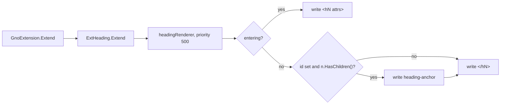

# `ExtHeading`: permalink anchors on gnoweb headings
Written by claude-opus-5-5.
PR: [gnolang/gno#5585](https://github.com/gnolang/gno/pull/5585)

## TLDR

Before, realm and readme headings carried an `id` from `parser.WithAutoHeadingID()`, and nothing on the page linked to it: the only way to a section link was the ToC sidebar. Now `GnoExtension` loads `ExtHeading`, a renderer that replaces goldmark's heading renderer and closes every heading holding an `id` and at least one child with an `<a class="heading-anchor">` pointing at that `id`. The anchor reuses the `#ico-link` icon and the `Permalink` label of the `ui/pkg_anchor` template, and CSS shows it on heading hover, on keyboard focus, and always where nothing hovers. A word joiner opens the anchor and the anchor does not wrap, so on a narrow screen the icon carries the heading's last word rather than wrapping alone. The request is [#5579](https://github.com/gnolang/gno/issues/5579).

## Before and after

The rendered markup of `## Title`, before then after:

| | HTML |
| --- | --- |
| Before | `<h2 id="title">Title</h2>` |
| After | `<h2 id="title">Title<a href="#title" class="heading-anchor" aria-label="Permalink">&#8288;<svg class="c-icon" aria-hidden="true"><use href="#ico-link"></use></svg></a></h2>` |

| Where it enters | Before | After |
| --- | --- | --- |
| A realm or readme heading, through `RenderRealm` | `id` only | `id` plus a trailing permalink anchor |
| A heading with no children, `##` | `<h2 id="heading"></h2>` | unchanged, no anchor |
| A heading inside `<gno-foreign>` | no `id` | unchanged: the inner instance loads neither auto IDs nor `ExtHeading` |
| A godoc heading in the doc view | no anchor | unchanged: `documentationGM` does not load `GnoExtension` |

## How `headingRenderer.render` works

The after side:



- `GnoExtension.Extend` calls `ExtHeading.Extend` after the mentions extension and before the icons one.
- `ExtHeading.Extend` registers `headingRenderer` at priority 500, ahead of goldmark's HTML renderer at 1000, so it owns `ast.KindHeading`.
- `headingRenderer.render` writes the opening tag with goldmark's `HeadingAttributeFilter`, lets the children render, then, on exit, reads the `id` attribute the icons extension may have rewritten and writes the anchor with the `id` HTML-escaped.

## Read the code in this order

1. [`markdown/ext_heading.go`](https://github.com/gnolang/gno/blob/9a416aa0b17166fc9d824611f79770abff481320/gno.land/pkg/gnoweb/markdown/ext_heading.go#L21-L45): the whole renderer. If the guard is wrong, a heading either loses its link or shows an icon next to nothing.
   ```go
   id, _ := n.AttributeString("id")
   if idBytes, ok := id.([]byte); ok && len(idBytes) > 0 && n.HasChildren() {
   ```
2. [`markdown/ext.go`](https://github.com/gnolang/gno/blob/9a416aa0b17166fc9d824611f79770abff481320/gno.land/pkg/gnoweb/markdown/ext.go#L96-L97): where `GnoExtension` loads it. Every `RenderRealm` caller goes through here.
3. [`render_config.go`](https://github.com/gnolang/gno/blob/9a416aa0b17166fc9d824611f79770abff481320/gno.land/pkg/gnoweb/render_config.go#L36): production's `parser.WithAutoHeadingID()`, which supplies the `id` the anchor needs.
4. [`frontend/css/05-composition.css`](https://github.com/gnolang/gno/blob/9a416aa0b17166fc9d824611f79770abff481320/gno.land/pkg/gnoweb/frontend/css/05-composition.css#L654-L696): the anchor's styling, scoped to `.c-realm-view` and `.c-readme-view`, hidden at `opacity: 0` until hover or `:focus-visible`, and shown under `@media (hover: none)`.
5. [`markdown/ext_test.go`](https://github.com/gnolang/gno/blob/9a416aa0b17166fc9d824611f79770abff481320/gno.land/pkg/gnoweb/markdown/ext_test.go#L45): the golden harness now parses with auto heading IDs, which is why most fixtures under `golden/` gained an `id` and the anchor; [`golden/ext_heading/all_cases.md.txtar`](https://github.com/gnolang/gno/blob/9a416aa0b17166fc9d824611f79770abff481320/gno.land/pkg/gnoweb/markdown/golden/ext_heading/all_cases.md.txtar) is the new fixture.
6. [`adr/pr5585_heading_anchor_links.md`](https://github.com/gnolang/gno/blob/9a416aa0b17166fc9d824611f79770abff481320/gno.land/adr/pr5585_heading_anchor_links.md): the alternatives, wrapping the text in the link among them.

## What a user notices

- On a pointer device, a small link icon appears after a heading's text while the heading is hovered; clicking it moves the URL fragment to that heading. Scope: every heading in a realm or readme view, per page.
- On a touch device, matched by `@media (hover: none)`, the icon is always visible.
- Keyboard users reach one extra tab stop per heading, outlined when focused.
- Screen readers announce each heading's name ending in "Permalink", since the anchor sits inside the heading.

## Words used here

| Name | What it is |
| --- | --- |
| `ExtHeading` | The package-level goldmark extension in `markdown/ext_heading.go`; `GnoExtension` loads it on every realm and readme render. |
| `headingRenderer` | The `ast.KindHeading` renderer `ExtHeading` registers at priority 500, replacing goldmark's. |
| `heading-anchor` | The class on the trailing `<a>`; the CSS hooks on it. |
| `#ico-link` | The sprite symbol in `components/ui/icons.html`, included on every page by `layouts/index.html`. |
| `ui/pkg_anchor` | The existing template whose icon and `Permalink` label the anchor copies. |
| `parser.WithAutoHeadingID()` | The goldmark parser option that gives each heading an `id` from its text; on in production, off inside `<gno-foreign>`. |
