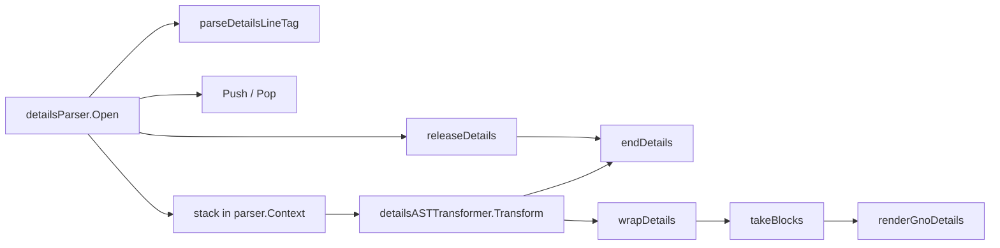

# `<gno-details>`: a neutral collapsible block in gnoweb markdown
Written by claude-opus-5-5.
PR: [gnolang/gno#5593](https://github.com/gnolang/gno/pull/5593)

## TLDR

gnoweb could fold content only through the alert syntax, `> [!INFO]- Title`, which always draws the alert's border, icon and type. The branch adds `ExtDetails`, which turns a `<gno-details summary="…" open>` line, the markdown under it and a `</gno-details>` line into a bare `<details class="gno-details">`. The tags are one-line markers, as with `<gno-frame>`: `detailsParser` turns each into a leaf node, and `detailsASTTransformer` later moves the blocks between an opener and its close under the opener. Each opener takes one level of the `MaxGnoNestDepth` of 4 that every gno-* block shares. It exists for [issue #5578](https://github.com/gnolang/gno/issues/5578): logs, JSON dumps and changelogs a realm wants folded without alert styling.

## What `<gno-details>` is

A realm's `Render` output can wrap any markdown in a fold the visitor opens by clicking its summary. The browser's `<details>` element does the toggling, and the chevron in the summary rotates when it opens, per [`.gno-details`](https://github.com/gnolang/gno/blob/5004185b57a30dfda916280ee62a4b3320813a80/gno.land/pkg/gnoweb/frontend/css/06-blocks.css#L3343).

## How it works, in 4 steps

All code here is the branch head.

1. A realm returns:
   ```markdown
   <gno-details summary="S" open>
   body
   </gno-details>
   ```
2. goldmark offers every line starting with `<` or `>` to `detailsParser`, the `>` so the release runs before an alert or a quoted gno-* block reads the depth. [`parseDetailsLineTag`](https://github.com/gnolang/gno/blob/5004185b57a30dfda916280ee62a4b3320813a80/gno.land/pkg/gnoweb/markdown/ext_details.go#L74-L97) classifies the trimmed line as an opener, a close, an invalid tag or no tag, and reads `summary` and a bare `open`. [`Open`](https://github.com/gnolang/gno/blob/5004185b57a30dfda916280ee62a4b3320813a80/gno.land/pkg/gnoweb/markdown/ext_details.go#L176-L220) calls `Push` for an opener and keeps it on a stack in the parser context; a close pairs with the innermost opener of the same parent and calls `Pop`. Before reading any line it calls [`releaseDetails`](https://github.com/gnolang/gno/blob/5004185b57a30dfda916280ee62a4b3320813a80/gno.land/pkg/gnoweb/markdown/ext_details.go#L133-L143), which ends every opener whose list item or blockquote no longer holds the parent goldmark hands it, so a block left unclosed in a container ends with it.
3. After parsing, [`wrapDetails` and `takeBlocks`](https://github.com/gnolang/gno/blob/5004185b57a30dfda916280ee62a4b3320813a80/gno.land/pkg/gnoweb/markdown/ext_details.go#L256-L292) move each opener's following siblings under it, innermost first, up to its close, a gno-columns or gno-frame marker whose tag sat at document level, or the end of the parent. A tight list's text block moved inside becomes a paragraph.
4. [`renderGnoDetails`](https://github.com/gnolang/gno/blob/5004185b57a30dfda916280ee62a4b3320813a80/gno.land/pkg/gnoweb/markdown/ext_details.go#L306-L329) writes fixed markup and the escaped summary. The output for step 1, from a run at the head:
   ```html
   <details class="gno-details" open>
   <summary><svg><use href="#ico-arrow"></use></svg><span>S</span></summary>
   <div>
   <p>body</p>
   </div>
   </details>
   ```

## The parts, at a glance

| Part | File | Job |
| --- | --- | --- |
| `GnoDetailsNode` | [`ext_details.go`](https://github.com/gnolang/gno/blob/5004185b57a30dfda916280ee62a4b3320813a80/gno.land/pkg/gnoweb/markdown/ext_details.go#L29-L41) | one node per tag line: an opener holding the block, a close, or an invalid tag rendered as a comment |
| `detailsParser` | [`ext_details.go`](https://github.com/gnolang/gno/blob/5004185b57a30dfda916280ee62a4b3320813a80/gno.land/pkg/gnoweb/markdown/ext_details.go#L157-L234) | classifies tag lines, pairs closes with openers by parent, applies the depth cap |
| `detailsASTTransformer` | [`ext_details.go`](https://github.com/gnolang/gno/blob/5004185b57a30dfda916280ee62a4b3320813a80/gno.land/pkg/gnoweb/markdown/ext_details.go#L238-L292) | gives back the depth of openers left open at EOF and moves blocks under each opener |
| `detailsRendererHTML` | [`ext_details.go`](https://github.com/gnolang/gno/blob/5004185b57a30dfda916280ee62a4b3320813a80/gno.land/pkg/gnoweb/markdown/ext_details.go#L296-L329) | writes `<details>`, `<summary>` and the body `<div>` |
| registration | [`ext.go:111`](https://github.com/gnolang/gno/blob/5004185b57a30dfda916280ee62a4b3320813a80/gno.land/pkg/gnoweb/markdown/ext.go#L111), [`ext_foreign.go:451`](https://github.com/gnolang/gno/blob/5004185b57a30dfda916280ee62a4b3320813a80/gno.land/pkg/gnoweb/markdown/ext_foreign.go#L451) | the main goldmark instance and the `<gno-foreign>` inner one |
| `.gno-details` styles | [`06-blocks.css`](https://github.com/gnolang/gno/blob/5004185b57a30dfda916280ee62a4b3320813a80/gno.land/pkg/gnoweb/frontend/css/06-blocks.css#L3343) | border, summary row, chevron rotation on `[open]` |
| goldens and tests | [`golden/ext_details/`](https://github.com/gnolang/gno/tree/5004185b57a30dfda916280ee62a4b3320813a80/gno.land/pkg/gnoweb/markdown/golden/ext_details), [`ext_details_test.go`](https://github.com/gnolang/gno/blob/5004185b57a30dfda916280ee62a4b3320813a80/gno.land/pkg/gnoweb/markdown/ext_details_test.go#L26) | 25 input and output pairs, five sanitize fixtures, and unit tests for the cap and the depth balance |

## How the markers become a block

The functions at the branch head, in the order goldmark calls them:



- `parseDetailsLineTag` decides whether a line is a tag: text after the tag makes it a paragraph, an unknown, repeated or valued attribute makes it invalid.
- `Open` decides pairing at parse time: a close matches the innermost opener with the same parent, and an opener the cap refused stays on the stack so its own close is the one it takes.
- `releaseDetails` decides which openers a new line's parent has left: each whose recorded container is not that parent or one of its ancestors ends. After a paragraph, `Open` calls it only on a details tag line or a `>` line, since any other line may still continue that paragraph lazily and keep its container open.
- `endDetails` drops the openers from an index up and gives back one level per accepted one; a gno-columns or gno-frame tag at document level ends them all.
- `wrapDetails` walks children before parents, so an outer block takes an inner one whole.
- `takeBlocks` decides where a block ends in the tree; the transformer runs at priority 502, after the frame transformer's 501.

## Read the code in this order

1. [`parseDetailsLineTag`](https://github.com/gnolang/gno/blob/5004185b57a30dfda916280ee62a4b3320813a80/gno.land/pkg/gnoweb/markdown/ext_details.go#L74-L97) fixes the syntax.
   ```go
   case kind == detailsTagOpen && bytes.EqualFold(key, []byte("open")) && val == nil && !seenOpen:
   ```
2. [`Open`](https://github.com/gnolang/gno/blob/5004185b57a30dfda916280ee62a4b3320813a80/gno.land/pkg/gnoweb/markdown/ext_details.go#L176-L220) decides which close ends which opener, and so where every later block lands.
   ```go
   case valid && stack != nil && len(*stack) > 0 && (*stack)[len(*stack)-1].parent == parent:
   ```
3. [`takeBlocks`](https://github.com/gnolang/gno/blob/5004185b57a30dfda916280ee62a4b3320813a80/gno.land/pkg/gnoweb/markdown/ext_details.go#L272-L292) builds the block; a wrong stop splits a grid or a frame.
   ```go
   if k := c.Kind(); k == KindGnoColumn || k == KindGnoFrame {
       break
   }
   ```
4. [`renderGnoDetails`](https://github.com/gnolang/gno/blob/5004185b57a30dfda916280ee62a4b3320813a80/gno.land/pkg/gnoweb/markdown/ext_details.go#L306-L329) writes only constants and `util.EscapeHTML(n.Summary)`.

## What a user notices

- On a realm page whose `Render` uses the tags, a bordered fold with a chevron, closed unless the opener carries `open`.
- Inside `<gno-foreign>` the same fold renders, golden `ext_foreign/cross_foreign_details`.
- A details opener past four open gno-* levels renders as a comment, on that page only.

## Words used here

| Name | What it is |
| --- | --- |
| `ExtDetails` | the extension value, registered in `ext.go` and `ext_foreign.go`: parser at priority 498, transformer at 502, renderer at 500 |
| `GnoDetailsNode` | the AST node for one tag line; `Open` and `Summary` come from the opener's attributes |
| `releaseDetails` | the call in `Open` that ends the openers whose container a line has left, the one measure goldmark gives of which containers are still open; skipped after a paragraph unless the line is a details tag or starts with `>` |
| `detailsStackKey` | the parser-context key holding the openers not yet closed, refused ones included, innermost last |
| `MaxGnoNestDepth` | the depth cap every gno-* block shares through `Push` and `Pop` in `nestdepth.go`, 4 |
| `gno-details` | the CSS class on the rendered `<details>` |
