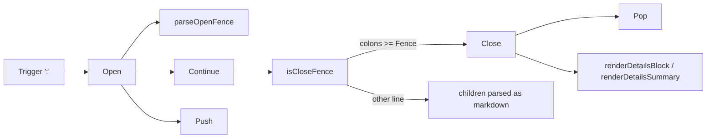

# `:::details`: a neutral collapsible block in gnoweb markdown
Written by claude-opus-5-5, solo review, high effort.
PR: [gnolang/gno#5593](https://github.com/gnolang/gno/pull/5593)

## TLDR

gnoweb could fold content only through the alert syntax, `> [!INFO]- Title`, which always draws the alert's border, icon and type. The branch adds `ExtDetails`, a goldmark block extension that turns `:::details Summary` … `:::` into a bare `<details class="gno-details">` with a `<summary>`, styled by `.gno-details` in `06-blocks.css`. `:::details[open]` starts it open, a missing summary renders as `Details`, a block closes on a line of at least as many colons as its opener, and each open block counts toward the `MaxGnoNestDepth` of 4 that every gno-* block shares. It exists for [issue #5578](https://github.com/gnolang/gno/issues/5578): logs, JSON dumps and changelogs a realm wants folded without alert styling.

## What `:::details` is

A realm's `Render` output can wrap any markdown in a fold the visitor opens by clicking its summary. The browser's own `<details>` element does the toggling, and the chevron in the summary [rotates when it opens](https://github.com/gnolang/gno/blob/c05644643affeec6d6f0c0f1b76b41f407caba5a/gno.land/pkg/gnoweb/frontend/css/06-blocks.css#L3346-L3348).

## How it works, in 4 steps

All code here is the branch head.

1. A realm returns markdown such as:
   ```markdown
   :::details[open] Logs
   line 1
   :::
   ```
2. goldmark offers every line starting with `:` to `detailsParser`, whose [`Trigger`](https://github.com/gnolang/gno/blob/c05644643affeec6d6f0c0f1b76b41f407caba5a/gno.land/pkg/gnoweb/markdown/ext_details.go#L92) returns `':'`. `Open` strips up to three leading spaces and calls `parseOpenFence`, which counts the colons, at least [`minDetailsFence`](https://github.com/gnolang/gno/blob/c05644643affeec6d6f0c0f1b76b41f407caba5a/gno.land/pkg/gnoweb/markdown/ext_details.go#L38) or 3, requires the word `details`, reads an optional `[open]`, and returns the summary's byte range. `Open` then calls [`Push`](https://github.com/gnolang/gno/blob/c05644643affeec6d6f0c0f1b76b41f407caba5a/gno.land/pkg/gnoweb/markdown/nestdepth.go#L57), which refuses the opener once 4 gno-* blocks are open, and builds a `DetailsBlock{Open: true, Fence: 3}` and, when the summary is not empty, a `DetailsSummary` child holding `Logs`.
3. For every following line, `Continue` asks `isCloseFence(line, Fence)`: a line made only of 3 or more colons closes the block and `Close` calls `Pop`; anything else is parsed as ordinary markdown children of the block, here the paragraph `line 1`.
4. `DetailsHTMLRenderer` writes the tags from its constants:
   ```html
   <details class="gno-details" open>
   <summary><svg><use href="#ico-arrow"></use></svg>Logs</summary>
   <div>
   <p>line 1</p>
   </div>
   </details>
   ```

## The parts, at a glance

| Part | File | Job |
| --- | --- | --- |
| `DetailsBlock`, `DetailsSummary` | [`ext_details.go`](https://github.com/gnolang/gno/blob/c05644643affeec6d6f0c0f1b76b41f407caba5a/gno.land/pkg/gnoweb/markdown/ext_details.go#L40-L80) | AST nodes: the container, its fence length and open flag, and the inline summary |
| `detailsParser` | [`ext_details.go`](https://github.com/gnolang/gno/blob/c05644643affeec6d6f0c0f1b76b41f407caba5a/gno.land/pkg/gnoweb/markdown/ext_details.go#L84-L228) | opens on `:::details`, closes on a long enough colon line |
| `DetailsHTMLRenderer` | [`ext_details.go`](https://github.com/gnolang/gno/blob/c05644643affeec6d6f0c0f1b76b41f407caba5a/gno.land/pkg/gnoweb/markdown/ext_details.go#L232-L287) | writes `<details>`, `<summary>` and the body `<div>` |
| `ExtDetails` registration | [`ext.go`](https://github.com/gnolang/gno/blob/c05644643affeec6d6f0c0f1b76b41f407caba5a/gno.land/pkg/gnoweb/markdown/ext.go#L88) | adds the extension to gnoweb's main goldmark instance, after alerts; [`ext_foreign.go:451`](https://github.com/gnolang/gno/blob/c05644643affeec6d6f0c0f1b76b41f407caba5a/gno.land/pkg/gnoweb/markdown/ext_foreign.go#L451) adds it to the `<gno-foreign>` instance too |
| `.gno-details` styles | [`06-blocks.css`](https://github.com/gnolang/gno/blob/c05644643affeec6d6f0c0f1b76b41f407caba5a/gno.land/pkg/gnoweb/frontend/css/06-blocks.css#L3310-L3362) | border, summary row, chevron rotation on `[open]`; built into `public/main.css` |
| goldens | [`golden/ext_details/`](https://github.com/gnolang/gno/tree/8ab095f495322cb3f1577ce39d1440de5c141477/gno.land/pkg/gnoweb/markdown/golden/ext_details) | 23 input and output pairs run by `TestGnoExtension` |
| `TestDetailsNestBounded` | [`ext_details_test.go`](https://github.com/gnolang/gno/blob/c05644643affeec6d6f0c0f1b76b41f407caba5a/gno.land/pkg/gnoweb/markdown/ext_details_test.go#L34) | parses 4000 nested openers and counts `MaxGnoNestDepth` blocks |
| docs | [`markdown.gno`](https://github.com/gnolang/gno/blob/c05644643affeec6d6f0c0f1b76b41f407caba5a/examples/quarantined/gno.land/r/docs/markdown/markdown.gno#L969-L974), [ADR](https://github.com/gnolang/gno/blob/c05644643affeec6d6f0c0f1b76b41f407caba5a/gno.land/adr/pr5593_gnoweb_details_block.md) | the syntax for realm authors and the decision record |

## How the parser works

The functions at the branch head, in the order goldmark calls them:



- `parseOpenFence` decides whether a line opens a block: the colon count, the `details` keyword, `[open]`, and a space or tab before the summary, so `:::detailsmore` stays a paragraph.
- `Open` refuses a line indented four columns or more, a tab counted to its next stop by `util.IndentWidth`, which is an indented code block, refuses an opener `Push` turns down at the shared depth of 4, and decides whether a `DetailsSummary` child exists.
- `Close` calls `Pop`, so a closed or unclosed block hands its depth back to the next gno-* block on the page.
- `isCloseFence` decides the close on a line `Continue` has measured to three columns of indentation or fewer: only colons, at least the opener's `Fence`.
- `Continue` runs on the details before any block open inside it, so the closer check sees each line first. While a `ForeignNode` whose `Closed` is false sits on the details' last-descendant chain, it skips that check, so a `:::` inside a `<gno-foreign>` body stays the body's text.
- `renderDetailsBlock` emits the default `Details` summary when the first child is not a `DetailsSummary`.

## Read the code in this order

1. [`parseOpenFence`](https://github.com/gnolang/gno/blob/c05644643affeec6d6f0c0f1b76b41f407caba5a/gno.land/pkg/gnoweb/markdown/ext_details.go#L98-L145) fixes the syntax; a mistake here turns ordinary `:::` text into a fold or misses a valid opener.
   ```go
   if !bytes.HasPrefix(trimmed[n:], detailsKeyword) {
       return 0, false, 0, 0, false
   }
   ```
2. [`Open`](https://github.com/gnolang/gno/blob/c05644643affeec6d6f0c0f1b76b41f407caba5a/gno.land/pkg/gnoweb/markdown/ext_details.go#L159-L200) builds the node and maps the summary range back to absolute source offsets, less `segment.Padding`, the spaces goldmark prepends to a line for a tab a container consumed.
   ```go
   block := &DetailsBlock{Open: open, Fence: fence}
   ```
3. [`isCloseFence` and `Continue`](https://github.com/gnolang/gno/blob/c05644643affeec6d6f0c0f1b76b41f407caba5a/gno.land/pkg/gnoweb/markdown/ext_details.go#L149-L219) decide where the block ends, and so what the rest of the page renders as.
   At the head:
   ```go
   for c := node.LastChild(); c != nil; c = c.LastChild() {
       if fn, ok := c.(*ForeignNode); ok && !fn.Closed {
           return parser.Continue | parser.HasChildren
       }
   }
   if w, pos := util.IndentWidth(line, reader.LineOffset()); w <= 3 && isCloseFence(line[pos:], node.(*DetailsBlock).Fence) {
       reader.AdvanceToEOL()
       return parser.Close
   }
   ```
4. [The renderer](https://github.com/gnolang/gno/blob/c05644643affeec6d6f0c0f1b76b41f407caba5a/gno.land/pkg/gnoweb/markdown/ext_details.go#L232-L287) writes fixed strings for every tag, so no attribute is built from input.
5. [`ext.go:88`](https://github.com/gnolang/gno/blob/c05644643affeec6d6f0c0f1b76b41f407caba5a/gno.land/pkg/gnoweb/markdown/ext.go#L88) registers it on the main instance, and [`ext_foreign.go:451`](https://github.com/gnolang/gno/blob/c05644643affeec6d6f0c0f1b76b41f407caba5a/gno.land/pkg/gnoweb/markdown/ext_foreign.go#L451) registers it in `buildInnerForeignMarkdown`, so a fold works inside `<gno-foreign>`.
6. [`.gno-details`](https://github.com/gnolang/gno/blob/c05644643affeec6d6f0c0f1b76b41f407caba5a/gno.land/pkg/gnoweb/frontend/css/06-blocks.css#L3310-L3362) lays out the summary as a flex row with the chevron and rotates it on `[open]`.

## What a user notices

- On any realm page whose `Render` uses the syntax, a bordered fold with a chevron, closed unless the opener says `[open]`.
- Inside `<gno-foreign>` the same fold renders, golden `ext_foreign/cross_foreign_details`.
- A fifth gno-* block nested inside four open ones renders as a paragraph, per page and per nesting path.

## Words used here

| Name | What it is |
| --- | --- |
| `ExtDetails` | the goldmark extension value registered in `ext.go`, adding the parser at priority 799 and the renderer |
| `DetailsBlock` | the AST container node; `Open` is the `[open]` flag, `Fence` the opener's colon count |
| `DetailsSummary` | the optional child holding the summary text after `:::details` |
| `MaxGnoNestDepth` | the depth cap every gno-* block shares through `Push` and `Pop` in `nestdepth.go`, 4 |
| `minDetailsFence` | the fewest colons a fence may have, 3 |
| `parseOpenFence` | returns fence length, open flag and summary range for an opener line |
| `isCloseFence` | true for a line, its indentation already removed by `Continue`, of at least `Fence` colons and nothing else |
| `gno-details` | the CSS class on the rendered `<details>`, styled in `06-blocks.css` |
