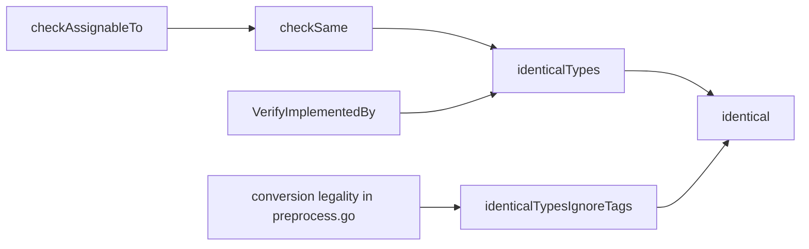

# Type identity checks: `identicalTypes` and `identicalTypesIgnoreTags`
Generated by claude-opus-5-5.
PR: [gnolang/gno#5785](https://github.com/gnolang/gno/pull/5785)

## TLDR

Static type checks in the GnoVM compared `TypeID()`, a key that ignores struct tags, embedded-field syntax and variadicity, and the pointer case of `checkAssignableTo` recursed into assignability. Gno therefore accepted assignments Go rejects: `struct{A int "b"}` to `struct{A int "a"}`, `func([]int)` to `func(...int)`, `*int` to `*interface{}`.

The branch adds `identicalTypes`, a structural comparison mirroring `go/types.Identical`, and `identicalTypesIgnoreTags` for conversions. `checkSame`, the element cases of `checkAssignableTo`, comparison operands, function redefinition, `specifyType` and `InterfaceType.VerifyImplementedBy` call it. Runtime value identity, interface `==`, concrete type assertions, concrete type-switch cases and map keys, stays on `TypeID()`, as `gnovm/adr/pr5785_type_identity.md` records.

## Before and after

Each row is a program shape; the right column is what the branch's own filetest pins.

| Shape, and the code that decides it | Before | After |
| --- | --- | --- |
| `var p *interface{} = &n` with `n int`, through the `*PointerType` case of `checkAssignableTo` | accepted | rejected, `assign_ptr_interface.gno` |
| `struct{A int "b"}` assigned to `struct{A int "a"}`, through `checkSame` | accepted | rejected, `assign_struct_tags.gno` |
| `T` with `M([]int)` assigned to `interface{ M(...int) }`, through `VerifyImplementedBy` | accepted | rejected, `interface51.gno` |
| `x.(interface{ M(...int) })` at runtime on that `T`, through `VerifyImplementedBy` | `true` | `false` |
| converting between structs that differ only in tags, through `identicalTypesIgnoreTags` | allowed | allowed, `convert_struct_tags.gno` |
| a `struct{A int "a"}` value asserted to `struct{A int "b"}` at runtime | `true` | `true`, `typeassert_struct_tags.gno` |

## How the identity check works

After the branch:



- `identical(at, bt, ignoreTags)` walks both types kind by kind; a `RefType`, a `*DeclaredType` and the kinds it does not inspect still compare by `TypeID()`.
- `checkSame` fails a static check when `identicalTypes` says no, which is what the pointer, array, slice and map element cases now call.
- `VerifyImplementedBy` requires each method's `*FuncType` to be identical to the interface's, at preprocess and on every runtime interface assertion.

## Read the code in this order

### 1. `hot` · The structural comparison, [`types.go`](https://github.com/gnolang/gno/pull/5785/files#diff-55046f19102d71267733edafff57a5779fb37e649fa25074cb9031872e51b6d4R385-R397)
Defines exact identity and the tag-ignoring variant over one recursive walk.
**If wrong:** every static check below accepts or rejects the wrong programs.
```go
func identicalTypes(at, bt Type) bool {
	return identical(at, bt, false)
}

func identicalTypesIgnoreTags(at, bt Type) bool {
	return identical(at, bt, true)
}
```

### 2. `hot` · Element identity in assignment, [`type_check.go`](https://github.com/gnolang/gno/pull/5785/files#diff-002eaef00689b1804b95a869792c2d3503a1fc4478ec4412d32ef4f6a8296ce0R553-R555)
The pointer case checks its element with `checkSame` instead of recursing into assignability.
**If wrong:** `*int` assigns to `*interface{}` and a write through it stores a non-int.
```go
case *PointerType: // case 4 from here on
	if pt, ok := xt.(*PointerType); ok {
		err := checkSame(pt.Elt, cdt.Elt, "")
```

### 3. `hot` · Interface method matching, [`types.go`](https://github.com/gnolang/gno/pull/5785/files#diff-55046f19102d71267733edafff57a5779fb37e649fa25074cb9031872e51b6d4R1252-R1255)
Decides whether a method satisfies an interface, statically and at runtime.
**If wrong:** `M([]int)` satisfies `M(...int)`, and a runtime assertion answers differently from preprocess.
```go
// check for func type equality.
if !identicalTypes(mt, im.Type) {
	return fmt.Errorf("wrong type for method %s", im.Name)
}
```

### 4. `hot` · Function redefinition, [`preprocess.go`](https://github.com/gnolang/gno/pull/5785/files#diff-ebdb0494324ba82339ca88219105656407e3f3a49240cf32c24c9a266d31e0f4R5678-R5681)
Refuses a redefinition whose signature differs in a tag or in variadicity.
**If wrong:** a later declaration changes a function's static type.
```go
if !identicalTypes(ft, ft2) {
	panic(fmt.Sprintf(
		"Redefinition (%s) cannot change .T; was %v, new %v",
		d, ft, ft2))
```

## What a user notices

- A package that assigns across a tag, embedding or variadic difference fails at preprocess with `cannot use ... as ...` or `incompatible types`, as `go/types` already reported.
- A runtime `x.(I)` or type-switch `case I` against an interface whose method differs from the concrete one only in variadicity or a tag answers `false` where it answered `true`, in every package that runs it.

## Words used here

| Name | What it is |
| --- | --- |
| `TypeID()` | A string key per type, cached on composite types, that ignores struct tags, embedded-field syntax and variadicity. |
| `identicalTypes` | Exact Go type identity, in `types.go`. |
| `identicalTypesIgnoreTags` | Identity ignoring struct tags at every depth, the rule for explicit conversions. |
| `checkSame` | The static check in `type_check.go` that errors when two types are not identical. |
| `VerifyImplementedBy` | `*InterfaceType`'s check that a type has every method with an identical signature, run by preprocess and by `x.(I)`. |
| `specifyType` | Unifies a uverse builtin's generic parameters, such as `append`'s, with the argument types. |
