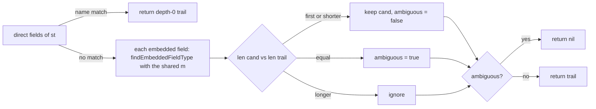

# `StructType.FindEmbeddedFieldType`: depth-based shadowing of promoted members
Written by claude-opus-5-5.
PR: [gnolang/gno#5820](https://github.com/gnolang/gno/pull/5820)

## TLDR

Before, `StructType.FindEmbeddedFieldType` walked a struct's embedded fields and returned no match on any second hit, whatever its depth. After, it searches the direct fields first, then keeps the embedded candidate with the shortest trail, a strictly shallower one replacing the current one and an equal-depth one marking the selector ambiguous. The aim is Go's rule that the shallowest promoted member wins, so that `var i I = T{}` with `T{Shallow; Mid{Deep}}`, both declaring `M`, stops failing preprocess after go/types has accepted it.

## Before and after

Measured with the PR's own filetests, `go test -run 'TestFiles/embed_method_shadow.*\.gno$' ./gnovm/pkg/gnolang`, at the merge base's `types.go` (before) and at the head (after):

| Fixture | Before | After |
| --- | --- | --- |
| `embed_method_shadow0`, `1`, `2`: one `M` at depth 1, another at depth 2 or 3 | preprocess panic `main.T does not implement main.I (missing method M)` | pass, the depth-1 `M` runs |
| `embed_method_shadow_ambiguous`, `_fieldmethod`, `_internal_ambiguous`: two at the shallowest depth | rejected | rejected |

## How the lookup works, after



- `findEmbeddedFieldType` dispatches on the field's type and recurses into `StructType`, `PointerType`, `DeclaredType` and `InterfaceType`.
- `m`, the recursion guard, is one set shared by the whole search: a type already in it returns nil, so a type reached twice is searched once.

## Read the code in this order

### 1. `hot` · The depth comparison, [`types.go`](https://github.com/gnolang/gno/pull/5820/files#diff-55046f19102d71267733edafff57a5779fb37e649fa25074cb9031872e51b6d4R899-R916)
Picks the shortest trail among the embedded candidates and returns nil on a tie at that depth.
**If wrong:** a selector resolves to a member Go does not pick, or a program Go accepts fails preprocess.
```go
		vp := NewValuePathField(0, uint16(i), sf.Name)
		cand := append([]ValuePath{vp}, trail2...)
		switch {
		case trail == nil || len(cand) < len(trail):
			// First match, or a strictly shallower one shadows the
			// previous candidate (resetting any earlier ambiguity).
			trail, hasPtr, rcvr, field = cand, hasPtr2, rcvr2, field2
			ambiguous = false
		case len(cand) == len(trail):
			// Two matches at the same shallowest depth: ambiguous.
			ambiguous = true
		}
		// len(cand) > len(trail): deeper, shadowed; ignore.
	}
```

### 2. `warm` · The decision record, [`pr5820_embedded_method_depth_shadowing.md`](https://github.com/gnolang/gno/pull/5820/files#diff-f79484cb1095ba9807a59bdc964d56a50dbd754f9554260865b98be423e05187R1-R141)
States the rule, the alternatives and the shapes left out of scope, the shared-set ones among them.
**If wrong:** a follow-up starts from a scope the code does not have.

## Words used here

| Name | What it is |
| --- | --- |
| `FindEmbeddedFieldType` | the lookup behind every selector, method value and interface-satisfaction check on a struct; returns a trail of `ValuePath`s, empty when there is no match |
| trail | the list of `ValuePath` steps from the struct to the member; its length is the promotion depth plus one |
| `m` | the `map[Type]struct{}` recursion guard threaded through one lookup |
| depth | how many embedded fields a promoted member sits under, per the Go spec's "Selectors" |
