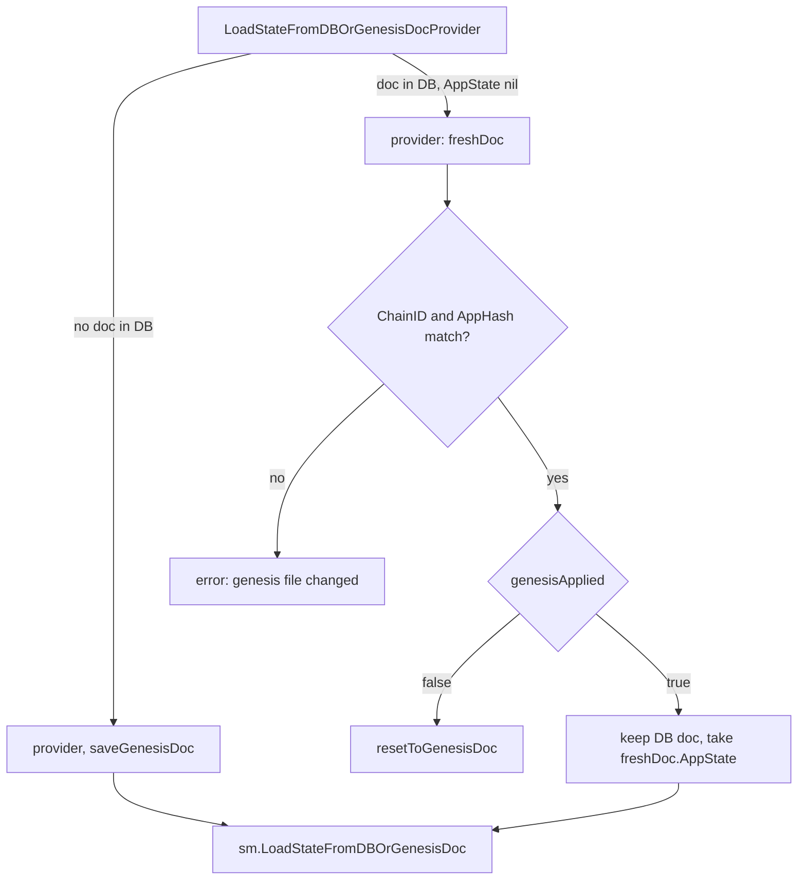

# InitChain rejection aborts the handshake, and `resetToGenesisDoc` lets a corrected genesis boot

Written by claude-opus-5-5.

PR: [gnolang/gno#5995](https://github.com/gnolang/gno/pull/5995)

## TLDR

Before, `Handshaker.ReplayBlocks` checked only the Go error from `InitChainSync`, so an app refusing the genesis through `ResponseInitChain.Error` booted anyway and the height-0 ABCI responses were saved as if the genesis had been applied.
Now `res.IsErr()` aborts the handshake before that save.
Because a rejection leaves the genesis doc and the state record in the state DB, `LoadStateFromDBOrGenesisDocProvider` now replaces both from the fresh genesis file whenever `genesisApplied` finds no height-0 responses, so the operator can fix `genesis.json` and restart on the same data dir.
`NewDefaultGenesisConfig` now builds a `GnoGenesisState` value, since `loadAppState` rejects a pointer and that rejection now stops boot.

## Before and after

One row per place the behaviour enters, before then after.

| Where | Before | After |
| --- | --- | --- |
| An app returns `ResponseInitChain.Error`, through `ReplayBlocks` | handshake completes, height-0 responses saved, node runs on an unapplied genesis | handshake fails with `InitChain rejected the genesis: ...`, nothing saved at height 0 |
| A restart after a rejection, through `LoadStateFromDBOrGenesisDocProvider` | the persisted doc wins; only `AppState` comes from the file | the file wins: doc and state record rebuilt by `resetToGenesisDoc` |
| A restart after the genesis applied, same function | persisted doc, fresh `AppState` | unchanged |
| `gnoland` `loadAppState` fails, through `InitChainer` | logged, boot continued | logged, boot aborts |
| `NewDefaultGenesisConfig` | `AppState: &GnoGenesisState{...}`, rejected as an invalid type | `AppState: GnoGenesisState{...}` |

## How the reset works

After the change:



- `genesisApplied` answers whether `abciResponsesKey:0` exists, with `stateDB.Has`; a read error is returned and fails the boot, so it never reads as "not applied".
- `resetToGenesisDoc` runs `sm.MakeGenesisState(freshDoc)`, then `saveGenesisDoc` and `sm.SaveState`, undoing the `InitialHeight` alignment `ReplayBlocks` persisted before the rejected `InitChain`.
- `ReplayBlocks` aborts on `res.IsErr()` before `sm.SaveABCIResponses(h.stateDB, 0, ...)`, which keeps the marker meaning "InitChain succeeded".

## Read the code in this order

1. [`replay.go` L346-L348](https://github.com/gnolang/gno/blob/abaa30adb9c22d350bcb8f925fc71b71881e827f/tm2/pkg/bft/consensus/replay.go#L346-L348): the abort. Without it the height-0 marker is written for a rejected genesis and the reset never fires.
2. [`node.go` L1088-L1094](https://github.com/gnolang/gno/blob/abaa30adb9c22d350bcb8f925fc71b71881e827f/tm2/pkg/bft/node/node.go#L1088-L1094): the gate, reached on every restart, since the persisted doc never carries `AppState`.

   ```go
   applied, aerr := genesisApplied(stateDB)
   if aerr != nil {
   	return sm.State{}, nil, aerr
   }
   if !applied {
   	return resetToGenesisDoc(stateDB, freshDoc)
   }
   ```

3. [`node.go` L1110](https://github.com/gnolang/gno/blob/abaa30adb9c22d350bcb8f925fc71b71881e827f/tm2/pkg/bft/node/node.go#L1110): `genesisApplied`, the probe the gate trusts.
4. [`app.go`](https://github.com/gnolang/gno/blob/abaa30adb9c22d350bcb8f925fc71b71881e827f/gno.land/pkg/gnoland/app.go): `InitChainer` returns the `loadAppState` error as `ResponseInitChain.Error`, which now stops boot; the valoper coverage check still panics.
5. [`node_inmemory.go`](https://github.com/gnolang/gno/blob/abaa30adb9c22d350bcb8f925fc71b71881e827f/gno.land/pkg/gnoland/node_inmemory.go): the `GnoGenesisState` value fix.

## What a user notices

- A node operator whose genesis the app refuses sees boot fail with the app's message, per node, instead of a node that starts with an empty app state.
- That operator can edit `genesis.json` and restart on the same data dir; the corrected `InitialHeight`, validators and genesis time are used, as long as `ChainID` and `AppHash` are unchanged.

## Upgrading

The reset keys on `abciResponsesKey:0` in the state DB. A data dir where an older binary ran a rejected `InitChain` already has that key, so the corrected file is not picked up there; wipe it.

## Words used here

| Name | What it is |
| --- | --- |
| `abciResponsesKey:0` | State DB key holding the genesis tx responses, written by `ReplayBlocks` once `InitChain` succeeds; `CalcABCIResponsesKey(0)`. |
| `genesisApplied` | Returns true when that key exists, and the `Has` error when the probe fails. |
| `resetToGenesisDoc` | Rebuilds and persists the genesis doc and state record from the genesis file. |
| `ResponseInitChain.Error` | The field an ABCI app sets to refuse a genesis; `InitChainSync` passes it through without a Go error. |
| `InitialHeight` | First block height of a hardfork chain, from `GenesisDoc.InitialHeight`; `ReplayBlocks` aligns the state record to `InitialHeight - 1` before `InitChain`. |
