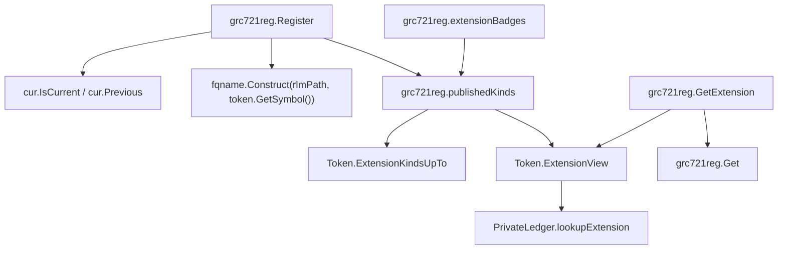

# `r/demo/defi/grc721reg`: a registry of GRC721 collections

Written by claude-opus-5-5, high effort.
PR: [gnolang/gno#6075](https://github.com/gnolang/gno/pull/6075)

## TLDR

Before, a GRC721 collection had no shared place to be found, and the read-view
of each extension, the royalty or metadata object a buyer reads, reached only
the realm that attached it. After, `grc721.Token` keeps each extension's
read-view beside its hooks and hands it out through `ExtensionView(kind)`, and
the new realm `r/demo/defi/grc721reg` lets any realm list its own collection
under `<realm path>.<symbol>`, so an explorer or a marketplace finds a
collection and its royalty, metadata or enumerable view from one address.
`RegisterExtension` takes a second argument, the view, to make that possible.

## What `grc721reg` is

A public index of NFT collections, the GRC721 counterpart of
[`r/demo/defi/grc20reg`](https://github.com/gnolang/gno/blob/74ec1b3e1ad9406d645443fffbca8ae277b8edf7/examples/gno.land/r/demo/defi/grc20reg/grc20reg.gno#L32-L49).
A realm that created a collection calls `Register` once. From then on any
caller looks the collection up by its key, reads its name, supply and owners
through the stored `*grc721.Token`, and asks for an extension's read-view by
kind, `"royalty"` for one. Browsing `/r/demo/defi/grc721reg` on gnoweb shows the
index, 20 collections a page, each with badges naming the extensions it
publishes.

The registry imports no extension package. It hands back the
`grc721.ExtensionView` interface, and the consumer type-asserts it to the
concrete view it knows, `*royalty.Royalty` for one.

## How it works, in 5 steps

The example is a realm at `gno.land/r/demo/reg_full` with one collection
carrying three extensions. The values below were printed by a scratch filetest
run against the head worktree.

1. The realm creates the collection with
   `grc721.NewToken("Full Stack", "FULL", 0, cur)`.
   The token's ID is `gno.land/r/demo/reg_full.FULL.0000000`: realm path, symbol
   and sequence number.
2. It attaches `royalty.NewRoyalty`, `metadata.NewMetadata` and
   `enumerable.NewEnumerable`. Each one calls
   `coreLedger.RegisterExtension(led, view)` with its hook set and its view,
   so the token now records the kinds
   `royalty`, `metadata`, `enumerable`, in that order, each with its view.
3. It calls `grc721reg.Register(cross(cur), token, "full")`. The registry reads
   the calling realm from the crossing frame, builds the key
   `gno.land/r/demo/reg_full.FULL`, checks the token's ID starts with that key
   plus a dot, stores the `*grc721.Token`, emits a `register` event and returns
   the key.
4. A consumer calls `GetExtensionKinds("gno.land/r/demo/reg_full.FULL")` and
   gets `enumerable`, `metadata`, `royalty`, sorted. It calls
   `GetExtension(key, "royalty")`, type-asserts the result to
   `*royalty.Royalty`, and calls `RoyaltyInfo`.
5. A visitor opens `/r/demo/defi/grc721reg` and sees this line, after the
   change:

   ```markdown
   - **Full Stack** - [gno.land/r/demo/reg_full](/r/demo/reg_full).FULL - `enumerable` `metadata` `royalty` - [info](/r/demo/defi/grc721reg:gno.land/r/demo/reg_full.FULL)
   ```

   The `info` link renders the collection page: name, symbol, realm, total
   supply and the same badges.

The `register` event of step 3 carries, in order, after the change: `token_path`
the key, `token_id` the token's ID, `pkgpath` the realm path, `slug` the
caller's slug, `symbol`, then one `extension` attribute per published kind.

## The parts, at a glance

After the change:

| Part | File | Job |
| --- | --- | --- |
| `Register`, `Unregister` | [`grc721reg.gno#L33`](https://github.com/gnolang/gno/blob/74ec1b3e1ad9406d645443fffbca8ae277b8edf7/examples/gno.land/r/demo/defi/grc721reg/grc721reg.gno#L33), [`#L100`](https://github.com/gnolang/gno/blob/74ec1b3e1ad9406d645443fffbca8ae277b8edf7/examples/gno.land/r/demo/defi/grc721reg/grc721reg.gno#L100) | Add or drop the calling realm's own entry and emit the event |
| `Get`, `MustGet`, `GetExtension`, `GetExtensionKinds`, `GetRegistry` | [`grc721reg.gno#L122-L163`](https://github.com/gnolang/gno/blob/74ec1b3e1ad9406d645443fffbca8ae277b8edf7/examples/gno.land/r/demo/defi/grc721reg/grc721reg.gno#L122-L163) | Read access for consumers |
| `Render`, `renderIndex`, `renderCollection`, `extensionBadges` | [`grc721reg.gno#L165-L269`](https://github.com/gnolang/gno/blob/74ec1b3e1ad9406d645443fffbca8ae277b8edf7/examples/gno.land/r/demo/defi/grc721reg/grc721reg.gno#L165-L269) | The gnoweb index and the per-collection page |
| `publishedKinds` | [`grc721reg.gno#L275`](https://github.com/gnolang/gno/blob/74ec1b3e1ad9406d645443fffbca8ae277b8edf7/examples/gno.land/r/demo/defi/grc721reg/grc721reg.gno#L275) | The kinds that carry a view, bounded and sorted |
| Page and event bounds | [`consts.gno#L10-L20`](https://github.com/gnolang/gno/blob/74ec1b3e1ad9406d645443fffbca8ae277b8edf7/examples/gno.land/r/demo/defi/grc721reg/consts.gno#L10-L20) | 20 per page, 8 badges, 64-byte kinds, 16 kinds per event |
| `RegisterExtension` | [`grc721/token.gno#L184`](https://github.com/gnolang/gno/blob/74ec1b3e1ad9406d645443fffbca8ae277b8edf7/examples/gno.land/p/demo/tokens/grc721/token.gno#L184) | Store an extension's hooks, its kind and its view |
| `ExtensionKinds`, `ExtensionKindsUpTo`, `ExtensionView` | [`grc721/token.gno#L137-L162`](https://github.com/gnolang/gno/blob/74ec1b3e1ad9406d645443fffbca8ae277b8edf7/examples/gno.land/p/demo/tokens/grc721/token.gno#L137-L162) | Let any holder of the `*Token` list kinds and fetch a view |
| `registeredExtension` | [`grc721/types.gno#L81-L85`](https://github.com/gnolang/gno/blob/74ec1b3e1ad9406d645443fffbca8ae277b8edf7/examples/gno.land/p/demo/tokens/grc721/types.gno#L81-L85) | One entry: kind, hooks, view |
| `NewEnumerable`, `NewMetadata`, `NewRoyalty` | [`enumerable`](https://github.com/gnolang/gno/blob/74ec1b3e1ad9406d645443fffbca8ae277b8edf7/examples/gno.land/p/demo/tokens/grc721/enumerable/token.gno#L19-L22), [`metadata`](https://github.com/gnolang/gno/blob/74ec1b3e1ad9406d645443fffbca8ae277b8edf7/examples/gno.land/p/demo/tokens/grc721/metadata/token.gno#L21-L24), [`royalty`](https://github.com/gnolang/gno/blob/74ec1b3e1ad9406d645443fffbca8ae277b8edf7/examples/gno.land/p/demo/tokens/grc721/royalty/token.gno#L26-L30) | Pass the view they return into `RegisterExtension` |

## Before and after in the `grc721` package

The registry is new. The `grc721` core changes in four places, one row each.

| Place | Before | After |
| --- | --- | --- |
| Attaching an extension, through `RegisterExtension` | The ledger stores the hook set alone; the view an extension builds goes back to the issuer and nowhere else | The ledger stores the kind, the hook set and the view, after checking the view's kind and token ID match |
| Detecting a duplicate kind, through `RegisterExtension` | Each stored extension's `ExtensionKind()` is called again at every registration | The kind is read once, stored in `registeredExtension.kind`, and compared from there |
| Reading extensions from a `*Token`, through `ExtensionKinds` and `ExtensionView` | No method exists; a holder of the `*Token` cannot learn which extensions are attached | Any holder lists the kinds in registration order and fetches a view by kind, `nil` for a kind registered with no view |
| Firing hooks, through `Mint`, `Burn` and `transfer` | Loop over `[]Extension` calling `OnMint`, `OnBurn`, `OnTransfer` | Same calls, through `e.hook` on each `registeredExtension` |

The attach step, before the change, as it stood at the merge base:

```go
// before
func (led *PrivateLedger) RegisterExtension(ext Extension) {
	if ext == nil {
		panic("grc721: nil extension")
	}

	kind := ext.ExtensionKind()
	for _, e := range led.extensions {
		if e.ExtensionKind() == kind {
			panic("grc721: extension kind already registered: " + kind)
		}
	}

	led.extensions = append(led.extensions, ext)
}
```

The same step after the change, from
[`token.gno#L184-L209`](https://github.com/gnolang/gno/blob/74ec1b3e1ad9406d645443fffbca8ae277b8edf7/examples/gno.land/p/demo/tokens/grc721/token.gno#L184-L209):

```go
// after
func (led *PrivateLedger) RegisterExtension(ext Extension, view ExtensionView) {
	if ext == nil {
		panic("grc721: nil extension")
	}

	if led.token == nil {
		panic("grc721: ledger has no token")
	}

	kind := ext.ExtensionKind()
	if _, ok := led.lookupExtension(kind); ok {
		panic("grc721: extension kind already registered: " + kind)
	}

	if view != nil {
		if vk := view.ExtensionKind(); vk != kind {
			panic("grc721: view kind does not match the extension: " + vk)
		}

		if tid := view.TokenID(); tid != led.token.id {
			panic("grc721: view belongs to another token: " + tid)
		}
	}

	led.extensions = append(led.extensions, registeredExtension{kind: kind, hook: ext, view: view})
}
```

## How a registration is keyed and listed

After the change. Each node is a function in the diff.



- [`Register`](https://github.com/gnolang/gno/blob/74ec1b3e1ad9406d645443fffbca8ae277b8edf7/examples/gno.land/r/demo/defi/grc721reg/grc721reg.gno#L33)
  decides who registers: it
  [aborts unless `cur.IsCurrent()`](https://github.com/gnolang/gno/blob/74ec1b3e1ad9406d645443fffbca8ae277b8edf7/examples/gno.land/r/demo/defi/grc721reg/grc721reg.gno#L46),
  [aborts when the caller is a user](https://github.com/gnolang/gno/blob/74ec1b3e1ad9406d645443fffbca8ae277b8edf7/examples/gno.land/r/demo/defi/grc721reg/grc721reg.gno#L50-L53)
  rather than a code realm, and
  [aborts unless the token's ID starts with the key and a dot](https://github.com/gnolang/gno/blob/74ec1b3e1ad9406d645443fffbca8ae277b8edf7/examples/gno.land/r/demo/defi/grc721reg/grc721reg.gno#L59-L62).
  The ID's prefix is the realm path `NewToken` recorded, so only the realm
  that created a collection can list it, and the key uses the token's own
  symbol, so one collection takes one key.
- [`Unregister`](https://github.com/gnolang/gno/blob/74ec1b3e1ad9406d645443fffbca8ae277b8edf7/examples/gno.land/r/demo/defi/grc721reg/grc721reg.gno#L100-L120)
  builds the key from the calling realm and the symbol it passes, so a realm
  can drop only its own entry.
- [`publishedKinds`](https://github.com/gnolang/gno/blob/74ec1b3e1ad9406d645443fffbca8ae277b8edf7/examples/gno.land/r/demo/defi/grc721reg/grc721reg.gno#L275-L288)
  walks at most `limit` registered kinds, drops each kind whose
  `ExtensionView` is `nil`, then sorts the rest. The limit applies before the
  filter, since the number of extensions is the issuer's choice.
- [`Token.ExtensionKindsUpTo`](https://github.com/gnolang/gno/blob/74ec1b3e1ad9406d645443fffbca8ae277b8edf7/examples/gno.land/p/demo/tokens/grc721/token.gno#L142-L152)
  returns the stored kinds in registration order, stopping at `limit`; a
  limit of 0 or less returns all of them.
- [`Token.ExtensionView`](https://github.com/gnolang/gno/blob/74ec1b3e1ad9406d645443fffbca8ae277b8edf7/examples/gno.land/p/demo/tokens/grc721/token.gno#L155-L162)
  returns the view stored for a kind, or `nil` when the kind is absent or was
  registered with no view.
- [`extensionBadges`](https://github.com/gnolang/gno/blob/74ec1b3e1ad9406d645443fffbca8ae277b8edf7/examples/gno.land/r/demo/defi/grc721reg/grc721reg.gno#L245-L269)
  asks `publishedKinds` for 9 kinds, renders 8 through `md.InlineCode`, cuts a
  kind over 64 bytes, and writes `…` when `publishedKinds` returns a ninth.

What the badge row and `Register` do for a given count of published kinds,
after the change, with every kind registered with a view. The 10 and 17 rows
are asserted by the project's own
[`TestExtensionCountIsCapped`](https://github.com/gnolang/gno/blob/74ec1b3e1ad9406d645443fffbca8ae277b8edf7/examples/gno.land/r/demo/defi/grc721reg/grc721reg_test.gno#L351-L373);
the 3 row is the scratch filetest above; the others follow from
[`maxBadges` and `maxEventKinds`](https://github.com/gnolang/gno/blob/74ec1b3e1ad9406d645443fffbca8ae277b8edf7/examples/gno.land/r/demo/defi/grc721reg/consts.gno#L10-L20).

| Published kinds | `Register` | Badges on the page |
| --- | --- | --- |
| 0 | registers | `_core only_` |
| 3 | registers, 3 `extension` attributes | 3 badges |
| 8 | registers | 8 badges |
| 10 | registers | 8 badges, then `…` |
| 16 | registers | 8 badges, then `…` |
| 17 | aborts with `grc721reg: too many extensions` | none, the entry does not exist |

## Read the code in this order

1. [`grc721/types.gno#L81-L85`](https://github.com/gnolang/gno/blob/74ec1b3e1ad9406d645443fffbca8ae277b8edf7/examples/gno.land/p/demo/tokens/grc721/types.gno#L81-L85).
   The new record each attached extension becomes. A wrong `kind` here makes
   every lookup by kind miss or hit the wrong extension.

   ```go
   // after
   type registeredExtension struct {
   	kind string
   	hook Extension
   	view ExtensionView
   }
   ```

2. [`grc721/token.gno#L184-L209`](https://github.com/gnolang/gno/blob/74ec1b3e1ad9406d645443fffbca8ae277b8edf7/examples/gno.land/p/demo/tokens/grc721/token.gno#L184-L209),
   `RegisterExtension`, shown whole above. It decides which view a kind
   publishes; a missing match check would let one collection publish another
   collection's view under its own name.
3. [`grc721/token.gno#L137-L162`](https://github.com/gnolang/gno/blob/74ec1b3e1ad9406d645443fffbca8ae277b8edf7/examples/gno.land/p/demo/tokens/grc721/token.gno#L137-L162),
   the read side on `*Token`. These are the only paths from a stored token to
   its views.

   ```go
   // after
   func (tok *Token) ExtensionView(kind string) ExtensionView {
   	e, ok := tok.ledger.lookupExtension(kind)
   	if !ok {
   		return nil
   	}

   	return e.view
   }
   ```

4. [`grc721reg.gno#L33-L96`](https://github.com/gnolang/gno/blob/74ec1b3e1ad9406d645443fffbca8ae277b8edf7/examples/gno.land/r/demo/defi/grc721reg/grc721reg.gno#L33-L96),
   `Register`. It decides who may list a collection and under which key; a
   wrong check lets one realm list or shadow another realm's collection.

   ```go
   // after
   rlmPath := prev.PkgPath()
   key := fqname.Construct(rlmPath, token.GetSymbol())
   if !strings.HasPrefix(token.ID(), key+".") {
   	panic("grc721reg: collection must be registered from its own realm")
   }
   ```

5. [`grc721reg.gno#L275-L288`](https://github.com/gnolang/gno/blob/74ec1b3e1ad9406d645443fffbca8ae277b8edf7/examples/gno.land/r/demo/defi/grc721reg/grc721reg.gno#L275-L288),
   `publishedKinds`. It feeds the event, `GetExtensionKinds` and the badges,
   so its bound decides how much work one issuer can push onto every reader.
6. [`grc721reg.gno#L165-L269`](https://github.com/gnolang/gno/blob/74ec1b3e1ad9406d645443fffbca8ae277b8edf7/examples/gno.land/r/demo/defi/grc721reg/grc721reg.gno#L165-L269),
   the render path. Every string it prints comes from a registrant, so each
   goes through `md.EscapeText` or `md.InlineCode`, and an unknown key renders
   `Unknown collection:` rather than aborting the page.

## What a user notices

- **The index page.** `/r/demo/defi/grc721reg` lists registered collections,
  20 a page in key order, with `?page=N` for the next page. Everyone sees the
  same page: the registry is one shared tree, and a visitor cannot change the
  page size.
- **The collection page.** `/r/demo/defi/grc721reg:<realm path>.<symbol>`
  shows name, symbol, realm, total supply and badges. The supply and the
  badges are read live from the stored `*Token`, so an extension attached
  after `Register` shows up without registering again, which
  [`TestRegisteredCollectionStaysLive`](https://github.com/gnolang/gno/blob/74ec1b3e1ad9406d645443fffbca8ae277b8edf7/examples/gno.land/r/demo/defi/grc721reg/grc721reg_test.gno#L555-L566)
  asserts through `GetExtensionKinds` and `GetExtension`.
- **Badges.** One per extension kind that publishes a view. A kind registered
  with no view gets no badge, and the collection's other kinds keep theirs.
- **Events.** Indexers see `register` and `unregister`, one per call, carrying
  the key and the realm path.
- **No transfer power.** The registry stores the `*grc721.Token`, never the
  `PrivateLedger`, so a lookup grants reads.
  [`TestRegistryLookupGrantsNoTransferAuthority`](https://github.com/gnolang/gno/blob/74ec1b3e1ad9406d645443fffbca8ae277b8edf7/examples/gno.land/r/demo/defi/grc721reg/grc721reg_test.gno#L527-L553)
  asserts that a teller a consumer realm builds from a looked-up token fails
  to transfer a token whose owner gave the consumer no approval.

## Upgrading

`RegisterExtension` gains a second argument. A caller passes the read-view its
extension returns, or `nil` for an extension with nothing to publish. In the
examples tree the three callers outside tests,
[`enumerable`](https://github.com/gnolang/gno/blob/74ec1b3e1ad9406d645443fffbca8ae277b8edf7/examples/gno.land/p/demo/tokens/grc721/enumerable/token.gno#L20),
[`metadata`](https://github.com/gnolang/gno/blob/74ec1b3e1ad9406d645443fffbca8ae277b8edf7/examples/gno.land/p/demo/tokens/grc721/metadata/token.gno#L22)
and
[`royalty`](https://github.com/gnolang/gno/blob/74ec1b3e1ad9406d645443fffbca8ae277b8edf7/examples/gno.land/p/demo/tokens/grc721/royalty/token.gno#L28),
pass their view. `PrivateLedger.extensions` changes type from `[]Extension` to
[`[]registeredExtension`](https://github.com/gnolang/gno/blob/74ec1b3e1ad9406d645443fffbca8ae277b8edf7/examples/gno.land/p/demo/tokens/grc721/types.gno#L76),
so a ledger stored under the old package keeps the old shape.

## Words used here

| Word | Meaning |
| --- | --- |
| collection | One `grc721.Token` and its tokens, created by one realm through `NewToken`. |
| `fqname` | `<realm path>.<name>`, built by [`fqname.Construct`](https://github.com/gnolang/gno/blob/74ec1b3e1ad9406d645443fffbca8ae277b8edf7/examples/gno.land/p/nt/fqname/v0/fqname.gno#L51); the registry key, `gno.land/r/demo/reg_full.FULL` in the example. |
| token ID | `Token.ID()`, `<realm path>.<symbol>.<sequence>`, set once by `NewToken` from the creating realm's path. |
| `Extension` | [The hook set](https://github.com/gnolang/gno/blob/74ec1b3e1ad9406d645443fffbca8ae277b8edf7/examples/gno.land/p/demo/tokens/grc721/types.gno#L47-L52) that runs on every mint, transfer and burn; a panic in it aborts the movement. |
| `ExtensionView` | [The read-only object](https://github.com/gnolang/gno/blob/74ec1b3e1ad9406d645443fffbca8ae277b8edf7/examples/gno.land/p/demo/tokens/grc721/types.gno#L54-L57) an extension publishes; it answers `ExtensionKind()` and `TokenID()`, and a consumer type-asserts it to the concrete view. |
| kind | The string `ExtensionKind()` returns, `"royalty"` for one; unique per collection, read once at `RegisterExtension`. |
| published kind | A kind registered with a non-`nil` view; only these reach the event, `GetExtensionKinds` and the badges. |
| `PrivateLedger` | The write handle `NewToken` returns to the creating realm alone; minting, burning and attaching extensions need it. |
| `cur` / crossing frame | The `realm` value a crossing function receives; `cur.Previous()` is the realm that called in, and `cur.IsCurrent()` is true only for the frame actually running. |
| slug | A free label passed to `Register`, at most 128 bytes of `[A-Za-z0-9_-]`, carried in the event and not part of the key. |
| badge | One extension kind, rendered as inline code on the index and collection pages. |
| `GetRegistry` | Returns the registry as a [`rotree.ReadOnlyTree`](https://github.com/gnolang/gno/blob/74ec1b3e1ad9406d645443fffbca8ae277b8edf7/examples/gno.land/p/nt/avl/v0/rotree/rotree.gno#L80), keyed by `fqname`, valued by `*grc721.Token`. |
