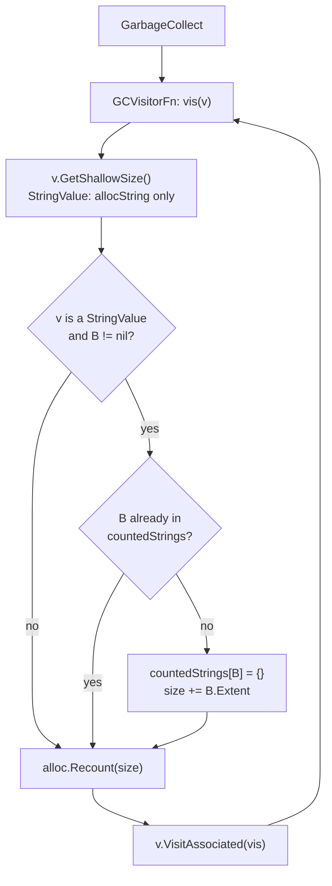
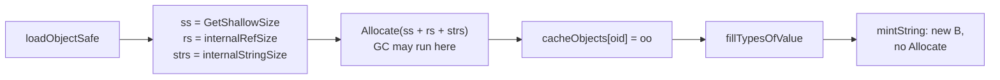

# `StringValue{Str, B *stringBacking}`: VM-owned string backing identity

Generated by claude-opus-5-5, review pipeline overview stage, effort high.

PR: [gnolang/gno#6110](https://github.com/gnolang/gno/pull/6110)

## TLDR

Before, [`StringValue`](https://github.com/gnolang/gno/blob/0099b3138/gnovm/pkg/gnolang/values.go#L85)
was a plain Go `string`, and the GC recount charged every string value it met
`allocString + len` through
[`GetShallowSize`](https://github.com/gnolang/gno/blob/0099b3138/gnovm/pkg/gnolang/alloc.go#L885-L887).
Two copies of one string paid its bytes twice, a slice paid only its own
length, and a string loaded from the store paid nothing at load.

After, [`StringValue`](https://github.com/gnolang/gno/blob/c800a571a/gnovm/pkg/gnolang/values.go#L111-L114)
is a struct carrying a pointer `B` to a
[`stringBacking`](https://github.com/gnolang/gno/blob/c800a571a/gnovm/pkg/gnolang/values.go#L91-L93).
[`NewString`](https://github.com/gnolang/gno/blob/c800a571a/gnovm/pkg/gnolang/alloc.go#L589-L592)
creates one; copies and slices share it. The GC charges each distinct
backing's bytes once per run, and
[`loadObjectSafe`](https://github.com/gnolang/gno/blob/c800a571a/gnovm/pkg/gnolang/store.go#L557) charges a loaded
object's strings in its single up-front
[`Allocate`](https://github.com/gnolang/gno/blob/c800a571a/gnovm/pkg/gnolang/store.go#L602).

It exists to make allocation and GC gas match what the program keeps
alive. It is an alternative to
[gnolang/gno#4885](https://github.com/gnolang/gno/pull/4885), which tracks
the same thing by Go heap address; one of the two is meant to merge.

## Before and after

One row per place string accounting enters; Before is the base, After is
this change.

| Where | Before | After |
| --- | --- | --- |
| A program builds a string | charged `allocString + len`, through [`NewString`](https://github.com/gnolang/gno/blob/0099b3138/gnovm/pkg/gnolang/alloc.go#L585-L588) | charged the same, then given a fresh backing, through [`NewString`](https://github.com/gnolang/gno/blob/c800a571a/gnovm/pkg/gnolang/alloc.go#L589-L592) and [`mintString`](https://github.com/gnolang/gno/blob/c800a571a/gnovm/pkg/gnolang/alloc.go#L599-L607) |
| A program slices a string, `s[i:j]` | charged `allocString + (j-i)` as a new string, through [`GetSlice`](https://github.com/gnolang/gno/blob/0099b3138/gnovm/pkg/gnolang/values.go#L2671) | charged `allocString` only, the slice sharing the source's backing, through [`GetSlice`](https://github.com/gnolang/gno/blob/c800a571a/gnovm/pkg/gnolang/values.go#L2709-L2717) |
| The GC recounts a live string | `allocString + len(Str)` for every value it visits, through [`GCVisitorFn`](https://github.com/gnolang/gno/blob/0099b3138/gnovm/pkg/gnolang/garbage_collector.go#L324) | `allocString` per value plus `Extent` once per distinct backing, through [`GCVisitorFn`](https://github.com/gnolang/gno/blob/c800a571a/gnovm/pkg/gnolang/garbage_collector.go#L335-L340) |
| An object loads from the store | its strings charge nothing, through [`loadObjectSafe`](https://github.com/gnolang/gno/blob/0099b3138/gnovm/pkg/gnolang/store.go#L597) and [`fillTypesOfValue`](https://github.com/gnolang/gno/blob/0099b3138/gnovm/pkg/gnolang/realm.go#L1894) | its strings charge `allocString + len` each inside the one `Allocate`, through [`internalStringSize`](https://github.com/gnolang/gno/blob/c800a571a/gnovm/pkg/gnolang/store.go#L596-L602); the fill then gives each a backing without charging, through [`fillTypesOfValue`](https://github.com/gnolang/gno/blob/c800a571a/gnovm/pkg/gnolang/realm.go#L1899) |
| A transaction argument becomes a string | built uncharged as a raw `StringValue` | minted and charged, through [`convertArgToGno`](https://github.com/gnolang/gno/blob/c800a571a/gno.land/pkg/sdk/vm/convert.go#L56) called with the machine's allocator from [`keeper.go`](https://github.com/gnolang/gno/blob/c800a571a/gno.land/pkg/sdk/vm/keeper.go#L1280) |
| `cur.Address()`, `cur.PkgPath()` | a fresh untracked copy | the realm handle's own value, same backing, through [`.grealm.Address`](https://github.com/gnolang/gno/blob/c800a571a/gnovm/pkg/gnolang/uverse.go#L1589) and [`.grealm.PkgPath`](https://github.com/gnolang/gno/blob/c800a571a/gnovm/pkg/gnolang/uverse.go#L1600) |
| `runtimeError.Error()`, `realm.Subpath()` | an untracked copy from `typedString` | a charged copy from [`newTypedString`](https://github.com/gnolang/gno/blob/c800a571a/gnovm/pkg/gnolang/values.go#L3383-L3385), at [`Error`](https://github.com/gnolang/gno/blob/c800a571a/gnovm/pkg/gnolang/uverse.go#L798) and [`Subpath`](https://github.com/gnolang/gno/blob/c800a571a/gnovm/pkg/gnolang/uverse.go#L1797) |
| A map literal is checked for duplicate keys | keyed by Go `==` on `TypedValue` | keyed by `MapKey`, through [`ComputeMapKey`](https://github.com/gnolang/gno/blob/c800a571a/gnovm/pkg/gnolang/preprocess.go#L2505-L2517), since `==` now compares `B` too |
| A string is saved to the store | written as the string | written as the string, `B` dropped, through [`MarshalAmino`](https://github.com/gnolang/gno/blob/c800a571a/gnovm/pkg/gnolang/values.go#L119) |

## How the GC recount works

The chart shows the head. Each node is a function or field in
[`garbage_collector.go`](https://github.com/gnolang/gno/blob/c800a571a/gnovm/pkg/gnolang/garbage_collector.go#L290-L340).



- [`GCVisitorFn`](https://github.com/gnolang/gno/blob/c800a571a/gnovm/pkg/gnolang/garbage_collector.go#L290)
  builds one visitor per GC run, with its own
  [`countedStrings`](https://github.com/gnolang/gno/blob/c800a571a/gnovm/pkg/gnolang/garbage_collector.go#L295)
  set, so the next run starts empty and the allocator holds no string state.
- [`StringValue.GetShallowSize`](https://github.com/gnolang/gno/blob/c800a571a/gnovm/pkg/gnolang/alloc.go#L904-L907)
  returns the 48-byte header and nothing for the bytes.
- The dedup check charges `allocStringByte * B.Extent` the first time a
  backing is seen in this run. `Extent` is the length at the mint, so a short
  slice still carries its source's full length.
- A nil `B` adds nothing past the header. Panic text built by
  [`typedString`](https://github.com/gnolang/gno/blob/c800a571a/gnovm/pkg/gnolang/values.go#L3374)
  is the case that carries a nil `B`.
- Objects still dedup by stamping `LastGCCycle` on themselves. Strings do
  not stamp, because a cached literal is shared by every machine in the
  process and a stamp would leak between them.

### What the recount charges, before and after

Each row is a set of live values handed to the visitor in one run. Both
columns were measured by calling `GCVisitorFn` on each tree, base and head,
from a test file overlaid with `go test -overlay`. The head column agrees with
the project's own tests
[`TestStringGCRecount`](https://github.com/gnolang/gno/blob/c800a571a/gnovm/pkg/gnolang/alloc_test.go#L49-L70)
and
[`TestStringSliceOutlivesSource`](https://github.com/gnolang/gno/blob/c800a571a/gnovm/pkg/gnolang/alloc_test.go#L95-L105),
which pass at the head.

| Live values | Before, bytes | After, bytes |
| --- | ---: | ---: |
| one 1052-byte string `s` | 1100 | 1100 |
| `s` and a copy `s1 := s`, 1052 bytes | 2200 | 1148 |
| three copies of a 4096-byte string | 12432 | 4240 |
| copy `s1` of a 1024-byte string plus `s[1:11]`, `s` itself dead | 1130 | 1120 |
| a 32-byte slice of a 1 MiB string, source dead | 80 | 1048624 |
| 20 bytes of panic text, nil `B` | 68 | 48 |

Creating that 32-byte slice charged 80 bytes before and 48 after, measured the
same way. On the head,
[`internalStringSize`](https://github.com/gnolang/gno/blob/c800a571a/gnovm/pkg/gnolang/alloc.go#L1032)
of a struct holding one 100-byte string returns 148, the charge that object's
load now carries; before, the load charged 0 for it.

## How a load charges its strings

Before, `loadObjectSafe` called `Allocate(ss + rs)` and the fill left strings
as decoded. After, the strings join that call, and the fill only gives each a
backing:



- [`internalStringSize`](https://github.com/gnolang/gno/blob/c800a571a/gnovm/pkg/gnolang/alloc.go#L1032)
  walks the same inline slots the fill walks and sums `allocString + len` per
  string. A child object is a `RefValue` slot and pays when it loads itself.
- The one [`Allocate`](https://github.com/gnolang/gno/blob/c800a571a/gnovm/pkg/gnolang/store.go#L602)
  runs before the
  [`cacheObjects` insert](https://github.com/gnolang/gno/blob/c800a571a/gnovm/pkg/gnolang/store.go#L625).
  An `Allocate` after the insert could start a GC while the object sits in the
  cache unreachable from any root; the GC would evict it, and the next
  `GetObject` for that ID would decode a second copy.
- [`mintString`](https://github.com/gnolang/gno/blob/c800a571a/gnovm/pkg/gnolang/alloc.go#L599-L607)
  never charges, which keeps the fill free of `Allocate` calls.
  [`gc_load_evicts_object.txtar`](https://github.com/gnolang/gno/blob/c800a571a/gno.land/pkg/integration/testdata/gc_load_evicts_object.txtar#L29)
  loads one array through two slices with the allocator parked near its cap
  and expects both to land on the same array.

## Read the code in this order

1. [`gnovm/pkg/gnolang/values.go:91-125`](https://github.com/gnolang/gno/blob/c800a571a/gnovm/pkg/gnolang/values.go#L91-L125) · [↗](../../../../.worktrees/gno-review-6110/gnovm/pkg/gnolang/values.go#L91)
   defines the new type and its wire form. If `MarshalAmino` wrote `B`, the
   stored bytes and the object hashes would change.
   ```go
   type stringBacking struct {
   	Extent int64
   }
   type StringValue struct {
   	Str string
   	B   *stringBacking
   }
   func (sv StringValue) MarshalAmino() (string, error) { return sv.Str, nil }
   ```
2. [`gnovm/pkg/gnolang/alloc.go:589-607`](https://github.com/gnolang/gno/blob/c800a571a/gnovm/pkg/gnolang/alloc.go#L589-L607) · [↗](../../../../.worktrees/gno-review-6110/gnovm/pkg/gnolang/alloc.go#L589)
   is where a backing is born. Every string a program can hold should come
   from here, or the recount sees only its header.
   ```go
   func (alloc *Allocator) NewString(s string) StringValue {
   	alloc.AllocateString(int64(len(s)))
   	return mintString(s)
   }
   func mintString(s string) StringValue {
   	if len(s) == 0 {
   		return StringValue{} // "" carries no backing; untracked
   	}
   	return StringValue{Str: s, B: &stringBacking{Extent: int64(len(s))}}
   }
   ```
3. [`gnovm/pkg/gnolang/values.go:2709-2717`](https://github.com/gnolang/gno/blob/c800a571a/gnovm/pkg/gnolang/values.go#L2709-L2717) · [↗](../../../../.worktrees/gno-review-6110/gnovm/pkg/gnolang/values.go#L2709)
   is slicing, which now shares `B` instead of minting.
   ```go
   alloc.Allocate(allocString)
   src, _ := tv.V.(StringValue) // zero value for nil ("")
   return TypedValue{
   	T: tv.T,
   	V: StringValue{Str: src.Str[low:high], B: src.B},
   }
   ```
4. [`gnovm/pkg/gnolang/garbage_collector.go:290-340`](https://github.com/gnolang/gno/blob/c800a571a/gnovm/pkg/gnolang/garbage_collector.go#L290-L340) · [↗](../../../../.worktrees/gno-review-6110/gnovm/pkg/gnolang/garbage_collector.go#L290)
   is the recount. A dedup set that outlived one run would undercount the
   next one.
   ```go
   countedStrings := make(map[*stringBacking]struct{})
   // ...
   if sv, ok := v.(StringValue); ok && sv.B != nil {
   	if _, counted := countedStrings[sv.B]; !counted {
   		countedStrings[sv.B] = struct{}{}
   		size += allocStringByte * sv.B.Extent
   	}
   }
   ```
5. [`gnovm/pkg/gnolang/store.go:594-602`](https://github.com/gnolang/gno/blob/c800a571a/gnovm/pkg/gnolang/store.go#L594-L602) · [↗](../../../../.worktrees/gno-review-6110/gnovm/pkg/gnolang/store.go#L594)
   and [`gnovm/pkg/gnolang/realm.go:1899`](https://github.com/gnolang/gno/blob/c800a571a/gnovm/pkg/gnolang/realm.go#L1899) · [↗](../../../../.worktrees/gno-review-6110/gnovm/pkg/gnolang/realm.go#L1899)
   are the load. If `internalStringSize` skips a slot the fill re-mints, that
   string loads uncharged.
   ```go
   ss := oo.GetShallowSize()
   rs := internalRefSize(oo)
   strs := internalStringSize(oo)
   // ...
   ds.alloc.Allocate(ss + rs + strs)
   ```
6. [`gnovm/pkg/gnolang/alloc.go:1032`](https://github.com/gnolang/gno/blob/c800a571a/gnovm/pkg/gnolang/alloc.go#L1032) · [↗](../../../../.worktrees/gno-review-6110/gnovm/pkg/gnolang/alloc.go#L1032)
   is that walk. It must visit the same slots as `fillTypesOfValue`, and it
   panics on a value type it does not list.
7. [`gnovm/pkg/gnolang/preprocess.go:2505-2517`](https://github.com/gnolang/gno/blob/c800a571a/gnovm/pkg/gnolang/preprocess.go#L2505-L2517) · [↗](../../../../.worktrees/gno-review-6110/gnovm/pkg/gnolang/preprocess.go#L2505)
   is the map-literal duplicate check, which compared keys with Go `==`. Two equal literals
   from different mints differ in `B`, so a `map[TypedValue]` set would miss
   the duplicate.
   ```go
   kset := make(map[MapKey]struct{})
   // ...
   mk, isNaN := cx.TypedValue.ComputeMapKey(nil, store, false)
   if isNaN {
   	continue // NaN never equals itself
   }
   if _, ok := kset[mk]; ok {
   ```
8. [`gnovm/pkg/gnolang/uverse.go:1589`](https://github.com/gnolang/gno/blob/c800a571a/gnovm/pkg/gnolang/uverse.go#L1589) · [↗](../../../../.worktrees/gno-review-6110/gnovm/pkg/gnolang/uverse.go#L1589)
   and the other native methods decide which returned strings carry a backing.
   A result built with `typedString` instead keeps a nil `B` and recounts as
   header only.

## What a user notices

Every effect lands on allocation and gas, per transaction, on every node; the
string contents a program sees do not change.

- **Copies of one string cost less in the recount.** A realm holding many
  copies of one large string pays its bytes once per GC run instead of once
  per copy.
- **A slice of a large string costs more once its source is gone.** The
  recount keeps the source's full length for as long as any slice lives. The
  32-byte slice of 1 MiB in the table above goes from 80 to 1048624 bytes, so
  a realm near its allocation cap can now fail where it fit before.
- **Loading an object costs more.** Every inline string in it charges
  `allocString + len` at load; before it charged nothing.
- **Gas totals move.** The
  [`alloc_0.gno`](https://github.com/gnolang/gno/blob/c800a571a/gnovm/tests/files/alloc_0.gno#L25)
  golden goes from 8174 to 8898 bytes, and six integration txtars change their
  expected gas. Nodes running the base and the head would compute different
  gas for the same transaction; that is an inference from those goldens, which
  only a mixed-version run would confirm.
- **Nothing to migrate.** Stored strings keep the same bytes, and a loaded
  string gets a new `B` on every load.

## Words used here

| Name | What it is |
| --- | --- |
| [`StringValue`](https://github.com/gnolang/gno/blob/c800a571a/gnovm/pkg/gnolang/values.go#L111-L114) | The VM's string value: the Go string `Str` plus the backing pointer `B`; 24 bytes, up from 16. |
| [`stringBacking`](https://github.com/gnolang/gno/blob/c800a571a/gnovm/pkg/gnolang/values.go#L91-L93) | One per mint; two values share a backing exactly when their `B` pointers are equal. |
| `Extent` | The byte length of the string at its mint, kept by every slice of it. |
| mint | One call of `mintString` with a non-empty string, which creates a new `stringBacking`. |
| [`mintString`](https://github.com/gnolang/gno/blob/c800a571a/gnovm/pkg/gnolang/alloc.go#L599-L607) | Builds a `StringValue` with a fresh backing and charges nothing; `""` gets a nil `B`. |
| [`NewString`](https://github.com/gnolang/gno/blob/c800a571a/gnovm/pkg/gnolang/alloc.go#L589-L592) | Charges `allocString + len` through `AllocateString`, then calls `mintString`. |
| [`allocString`](https://github.com/gnolang/gno/blob/c800a571a/gnovm/pkg/gnolang/alloc.go#L135) | The header charge per string value: `_allocHeap + 16`, which is 48 bytes. |
| [`allocStringByte`](https://github.com/gnolang/gno/blob/c800a571a/gnovm/pkg/gnolang/alloc.go#L136) | The charge per string byte: 1. |
| [`GCVisitorFn`](https://github.com/gnolang/gno/blob/c800a571a/gnovm/pkg/gnolang/garbage_collector.go#L290) | Builds the visitor one GC run uses to recount every live value. |
| [`countedStrings`](https://github.com/gnolang/gno/blob/c800a571a/gnovm/pkg/gnolang/garbage_collector.go#L295) | The set of backings already charged in the current GC run, empty at the start of each run. |
| [`internalStringSize`](https://github.com/gnolang/gno/blob/c800a571a/gnovm/pkg/gnolang/alloc.go#L1032) | The sum of `allocString + len` over every inline string of an object being loaded. |
| [`loadObjectSafe`](https://github.com/gnolang/gno/blob/c800a571a/gnovm/pkg/gnolang/store.go#L557) | Decodes one object from the store, charges it, caches it and fills it. |
| `cacheObjects` | The store's in-memory map from object ID to loaded object; the GC can evict an entry no root reaches. |
| [`fillTypesOfValue`](https://github.com/gnolang/gno/blob/c800a571a/gnovm/pkg/gnolang/realm.go#L1890) | Walks a freshly loaded value to restore its types, and now gives each string a backing. |
| [`typedString`](https://github.com/gnolang/gno/blob/c800a571a/gnovm/pkg/gnolang/values.go#L3374) | Builds a string value with a nil `B` and no charge; used for panic text. |
| [`newTypedString`](https://github.com/gnolang/gno/blob/c800a571a/gnovm/pkg/gnolang/values.go#L3383-L3385) | Builds a string value through `NewString`, charged and with a backing. |
| `MapKey` | The byte key a runtime map uses for a value, compared by string content. |
| [ADR](https://github.com/gnolang/gno/blob/c800a571a/gnovm/adr/pr6110_string_backing_id.md?plain=1#L20-L69) | The design record in the pull request, with the alternatives and the benchmarks. |
