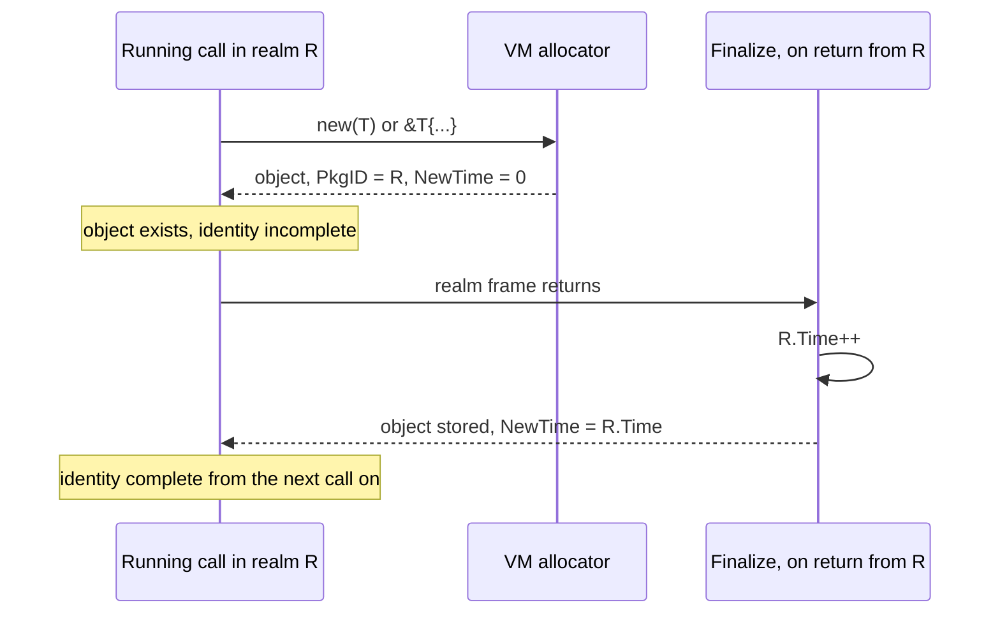
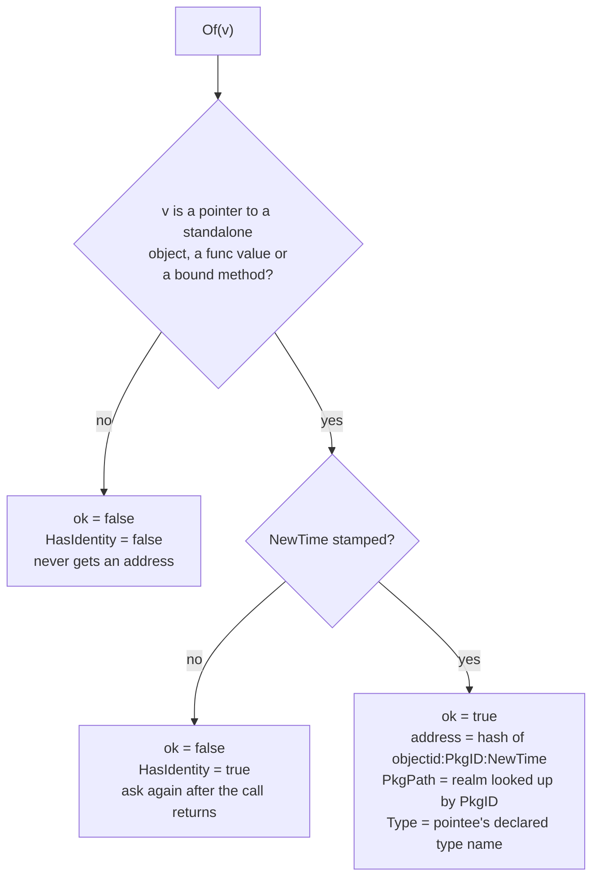

# Giving a Gno object its own on-chain address

claude-opus-5-5, overview agent, high effort

## TLDR

A realm today can only name the things it creates with names it picks, so it
can pick the same name twice. The VM already gives every stored object an
identity no realm picks. Pull request
[#6214](https://github.com/gnolang/gno/pull/6214) adds a standard library
package, `chain/reflect`, that hashes that identity into a gno.land address, so
an object can receive tokens and coins. It cannot spend them yet.

## What it is for

A realm is a Gno program with its own on-chain storage. When it creates
something that other code must tell apart, a token, a proposal, a vote, the
realm needs a name for that thing. Every name available today comes from the
realm or its caller: a package path, a symbol, a counter, an argument. Anything
a realm chooses, it can choose twice.

Issue [#6026](https://github.com/gnolang/gno/issues/6026) is the case that
surfaced it.
[`grc20.NewToken`](https://github.com/gnolang/gno/blob/58b2692067d6545410b99c71f33bdf506caadaa0/examples/gno.land/p/nt/grc20/v0/token.gno#L67) · [↗](../../../../.worktrees/gno-review-6214/examples/gno.land/p/nt/grc20/v0/token.gno#L67)
builds a token's name from the realm path, the symbol and a sequence number the
caller passes in, so one realm can issue two independent tokens under one name,
and their `Transfer` events cannot be told apart.

The change gives each object a name the realm has no say in, in the one format
every existing API already accepts: an address. The filetest
[`zrealm_reflect_duplicate_symbol.gno`](https://github.com/gnolang/gno/blob/58b2692067d6545410b99c71f33bdf506caadaa0/gnovm/tests/files/zrealm_reflect_duplicate_symbol.gno#L88-L103) · [↗](../../../../.worktrees/gno-review-6214/gnovm/tests/files/zrealm_reflect_duplicate_symbol.gno#L88)
shows the difference. This is its expected output after the change:

```text
first name:  gno.land/r/demo/reflectdup.FOO
second name: gno.land/r/demo/reflectdup.FOO
names collide: true

first addr:  g1vfk0e46hfcgq82v30du00a4elaf7c4gvmgs43e
second addr: g1ch9j854thst84rj8kp7nuqxw5aexju5c5hu8tv
addresses collide: false
```

The motivating use is a governance proposal that owns a fund. The fund's
address is the proposal's address, derived from the proposal object, so no
later version of the realm can point it elsewhere and no second proposal can
share it. The proposal's stored callback, a func value, gets an address of its
own too, distinct from the proposal holding it.

## How it works today

This whole section describes the code before the change. None of it is
modified by the pull request.

### Every stored object already has an identity

The VM names each object it stores with an
[`ObjectID`](https://github.com/gnolang/gno/blob/58b2692067d6545410b99c71f33bdf506caadaa0/gnovm/pkg/gnolang/ownership.go#L42-L45) · [↗](../../../../.worktrees/gno-review-6214/gnovm/pkg/gnolang/ownership.go#L42),
two fields. Before and after, unchanged:

```go
type ObjectID struct {
	PkgID   PkgID  // base
	NewTime uint64 // time created
}
```

`PkgID` is a hash of the path of the realm that created the object. `NewTime`
is a tick of that realm's storage clock, a counter the VM advances each time
the realm stores a new object. The realm reads neither and sets neither.

### The identity is completed only when the realm stores the object

The two halves are stamped at different moments. Before and after, unchanged:



The tick happens in
[`assignNewObjectID`](https://github.com/gnolang/gno/blob/58b2692067d6545410b99c71f33bdf506caadaa0/gnovm/pkg/gnolang/realm.go#L2040-L2041) · [↗](../../../../.worktrees/gno-review-6214/gnovm/pkg/gnolang/realm.go#L2040),
which
[`FinalizeRealmTransaction`](https://github.com/gnolang/gno/blob/58b2692067d6545410b99c71f33bdf506caadaa0/gnovm/pkg/gnolang/realm.go#L499) · [↗](../../../../.worktrees/gno-review-6214/gnovm/pkg/gnolang/realm.go#L499)
reaches when a realm frame returns. The clock `assignNewObjectID` advances
belongs to the realm named by `PkgID`, even when another realm runs the
finalize, so two objects created by one realm never share a tick.
[`IsFinalized`](https://github.com/gnolang/gno/blob/58b2692067d6545410b99c71f33bdf506caadaa0/gnovm/pkg/gnolang/ownership.go#L107-L109) · [↗](../../../../.worktrees/gno-review-6214/gnovm/pkg/gnolang/ownership.go#L107)
is true once `NewTime` is non-zero, and the VM treats that same test as "this
object is stored".

### Realms already have addresses, objects do not

A realm's address is a hash of its package path, in
[`DerivePkgCryptoAddr`](https://github.com/gnolang/gno/blob/58b2692067d6545410b99c71f33bdf506caadaa0/gnovm/pkg/gnolang/misc.go#L199) · [↗](../../../../.worktrees/gno-review-6214/gnovm/pkg/gnolang/misc.go#L199).
Before and after, unchanged:

```go
return crypto.AddressFromPreimage([]byte("pkgPath:" + pkgPath))
```

No Gno code can read an `ObjectID`. It exists inside the VM and in storage
only, so a realm wanting a unique name has to invent one.

## What the change does

Every block in this section shows the code after the change.

### A new package with one question

`chain/reflect` answers "which object is this, and where does it live". It is
not Go's `reflect`: no type or field inspection, no reading a value the caller
was not handed. Its surface, from
[`reflect.gno`](https://github.com/gnolang/gno/blob/58b2692067d6545410b99c71f33bdf506caadaa0/gnovm/stdlibs/chain/reflect/reflect.gno#L40-L63) · [↗](../../../../.worktrees/gno-review-6214/gnovm/stdlibs/chain/reflect/reflect.gno#L40),
after:

```go
type Addressable interface{ Address() address }

type Object struct { /* unexported */ }

func Of(v any) (Object, bool)
func HasIdentity(v any) bool

func (o Object) Address() address // g1..., derived from the identity
func (o Object) ID() string       // "<realm-id>:<clock-tick>"
func (o Object) PkgPath() string  // the realm that created it
func (o Object) Type() string     // "<pkgpath>.<Name>"
func (o Object) String() string   // "gno.land/r/demo/foo.Token#7 (g1...)"
func (o Object) IsZero() bool
```

`Object` has only unexported fields, so no realm can build one. A non-empty
`Object` comes from
[`Of`](https://github.com/gnolang/gno/blob/58b2692067d6545410b99c71f33bdf506caadaa0/gnovm/stdlibs/chain/reflect/reflect.gno#L131-L137) · [↗](../../../../.worktrees/gno-review-6214/gnovm/stdlibs/chain/reflect/reflect.gno#L131)
and from nowhere else. `Addressable` is the opposite on purpose: any type can
implement `Address()` and return anything, so an `Addressable` tells an API
where to send value and never who may move it.

### How one call answers

`Of` and `HasIdentity` both call one native function, a Go function the VM
exposes to Gno,
[`X_objectInfo`](https://github.com/gnolang/gno/blob/58b2692067d6545410b99c71f33bdf506caadaa0/gnovm/stdlibs/chain/reflect/reflect.go#L19-L39) · [↗](../../../../.worktrees/gno-review-6214/gnovm/stdlibs/chain/reflect/reflect.go#L19).
After:



The first test is
[`ownObject`](https://github.com/gnolang/gno/blob/58b2692067d6545410b99c71f33bdf506caadaa0/gnovm/stdlibs/chain/reflect/reflect.go#L64-L89) · [↗](../../../../.worktrees/gno-review-6214/gnovm/stdlibs/chain/reflect/reflect.go#L64).
A pointer counts only when what it points at is a standalone heap object, which
is what `new(T)` and `&T{...}` produce. A pointer to a struct field or an
array element would resolve to the container, and every sibling would then
answer with the container's address. The realm name comes from
[`creatingRealmPath`](https://github.com/gnolang/gno/blob/58b2692067d6545410b99c71f33bdf506caadaa0/gnovm/stdlibs/chain/reflect/reflect.go#L108) · [↗](../../../../.worktrees/gno-review-6214/gnovm/stdlibs/chain/reflect/reflect.go#L108),
a store lookup by `PkgID`, and the type name from
[`declaredTypeName`](https://github.com/gnolang/gno/blob/58b2692067d6545410b99c71f33bdf506caadaa0/gnovm/stdlibs/chain/reflect/reflect.go#L127-L144) · [↗](../../../../.worktrees/gno-review-6214/gnovm/stdlibs/chain/reflect/reflect.go#L127).

Which values get an address, after, as printed by the filetest
[`zrealm_reflect_identity.gno`](https://github.com/gnolang/gno/blob/58b2692067d6545410b99c71f33bdf506caadaa0/gnovm/tests/files/zrealm_reflect_identity.gno#L88-L101) · [↗](../../../../.worktrees/gno-review-6214/gnovm/tests/files/zrealm_reflect_identity.gno#L88):

| Value handed to `Of` | Address | Why |
|---|---|---|
| `&inner{}`, stored | `g1aecuuaguc5654vk3yaa2jzlsr36tu543gfjuky` | its own object |
| `func() int`, stored | `g1tgzz9nkvgtlr90cgha8g8lajvn9p2pew5epgmd` | a func value is shared by every holder |
| `&container.field` | none, ever | would borrow the container's |
| `&container.arr[0]` | none, ever | would borrow the container's |
| `[]int` | none, ever | every view of the backing array would share it |
| `42`, `"hello"`, a nil pointer | none, ever | no object behind it |
| `&inner{n: 9}` made by this call | none yet | `NewTime` is still 0 |

### The address

[`DeriveObjectCryptoAddr`](https://github.com/gnolang/gno/blob/58b2692067d6545410b99c71f33bdf506caadaa0/gnovm/pkg/gnolang/misc.go#L217-L223) · [↗](../../../../.worktrees/gno-review-6214/gnovm/pkg/gnolang/misc.go#L217)
hashes the finished identity the same way a package path becomes a realm
address, under a different prefix. After:

```go
func DeriveObjectCryptoAddr(oid ObjectID) crypto.Address {
	if !oid.IsFinalized() || oid.PkgID.IsZero() {
		panic("objectID is not fully stamped: " + oid.String())
	}

	return crypto.AddressFromPreimage([]byte("objectid:" + oid.PkgID.String() + ":" + strconv.FormatUint(oid.NewTime, 10)))
}
```

The hashed text, called the preimage, has two shapes side by side. After:

| Owner | Preimage | Source |
|---|---|---|
| realm | `pkgPath:gno.land/r/demo/foo` | [`misc.go:199`](https://github.com/gnolang/gno/blob/58b2692067d6545410b99c71f33bdf506caadaa0/gnovm/pkg/gnolang/misc.go#L199) · [↗](../../../../.worktrees/gno-review-6214/gnovm/pkg/gnolang/misc.go#L199) |
| object | `objectid:RID<40 hex digits>:<tick>` | [`misc.go:222`](https://github.com/gnolang/gno/blob/58b2692067d6545410b99c71f33bdf506caadaa0/gnovm/pkg/gnolang/misc.go#L222) · [↗](../../../../.worktrees/gno-review-6214/gnovm/pkg/gnolang/misc.go#L222) |

The object's realm half is spelled by
[`PkgID.String`](https://github.com/gnolang/gno/blob/58b2692067d6545410b99c71f33bdf506caadaa0/gnovm/pkg/gnolang/realm.go#L74-L76) · [↗](../../../../.worktrees/gno-review-6214/gnovm/pkg/gnolang/realm.go#L74),
`RID` and upper-case hex. `Object.ID()` shows the storage spelling instead,
from
[`MarshalAmino`](https://github.com/gnolang/gno/blob/58b2692067d6545410b99c71f33bdf506caadaa0/gnovm/pkg/gnolang/ownership.go#L47-L50) · [↗](../../../../.worktrees/gno-review-6214/gnovm/pkg/gnolang/ownership.go#L47),
lower-case hex with no prefix. Once an address lands in a balance or an event,
every character of this preimage is fixed: changing any of it moves every
object address on chain.

What a reader sees for one stored object, after, from the filetest
[`zrealm_reflect_objectid.gno`](https://github.com/gnolang/gno/blob/58b2692067d6545410b99c71f33bdf506caadaa0/gnovm/tests/files/zrealm_reflect_objectid.gno#L67-L85) · [↗](../../../../.worktrees/gno-review-6214/gnovm/tests/files/zrealm_reflect_objectid.gno#L67):

```text
first   gno.land/r/demo/reflectid.Account#8 (g1delmyrysc3x2xdq92j2ttmykkfj5rs6r682dw0)
address     g1delmyrysc3x2xdq92j2ttmykkfj5rs6r682dw0
id          0f0fab98e0c5e59ebb5c1cae1ba307b5adcb6026:8
created by  gno.land/r/demo/reflectid
type        gno.land/r/demo/reflectid.Account
```

### What an address lets an object do

The package doc in
[`reflect.gno`](https://github.com/gnolang/gno/blob/58b2692067d6545410b99c71f33bdf506caadaa0/gnovm/stdlibs/chain/reflect/reflect.gno#L25-L31) · [↗](../../../../.worktrees/gno-review-6214/gnovm/stdlibs/chain/reflect/reflect.gno#L25)
states the reach after the change:

| Action | After the change |
|---|---|
| Hold a GRC20 balance | yes, `Transfer` takes a plain `address` |
| Receive ugnot | yes, a banker's recipient is any address |
| Spend what it holds | no, a banker sends only from the calling realm's own address |
| Sign a transaction | no, no private key exists for it |

### The rest of the diff

After the change, beside the package itself:

| Piece | What it adds |
|---|---|
| [`native_gas.go:157`](https://github.com/gnolang/gno/blob/58b2692067d6545410b99c71f33bdf506caadaa0/gnovm/stdlibs/native_gas.go#L157) · [↗](../../../../.worktrees/gno-review-6214/gnovm/stdlibs/native_gas.go#L157) | a flat gas price of 1200 for the native call, whatever the answer |
| [`apphash_crossrealm38_test.go:238`](https://github.com/gnolang/gno/blob/58b2692067d6545410b99c71f33bdf506caadaa0/gno.land/pkg/sdk/vm/apphash_crossrealm38_test.go#L238) · [↗](../../../../.worktrees/gno-review-6214/gno.land/pkg/sdk/vm/apphash_crossrealm38_test.go#L238) | a new expected genesis hash, since standard library source is part of genesis state |
| [`gno-stdlibs.md:710`](https://github.com/gnolang/gno/blob/58b2692067d6545410b99c71f33bdf506caadaa0/docs/resources/gno-stdlibs.md?plain=1#L710) · [↗](../../../../.worktrees/gno-review-6214/docs/resources/gno-stdlibs.md#L710) | the user-facing docs section |
| [`chain_reflect_object_identity.md`](https://github.com/gnolang/gno/blob/58b2692067d6545410b99c71f33bdf506caadaa0/gnovm/adr/chain_reflect_object_identity.md?plain=1#L1) · [↗](../../../../.worktrees/gno-review-6214/gnovm/adr/chain_reflect_object_identity.md#L1) | the design record, comparing it with [#6101](https://github.com/gnolang/gno/pull/6101) and [#6139](https://github.com/gnolang/gno/pull/6139) |
| five `zrealm_reflect_*.gno` filetests | the identity table and the outputs quoted in this file, plus one object stored by a second realm keeping its creator's clock |

`grc20` itself is untouched. Fixing
[#6026](https://github.com/gnolang/gno/issues/6026) on top of this is left to a
follow-up that drops the caller-supplied sequence number.

## Words used here

- **Realm**: a Gno package under `r/` with its own persistent storage. Each
  realm has an address derived from its path.
- **Object**: a value the VM stores as a unit in a realm's storage, such as a
  struct reached through a pointer or a closure.
- **ObjectID**: the VM's name for a stored object, the pair `PkgID` and
  `NewTime`.
- **PkgID**: a hash of the creating realm's path.
  [Its first four bits](https://github.com/gnolang/gno/blob/58b2692067d6545410b99c71f33bdf506caadaa0/gnovm/pkg/gnolang/realm.go#L89-L93) · [↗](../../../../.worktrees/gno-review-6214/gnovm/pkg/gnolang/realm.go#L89)
  carry flags for standard library, immutable and internal packages.
- **Realm clock, `NewTime`**: a per-realm counter the VM advances when it
  stores a new object.
  [Every object the realm stores takes a tick](https://github.com/gnolang/gno/blob/58b2692067d6545410b99c71f33bdf506caadaa0/gnovm/pkg/gnolang/realm.go#L2040-L2041) · [↗](../../../../.worktrees/gno-review-6214/gnovm/pkg/gnolang/realm.go#L2040),
  so `#8` in `Account#8` is not a count of accounts.
- **Finalize**: the step at the end of a realm call that stores every object
  the call attached to the realm and stamps its `NewTime`.
- **Stamping window**: the span between an object's creation and the finalize
  that stores it. During it, `Of` answers `ok == false` and `HasIdentity`
  answers true.
- **Preimage**: the exact text that is hashed to produce an address.
- **Native function**: a Go function the VM exposes to Gno code under a Gno
  signature, priced by a row in the native gas table.
- **Address**: an account identifier, written in bech32 as `g1...`.
  Tokens and coins are recorded against addresses.
