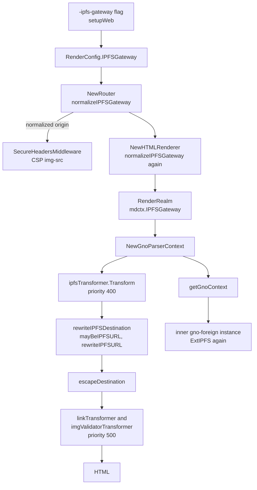

# gnoweb resolves IPFS URLs through `RenderConfig.IPFSGateway`
Generated by claude-opus-5-5, high effort.
PR: [gnolang/gno#6270](https://github.com/gnolang/gno/pull/6270)

## TLDR

Before, gnoweb rendered IPFS URLs exactly as written, and its CSP `img-src`
allowed images from `https://ipfs.io` and `https://cloudflare-ipfs.com` only.
Both hosts stopped serving embedded content, so every IPFS image on a gnoweb
page broke, URLs stored in realm state included. After, a markdown AST
transformer, `ipfsTransformer`, rewrites `ipfs://`, `ipns://` and URLs on
seven retired public gateways to one configured gateway origin,
`RenderConfig.IPFSGateway`. The CSP allows that origin instead of the dead
hosts. The gnoweb flag `-ipfs-gateway` and the gnodev flag `-web-ipfs-gateway`
set it, both defaulting to `https://ipfs.filebase.io`.

## Before and after

One row per place the behaviour enters. The left column is the base, the
right column is the head of the pull request.

| Where it enters | Before | After |
| --- | --- | --- |
| A realm image `` | the browser asks ipfs.io, which no longer serves embedded images, through no gnoweb code at all | the image loads from `<gateway>/ipfs/<cid>/a.png` with `loading="lazy"`, through [`ipfsTransformer.Transform`](https://github.com/gnolang/gno/pull/6270/files#diff-873c9680aff44c049ac35217b14bf66c24ebabcac0c1004786aeaec531fd9187R59-R65) |
| A realm image `` | the CSP blocks the `ipfs:` source, per the [ADR](https://github.com/gnolang/gno/pull/6270/files#diff-43938872b52f730c87fb6fc2d2cc9095c6f2c781510dcbc392b0dc9e6de89b1b) | the image loads from `<gateway>/ipfs/<cid>`, through [`rewriteIPFSURL`](https://github.com/gnolang/gno/pull/6270/files#diff-873c9680aff44c049ac35217b14bf66c24ebabcac0c1004786aeaec531fd9187R130-R172) |
| A realm link `[x](ipfs://<cid>)` or `[x](ipns://<name>)` | the link keeps a scheme most browsers cannot open, per the ADR | the link opens `<gateway>/ipfs/...` or `<gateway>/ipns/...`, through `rewriteIPFSURL` |
| A link on a subdomain gateway, `https://<cid>.ipfs.dweb.link/x` | the link points at dweb.link | the link points at `<gateway>/ipfs/<cid>/x`, through [`splitGatewaySubdomain`](https://github.com/gnolang/gno/pull/6270/files#diff-873c9680aff44c049ac35217b14bf66c24ebabcac0c1004786aeaec531fd9187R197-R211) |
| An autolink `<https://ipfs.io/ipfs/<cid>>` | the text and the target both name ipfs.io | the autolink is replaced by a link whose text and target are the gateway URL, through [`newLinkFromAutoLink`](https://github.com/gnolang/gno/pull/6270/files#diff-e05ed50f27a6c120e23aa6d3001c1725c7bffc77c38e467d5cd946d74d91bc11R170-R179) |
| Content inside `<gno-foreign>` | rendered as written | rewritten the same way, through [`buildInnerForeignMarkdown`](https://github.com/gnolang/gno/pull/6270/files#diff-4ee77426d5a939c5259f5ed5712ebff4dd91f1fc2a1aa05c5109b29d25beca5cR452) and [`getGnoContext`](https://github.com/gnolang/gno/pull/6270/files#diff-c8157411fa9b2e88bcb684d1ca01b3dd1aee58e762bf225266c959a125b057fdR47-R57) |
| The `Content-Security-Policy` header of `gnoweb -strict` | `img-src` lists [`https://ipfs.io` and `https://cloudflare-ipfs.com`](https://github.com/gnolang/gno/pull/6270/files#diff-a123dd3737a47dbac1001d53f411dfb5034817ca1f4a4cd89e3dffcc003c5a0cL42-L43) | `img-src` lists the configured gateway, through [`SecureHeadersMiddleware`](https://github.com/gnolang/gno/pull/6270/files#diff-a123dd3737a47dbac1001d53f411dfb5034817ca1f4a4cd89e3dffcc003c5a0cR462-R472) |
| gnoweb startup | there is no gateway setting | an invalid gateway stops startup with `invalid IPFS gateway`, through [`NewRouter`](https://github.com/gnolang/gno/pull/6270/files#diff-d9864fd6567bb81edc36439b71fe21f913ae9e6501acff8220a6f7fc5f046e04R162-R168) |
| The traefik CSP of the loop deployment | lists ipfs.io and cloudflare-ipfs.com | lists `https://ipfs.filebase.io`, in [`misc/loop/traefik/gno.yml`](https://github.com/gnolang/gno/pull/6270/files#diff-01b73ff52571131ad27c33c76cee5942227e31460bda7f5f4b513264c6ee07f0R7) |

## How the rewrite works

The diagram shows the after side: how the flag value reaches both the
rendered markdown and the CSP header.



- `normalizeIPFSGateway` accepts an `https` origin, or `http` on a loopback
  host, with a DNS name or IPv4 host and no credentials, path, query or
  fragment. It refuses the chain domain, the canonical origin's host and their
  subdomains, and returns `scheme://host[:port]` in lowercase. An empty value
  turns the whole feature off.
- `NewRouter` runs it with the chain domain and the canonical host, and fails
  on an error. `NewHTMLRenderer` runs it again with neither, and drops a
  malformed value with a warning instead of failing.
- `ipfsTransformer.Transform` returns at once when the context carries no
  gateway. Otherwise it walks the document and rewrites the destination of
  every `ast.Link` and `ast.Image`, and collects every URL autolink to replace
  after the walk.
- `mayBeIPFSURL` skips `url.Parse` for a destination holding neither `pfs` nor
  `pns` in any letter case, nor a `%`.
- `rewriteIPFSURL` maps the URL to `<gateway>/<namespace>/<name><path>`,
  keeping the query and fragment, or reports `false` and leaves it alone.
- `escapeDestination` re-escapes `\` and `&`, since the renderers resolve
  escapes and character references in a destination once more.
- Priority 400 runs before the link and image validators at 500, so
  [`linkTransformer`](https://github.com/gnolang/gno/blob/fe1c9f046d52faaeafe13f9bd48ce44c77f39e20/gno.land/pkg/gnoweb/markdown/ext_links.go#L486)
  and
  [`imgValidatorTransformer`](https://github.com/gnolang/gno/blob/fe1c9f046d52faaeafe13f9bd48ce44c77f39e20/gno.land/pkg/gnoweb/markdown/ext_imgvalidator.go#L77)
  judge the gateway URL rather than the original.

### Which URLs are rewritten

The rows are copied from `TestRewriteIPFSURL` in
`gno.land/pkg/gnoweb/markdown/ext_ipfs_test.go`, which passes at the head:
`go test ./gno.land/pkg/gnoweb/markdown/ -run IPFS` printed `ok`. The gateway
in the test is `https://gw.test`. The output column is the after side; before
the change every input rendered unchanged.

| Input | Output |
| --- | --- |
| `ipfs://<cidv1>` | `https://gw.test/ipfs/<cidv1>` |
| `ipfs://<cidv1>/dir/a%20b.png?filename=x.png#top` | `https://gw.test/ipfs/<cidv1>/dir/a%20b.png?filename=x.png#top` |
| `ipns://en.wikipedia-on-ipfs.org/wiki/` | `https://gw.test/ipns/en.wikipedia-on-ipfs.org/wiki/` |
| `http://IPFS.IO/ipfs/<cidv1>` | `https://gw.test/ipfs/<cidv1>` |
| `https://<cidv1>.ipfs.dweb.link/img.png` | `https://gw.test/ipfs/<cidv1>/img.png` |
| `https://en-wikipedia--on--ipfs-org.ipns.dweb.link/wiki/` | `https://gw.test/ipns/en.wikipedia-on-ipfs.org/wiki/` |
| `//ipfs.io/ipfs/<cidv1>/x` | `https://gw.test/ipfs/<cidv1>/x` |
| `https://ipfs.filebase.io/ipfs/<cidv1>` | unchanged: not a retired gateway |
| `https://ipfs.io:8443/ipfs/<cidv1>` | unchanged: a port |
| `https://user@ipfs.io/ipfs/<cidv1>` | unchanged: userinfo |
| `ipfs://bafy.example` | unchanged: a dot in a CID |
| `ipfs://<cidv1>/../<cidv0>/x.png` | unchanged: a `..` segment |
| `ipfs://<cidv1>/x%2F..%2F..%2F<cidv0>` | unchanged: an encoded `..` segment |
| `ipfs://<cidv1>/x?uri=ipfs://<cidv0>` | unchanged: a `uri` query key |
| `/ipfs/<cidv1>` | unchanged: relative to the gnoweb host |

The two refusals at the bottom exist because the CID moves from the host into
the path. `ipfs://A/../B/x.png` names content under `A`; rewritten, it would
read `<gateway>/ipfs/A/../B/x.png`, which the browser resolves to
`<gateway>/ipfs/B/x.png`, other content. Gateways built on boxo redirect a
request carrying a `uri` query parameter to the content that parameter names.

### Which gateway settings start

The rows are copied from `TestNormalizeIPFSGateway` in
`gno.land/pkg/gnoweb/ipfs_test.go`, run with chain domain `gno.land`, which
passes at the head: `go test ./gno.land/pkg/gnoweb/ -run 'IPFS|Gateway'`
printed `ok`. Every row is the after side; the setting did not exist before.

| `-ipfs-gateway` value | Result |
| --- | --- |
| empty | `""`: rewrite off, nothing added to the CSP |
| ` https://IPFS.Filebase.io ` | `https://ipfs.filebase.io` |
| `https://ipfs.filebase.io/` | `https://ipfs.filebase.io` |
| `http://localhost:8080` | accepted: http on loopback |
| `http://ipfs.filebase.io` | refused: http off loopback |
| `https://ipfs.filebase.io/ipfs` | refused: a path |
| `https://ipfs.GNO.land` | refused: a subdomain of the chain domain |
| `https://*.example` | refused: a CSP wildcard |
| `https://[2001:db8::1]` | refused: an IPv6 literal, which a CSP host-source cannot name |

## Read the code in this order

Every excerpt below is the after side, copied from the head of the pull
request.

### 1. `hot` · The rewrite pass, [`ext_ipfs.go`](https://github.com/gnolang/gno/pull/6270/files#diff-873c9680aff44c049ac35217b14bf66c24ebabcac0c1004786aeaec531fd9187R37-R87)

Decides which nodes get a new destination, and swaps each autolink for a link
once the walk is over.
**If wrong:** an IPFS URL in some markdown construct keeps pointing at a dead
gateway, or the walk stops early and later links miss their `rel`.

```go
	gateway, _ := getIPFSGatewayFromContext(pc)
	if gateway == "" {
		return
	}
	...
		case *ast.Image:
			if u, ok := rewriteIPFSDestination(gateway, n.Destination); ok {
				n.Destination = escapeDestination(u)
				// An image no IPFS node provides can otherwise hold the
				// page's load event for close to a minute.
				n.SetAttributeString("loading", []byte("lazy"))
			}
	...
	for _, a := range autolinks {
		parent := a.node.Parent()
		parent.ReplaceChild(parent, a.node, newLinkFromAutoLink(escapeDestination(a.url), []byte(a.url)))
	}
```

### 2. `hot` · The URL mapping, [`ext_ipfs.go`](https://github.com/gnolang/gno/pull/6270/files#diff-873c9680aff44c049ac35217b14bf66c24ebabcac0c1004786aeaec531fd9187R130-R172)

Decides which URLs are IPFS content and what gateway URL names the same
content.
**If wrong:** a rewritten URL names other content than the author wrote, or a
non-IPFS URL is sent to the gateway.

```go
	switch u.Scheme { // url.Parse lowercases the scheme
	case "ipfs", "ipns":
		namespace, name, rest = u.Scheme, u.Host, u.EscapedPath()
	case "http", "https", "": // "" with a host: protocol-relative //host/...
		host := strings.ToLower(u.Host) // keeps any port, so ported hosts never match
		if _, retired := ipfsRetiredGateways[host]; retired {
			namespace, name, rest = splitGatewayPath(u.EscapedPath())
		} else {
			namespace, name = splitGatewaySubdomain(host)
			rest = u.EscapedPath()
		}
	default:
		return "", false
	}
	...
	if hasDotSegment(u.Path) || hasURIParam(u.RawQuery) {
		return "", false
	}

	out := gateway + "/" + namespace + "/" + name + rest
```

### 3. `hot` · The retired hosts and the subdomain form, [`ext_ipfs.go`](https://github.com/gnolang/gno/pull/6270/files#diff-873c9680aff44c049ac35217b14bf66c24ebabcac0c1004786aeaec531fd9187R18-R31)

Names the seven hosts the rewrite replaces, and which of them also served
`<cid>.ipfs.<host>`.
**If wrong:** a URL on a dead host stays dead, or a URL on a live host is
moved to the gateway.

```go
var ipfsRetiredGateways = map[string]bool{
	"ipfs.io":             false,
	"gateway.ipfs.io":     false,
	"cloudflare-ipfs.com": false,
	"cf-ipfs.com":         true,
	"dweb.link":           true,
	"nftstorage.link":     true,
	"w3s.link":            true,
}
```

### 4. `hot` · The path guards, [`ext_ipfs.go`](https://github.com/gnolang/gno/pull/6270/files#diff-873c9680aff44c049ac35217b14bf66c24ebabcac0c1004786aeaec531fd9187R239-R260)

Refuses a path with a `.` or `..` segment, split at `/` or `\`, and a query
with a `uri` key.
**If wrong:** an author makes a link that reads as one CID and opens another.

```go
func hasDotSegment(p string) bool {
	for _, seg := range strings.FieldsFunc(p, func(r rune) bool { return r == '/' || r == '\\' }) {
		if seg == "." || seg == ".." {
			return true
		}
	}
	return false
}
```

### 5. `hot` · The gateway check, [`ipfs.go`](https://github.com/gnolang/gno/pull/6270/files#diff-a829c4898f52e019eaac8ef1926af1960fc9595e120dd1c58b85b9ea77d3b6cdR36-R66)

Decides which origins an operator may set, since the origin goes into the CSP
and into every rewritten URL.
**If wrong:** a gateway on gnoweb's own host serves any author's HTML as that
host, or a malformed value breaks the CSP header.

```go
	host := strings.ToLower(u.Hostname())
	switch {
	case !gatewayHost.MatchString(host):
		return "", errors.New("host must be a DNS name or an IPv4 address")
	case strings.HasSuffix(u.Host, ":") || (u.Port() != "" && !validPort(u.Port())):
		return "", errors.New("invalid port")
	case u.Scheme != "https" && (u.Scheme != "http" || !isLoopbackHost(host)):
		return "", errors.New("must use https (http is only allowed on localhost)")
	case u.User != nil:
		return "", errors.New("must not contain credentials")
	case (u.Path != "" && u.Path != "/") || u.RawQuery != "" || u.ForceQuery || u.Fragment != "":
		return "", errors.New("must be an origin, without path, query or fragment")
	case onHost(host, domain):
		return "", fmt.Errorf("must not be on the chain domain %q", domain)
	case onHost(host, canonicalHost):
		return "", fmt.Errorf("must not be on the canonical origin's host %q", canonicalHost)
	}
```

### 6. `hot` · The context carried into `<gno-foreign>`, [`context.go`](https://github.com/gnolang/gno/pull/6270/files#diff-c8157411fa9b2e88bcb684d1ca01b3dd1aee58e762bf225266c959a125b057fdR47-R57)

Copies the gateway into the parser context of the inner instance that renders
a `<gno-foreign>` block.
**If wrong:** IPFS URLs inside a foreign block keep their dead hosts.

```go
	gateway, _ := getIPFSGatewayFromContext(ctx)
	return GnoContext{
		GnoURL: url, ChainId: chainId, Remote: remote, Domain: domain,
		IPFSGateway: gateway, Links: getLinkPolicyFromContext(ctx),
	}
```

### 7. `warm` · Startup validation, [`app.go`](https://github.com/gnolang/gno/pull/6270/files#diff-d9864fd6567bb81edc36439b71fe21f913ae9e6501acff8220a6f7fc5f046e04R162-R168)

Validates the gateway once with the chain domain and canonical host, and
writes the normalized origin back into `cfg` for the CSP builder.
**If wrong:** the CSP and the rendered URLs disagree on the origin.

```go
	ipfsGateway, err := normalizeIPFSGateway(cfg.RenderConfig.IPFSGateway, cfg.Domain, originHost(canonicalOrigin))
	if err != nil {
		return nil, fmt.Errorf("invalid IPFS gateway %q: %w", cfg.RenderConfig.IPFSGateway, err)
	}
	cfg.RenderConfig.IPFSGateway = ipfsGateway
```

### 8. `warm` · The renderer, [`render.go`](https://github.com/gnolang/gno/pull/6270/files#diff-1b66be4e80054f18ddb4cffb3bbf609ad18911a346bbaf53571b0e75aa90516bR93-R100)

Drops a malformed gateway for a caller that builds `NewHTMLRenderer` without
`NewRouter`, and hands the gateway to each realm render at
[line 145](https://github.com/gnolang/gno/pull/6270/files#diff-1b66be4e80054f18ddb4cffb3bbf609ad18911a346bbaf53571b0e75aa90516bR145).
**If wrong:** a value like `gw.test` renders as a relative URL on the gnoweb
host.

```go
	gateway, err := normalizeIPFSGateway(cfg.IPFSGateway, "", "")
	if err != nil {
		logger.Warn("ignoring invalid IPFS gateway", "gateway", cfg.IPFSGateway, "error", err)
	}
	cfg.IPFSGateway = gateway
```

### 9. `warm` · The CSP header, [`main.go`](https://github.com/gnolang/gno/pull/6270/files#diff-a123dd3737a47dbac1001d53f411dfb5034817ca1f4a4cd89e3dffcc003c5a0cR462-R472)

Adds the configured gateway to `img-src`, in place of the two hosts the change
removes from `cspImgHost`.
**If wrong:** rewritten images are blocked by the browser.

```go
func SecureHeadersMiddleware(next http.Handler, strict bool, remote, ipfsGateway string) http.Handler {
	// Build img-src CSP directive
	var imgSrc strings.Builder
	imgSrc.WriteString("'self' data:")

	for _, host := range cspImgHost {
		imgSrc.WriteString(" " + host)
	}
	if ipfsGateway != "" {
		imgSrc.WriteString(" " + ipfsGateway)
	}
```

### 10. `warm` · Escaping and the shared autolink helper, [`ext_links.go`](https://github.com/gnolang/gno/pull/6270/files#diff-e05ed50f27a6c120e23aa6d3001c1725c7bffc77c38e467d5cd946d74d91bc11R161-R179)

Turns a resolved URL back into destination bytes, and builds the link that
stands in for an autolink, now shared with `linkTransformer`.
**If wrong:** a `&` or `\` in a rewritten URL is decoded twice.

```go
func escapeDestination(resolved string) []byte {
	resolved = strings.ReplaceAll(resolved, `\`, `\\`)
	resolved = strings.ReplaceAll(resolved, "&", "&amp;")
	return []byte(resolved)
}
```

### 11. `warm` · Registration, [`ext.go`](https://github.com/gnolang/gno/pull/6270/files#diff-3e2a7abeb9d240ddb89a36d194e3c8de47852f3c25a53eb99b22543358a73167R113-R114) and [`ext_foreign.go`](https://github.com/gnolang/gno/pull/6270/files#diff-4ee77426d5a939c5259f5ed5712ebff4dd91f1fc2a1aa05c5109b29d25beca5cR452)

Loads `ExtIPFS` on the top-level instance and on each inner `<gno-foreign>`
instance.
**If wrong:** one of the two instances never rewrites.

```go
	// Add IPFS gateway rewriting (no-op unless the context sets a gateway)
	ExtIPFS.Extend(m)
```

### 12. `warm` · The flags, [`main.go`](https://github.com/gnolang/gno/pull/6270/files#diff-a123dd3737a47dbac1001d53f411dfb5034817ca1f4a4cd89e3dffcc003c5a0cR355) and [`setup_web.go`](https://github.com/gnolang/gno/pull/6270/files#diff-b3a2247ee7ab3cd0af606b0ad1211ac696d44b1a23b634d18ba9d6973dde288eR42)

Copies `-ipfs-gateway` and `-web-ipfs-gateway` into
`RenderConfig.IPFSGateway`. `NewDefaultAppConfig` leaves it empty, so a library
caller gets no rewrite unless it sets one.
**If wrong:** the binaries render IPFS URLs unchanged.

```go
	appcfg.RenderConfig.IPFSGateway = cfg.ipfsGateway
```

## What a user notices

Every effect is per gnoweb deployment, set by its flag, whatever the browser
or account. This is the after side.

- IPFS images in realm pages load again, from the configured gateway, where
  the served CSP allows that gateway. The ADR records that gno.land still
  served the old `img-src` on 2026-10-06, so images there stay blocked until
  that header changes.
- `ipfs://` and `ipns://` links open in any browser.
- An autolink to a retired gateway shows the gateway URL as its text.
- Rewritten images carry `loading="lazy"`, so an image no IPFS node provides
  no longer holds the page's `load` event.
- A link that would rewrite with a `.` or `..` segment or a `uri` query key
  stays exactly as written.
- The documentation renderer, the site banner and raw HTML under `-html` are
  not rewritten, per the ADR.

## Upgrading

- A gnoweb or gnodev started with no new flag uses
  `https://ipfs.filebase.io`. `-ipfs-gateway=""` turns the rewrite off and adds
  no host to the CSP.
- A deployment whose proxy sets its own CSP must add the gateway origin to
  `img-src`, as `misc/loop/traefik/gno.yml` does.
- A gateway on the chain domain, on the canonical origin's host, or under
  either, makes `NewRouter` fail at startup.
- The ADR names Filebase's public gateway a development default, rate limited,
  and says gno.land needs a dedicated or self-hosted gateway.

## Words used here

| Name | What it is |
| --- | --- |
| CID | The content identifier of an IPFS object. `rewriteIPFSURL` accepts one made of ASCII letters and digits only. |
| IPNS name | A mutable name, a key or a DNS name, resolved by a gateway under `/ipns/`. Dots and hyphens are accepted after the first character. |
| DNSLink label | A DNS name inlined into one subdomain label: `--` stands for `-` and a lone `-` for `.`, decoded by `dnsLinkLabelDecoder`. |
| Path gateway | A gateway that serves `https://<host>/ipfs/<cid>/<path>`. |
| Subdomain gateway | A gateway that serves `https://<cid>.ipfs.<host>/<path>`, marked `true` in `ipfsRetiredGateways`. |
| `RenderConfig.IPFSGateway` | The gateway origin realm markdown is rewritten to. Default empty in `NewDefaultAppConfig`; empty disables the rewrite. |
| `DefaultIPFSGateway` | `https://ipfs.filebase.io`, the default of both flags. |
| `-ipfs-gateway` | The gnoweb flag setting `RenderConfig.IPFSGateway`. Default `DefaultIPFSGateway`. |
| `-web-ipfs-gateway` | The gnodev flag setting the same field. Default `DefaultIPFSGateway`. |
| `ipfsRetiredGateways` | The seven hosts whose URLs are rewritten: `ipfs.io`, `gateway.ipfs.io`, `cloudflare-ipfs.com`, `cf-ipfs.com`, `dweb.link`, `nftstorage.link`, `w3s.link`. |
| `ipfsTransformer` | The goldmark AST transformer at priority 400 that rewrites link, image and autolink destinations. |
| `ExtIPFS` | The extension that registers `ipfsTransformer`, loaded by `GnoExtension.Extend` and `buildInnerForeignMarkdown`. |
| `normalizeIPFSGateway` | Returns the validated `scheme://host[:port]` origin, or an error. |
| Dot segment | A path segment that is exactly `.` or `..`, after percent-decoding, split at `/` or `\`. |
| `uri` query key | A query parameter named `uri`, which boxo-based gateways such as Kubo and Rainbow follow as a redirect. |
| `escapeDestination` | Re-escapes `\` and `&` so the renderer's second resolution yields the same URL. |
| CSP `img-src` | The directive of the `Content-Security-Policy` header listing the hosts a page may load images from, built by `SecureHeadersMiddleware` under `-strict`. |
| `<gno-foreign>` | A sandboxed markdown block rendered by its own inner goldmark instance, whose links are marked untrusted. |
