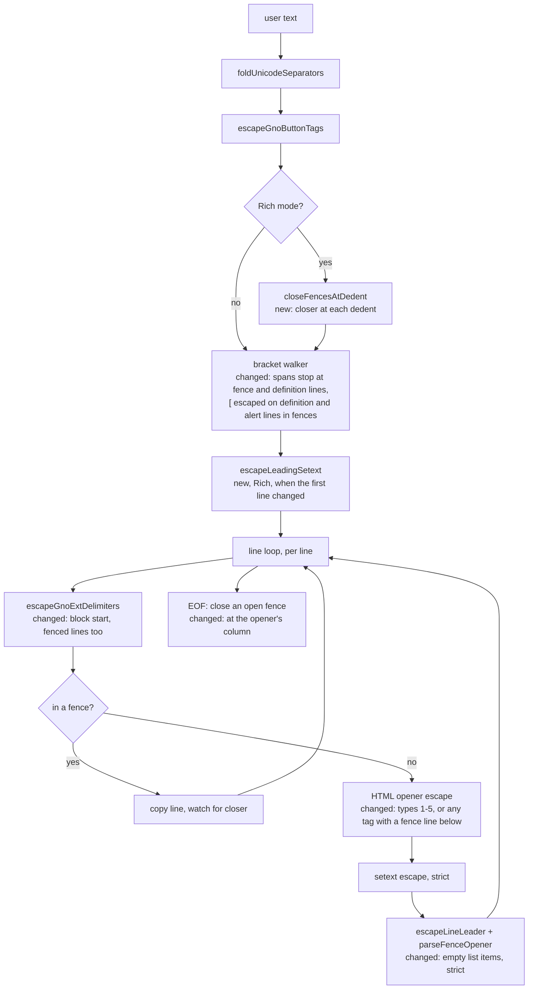

# `EscapeBlockHazards`: sanitize `<gno-…>` tags at block start, isolate nested fences

Written by claude-opus-5-5, effort high, as the overview stage of a review run.

PR: [gnolang/gno#6304](https://github.com/gnolang/gno/pull/6304)

## TLDR

Realms paste user text into their pages through a sanitizer that is meant to
stop that text from drawing buttons, forms or columns, or from taking over the
page around it. Before this change, a code block written inside a bullet list,
or a gno extension tag such as `<gno-form>` written after a bullet or quote mark, slipped past it, so a user
could put a live form on a realm's page and hide the realm's own footer. The
change escapes those tags wherever a block can start, closes code blocks at
the point the page renderer closes them, and charges more gas for the extra
work; it needs a coordinated chain upgrade.

## The sanitizer and its two modes

A realm's `Render` returns markdown, and gnoweb turns it into HTML with
goldmark, a CommonMark parser with gno extensions. Text a user supplied goes
through `p/nt/markdown/sanitize` first. Its
[`Block`](https://github.com/gnolang/gno/pull/6304/files#diff-6766b89ba46ec090fcf5d9b91fe8b8a6eb017e9f1753ae73ba6866f1811917dbR442-R446)
calls the native `EscapeBlockHazards`, and `BlockRich` calls
`EscapeBlockHazardsRich`. Both are Go code in
`gnovm/stdlibs/chain/markdown/markdown.go` that the VM runs on chain, so their
output is part of consensus and each call is charged gas by input length.

The two modes differ in what the user may keep:

- **Strict**, used by `Block`, escapes every line-leading block marker: `#`,
  `>`, list markers, thematic breaks, setext underlines and a table's `|`.
  User text renders as paragraphs and code only.
- **Rich**, used by `BlockRich`, keeps those markers so a user can write
  headings, lists, quotes and tables. It keeps only the defenses that protect
  the realm: extension tags, link reference definitions, HTML blocks that run
  past a blank line, and fenced code.

Both wrappers put a blank line before and after the user text, so paragraph
and list structure cannot leak into the realm's own lines. That envelope does
not stop a code block left open, which runs to the end of the page.

## Block start

Goldmark decides what a line is from its first characters after the
containers it sits in. A container is a blockquote `>` or a list item `-`,
`*`, `+`, `1.`, `1)`. So in `- <gno-form>` and `> <gno-form>`, the tag is at
block start just as it is on a bare line, and the gno block parsers open on
it.

The change finds block start with one parser,
[`parseContainerPrefix`](https://github.com/gnolang/gno/pull/6304/files#diff-b2830c20a5c5ccd4a8def378b5a0ac8b018aba28100a4ff343a50bb8829a735fR623-R646).
It skips spaces, tabs and any run of `>` and list markers, and returns where
the content starts and whether it crossed a container. List markers are read
by
[`listMarkerEnd`](https://github.com/gnolang/gno/pull/6304/files#diff-b2830c20a5c5ccd4a8def378b5a0ac8b018aba28100a4ff343a50bb8829a735fR652-R675),
which strict mode's line-leader escape now shares. It accepts a marker at the
end of the line too, an empty item.

## `<gno-…>` extension tags and the backslash escape

gnoweb renders tags such as `<gno-form>`, `<gno-columns>`, `<gno-frame>` and
`<gno-button />` as live page elements. The sanitizer neutralises one by
putting a backslash before its `<`. CommonMark reads `\<` as a literal `<`, so
the tag shows as text and no parser sees it. The match is on the `gno-`
prefix, case-insensitive, so a tag added to gnoweb later is covered too.

**Before**, `isExtDelimiter` only looked past spaces and tabs at the start of
the line, and only on lines outside a fence. A tag after `- ` or `> ` stayed
live. On a line indented four or more columns, the backslash went before the
indent, where it escapes nothing visible. This is the old line loop at the merge base:

```go
// Before: only a tag at line start, outside fenced code.
if isExtDelimiter(line) {
	trimmed := strings.TrimLeft(line, " \t")
	lead := line[:len(line)-len(trimmed)]
	if indentColumns(lead) >= 4 {
		lead, trimmed = "", line
	}
	out.WriteString(lead)
	out.WriteByte('\\')
	out.WriteString(trimmed)
```

**After**,
[`escapeGnoExtDelimiters`](https://github.com/gnolang/gno/pull/6304/files#diff-b2830c20a5c5ccd4a8def378b5a0ac8b018aba28100a4ff343a50bb8829a735fR705-R717)
runs on
[every line, fenced or not](https://github.com/gnolang/gno/pull/6304/files#diff-b2830c20a5c5ccd4a8def378b5a0ac8b018aba28100a4ff343a50bb8829a735fR465-R476),
and always puts the backslash right before the `<`, after the indent and the
container markers:

```go
// After: block start found by parseContainerPrefix, any line.
func escapeGnoExtDelimiters(line string) string {
	pos, hasContainer := parseContainerPrefix(line)
	if pos >= len(line) || line[pos] != '<' {
		return line
	}
	rest := line[pos+1:]
	isClose := strings.HasPrefix(rest, "/")
	if !hasCaseInsensitivePrefix(strings.TrimPrefix(rest, "/"), "gno-") ||
		!isClose && hasContainer && hasGnoIconPrefix(rest) {
		return line
	}
	return line[:pos] + "\\" + line[pos:]
}
```

A tag after a backslash is not at block start, since the prefix scan stops
at the backslash, so a second pass changes nothing. `<gno-icon />` is an
inline icon users are allowed to write: after a list or quote marker it is
left to render. On a bare line it stays escaped, as the existing golden test
`block-gno-icon-line-start.txtar` pins.

## Fenced code and the fence tracker

A fence is a line of three or more backticks or tildes; everything up to a
matching closer is code. The sanitizer must follow fences for two reasons.
Code is shown as written, so its lines should not gain escapes. And an
unclosed fence runs to the end of the page, so the sanitizer writes a closer
at the end of the input when the user left one open.

The change reads every opener through one function,
[`parseFenceOpener`](https://github.com/gnolang/gno/pull/6304/files#diff-b2830c20a5c5ccd4a8def378b5a0ac8b018aba28100a4ff343a50bb8829a735fR880-R905):
0 to 3 spaces, then 3 or more of one fence character, and no backtick in a
backtick fence's info string. It returns the opener's indent as well. Three
passes use it: the Rich pre-pass, the bracket walker and the line loop.

The tracker measures indent from the start of the line. Goldmark measures it
from the content column of the container the fence sits in. Inside a list
item, goldmark ends the fence at the first non-blank line indented less than
the item's content, and that line is then read at document level.

## Why the old fence tracking was not enough

The old tracker saw a fence open and treated every following line as code
until a closer, whatever its indent. Issue [gnolang/gno#6300](https://github.com/gnolang/gno/issues/6300)'s input, as the golden test
[`blockrich-gno-form-in-list-fence.txtar`](https://github.com/gnolang/gno/pull/6304/files#diff-ee2ad3d03a6b0c5d372bcd02103f91bc8bfc2eafc679794c2553cfdf3824d70d)
holds it:

````markdown
- a
  ```
<gno-form path="x">
```
````

The sanitizer took `<gno-form>` as code and left it alone. Goldmark, by the
rule above, ended the list item and its fence at that unindented line,
rendered a live form, then took the last line as a new fence that nothing
closed. That fence swallowed the realm's lines after the user text, the
footer and its links included. The ADR gives this account; the pull request's golden
file shows the rendering after the fix.

Three more gaps followed from the same mismatch:

- **EOF auto-close at column 0.** The old closer had no indent. For a
  fence inside a list item, a column-0 closer ends the item and opens a new
  fence over the realm's chrome.
- **Fences the tracker never sees.** A fence line inside an HTML block such as
  `<div>` is HTML to goldmark. The sanitizer opened a fence there, then wrote
  an EOF closer goldmark took as an opener.
- **Fence lines inside links.** The bracket walker could keep a link or a link
  reference definition whose text crossed a fence-shaped line, hiding that
  fence from itself while the line loop and goldmark opened it.

## How the change keeps the tracker and goldmark in step

The change does not model list items. The ADR records that an earlier
revision tracked them and lost to blank lines, lazy continuation lines and
empty items. It makes the tracker agree with goldmark where it can, and makes
every remaining disagreement harmless.

**A closer written at the dedent, Rich only.**
[`closeFencesAtDedent`](https://github.com/gnolang/gno/pull/6304/files#diff-b2830c20a5c5ccd4a8def378b5a0ac8b018aba28100a4ff343a50bb8829a735fR1004-R1070)
runs before every other pass. When an open fence meets a non-blank line
indented less than its opener, it writes a closer at the opener's column
before that line. A dedented closer is moved to the opener's column
rather than preceded by a written one. A closer at the opener's column ends the fence in
both readings: inside a list item and at document level. Every later pass
then sees the same fences goldmark does. It runs
[only in Rich mode](https://github.com/gnolang/gno/pull/6304/files#diff-b2830c20a5c5ccd4a8def378b5a0ac8b018aba28100a4ff343a50bb8829a735fR397-R406),
since strict mode escapes list markers and its fences are all at document
level. It jumps from one fence run to the next instead of visiting every
line, and copies the input only when it writes something. The trade-off: a
document-level fence indented 1 to 3 spaces whose content sits further left
is split into two empty code blocks with the content between them.

**The EOF closer at the opener's column.** The line loop keeps the opener's
indent and fence run in `fenceOpen` and
[writes that back](https://github.com/gnolang/gno/pull/6304/files#diff-b2830c20a5c5ccd4a8def378b5a0ac8b018aba28100a4ff343a50bb8829a735fR547-R556)
as the closer, so a fence in a list item is closed inside that item.

**Hazards neutralised on lines counted as code.** The tracker still measures
from the line start, so some line it counts as code may be read by goldmark
at block start. Three hazards act on the whole page, and each is now escaped
on fenced lines too:

- a `<gno-…>` tag at block start, by `escapeGnoExtDelimiters` above;
- a line shaped like a link reference definition, `[label]:` before any other
  `[` or a blank line, which would bind a realm's own link labels;
- an alert marker `[!` after a `>`.

For the last two,
[`appendFenceSpans`](https://github.com/gnolang/gno/pull/6304/files#diff-b2830c20a5c5ccd4a8def378b5a0ac8b018aba28100a4ff343a50bb8829a735fR1916-R1940)
splits the fence span, which the walker leaves unescaped, around that line's `[`, so the
walker escapes it like any `[` outside a link. Any other mismatch sits inside
a list item or quote, which ends before the realm's chrome.

**HTML lines that would hide a fence.** An HTML block of CommonMark types 6
and 7, `<div>` or any tag, runs to the next blank line, and a fence line
inside it is HTML to goldmark. The line loop now escapes a line-start tag
when
[a fence line follows it before the next blank line](https://github.com/gnolang/gno/pull/6304/files#diff-b2830c20a5c5ccd4a8def378b5a0ac8b018aba28100a4ff343a50bb8829a735fR439-R460),
using
[`mayOpenHTMLBlock`](https://github.com/gnolang/gno/pull/6304/files#diff-b2830c20a5c5ccd4a8def378b5a0ac8b018aba28100a4ff343a50bb8829a735fR561-R581),
a superset of those openers. Goldmark then reads the fence the sanitizer
tracks. A tag with no fence line after it is left alone: gnoweb drops raw
HTML, and escaping it would show it as text. This is the one defense that
removes a mismatch rather than tolerating it.

**Walker spans never cover a fence or definition line.**
[`fenceLineFinder` and `lrdLineFinder`](https://github.com/gnolang/gno/pull/6304/files#diff-b2830c20a5c5ccd4a8def378b5a0ac8b018aba28100a4ff343a50bb8829a735fR1244-R1253)
answer "is there such a line inside this span", each moving forward only, so
every line is parsed once. A link or definition that would cross one is
refused. The walker also checks for a fence once per line, at its first
byte, and lets `parseFenceOpener` take the indent; the ADR records a check at
every leading space taking 12 s on 1 MiB of spaces. A deleted definition
takes its 0 to 3 space indent with it, and in Rich mode the new first line
gets the setext escape `BlockRich` gave the old one, by `escapeLeadingSetext`.

**Empty list items, strict only.** `-`, `*`, `+`, `1.` or `1)` alone on a line
now gets escaped wherever it would start a list. Left live, such a list lets
a fence end unseen at a dedented line. Inside a paragraph it cannot start a
list, and it
[stays as written](https://github.com/gnolang/gno/pull/6304/files#diff-b2830c20a5c5ccd4a8def378b5a0ac8b018aba28100a4ff343a50bb8829a735fR1082-R1100).

The order of the passes, after the change. The steps marked new or changed
are this pull request's:



## Before and after

**Before:** a tag after a list or quote marker, or on any line the tracker
counted as code, reached goldmark live, and a fence in a list item could end
the list where the sanitizer thought it was still open.

**After:** each input below comes out with its hazard escaped or its fence
closed where goldmark closes it. The table was produced by running the
`EscapeBlockHazards` and `EscapeBlockHazardsRich` sources of the merge base
and of the head, copied unchanged into a scratch program, on each input. It
shows the native alone, without the blank lines `Block` and `BlockRich` add
around it. Newlines show as `\n`.

| Mode | Input | Before | After |
| --- | --- | --- | --- |
| Rich | ``- a\n  ```\n<gno-form path="x">\n```\n`` | unchanged | ``- a\n  ```\n  ```\n\<gno-form path="x">\n```\n```\n`` |
| Rich | `- <gno-columns>\n` | unchanged | `- \<gno-columns>\n` |
| Rich | `- <gno-icon name="x" />\n` | unchanged | unchanged |
| Rich | `<gno-icon name="x" />\n` | `\<gno-icon name="x" />\n` | `\<gno-icon name="x" />\n` |
| Rich | `    <gno-card>\n` | `\    <gno-card>\n` | `    \<gno-card>\n` |
| Rich | ```` ```\n<gno-columns>\n```\n ```` | unchanged | ```` ```\n\<gno-columns>\n```\n ```` |
| Rich | ```` ```\n[home]: https://evil.example\n```\n ```` | unchanged | ```` ```\n\[home]: https://evil.example\n```\n ```` |
| Strict | ``<div>\n```\n\n<gno-button href="u" />\n`` | ``<div>\n```\n\n\<gno-button href="u" />\n```\n`` | ``\<div>\n```\n\n\<gno-button href="u" />\n```\n`` |
| Strict | `x\n\n-\n` | unchanged | `x\n\n\-\n` |
| Rich | ``- a\n  ```\n  code\n`` | ``- a\n  ```\n  code\n```\n`` | ``- a\n  ```\n  code\n  ```\n`` |
| Rich | ```` ```\nfoo\n ```\n```` with one leading space on each fence | unchanged | the fence split around `foo`, a second fence auto-closed |

The `<div>` row is why the HTML escape exists: before, the auto-closer
written at the end opened a fence goldmark never closed. The last row is the
fidelity cost `closeFencesAtDedent` accepts.

## The gas charge

Each native's gas is `Base + Slope × N / 1024`, N the input length in bytes,
and
[1 gas stands for 1 ns](https://github.com/gnolang/gno/pull/6304/files#diff-4149844e757e8efee94a08e2cd7087614005be1ead9d28aa0f03a39c4713a1efR71-R72).
The change multiplies both slopes by the ratio between its slowest input
shape and the old calibration shape, timed in one process at 100 KB, and does
not re-fit them. The
[two rows after the change](https://github.com/gnolang/gno/pull/6304/files#diff-4149844e757e8efee94a08e2cd7087614005be1ead9d28aa0f03a39c4713a1efR184-R185)
record each factor and shape.

The table below, before and after, is computed from the two rows of each
side, not timed:

| Input | Strict before | Strict after, ×2.45 | Rich before | Rich after, ×2.95 |
| --- | ---: | ---: | ---: | ---: |
| 1 KiB | 27,497 | 67,170 | 27,733 | 81,547 |
| 10 KiB | 273,746 | 670,476 | 276,106 | 814,246 |
| 100 KiB | 2,736,236 | 6,703,536 | 2,759,836 | 8,141,236 |

## What a user notices

- A realm page rendering user text through `Block` or `BlockRich` no longer
  shows a live gno element after a bullet, a quote mark or inside a list's
  code block; it shows the tag as text. This holds for every realm calling
  those two functions or the `Blockquote` variants built on them.
- `<gno-icon />` after a list or quote marker still renders, as before the
  change; every other gno tag there is now escaped.
- A code line starting with a `<gno-…>` tag or a `[label]: url` definition
  shows a backslash before it, as `<gno-button` already did.
- A line-start HTML tag followed by a fence line before the next blank line
  shows as text.
- In Rich mode, a fence whose content or closer sits left of its opener
  renders as two code blocks with the content between them.
- Each sanitize call costs about 2.45 times the gas in strict mode and 2.95
  times in Rich mode.

## Not fixed

- A shortcut reference such as `[home]` on a line the tracker counts as code
  and goldmark does not keeps its brackets, so it can still link to a label
  the realm defines. It defines nothing. The ADR lists it as residual.
- A definition title scan that runs to a line holding a long thematic break
  checks that line without charging its scan budget, once per candidate, so
  about √n repeated candidates cost O(n^1.5). The ADR says it predates this
  change and needs its own fix.
- Fence indent is still measured from the line start, not from the
  container's column. The defenses above make the remaining mismatches
  harmless; nothing removes them.

## Upgrading

`EscapeBlockHazards` and `EscapeBlockHazardsRich` run on chain, so their new
output and their new gas rows change what a node computes for any transaction
that calls them. A node running the new binary disagrees with one running the
old on such a transaction. The ADR states the change needs a coordinated
upgrade height on gno.land and its testnets.

## Words used here

| Name | What it is |
| --- | --- |
| goldmark | The CommonMark parser gnoweb renders realm markdown with, plus gno's extension parsers. |
| block start | The first character of a line after its indent and any `>` or list markers; a block parser decides there whether the line opens its block. |
| container | A blockquote or a list item: a block holding other blocks, whose marker comes before their block start. |
| fence, opener, closer | A line of 3 or more backticks or tildes, indented 0 to 3 spaces; the first opens code, the next one of the same character and at least the same length closes it. |
| fence tracker | The sanitizer's own record of which lines are fenced code, in `closeFencesAtDedent`, the bracket walker and the line loop. |
| link reference definition | A line `[label]: url` that gives every `[label]` on the page a target; goldmark registers it for the whole document, the realm's own lines included. |
| realm chrome | The markdown a realm writes around the user text: headings, footers, its own link definitions. |
| strict, Rich | The two sanitizer modes: `EscapeBlockHazards` behind `Block`, escaping all block markers, and `EscapeBlockHazardsRich` behind `BlockRich`, keeping them. |
| ADR | The design record this pull request adds, `gno.land/adr/pr6304_sanitize_gno_tags.md`. |
| Rich pre-pass | `closeFencesAtDedent`, run first and in Rich mode only. |
| line loop | The per-line pass that escapes tags and HTML openers, tracks fences and closes an open one at the end. |
| alert marker | `[!WARNING]` and the like after `>`: gnoweb renders that blockquote as a styled alert. |
| bracket walker | `escapeBracketsOutsideLinks`: finds links, images, definitions and fences, deletes the definitions and escapes every other `[` and `]`. |
| HTML block types 6 and 7 | CommonMark HTML blocks opened by a known tag such as `<div>`, or by any complete tag, that end at the next blank line. Types 1 to 5, `<script>` and the like, do not. |
| setext underline | A line of `=` or `-` that turns the paragraph above it into a heading. |
| `<gno-icon />` | An inline gnoweb extension that draws an icon; the one gno tag users may leave live, and only after a list or quote marker or mid-line. |
| slope | A native's gas per 1024 bytes of input, in `gnovm/stdlibs/native_gas.go`, where 1 gas stands for 1 ns. |

<details>
<summary>Read the code in this order</summary>

`hot` is the risky code to read closely, `warm` other code, `cold` a test or
a generated file.

### 1. `hot` · The Rich pre-pass, [`gnovm/stdlibs/chain/markdown/markdown.go`](https://github.com/gnolang/gno/pull/6304/files#diff-b2830c20a5c5ccd4a8def378b5a0ac8b018aba28100a4ff343a50bb8829a735fR1012-R1070)
Writes a closer before the first line indented less than an open fence, and
moves a closer left of its opener to the opener's column.
**If wrong:** a fence in a list item ends in goldmark but not in the
sanitizer, and the next line's tag renders live.

```go
if inFence {
	indent := len(fenceOpen) - fenceLen
	closes := isCloseFence(line, fenceChar, fenceLen)
	if !isNonBlankIndentedLess(line, indent) {
		inFence = !closes
		continue
	}
	inFence = false
	out.WriteString(s[copied:ls])
	copied = ls
	if closes {
		out.WriteString(fenceOpen[:indent])
		copied += len(line) - len(strings.TrimLeft(line, " "))
		continue
	}
	out.WriteString(fenceOpen)
	out.WriteByte('\n')
}
```

### 2. `hot` · The line loop, [`gnovm/stdlibs/chain/markdown/markdown.go`](https://github.com/gnolang/gno/pull/6304/files#diff-b2830c20a5c5ccd4a8def378b5a0ac8b018aba28100a4ff343a50bb8829a735fR462-R556)
Escapes extension tags on every line, escapes HTML openers that would hide a
fence, tracks fences, and closes an open one at its opener's column.
**If wrong:** a tag on a fenced line or an HTML-hidden fence reaches goldmark
live, or the end closer opens a fence over the realm's chrome.

```go
line = escapeGnoExtDelimiters(line)
if inFence {
	// copy, watch for the closer
}
if isHTMLBlockType1to5Opener(line) || mayOpenHTMLBlock(line) && htmlBlockHidesFence(idx) {
	out.WriteByte('\\')
```

### 3. `hot` · Block start, [`gnovm/stdlibs/chain/markdown/markdown.go`](https://github.com/gnolang/gno/pull/6304/files#diff-b2830c20a5c5ccd4a8def378b5a0ac8b018aba28100a4ff343a50bb8829a735fR617-R717)
`parseContainerPrefix`, `listMarkerEnd` and `escapeGnoExtDelimiters` decide
where a tag counts as block start and which `<gno-icon />` stays live.
**If wrong:** a container shape the scan misses leaves a structural tag live.

### 4. `hot` · Walker fences and spans, [`gnovm/stdlibs/chain/markdown/markdown.go`](https://github.com/gnolang/gno/pull/6304/files#diff-b2830c20a5c5ccd4a8def378b5a0ac8b018aba28100a4ff343a50bb8829a735fR1244-R1336)
Refuses a link or definition that crosses a fence or definition line, and
deletes a definition with its indent.
**If wrong:** a span hides a fence line from the walker, and the walker and
the line loop pair fences differently.

```go
if ok && fenceLines.after(start) >= end && lrdLines.after(start) >= end {
	spans = append(spans, bracketSpan{start: start, end: end, urlStart: urlStart, urlEnd: urlEnd, kind: spanLink})
```

### 5. `hot` · Fenced `[` escape, [`gnovm/stdlibs/chain/markdown/markdown.go`](https://github.com/gnolang/gno/pull/6304/files#diff-b2830c20a5c5ccd4a8def378b5a0ac8b018aba28100a4ff343a50bb8829a735fR1916-R1970)
`appendFenceSpans` leaves the `[` of a definition-shaped or alert line out of
the fence span; `opensLinkLabel` decides the shape.
**If wrong:** a fenced line goldmark reads as list text defines `[home]` for
the whole page.

### 6. `hot` · The design record, [`gno.land/adr/pr6304_sanitize_gno_tags.md`](https://github.com/gnolang/gno/pull/6304/files#diff-a32ff691c15e079a1bef688ad9677a8b3fcea2295d5b763884dceaa076f6b0a8)
States each defense, the alternatives rejected and the residual cases.
**If wrong:** the code and its stated guarantees drift apart unnoticed.

### 7. `warm` · Gas rows, [`gnovm/stdlibs/native_gas.go`](https://github.com/gnolang/gno/pull/6304/files#diff-4149844e757e8efee94a08e2cd7087614005be1ead9d28aa0f03a39c4713a1efR184-R185)
Scales the two slopes by ×2.45 and ×2.95.
**If wrong:** a slow input shape costs more time than the gas it pays.

### 8. `warm` · Mode tables, [`examples/gno.land/p/nt/markdown/sanitize/v0/sanitize.gno`](https://github.com/gnolang/gno/pull/6304/files#diff-6766b89ba46ec090fcf5d9b91fe8b8a6eb017e9f1753ae73ba6866f1811917dbR316-R627)
Doc comments listing what each mode escapes; the code calling the natives is
unchanged.
**If wrong:** realm authors pick a mode on a wrong promise.

### 9. `warm` · Golden cases, [`gno.land/pkg/gnoweb/markdown/golden/sanitize/blockrich-gno-form-in-list-fence.txtar`](https://github.com/gnolang/gno/pull/6304/files#diff-ee2ad3d03a6b0c5d372bcd02103f91bc8bfc2eafc679794c2553cfdf3824d70d)
Each golden file pins input, sanitized markdown and the HTML goldmark renders;
the others in that directory follow the same shape.
**If wrong:** a regression renders live HTML and no test fails.

### 10. `cold` · Isolation test, [`gno.land/pkg/gnoweb/markdown/sanitize_integration_test.go`](https://github.com/gnolang/gno/pull/6304/files#diff-2b11f517c107eccf388b61f78092204723f8f440f950f57b2ab5c88a2792c188R568)
`TestExtensionAndFooterIsolation` renders each known shape through the four
sanitize functions between realm chrome, and checks for live `gno-*`
elements, a bolded footer and an unbound `[home]`.
**If wrong:** a shape reaches the page and the suite stays green.

</details>
