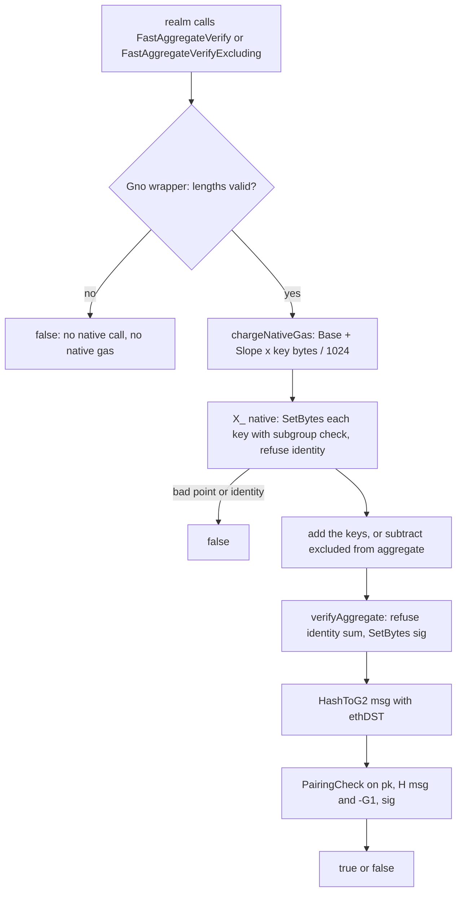

# crypto/bls12381: `FastAggregateVerify` and `FastAggregateVerifyExcluding`
Written by claude-opus-5-5, review overview stage, effort high.
PR: [gnolang/gno#6375](https://github.com/gnolang/gno/pull/6375), its BLS
natives only.

## TLDR

To follow Ethereum from gno.land, a contract must check one signature that up
to 512 Ethereum validators made together, on every update it receives. Doing
that maths in interpreted Gno would cost far more gas than a block holds. The
change adds a standard library, `crypto/bls12381`, that runs the check in Go
for a fixed price plus a price per key, with two duties left to the calling
contract: trusting the keys it passes, and proving who did not sign.

## BLS signatures and the pairing check

A BLS key pair is a secret number `sk` and a public key `pk = sk·G1`, a point
of the curve group G1. Signing a message `m` first maps it to a point `H(m)`
of a second group, G2, then multiplies: `sig = sk·H(m)`. A pairing `e` takes
one point of each group and has one property that matters here: a factor moves
freely between its two sides, so `e(sk·G1, H(m)) == e(G1, sk·H(m))`. A
signature is valid when

$$e(pk,\ H(m)) = e(G1,\ sig)$$

The verifier holds `pk`, `m` and `sig` and never needs `sk`.
[`verifyAggregate`](https://github.com/gnolang/gno/pull/6375/files#diff-302d77199f3d9fa66beab16da6bf3bb2cce9b8b6f4a9b72be34aafc7bfe4a7a2R115-R132)
writes the same equation as one product equal to 1,
`e(pk, H(m)) · e(-G1, sig) == 1`, and hands both pairs to gnark's
`PairingCheck`
[at once](https://github.com/gnolang/gno/pull/6375/files#diff-302d77199f3d9fa66beab16da6bf3bb2cce9b8b6f4a9b72be34aafc7bfe4a7a2R127-R131).
A product lets gnark share its most expensive step, the final
exponentiation, between the two pairings instead of running it twice. The
negated generator `-G1` it needs is
[`negG1Gen`](https://github.com/gnolang/gno/pull/6375/files#diff-302d77199f3d9fa66beab16da6bf3bb2cce9b8b6f4a9b72be34aafc7bfe4a7a2R16-R23),
computed once when the package loads.

The curve is BLS12-381, the one Ethereum's consensus layer uses. A public key
travels as 48 bytes and a signature as 96, both in compressed form, which
stores one coordinate and a flag saying which of the two possible points it
names. The library doing the arithmetic is
[`gnark-crypto` v0.20.1](https://github.com/gnolang/gno/blob/0ee53fefc/go.mod#L13),
already a dependency of `crypto/bn254` and `crypto/cometbls`, as the
[decision record](https://github.com/gnolang/gno/pull/6375/files#diff-c60149df089ac1151cb69d257fcba494e0f39a6b13112ae47e02a036e74bc1df)
notes.

## Why signatures add up

Points of each group add, and the pairing turns that addition into
multiplication on its output. When every member of a committee signs the same
message, the sum of their signatures verifies against the sum of their keys:

$$e(pk_1 + pk_2 + \dots + pk_n,\ H(m)) = e(G1,\ sig_1 + sig_2 + \dots + sig_n)$$

One pairing check then covers the whole committee, however large it is. The
only work that grows with the committee is decoding each key and adding it to
a running sum, which is what
[the loop in `X_fastAggregateVerify`](https://github.com/gnolang/gno/pull/6375/files#diff-302d77199f3d9fa66beab16da6bf3bb2cce9b8b6f4a9b72be34aafc7bfe4a7a2R48-R58)
does, 48 bytes at a time. That shape, one signature over one message by many
keys, is what the IETF BLS draft calls `FastAggregateVerify`, and it is the
only shape the package offers.

## Decoding a key or a signature

Every key and signature reaches the native as bytes, and gnark's `SetBytes`
turns them into a point. For a G1 key it
[reads the three flag bits of the first byte](https://github.com/consensys/gnark-crypto/blob/v0.20.1/ecc/bls12-381/marshal.go#L901-L905),
then refuses a coordinate at or above the field's prime, a coordinate with no
point on the curve above it, and
[a point outside the prime-order subgroup](https://github.com/consensys/gnark-crypto/blob/v0.20.1/ecc/bls12-381/marshal.go#L987-L990).
The last refusal matters because the curve holds extra points the pairing's
security argument does not cover. A 48-byte slice whose flag claims the
uncompressed form fails as
[too short](https://github.com/consensys/gnark-crypto/blob/v0.20.1/ecc/bls12-381/marshal.go#L908-L913),
since that form needs 96 bytes. The natives rely on gnark for all of these and
add one check of their own, the identity check below.

## The identity point

Every group has a point that behaves like zero: adding it changes nothing.
gnark
[decodes it from a flag](https://github.com/consensys/gnark-crypto/blob/v0.20.1/ecc/bls12-381/marshal.go#L916-L922)
without error. If the key handed to the pairing were the identity, both sides
of the equation would equal 1 for the identity signature, so that signature
would pass for any message. The natives therefore refuse the identity three
times:

| Where, after this change | What is refused |
| --- | --- |
| [`X_fastAggregateVerify`](https://github.com/gnolang/gno/pull/6375/files#diff-302d77199f3d9fa66beab16da6bf3bb2cce9b8b6f4a9b72be34aafc7bfe4a7a2R54-R56) | any single key that is the identity |
| [`X_fastAggregateVerifyExcluding`](https://github.com/gnolang/gno/pull/6375/files#diff-302d77199f3d9fa66beab16da6bf3bb2cce9b8b6f4a9b72be34aafc7bfe4a7a2R86-R93) | an aggregate or an excluded key that is the identity |
| [`verifyAggregate`](https://github.com/gnolang/gno/pull/6375/files#diff-302d77199f3d9fa66beab16da6bf3bb2cce9b8b6f4a9b72be34aafc7bfe4a7a2R116-R118) | the sum of the keys, when it lands on the identity |

The third row exists because two valid keys can still sum to zero: `pk` and
`-pk` are both ordinary points, and the
[`identity aggregate` test](https://github.com/gnolang/gno/pull/6375/files#diff-f690a634a9579f961a94cc356cc5748132e62ccca6052a66dca34077a174127aR84-R99)
builds exactly that pair. The signature itself is never refused for being the
identity. With a key that is not the identity the equation reads
`e(pk, H(m)) == 1`, which does not hold, and the
[Gno test](https://github.com/gnolang/gno/pull/6375/files#diff-28c5b69d45f33a7814dabcf5ffb04e2f78b55a82e1023e4655b62db42050453fR61-R72)
checks that the identity signature fails under a real committee.

## Proof of possession, the caller's duty

Adding keys opens a rogue-key attack. An attacker who sees the honest keys
publishes `pk_rogue = pk_a - pk_1 - … - pk_n`, a key whose secret they do not
know. The committee's sum is then `pk_a`, a key whose secret they do know, so
the attacker alone signs for the whole committee. The ciphersuite Ethereum
uses, `BLS_SIG_BLS12381G2_XMD:SHA-256_SSWU_RO_POP_`, closes this by requiring a
proof of possession: a signature by each key over that key itself, which
nobody can produce for `pk_rogue`.

The package checks no such proof. Its
[package doc](https://github.com/gnolang/gno/pull/6375/files#diff-3a317d926a5baee5f67f9f2cc9bd3a5c179e8de3a893a508efcd7084e9b7db87R7-R17)
puts the duty on the caller: every key passed in, and every member key behind
an aggregate, must have had its possession proven, or must come from a source
that guarantees it. Ethereum sync committee keys qualify for a related
reason. Each validator signed a deposit message bound to its own key, and the
beacon chain verified that signature before admitting the key. Keys a relayer
supplies do not qualify.

## Subtracting the non-signers

An Ethereum sync committee commits to its aggregate key, the sum of all 512
member keys, beside the list of keys. Most members sign each update, the
[decision record](https://github.com/gnolang/gno/pull/6375/files#diff-c60149df089ac1151cb69d257fcba494e0f39a6b13112ae47e02a036e74bc1dfR49-R58)
citing participation above 95%, so the signers' sum is cheaper to reach by
subtraction than by addition:

$$pk_{signers} = aggregate - (e_1 + e_2 + \dots + e_k)$$

[`X_fastAggregateVerifyExcluding`](https://github.com/gnolang/gno/pull/6375/files#diff-302d77199f3d9fa66beab16da6bf3bb2cce9b8b6f4a9b72be34aafc7bfe4a7a2R81-R103)
decodes `aggregate`, then negates and adds each excluded key `e_i`, and hands
the result to the same `verifyAggregate`. At 95% participation `k` is about
25 keys instead of about 487.

The native cannot tell whether the excluded keys belong to the committee.
[Its Gno doc](https://github.com/gnolang/gno/pull/6375/files#diff-3a317d926a5baee5f67f9f2cc9bd3a5c179e8de3a893a508efcd7084e9b7db87R50-R58)
spells out the attack: an attacker holding `pk_a` passes `excluded` as two
valid points, `e1` and `aggregate - pk_a - e1`, so `aggregate` minus
`excluded` is exactly `pk_a`. The caller must prove each excluded key's
membership, for example with a Merkle branch from the key to the committee's
pubkeys root. With that proof in hand, a light client never stores the
committee's 512 keys: each update carries only the non-signers' keys and
their branches.

## Hashing the message to the curve

The message is mapped to G2 by
[`bls.HashToG2(msg, ethDST)`](https://github.com/gnolang/gno/pull/6375/files#diff-302d77199f3d9fa66beab16da6bf3bb2cce9b8b6f4a9b72be34aafc7bfe4a7a2R123),
gnark's RFC 9380 hash-to-curve. It
[stretches the message with SHA-256](https://github.com/consensys/gnark-crypto/blob/v0.20.1/field/hash/hashutils.go#L11-L13)
into
[four field elements](https://github.com/consensys/gnark-crypto/blob/v0.20.1/ecc/bls12-381/hash_to_g2.go#L52-L65),
maps two pairs of them onto the curve, and adds the results. The domain
separation tag
[`ethDST`](https://github.com/gnolang/gno/pull/6375/files#diff-302d77199f3d9fa66beab16da6bf3bb2cce9b8b6f4a9b72be34aafc7bfe4a7a2R14)
is mixed into the hash, so a signature made under another protocol's tag maps
to a different point and does not verify here. SHA-256 reads every byte of
the message, so this step takes time in proportion to the message's length.

## How a native call is priced

A native's gas comes from its row in the stdlib table. The VM charges it in
[`chargeNativeGas`](https://github.com/gnolang/gno/blob/0ee53fefc/gnovm/pkg/gnolang/native_gas.go#L282-L289),
before the Go function runs:

$$gas = Base + \left\lfloor \frac{Slope \cdot N}{1024} \right\rfloor$$

`N` is the size of one argument, picked by the row's `SlopeIdx`; with
`SlopeKind: SizeLenBytes` it is that argument's length in bytes. The call site
in
[`doOpCallNativeBody`](https://github.com/gnolang/gno/blob/0ee53fefc/gnovm/pkg/gnolang/op_call.go#L542-L549)
charges first and runs the native second. A row may carry a second slope on
another argument; neither BLS row uses one.

The change adds two rows to
[`native_gas.go`](https://github.com/gnolang/gno/pull/6375/files#diff-4149844e757e8efee94a08e2cd7087614005be1ead9d28aa0f03a39c4713a1efR193-R201):

| Row, after this change | `Base` | `Slope` | Slope prices |
| --- | --- | --- | --- |
| [`fastAggregateVerify`](https://github.com/gnolang/gno/pull/6375/files#diff-4149844e757e8efee94a08e2cd7087614005be1ead9d28aa0f03a39c4713a1efR196) | 2,024,000 | 1,962,000 | `pubkeys`, argument 0 |
| [`fastAggregateVerifyExcluding`](https://github.com/gnolang/gno/pull/6375/files#diff-4149844e757e8efee94a08e2cd7087614005be1ead9d28aa0f03a39c4713a1efR201) | 2,116,000 | 1,962,000 | `excluded`, argument 1 |

The `Excluding` base adds roughly one key's price for decoding `aggregate`.
Both rows are marked draft: the
[comment above them](https://github.com/gnolang/gno/pull/6375/files#diff-4149844e757e8efee94a08e2cd7087614005be1ead9d28aa0f03a39c4713a1efR193-R195)
says they come from an Apple M4 Pro scaled by 2.3 toward the Xeon Silver 4114
the neighbouring IBC rows were measured on, and that they are regenerated
with the rest of the table.

The charge each row yields, after this change, for committee sizes a light
client meets. The figures come from a script mirroring `chargeNativeGas`
lines 282 to 289, integer division included, run against the two rows; they
were not read off a running chain.

| Call, after this change | Keys priced | Bytes priced | Gas charged |
| --- | --- | --- | --- |
| `FastAggregateVerify` | 1 | 48 | 2,115,968 |
| `FastAggregateVerify` | 16 | 768 | 3,495,500 |
| `FastAggregateVerify` | 128 | 6,144 | 13,796,000 |
| `FastAggregateVerify` | 512 | 24,576 | 49,112,000 |
| `FastAggregateVerifyExcluding` | 0 excluded | 0 | 2,116,000 |
| `FastAggregateVerifyExcluding` | 2 excluded | 96 | 2,299,937 |
| `FastAggregateVerifyExcluding` | 25 excluded | 1,200 | 4,415,218 |
| `FastAggregateVerifyExcluding` | 51 excluded | 2,448 | 6,806,406 |

Each key adds about 91,969 gas, 48 bytes at 1,962,000 per 1024.

## The wrapper checks lengths first

Each exported Gno function checks the lengths before it calls its native:
[`FastAggregateVerify`](https://github.com/gnolang/gno/pull/6375/files#diff-3a317d926a5baee5f67f9f2cc9bd3a5c179e8de3a893a508efcd7084e9b7db87R37-R39)
wants `pubkeys` non-empty and a multiple of 48, and `sig` exactly 96;
[`FastAggregateVerifyExcluding`](https://github.com/gnolang/gno/pull/6375/files#diff-3a317d926a5baee5f67f9f2cc9bd3a5c179e8de3a893a508efcd7084e9b7db87R65-R67)
wants `aggregate` exactly 48, `excluded` a multiple of 48, possibly empty, and
`sig` exactly 96. A malformed call returns `false` in interpreted Gno, so its
bytes are never copied into Go and the native row is never charged. The rule
behind it is
[`native_input_bounds.md`](https://github.com/gnolang/gno/blob/0ee53fefc/gnovm/adr/native_input_bounds.md?plain=1#L42-L43):
every native argument of variable length is either bounded before the copy or
priced per byte. The Go natives repeat the same checks, so a direct Go caller
gets the same answers.

## Stdlib sources are genesis state

A chain's genesis commits every stdlib's source files, so a new stdlib changes
the genesis state and the app hash computed from it. The
[decision record](https://github.com/gnolang/gno/pull/6375/files#diff-c60149df089ac1151cb69d257fcba494e0f39a6b13112ae47e02a036e74bc1dfR74-R75)
names the pinned hash this moves,
[`expectedCrossrealm38Hash`](https://github.com/gnolang/gno/blob/0ee53fefc/gno.land/pkg/sdk/vm/apphash_crossrealm38_test.go#L240).
The package's `_test.gno` file is part of that state too, as every stdlib's
test files already are.

## What the feature is

A realm imports `crypto/bls12381` and asks one question: did this group of
keys sign this message? It gets `true` or `false`, never an error, for a gas
price that grows with the number of keys it hands over. The intended caller is
an Ethereum light client written in Gno, which checks each sync committee
update, the beacon block header the committee signed, before trusting
anything proven against that header.

## How it works, in 6 steps

The example, after this change, is the four-member committee of the
[Gno test](https://github.com/gnolang/gno/pull/6375/files#diff-28c5b69d45f33a7814dabcf5ffb04e2f78b55a82e1023e4655b62db42050453fR74-R83),
whose second and fourth members did not sign.

1. The realm calls `FastAggregateVerifyExcluding(aggregate, excluded, msg,
   sig)` with `aggregate` the 48-byte sum of the four keys, `excluded` 96
   bytes holding the second and fourth members' keys, and `sig` the 96-byte
   signature by the first and third.
2. The Gno wrapper checks the lengths: 48, 96 is a multiple of 48, and 96.
   All pass, so it calls the native `fastAggregateVerifyExcluding`.
3. `chargeNativeGas` charges 2,116,000 + 1,962,000 × 96 / 1024, which is
   2,299,937 gas, before any Go code runs.
4. `X_fastAggregateVerifyExcluding` decodes `aggregate` and both excluded
   keys, each with gnark's subgroup check, refuses any identity, and computes
   `aggregate - e2 - e4`, which is `pk1 + pk3`.
5. `verifyAggregate` refuses that sum if it is the identity, decodes `sig`,
   hashes `msg` to G2 under `ethDST`, and runs `PairingCheck` on the pairs
   `(pk1 + pk3, H(msg))` and `(-G1, sig)`.
6. The product equals 1, so the realm gets `true`. Changing one byte of
   `msg`, or dropping a key from `excluded`, gives `false`.

The call path after this change, for either function:



## The parts, at a glance

Every part below exists after this change; `native_gas.go` and
`generated.go` existed before it and gain BLS rows.

| Part | File | Job |
| --- | --- | --- |
| Gno API | [`bls12381.gno`](https://github.com/gnolang/gno/pull/6375/files#diff-3a317d926a5baee5f67f9f2cc9bd3a5c179e8de3a893a508efcd7084e9b7db87R1-R73) | exported functions, length checks, the caller's duties in the doc |
| Go natives | [`bls12381.go`](https://github.com/gnolang/gno/pull/6375/files#diff-302d77199f3d9fa66beab16da6bf3bb2cce9b8b6f4a9b72be34aafc7bfe4a7a2R1-R132) | decode, sum or subtract keys, run the pairing check |
| Bindings | [`generated.go`](https://github.com/gnolang/gno/pull/6375/files#diff-acb647ed315342274a44b41a24f068d78f057496180c5b0abec17108327f17cbR1400-R1489) | generated glue copying the Gno byte slices into Go and the `bool` back |
| Gas rows | [`native_gas.go`](https://github.com/gnolang/gno/pull/6375/files#diff-4149844e757e8efee94a08e2cd7087614005be1ead9d28aa0f03a39c4713a1efR193-R201) | base and per-byte price of each native |
| Module | [`gnomod.toml`](https://github.com/gnolang/gno/blob/0ee53fefc/gnovm/stdlibs/crypto/bls12381/gnomod.toml) | declares the stdlib package |
| Go tests | [`bls12381_test.go`](https://github.com/gnolang/gno/pull/6375/files#diff-f690a634a9579f961a94cc356cc5748132e62ccca6052a66dca34077a174127a) | sign with gnark, check acceptance and each refusal, benchmarks |
| Gno tests | [`bls12381_test.gno`](https://github.com/gnolang/gno/pull/6375/files#diff-28c5b69d45f33a7814dabcf5ffb04e2f78b55a82e1023e4655b62db42050453f) | fixed vectors through the Gno API |
| Decision record | [`pr6375_bls12381_native.md`](https://github.com/gnolang/gno/pull/6375/files#diff-c60149df089ac1151cb69d257fcba494e0f39a6b13112ae47e02a036e74bc1df) | why natives, the duties, the gas fit, the alternatives |

## What a user notices

- A realm author can import `crypto/bls12381`, on every chain whose genesis
  carries this release.
- A transaction calling either function pays the row's charge, which grows
  with the number of key bytes passed, whatever the message's length.
- A chain started from a regenerated genesis gets a different app hash, since
  the stdlib's files are part of genesis state.

## Not fixed

- Proof of possession: no `PopVerify` exists here, and nothing in the package
  checks it. The calling realm, or the source of its keys, carries it.
- Membership of `excluded`: the native cannot check it. The calling realm
  checks it, with a Merkle branch per key.
- Signatures over different messages, the IETF draft's `AggregateVerify`: not
  offered. Nothing in the package reaches that case.
- Final gas figures: the rows are draft fits from a scaled laptop measurement.
  The regeneration of the whole table on the reference machine reaches them.

## Upgrading

The stdlib's source files join genesis state, so the app hash moves. An
existing chain cannot add the package with a rolling upgrade: nodes on either
side of it compute different genesis state. The pull request plans the bridge
on a fresh chain whose genesis carries this release.

## Words used here

| Name | What it is |
| --- | --- |
| `FastAggregateVerify` | Gno function: `true` when `sig` is a valid signature of `msg` by the sum of every key in `pubkeys`, at least one 48-byte key. |
| `FastAggregateVerifyExcluding` | Gno function: `true` when `sig` verifies against `aggregate` minus every key in `excluded`, zero or more 48-byte keys. |
| `X_fastAggregateVerify`, `X_fastAggregateVerifyExcluding` | The Go natives the Gno functions call after their length checks. |
| `verifyAggregate` | Go helper both natives end in: refuses an identity key, decodes `sig`, hashes `msg`, runs `PairingCheck`. |
| `PairingCheck` | gnark function: `true` when the product of the pairings of its point pairs equals 1. |
| `HashToG2` | gnark function mapping a message and a tag to a G2 point, per RFC 9380. |
| `SetBytes` | gnark decoder: fails on a bad flag, a non-canonical coordinate, a point off the curve or outside the prime-order subgroup. |
| `ethDST` | The domain separation tag `BLS_SIG_BLS12381G2_XMD:SHA-256_SSWU_RO_POP_`, mixed into every message hash. |
| `negG1Gen` | The G1 generator negated, computed once at package `init()`. |
| identity | The group's zero point: adding it changes nothing, and gnark decodes it without error. |
| proof of possession | A signature by a key over that key itself, proving its holder knows the secret. |
| `PubKeySize`, `SignatureSize` | 48 and 96, the byte lengths of a compressed G1 key and a compressed G2 signature. |
| `Base`, `Slope` | Gas row fields: a fixed charge, and a charge per 1024 units of the argument `SlopeIdx` picks. |
| `SlopeIdx` | Position of the argument the slope prices, counted from 0; -1 for none. |
| `SizeLenBytes` | Slope kind measuring the argument's length in bytes. |
| `chargeNativeGas` | VM function charging a native's row before the native runs. |

<details><summary>Read the code in this order</summary>

`hot` is the risky code to read closely, `warm` other code, `cold` a test or a
generated file. Every stop shows the code after this change.

### 1. `warm` · The Gno API and its guards, [`gnovm/stdlibs/crypto/bls12381/bls12381.gno`](https://github.com/gnolang/gno/pull/6375/files#diff-3a317d926a5baee5f67f9f2cc9bd3a5c179e8de3a893a508efcd7084e9b7db87R63-R69)
Decides what a realm may pass and which duties stay with the caller.
**If wrong:** a realm aggregates unproven keys or unchecked excluded keys and
accepts an update the committee never signed.
```go
func FastAggregateVerifyExcluding(aggregate, excluded, msg, sig []byte) bool {
	// Reject wrong lengths before the native call; see FastAggregateVerify.
	if len(aggregate) != PubKeySize || len(excluded)%PubKeySize != 0 || len(sig) != SignatureSize {
		return false
	}
	return fastAggregateVerifyExcluding(aggregate, excluded, msg, sig)
}
```

### 2. `hot` · Decoding and summing keys, [`gnovm/stdlibs/crypto/bls12381/bls12381.go`](https://github.com/gnolang/gno/pull/6375/files#diff-302d77199f3d9fa66beab16da6bf3bb2cce9b8b6f4a9b72be34aafc7bfe4a7a2R81-R103)
Decodes every key with gnark's subgroup check, refuses the identity, and sums
or subtracts.
**If wrong:** an off-subgroup or identity key reaches the pairing.
```go
	var agg bls.G1Affine
	if _, err := agg.SetBytes(aggregate); err != nil || agg.IsInfinity() {
		return false
	}
	var sum bls.G1Jac
	sum.FromAffine(&agg)
	for i := 0; i < len(excluded); i += pubKeySize {
		var pk bls.G1Affine
		if _, err := pk.SetBytes(excluded[i : i+pubKeySize]); err != nil || pk.IsInfinity() {
			return false
		}
		var neg bls.G1Affine
		neg.Neg(&pk)
		sum.AddMixed(&neg)
	}
```

### 3. `hot` · The pairing check, [`gnovm/stdlibs/crypto/bls12381/bls12381.go`](https://github.com/gnolang/gno/pull/6375/files#diff-302d77199f3d9fa66beab16da6bf3bb2cce9b8b6f4a9b72be34aafc7bfe4a7a2R115-R132)
Refuses an identity sum, hashes the message and checks the equation.
**If wrong:** the identity signature verifies any message.
```go
func verifyAggregate(pk bls.G1Affine, msg, sig []byte) bool {
	if pk.IsInfinity() {
		return false
	}
	var s bls.G2Affine
	if _, err := s.SetBytes(sig); err != nil {
		return false
	}
	h, err := bls.HashToG2(msg, ethDST)
	if err != nil {
		return false
	}
	ok, err := bls.PairingCheck(
		[]bls.G1Affine{pk, negG1Gen},
		[]bls.G2Affine{h, s},
	)
	return err == nil && ok
}
```

### 4. `hot` · The gas rows, [`gnovm/stdlibs/native_gas.go`](https://github.com/gnolang/gno/pull/6375/files#diff-4149844e757e8efee94a08e2cd7087614005be1ead9d28aa0f03a39c4713a1efR193-R201)
Prices each call from its key bytes alone.
**If wrong:** validators do work the caller did not pay for.
```go
	{Pkg: "crypto/bls12381", Fn: "fastAggregateVerify", Base: 2024000, Slope: 1962000, SlopeIdx: 0, SlopeKind: SizeLenBytes},
	{Pkg: "crypto/bls12381", Fn: "fastAggregateVerifyExcluding", Base: 2116000, Slope: 1962000, SlopeIdx: 1, SlopeKind: SizeLenBytes},
```

### 5. `warm`, lines the diff leaves alone · The charge, [`gnovm/pkg/gnolang/native_gas.go`](https://github.com/gnolang/gno/blob/0ee53fefc/gnovm/pkg/gnolang/native_gas.go#L282-L289)
How a row becomes a charge, before the native runs.
**If wrong:** a row prices the wrong argument and the charge collapses to
`Base`.
```go
	cost := gi.Base
	if gi.Slope != 0 {
		cost += gi.Slope * m.nativeSizeFromBlock(gi.SlopeKind, gi.SlopeIdx) / 1024
	}
	if gi.Slope2 != 0 {
		cost += gi.Slope2 * m.nativeSizeFromBlock(gi.Slope2Kind, gi.Slope2Idx) / 1024
	}
	m.incrCPU(cost)
```

### 6. `hot` · The decision record, [`gnovm/adr/pr6375_bls12381_native.md`](https://github.com/gnolang/gno/pull/6375/files#diff-c60149df089ac1151cb69d257fcba494e0f39a6b13112ae47e02a036e74bc1df)
States the two natives, the caller's duties, the gas fit and the rejected
alternatives.
**If wrong:** a later reader prices or uses the natives from a wrong record.

### 7. `hot` · The bindings, [`gnovm/stdlibs/generated.go`](https://github.com/gnolang/gno/pull/6375/files#diff-acb647ed315342274a44b41a24f068d78f057496180c5b0abec17108327f17cbR1400-R1489)
Generated glue: copies each Gno byte slice into Go and pushes the `bool`
back.
**If wrong:** an argument lands in the wrong parameter and every call
fails.

### 8. `cold` · The tests, [`gnovm/stdlibs/crypto/bls12381/bls12381_test.go`](https://github.com/gnolang/gno/pull/6375/files#diff-f690a634a9579f961a94cc356cc5748132e62ccca6052a66dca34077a174127a)
Signs with gnark and checks the refusals: wrong message, missing signer,
malformed lengths, identity key, identity sum, identity and garbage
signatures. The [Gno tests](https://github.com/gnolang/gno/pull/6375/files#diff-28c5b69d45f33a7814dabcf5ffb04e2f78b55a82e1023e4655b62db42050453f)
run fixed vectors through the Gno API.
**If wrong:** a guard above is removed and nothing turns red.

</details>
