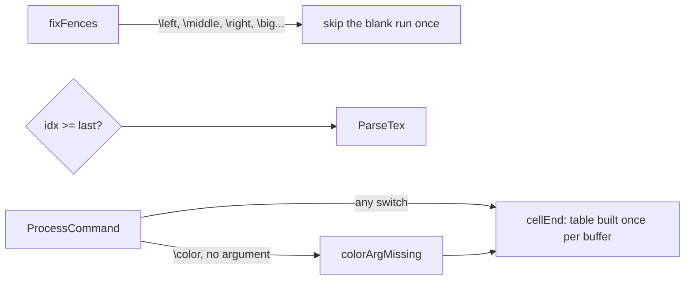

# Math conversion: comment runs, `\color` runs, malformed input
claude-opus-5-5, high effort
PR: [gnolang/gno#6377](https://github.com/gnolang/gno/pull/6377)
Review files: [reviews/pr/6xxx/6377-math-comment-runs](https://github.com/samouraiworld/gno-agent-workspace/tree/main/reviews/pr/6xxx/6377-math-comment-runs)

## TLDR

Before, three kinds of math input misbehaved. A run of `%` comment lines and a run of `\color` commands with no `{argument}` converted in time growing with the square of their length. And some malformed input crashed the converter, so gnoweb showed the expression as its LaTeX source instead of rendering it: about one in twenty random expressions built from common commands.
Now every run is walked once, through `fixFences`, `TokenBuffer.Empty`'s `last`, `colorArgMissing` and a per-buffer `cellEnd` table. The crash sites are guarded: a command that draws nothing, and a group whose match lies outside the buffer being read.
Valid TeX converts to the same MathML as before. A `}` that `\left` or `\bigl` takes as its delimiter, which TeX rejects, now renders as a plain brace.

## Before and after

Each row's two columns come from one run on one machine under load, so read the ratios: the left column is master before this change, the right is the branch.

| Input | Before | After |
| --- | --- | --- |
| A 1 MiB realm page of 8 KiB `$$` blocks of `%` lines, through `NewGnoExtension`, best of 3 | 669 ms | 131 ms |
| The same page, each line indented | 522 ms | 89 ms |
| The same page, blocks of bare `\color` | 102 ms | 29 ms |
| One expression of 65,536 indented `%` lines, `ConvertDisplay` called directly | 14.0 s | 17.4 ms |
| 300,000 random expressions of common commands, seed 13 | 15,613 crash | 0 crash, the rest identical |
| `\left`, `\big`, `\newcommand` or groups beside comments | linear | linear, unchanged |

## How a run is walked

After the change:



- `fixFences` skips the spaces and comments after a fence command only, so a comment run is walked once.
- `NewTokenBuffer` sets `last`, the index past the buffer's last token that is not a space or a comment, and `Empty` compares the position with it.
- `cellEnd` answers where a switch's cell ends from any position, from a table filled in one backward pass on first use.
- `colorArgMissing` answers a `\color` with no argument before the switch slices its cell.

## Read the code in this order

### 1. `hot` · The guard in `fixFences`, [`tokenize.go`](https://github.com/gnolang/gno/pull/6377/files#diff-0a86b2ef7f4c0cd16b59b787292e98ac793071187c792e328b5b450e5f360f86R672-R677)
Sends every token that is not a fence or `\big` command to `out` before the blank-run skip.
**If wrong:** a `\left` or `\big` loses its delimiter, or a comment run is walked once per comment again.

### 2. `hot` · `last` and `cellEnd`, [`tokenize.go`](https://github.com/gnolang/gno/pull/6377/files#diff-0a86b2ef7f4c0cd16b59b787292e98ac793071187c792e328b5b450e5f360f86R310-R338)
`Empty` is true once the position reaches `last`. `cellEnd` reads a table where a group opener takes the answer after its closer and a cell end is its own answer, exact from any position, inside a skipped group included.
**If wrong:** a switch spans the wrong cell, or `Empty` ends a buffer early.
```go
case opensGroup(t):
	b.cellEnds[i] = b.cellEnds[min(i+t.MatchOffset+1, n)]
```

### 3. `hot` · `matched`, [`tokenize.go`](https://github.com/gnolang/gno/pull/6377/files#diff-0a86b2ef7f4c0cd16b59b787292e98ac793071187c792e328b5b450e5f360f86R340-R345)
A `[` or `{` counts as a group only when its content lies within the buffer; `GetNextToken`, `GetNextExpr` and `GetOptions` ask it.
**If wrong:** a sub-buffer cut through a group slices past its end and crashes, as `\bf\sqrt[a&b]x` did.

### 4. `hot` · The bare `\color` shortcut, [`commands.go`](https://github.com/gnolang/gno/pull/6377/files#diff-e00d7e18532389cb0ca1c98a580bda6dfa410ede42130ce86f1b2a455787f085R312-R316)
Returns the missing-argument error before the switch slices its cell.
**If wrong:** a `\color` with an argument renders as an error, or a run of bare ones is quadratic again.

### 5. `warm` · The nil guards, [`parse.go`](https://github.com/gnolang/gno/pull/6377/files#diff-68347990c0498360ca09607c0fd3a3d1b55d14229add4b92002742c27ae265d6R229-R232)
A `\left`, `\big` or `\middle` whose delimiter is a command drawing nothing is skipped, as is `\class{a}{}`; each crashed on a nil node before.
**If wrong:** that input crashes the converter again, and the page shows the expression as source.

### 6. `cold` · The tests, [`edgecases_test.go`](https://github.com/gnolang/gno/pull/6377/files#diff-bad9ba16d355ebdd42acccc074b55514171fb90517664d7730a3fb2d1f042cd3R113-R174)
Fence-and-comment cases, `TestCommentRunIsLinear`, `TestBareColorRunIsLinear`, `TestSwitchEndsAtItsCell` and `TestMalformedInputDoesNotCrash`; reverting any one fix alone turns one of them red.
**If wrong:** a quadratic walk or a crash comes back and the suite stays green.

## Words used here

| Name | What it is |
| --- | --- |
| `fixFences` | The tokenizer pass that folds `\left`, `\middle`, `\right` and the `\big` family into the delimiter token after them. |
| `TokenBuffer.Empty` | True when every token from the buffer's position on is a space or a comment; it then moves the position to the end. |
| `cellEnd` | The index of the first `&` or line break from the buffer's position on, outside a group; a style switch applies up to it. |
| `colorArgMissing` | True when a `\color` has no `{argument}` in its cell, after an optional `[model]` closing there. |
| `matched` | True when a `[` or `{` opens a group whose content lies within the buffer being read. |
