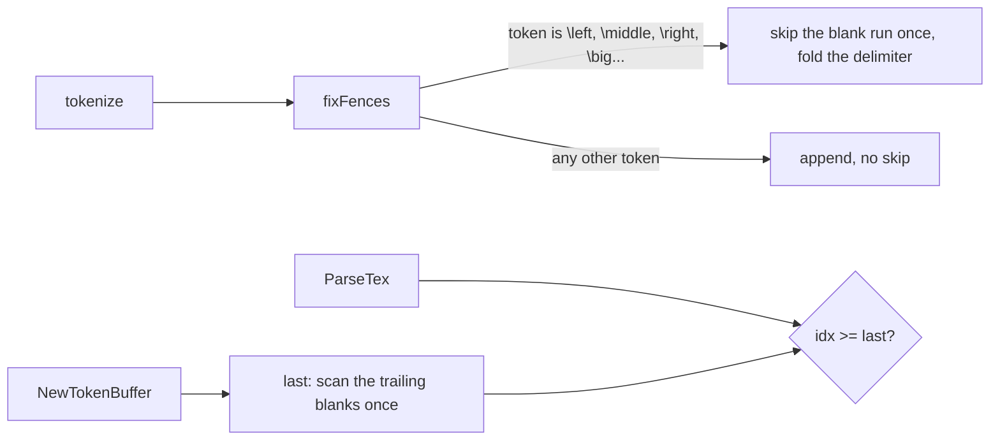

# Math comment runs: `fixFences` and `TokenBuffer.Empty`
claude-opus-5-5, high effort
PR: [gnolang/gno#6377](https://github.com/gnolang/gno/pull/6377)
Review files: [reviews/pr/6xxx/6377-math-comment-runs](https://github.com/samouraiworld/gno-agent-workspace/tree/main/reviews/pr/6xxx/6377-math-comment-runs)

## TLDR

Before, two passes walked a run of `%` comment lines once per token in it. `fixFences` skipped the spaces and comments after every token, and kept the result only after `\left`, `\middle`, `\right` or a `\big` command. `TokenBuffer.Empty` scanned the rest of a blank run each time `ParseTex` asked, and `ParseTex` steps through an indented run one comment at a time. Either way a run of K tokens cost K²/2 steps.
Now `fixFences` skips only after those commands, and `Empty` compares the position with `last`, the index past the buffer's last token that is not a space or a comment, found once when the buffer is built. Each run is walked once and costs its length.
A run of `\color` with no `{argument}` was quadratic the same way, each one scanning to the end of its table cell before failing; `colorArgMissing` now answers it before that scan.
Every expression converts to the same MathML as before.

## Before and after

Each row's two columns come from one run on one machine under load, so read the ratios: the left column is master before this change, the right is the branch.

| Input | Before | After |
| --- | --- | --- |
| A 1 MiB realm page of `$$` blocks of `%` lines, through `NewGnoExtension` | 1.73 s | 177 ms |
| The same page with lines indented by two spaces, `  % c` | 1.07 s | 111 ms |
| One expression of 65,536 `%` lines, `ConvertDisplay` | 2.63 s | 6.5 ms |
| One expression of 65,536 indented `%` lines, `ConvertDisplay` | 14.0 s | 17.4 ms |
| One expression of 131,072 bare `\color` commands, `ConvertInline` | 35.8 s | 115 ms |
| One expression of 32,768 `\color[RGB]` commands, `ConvertInline` | 21.3 s | 100 ms |
| `\left`, `\big`, `\newcommand` or groups beside comments | linear | linear, unchanged |

## How a comment run is walked

After the change:



- `fixFences` decides which delimiter a `\left` or `\big` takes, skipping the spaces and comments between them as TeX does.
- `NewTokenBuffer` sets `last` from the buffer's trailing blanks, the only part of it `Empty` needs.
- `Empty` answers whether only spaces and comments remain, for every `for !b.Empty()` loop in the parser.

## Read the code in this order

### 1. `hot` · The guard in `fixFences`, [`tokenize.go`](https://github.com/gnolang/gno/pull/6377/files#diff-0a86b2ef7f4c0cd16b59b787292e98ac793071187c792e328b5b450e5f360f86R642-R647)
Sends every token that is not a fence or `\big` command to `out` before the blank-run skip.
**If wrong:** a `\left` or `\big` loses its delimiter, or a comment run is walked once per comment again.
```go
if set == 0 {
	out = append(out, toks[i])
	continue
}
```

### 2. `hot` · `last` in `NewTokenBuffer` and `Empty`, [`tokenize.go`](https://github.com/gnolang/gno/pull/6377/files#diff-0a86b2ef7f4c0cd16b59b787292e98ac793071187c792e328b5b450e5f360f86R309-R325)
`Empty` is true once the position reaches `last`; `Expr` is never written after `NewTokenBuffer`, so `last` stays true whichever way the position moves.
**If wrong:** `Empty` reports a buffer empty while a token remains, or not empty at its end.
```go
if b.idx >= b.last {
	b.idx = max(b.idx, len(b.Expr))
	return true
}
```

### 3. `hot` · The bare `\color` shortcut, [`commands.go`](https://github.com/gnolang/gno/pull/6377/files#diff-e00d7e18532389cb0ca1c98a580bda6dfa410ede42130ce86f1b2a455787f085R312-R316)
Returns the missing-argument error before the scan to the cell end; `colorArgMissing` answers false whenever it cannot tell within the cell, and the old path then runs unchanged.
**If wrong:** a `\color` with an argument renders as an error, or a run of bare ones is quadratic again.
```go
if name == "color" && colorArgMissing(b) {
```

### 4. `cold` · The tests, [`edgecases_test.go`](https://github.com/gnolang/gno/pull/6377/files#diff-bad9ba16d355ebdd42acccc074b55514171fb90517664d7730a3fb2d1f042cd3R113-R149)
Five cases put a comment between a fence command and its delimiter. `TestCommentRunIsLinear` converts 256 KiB of plain and of space-indented `%` lines, and `TestBareColorRunIsLinear` 65,536 bare `\color`, `\color[RGB]` and `\color[{&}]`, each under the package's two-second bound; reverting any of the three fixes alone turns its test red.
**If wrong:** a quadratic walk comes back, or a fence stops skipping a comment, and the suite stays green.

## Words used here

| Name | What it is |
| --- | --- |
| `fixFences` | The tokenizer pass that folds `\left`, `\middle`, `\right` and the `\big` family into the delimiter token after them. |
| `TokenBuffer.Empty` | True when every token from the buffer's position on is a space or a comment; it then moves the position to the end. |
| `last` | One past the buffer's last token that is not a space or a comment, set by `NewTokenBuffer`. |
| `colorArgMissing` | True when a `\color` certainly has no `{argument}` within its cell, after an optional `[model]`; false when unsure. |
