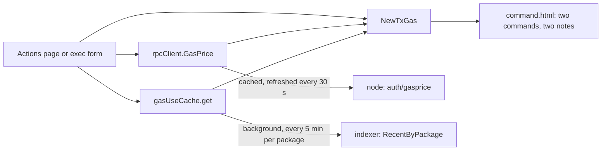

# gnoweb prices its copied gnokey commands at the chain's gas price

Written by claude-opus-5-5, effort high.

PR: [gnolang/gno#6425](https://github.com/gnolang/gno/pull/6425)

## TLDR

gnoweb shows a ready-made gnokey command under every function a visitor can
call, and that command always offered a fee of 1 GNOT, which the chain keeps
in full. The change reads what gas costs on the chain right now and offers
three times the price of 10 million gas instead, 0.03 GNOT at a price of
1 ugnot per 1,000 gas, and sizes the gas from what recent calls of the same
function used when an indexer is configured. Someone who copies the command
pays a fee close to what the call needs, never more than the old 1 GNOT.

## Gas wanted and the gas fee

Every gno.land transaction states two numbers. `-gas-wanted` is the most gas
the call may burn before the chain stops it. `-gas-fee` is what the sender
offers for that gas, and the chain keeps all of it: gas left unused is not
refunded. A call that runs out of gas fails and still pays the fee. A fee too
small for the gas wanted at the chain's price is rejected when the node first
checks the transaction, before it enters a block, so that rejection costs
nothing.

**Before:** both numbers were the constants of
[`CallGas`](https://github.com/gnolang/gno/blob/5e9668dab1678e778ca6709a01c4ca642901f704/gno.land/pkg/gnoweb/components/view_action.go#L60-L62),
1,000 M gas for `1000000ugnot`, the same for every function on every chain,
so every copied call paid 1 GNOT whatever it used.

**After:** the numbers come from a [`TxGas`](https://github.com/gnolang/gno/pull/6425/files#diff-92da5ecc935e0e465c626ae02c0337898308d43233c0b97e7cb6daecc95268e1R84-R100)
worked out per function on each page view, by
[`NewTxGas`](https://github.com/gnolang/gno/pull/6425/files#diff-92da5ecc935e0e465c626ae02c0337898308d43233c0b97e7cb6daecc95268e1R109-R139).
The default gas is
[`TxGasWanted`](https://github.com/gnolang/gno/pull/6425/files#diff-92da5ecc935e0e465c626ae02c0337898308d43233c0b97e7cb6daecc95268e1R35),
10,000,000. The ADR picks it as several times what common calls use and
below what governance calls use, which the measured gas below then raises.

## The chain's gas price

The chain moves its gas price every block: up after a busy one, down after a
quiet one. A node answers the current price on the query `auth/gasprice`, as a
pair such as `1ugnot/1000gas`, meaning 1 ugnot buys 1,000 gas.

gnoweb reads it through a new client method,
[`GasPrice`](https://github.com/gnolang/gno/pull/6425/files#diff-5ff000b6e1c77addf6c595ddeb623cc326e6a25e2c273e71584d5e8224d53152R215-R245),
which serves the last price it read and refreshes it in the background once
it is older than
[30 s](https://github.com/gnolang/gno/pull/6425/files#diff-5ff000b6e1c77addf6c595ddeb623cc326e6a25e2c273e71584d5e8224d53152R162).
A page waits only while no price has ever been read. Every page arriving
then joins one shared query, bounded by a
[2 s timeout](https://github.com/gnolang/gno/pull/6425/files#diff-5ff000b6e1c77addf6c595ddeb623cc326e6a25e2c273e71584d5e8224d53152R165),
and each page can stop waiting when its own request is cancelled. A failed
query keeps the last good price, in
[`queryGasPrice`](https://github.com/gnolang/gno/pull/6425/files#diff-5ff000b6e1c77addf6c595ddeb623cc326e6a25e2c273e71584d5e8224d53152R250-R268).
The price is cached once for the whole gnoweb process, so every visitor
shares it.

## Fast mode and secure mode

The Actions page offers each command in two modes, picked with a switch on
the page.

- **Fast mode** is one `gnokey maketx call` line that signs and broadcasts
  with the key on the visitor's machine. gnokey simulates the call before it
  broadcasts it by default, so a call short of gas stops there and costs
  nothing.
- **Secure mode** builds the transaction with `-broadcast=false`, signs it
  with `gnokey sign`, possibly on an offline machine, and sends it with
  `gnokey broadcast`. `gnokey broadcast` does not simulate, so a call short of
  gas is broadcast, fails and pays.

The change gives each mode its own gas and fee, `Secure` and `Fast` in
`TxGas`, because getting the gas too low costs nothing in fast mode and costs
a new signature in secure mode. It also adds a line before the secure
broadcast,
[`gnokey broadcast -dry-run`](https://github.com/gnolang/gno/pull/6425/files#diff-7cbc59366363af9ce882f3912c865c3cb7ddd50f626983b0f55e447d434ea368R15),
which runs the signed transaction against the node without committing it.
A transaction short of gas fails the dry run, before anything is charged.
The integration test
[`gnoweb_airgapped.txtar`](https://github.com/gnolang/gno/pull/6425/files#diff-3df77f65224cf28f30c057aa28bae50e271d4b251f9392182d7c11833f032b38R30-R35)
signs a call with 1 M gas, expects the dry run to fail with `out of gas`,
and expects the account's sequence to stay at 0, meaning nothing was sent.
The dry run checks the gas and that the balance covers the fee. It skips
the check of the fee against the price, per the
[ADR](https://github.com/gnolang/gno/pull/6425/files#diff-78255a0234f37fc0d62032a58918198eb6e803a95c62ba0aa76516150353af97R108-R111).

The secure-mode command flow, before and after:

```text
# Before
gnokey maketx call ... -gas-fee 1000000ugnot -gas-wanted 1_000_000_000 ... -broadcast=false ADDRESS > call.tx
gnokey sign -tx-path call.tx ...
gnokey broadcast -remote "..." call.tx

# After, at 1ugnot/1000gas with no measured gas
gnokey maketx call ... -gas-fee 30000ugnot -gas-wanted 10_000_000 ... -broadcast=false ADDRESS > call.tx
gnokey sign -tx-path call.tx ...
gnokey broadcast -dry-run -remote "..." call.tx
gnokey broadcast -remote "..." call.tx
```

## Headroom, the 1 GNOT cap and the fallback price

The fee is the price of the gas wanted, times three, rounded up, in
[`txFee`](https://github.com/gnolang/gno/pull/6425/files#diff-92da5ecc935e0e465c626ae02c0337898308d43233c0b97e7cb6daecc95268e1R160-R183):

$$\text{fee} = \left\lceil \frac{\text{wanted} \times \text{price amount} \times 3}{\text{price gas}} \right\rceil$$

The factor three is
[`txFeeHeadroom`](https://github.com/gnolang/gno/pull/6425/files#diff-92da5ecc935e0e465c626ae02c0337898308d43233c0b97e7cb6daecc95268e1R37-R40).
The price can rise between the page load and the broadcast, and at
1 ugnot per 1,000 gas one busy block raises it by one unit, which doubles
it. Three times covers two busy blocks in a row.

Two limits bound it, both in ugnot only:

- **The cap.** A fee above
  [`maxUgnotFee`](https://github.com/gnolang/gno/pull/6425/files#diff-92da5ecc935e0e465c626ae02c0337898308d43233c0b97e7cb6daecc95268e1R45-R47),
  1 GNOT, the old fee, is cut to 1 GNOT, as long as 1 GNOT still pays for
  the gas at the price read. `GasFee.Capped` is then set, and the note says
  the fee may not cover a rise instead of saying times three.
- **The fallback.** A price that is zero, invalid, overflowing, or so high
  that the gas alone costs more than 1 GNOT is replaced by
  [`FallbackGasPrice`](https://github.com/gnolang/gno/pull/6425/files#diff-92da5ecc935e0e465c626ae02c0337898308d43233c0b97e7cb6daecc95268e1R53-R55),
  1 ugnot per 1,000 gas, and `TxGas.Estimated` is set. A ugnot price that was
  read but is too high is kept in `TxGas.TooHigh`, so the note can give it
  and tell the reader to raise `-gas-fee`.

After: the fee at 10 M gas for a range of prices. Each row is a case of
`TestNewTxGas` in
[`components/gas_test.go`](https://github.com/gnolang/gno/blob/6b7e7bdfc61f4db559693bfdc521da564f364f41/gno.land/pkg/gnoweb/components/gas_test.go#L38-L54),
which passes at the head.

| Price read | Fee offered | What the note says |
| --- | --- | --- |
| `1ugnot/1000gas` | `30000ugnot`, 0.03 GNOT | the chain's price, times 3 |
| `3ugnot/1000gas` | `90000ugnot` | the chain's price, times 3 |
| `34ugnot/1000gas` | `1000000ugnot`, capped | capped at 1 GNOT |
| `100ugnot/1000gas` | `1000000ugnot`, capped | capped at 1 GNOT |
| `101ugnot/1000gas` | `30000ugnot` at the fallback | the chain's price is too high, raise `-gas-fee` |
| none, zero or invalid | `30000ugnot` at the fallback | an estimated price, the chain's was unavailable |
| `2foo/1000gas` | `60000foo` | the chain's price, times 3, no cap |

## Gas measured from recent calls

gnoweb can be started with an indexer, a service that answers what recent
transactions did. When one is configured, gnoweb reads a package's last
[100 transactions](https://github.com/gnolang/gno/pull/6425/files#diff-9e707a662f0a43d768281c8c55bf6b7f879ad6f78f2ffc578b38c8531ebb909fR20)
and keeps, per function, the most gas any of its last 20 successful calls
used, in
[`gasUses`](https://github.com/gnolang/gno/pull/6425/files#diff-9e707a662f0a43d768281c8c55bf6b7f879ad6f78f2ffc578b38c8531ebb909fR47-R66).
A row counts only when the transaction succeeded, used a positive amount of
gas, and holds exactly one `MsgCall` into this package naming a function that
is a Go identifier of at most 64 bytes. The check is repeated in gnoweb
because the indexer's filter has returned unrelated transactions,
[#6411](https://github.com/gnolang/gno/issues/6411).

`NewTxGas` then asks for twice that most, rounded up to 100 k, at least
1 M, and at most what 1 GNOT pays for at the price, up to the old 1,000 M.
Where that lands decides which mode takes it, in
[the switch at the end of `NewTxGas`](https://github.com/gnolang/gno/pull/6425/files#diff-92da5ecc935e0e465c626ae02c0337898308d43233c0b97e7cb6daecc95268e1R132-R137):

- **Below 10 M**, only fast mode is lowered, and only once at least
  [3 calls](https://github.com/gnolang/gno/pull/6425/files#diff-92da5ecc935e0e465c626ae02c0337898308d43233c0b97e7cb6daecc95268e1R63-R65)
  were measured. A wrong measure there costs nothing, since gnokey simulates.
- **Above 10 M**, both modes are raised, on a single call. One costly call
  among the last 20 sets the maximum anyway.

The indexer is not part of consensus, so its data is not trusted to cost
anyone money. A lowered gas only reaches the mode that simulates, and a raised
gas costs at most the old 1 GNOT, which every call paid before.

After: the gas and fee each mode offers at `1ugnot/1000gas`, from the cases
of `TestNewTxGasFromUse` in
[`components/gas_test.go`](https://github.com/gnolang/gno/blob/6b7e7bdfc61f4db559693bfdc521da564f364f41/gno.land/pkg/gnoweb/components/gas_test.go#L105-L119),
which passes at the head.

| Most gas used, calls | Fast mode | Secure mode |
| --- | --- | --- |
| no indexer or no read yet | 10 M, `30000ugnot` | 10 M, `30000ugnot` |
| 1.38 M, 2 calls | 10 M, too few to lower | 10 M |
| 1.38 M, 3 calls | 2.8 M, `8400ugnot` | 10 M |
| 100 k, 5 calls | 1 M floor, `3000ugnot` | 10 M |
| 16.92 M, 2 calls | 33.9 M, `101700ugnot` | 33.9 M, `101700ugnot` |
| 18.8 M, 13 calls | 37.6 M, `112800ugnot` | 37.6 M, `112800ugnot` |
| 83 M, 20 calls | 166 M, `498000ugnot` | 166 M, `498000ugnot` |
| 200 M, 20 calls | 400 M, capped at 1 GNOT | 400 M, capped at 1 GNOT |

## No page waits for the indexer

The measures live in
[`gasUseCache`](https://github.com/gnolang/gno/pull/6425/files#diff-9e707a662f0a43d768281c8c55bf6b7f879ad6f78f2ffc578b38c8531ebb909fR68-R146),
one entry per package. A page takes whatever the cache holds, nothing on a
package's first view, and
[`get`](https://github.com/gnolang/gno/pull/6425/files#diff-9e707a662f0a43d768281c8c55bf6b7f879ad6f78f2ffc578b38c8531ebb909fR90-R104)
starts one background read when the entry is missing or older than 5 min.
The first view of a package therefore shows 10 M, and the views after the
read show the measure. The limits sit in
[the constants](https://github.com/gnolang/gno/pull/6425/files#diff-9e707a662f0a43d768281c8c55bf6b7f879ad6f78f2ffc578b38c8531ebb909fR17-R41):
at most 4 reads in flight, a 10 s timeout per read, 1,024 packages kept,
the least recently viewed dropped first. A failed read keeps the last
measure and is retried after 30 s, in
[`read`](https://github.com/gnolang/gno/pull/6425/files#diff-9e707a662f0a43d768281c8c55bf6b7f879ad6f78f2ffc578b38c8531ebb909fR124-R131).

The price is fetched lazily too. A realm page's render context carries a
`Gas` function that wraps the price in a `sync.OnceValue`, in
[`renderContext`](https://github.com/gnolang/gno/pull/6425/files#diff-9583809dcb333e5ac71c297ea3e6f6ceb28dd64624b025136e7993063e84d1a4R253-R264),
so the price is read at most once per page and only when a `<gno-form exec>`
block calls it, through
[`getGasFromContext`](https://github.com/gnolang/gno/pull/6425/files#diff-c8157411fa9b2e88bcb684d1ca01b3dd1aee58e762bf225266c959a125b057fdR92-R100).
The Actions page reads the price and the measures only when the package has
a crossing function, in
[`handler_http.go`](https://github.com/gnolang/gno/pull/6425/files#diff-14c9af5c4d6d337ded17f989428cb916ecd9ba3db4013cec6e949b7a5555cb8dR1276-R1278),
since only a crossing function renders a command.

After: what a page that shows a command asks for.



## The fee note

Under each command, a two-line note says what the command offers, one note
per mode, in
[`command.html`](https://github.com/gnolang/gno/pull/6425/files#diff-7cbc59366363af9ce882f3912c865c3cb7ddd50f626983b0f55e447d434ea368R18-R29).
It gives the fee, the gas and, when measured, how many calls the measure
came from, the price and whether it is the chain's or estimated, then the
times three or the cap, and that unused gas is not refunded. The mode switch
shows one note and hides the other, in
[`controller-action-function.ts`](https://github.com/gnolang/gno/pull/6425/files#diff-99ae20ddb7ea356ed1eb4f5625e143a822f85ed68ec38dd127e699f66cd3edd9R82-R85).
The note sits outside the copied text, so it is never pasted into a
terminal.

After, the fast-mode note with no chain price available, from the
`exec_empty_no_args` golden file:

```text
Fee 0.03 GNOT for up to 10 M gas, at an estimated 1ugnot/1000gas (the chain's price was unavailable), times 3 in case it rises.
Unused gas is not refunded; gnokey simulates first, so running out of gas charges nothing.
```

## Before and after

**Before:** every command on the Actions page and in `<gno-form exec>`
blocks offered `-gas-fee 1000000ugnot -gas-wanted 1_000_000_000` from
`CallGas`, through the template function `callGas`, and the secure flow went
from signing straight to `gnokey broadcast`.

**After:** each command offers the gas and fee `NewTxGas` works out from the
chain's price and the function's measured gas, each mode its own, with a
note under it, and the secure flow runs `gnokey broadcast -dry-run` before
`gnokey broadcast`.

## What a user notices

- **A smaller fee on every copied command**, three times the price of
  10 M gas, 0.03 GNOT at `1ugnot/1000gas`. The price is shared by every
  visitor of one gnoweb process and is refreshed once it is 30 s old.
- **A gas that follows the function**, on a gnoweb started with an
  indexer: lower in fast mode for a function whose recent calls were
  cheap, higher in both modes for one whose calls needed more than 5 M. It
  is the same for every visitor of that gnoweb process and changes at most
  every 5 min per package. A package's first view shows 10 M.
- **A note under each command** saying the fee, the gas and the price, which
  follows the mode switch.
- **A new dry-run line in secure mode**, which stops a transaction short of
  gas before anything is charged.

## Not fixed

- **The `$run` page** keeps its own editable defaults,
  [`RunGas`](https://github.com/gnolang/gno/blob/6b7e7bdfc61f4db559693bfdc521da564f364f41/gno.land/pkg/gnoweb/components/view_action.go#L62-L68),
  50 M gas for 0.1 GNOT, and has no dry run. Nothing reaches it yet.
- **The exact gas of a call** with the visitor's own arguments. gnokey would
  have to work it out, which is
  [#3703](https://github.com/gnolang/gno/issues/3703), closed as not planned.
- **A secure-mode call needing more than its measure**, or more than 10 M on
  a package's first view. The dry run stops it for free, and the reader
  raises `-gas-wanted` and signs again.
- **A price that outgrows the fee** between the page load and the broadcast.
  The dry run does not check the price, and the node rejects the fee when it
  first checks the transaction, for free.
- **A chain whose fee is not paid in ugnot.** The fallback price is in ugnot,
  so a fallback fee there is rejected, for free, per the
  [ADR](https://github.com/gnolang/gno/pull/6425/files#diff-78255a0234f37fc0d62032a58918198eb6e803a95c62ba0aa76516150353af97R98-R101).
- **A node whose own minimum gas price is above the chain's.** `auth/gasprice`
  does not report it, and such a node rejects the fee, for free.
- **Printing the realm URL after a deploy**, the rest of
  [#6276](https://github.com/gnolang/gno/issues/6276), is left to gnokey and
  gnodev.

## Words used here

| Name | What it is |
| --- | --- |
| `auth/gasprice` | The node query answering the chain's current gas price, such as `1ugnot/1000gas`. |
| ugnot, GNOT | The chain's fee coin: 1 GNOT is 1,000,000 ugnot. |
| crossing function | A realm function declared with a `cur realm` parameter, the only kind a transaction calls and so the only kind with a command. |
| `<gno-form exec>` | A form a realm writes in its Markdown, rendered by gnoweb with a gnokey command calling one of its functions. |
| [`TxGasWanted`](https://github.com/gnolang/gno/pull/6425/files#diff-92da5ecc935e0e465c626ae02c0337898308d43233c0b97e7cb6daecc95268e1R35) | The default gas a command asks for, 10,000,000. |
| [`txFeeHeadroom`](https://github.com/gnolang/gno/pull/6425/files#diff-92da5ecc935e0e465c626ae02c0337898308d43233c0b97e7cb6daecc95268e1R40) | The factor the fee is multiplied by over the price, 3. |
| [`maxUgnotFee`](https://github.com/gnolang/gno/pull/6425/files#diff-92da5ecc935e0e465c626ae02c0337898308d43233c0b97e7cb6daecc95268e1R47) | The fee cap, `1000000` ugnot, the old hardcoded fee. |
| [`FallbackGasPrice`](https://github.com/gnolang/gno/pull/6425/files#diff-92da5ecc935e0e465c626ae02c0337898308d43233c0b97e7cb6daecc95268e1R55) | `1ugnot/1000gas`, used when the chain's price cannot be read or is unusable. |
| [`GasUse`](https://github.com/gnolang/gno/pull/6425/files#diff-92da5ecc935e0e465c626ae02c0337898308d43233c0b97e7cb6daecc95268e1R69-R72) | The most gas a function's recent successful calls used, and how many calls were counted, at most 20. |
| [`GasFee`](https://github.com/gnolang/gno/pull/6425/files#diff-92da5ecc935e0e465c626ae02c0337898308d43233c0b97e7cb6daecc95268e1R75-R80) | One mode's gas wanted and fee, with `Capped` true when the fee was cut to 1 GNOT. |
| [`TxGas`](https://github.com/gnolang/gno/pull/6425/files#diff-92da5ecc935e0e465c626ae02c0337898308d43233c0b97e7cb6daecc95268e1R84-R100) | Both modes' `GasFee`, the price used, and whether that price is estimated or the chain's was too high. |
| [`NewTxGas`](https://github.com/gnolang/gno/pull/6425/files#diff-92da5ecc935e0e465c626ae02c0337898308d43233c0b97e7cb6daecc95268e1R109-R139) | Works out a `TxGas` from a price and a `GasUse`, once per function on each page view. |
| [`GasPrice`](https://github.com/gnolang/gno/pull/6425/files#diff-5ff000b6e1c77addf6c595ddeb623cc326e6a25e2c273e71584d5e8224d53152R215-R245) | The client method returning the cached chain price, refreshed when older than 30 s. |
| [`gasUseCache`](https://github.com/gnolang/gno/pull/6425/files#diff-9e707a662f0a43d768281c8c55bf6b7f879ad6f78f2ffc578b38c8531ebb909fR68-R146) | Per-package measures from the indexer, kept 5 min, 1,024 packages at most; empty without an indexer. |
| dry run | `gnokey broadcast -dry-run`, which runs a signed transaction on the node without committing it. |

<details>
<summary>Read the code in this order</summary>

`hot` is the risky code to read closely, `warm` other code, `cold` a test or
a generated file.

### 1. `hot` · The fee and gas decision, [`gno.land/pkg/gnoweb/components/gas.go`](https://github.com/gnolang/gno/pull/6425/files#diff-92da5ecc935e0e465c626ae02c0337898308d43233c0b97e7cb6daecc95268e1R109-R139)
Turns a price and a measure into each mode's gas and fee.
**If wrong:** a copied command offers too little to be accepted, or more
than the old 1 GNOT.
```go
most := maxWanted(g.Price)
w := most
if use.Max < most/2 {
	w = min(max((2*use.Max+gasWantedStep-1)/gasWantedStep*gasWantedStep, minTxGasWanted), most)
}
fee, _ = txFee(g.Price, w) // w is within what maxUgnotFee pays for
switch {
case w < TxGasWanted && use.Calls >= minGasUseCalls:
	g.Fast, g.Used = fee, use
case w > TxGasWanted:
	g.Secure, g.Fast, g.Used = fee, fee, use
}
```

### 2. `hot` · The fee formula and cap, [`gno.land/pkg/gnoweb/components/gas.go`](https://github.com/gnolang/gno/pull/6425/files#diff-92da5ecc935e0e465c626ae02c0337898308d43233c0b97e7cb6daecc95268e1R160-R183)
Computes the fee in big integers and decides when a price is unusable.
**If wrong:** an overflowing or tiny price yields a fee the node rejects.
```go
fee := ceilTimes(txFeeHeadroom)
if !fee.IsInt64() {
	return GasFee{}, false
}
if p.Price.Denom == "ugnot" && fee.Int64() > maxUgnotFee {
	if ceilTimes(1).Cmp(big.NewInt(maxUgnotFee)) > 0 {
		return GasFee{}, false
	}
	return GasFee{Wanted: wanted, Fee: std.NewCoin(p.Price.Denom, maxUgnotFee), Capped: true}, true
}
```

### 3. `hot` · The indexer row filter, [`gno.land/pkg/gnoweb/gas_use.go`](https://github.com/gnolang/gno/pull/6425/files#diff-9e707a662f0a43d768281c8c55bf6b7f879ad6f78f2ffc578b38c8531ebb909fR47-R66)
Keeps only single-call successful transactions into the package.
**If wrong:** unrelated cheap rows lower the fast-mode gas below what the
function needs.
```go
if !tx.Success || tx.GasUsed <= 0 || len(tx.Messages) != 1 {
	continue
}
m := tx.Messages[0].Value
if m.Type != "MsgCall" || m.PkgPath != pkgPath ||
	len(m.Func) > maxGasUseFunc || !token.IsIdentifier(m.Func) {
	continue
}
```

### 4. `hot` · The measure cache, [`gno.land/pkg/gnoweb/gas_use.go`](https://github.com/gnolang/gno/pull/6425/files#diff-9e707a662f0a43d768281c8c55bf6b7f879ad6f78f2ffc578b38c8531ebb909fR90-R133)
Serves what is cached and refreshes one package at a time in the
background.
**If wrong:** a page waits on the indexer, or reads pile up past 4.
```go
e, ok := c.lookup(pkgPath)
if !ok {
	ctx := context.WithoutCancel(ctx)
	c.sf.DoChan(pkgPath, func() (any, error) {
		c.read(ctx, pkgPath)
		return nil, nil
	})
}
return e.uses
```

### 5. `hot` · The price cache, [`gno.land/pkg/gnoweb/client.go`](https://github.com/gnolang/gno/pull/6425/files#diff-5ff000b6e1c77addf6c595ddeb623cc326e6a25e2c273e71584d5e8224d53152R215-R245)
Returns the cached price at once, or waits on one shared first read.
**If wrong:** every page with a command waits on the node, or shows the
fallback while the node answers.
```go
stale := time.Since(at) >= gasPriceTTL
if !ok && stale {
	ch := c.gasFirst.DoChan("", func() (any, error) { return c.queryGasPrice(ctx) })
	select {
	case res := <-ch:
		...
	case <-ctx.Done():
		return std.GasPrice{}, ctx.Err()
	}
}
if stale && c.gasBusy.CompareAndSwap(false, true) {
	go func() {
		defer c.gasBusy.Store(false)
		c.queryGasPrice(ctx)
	}()
}
```

### 6. `hot` · Who asks for a price, [`gno.land/pkg/gnoweb/handler_http.go`](https://github.com/gnolang/gno/pull/6425/files#diff-14c9af5c4d6d337ded17f989428cb916ecd9ba3db4013cec6e949b7a5555cb8dR1276-R1286)
The Actions page reads the price and the measures only for a package with a
crossing function.
**If wrong:** pages with no command query the node and the indexer.
```go
if slices.ContainsFunc(fsigs, func(fn *doc.JSONFunc) bool { return fn.Crossing }) {
	price, uses = h.gasPrice(ctx), h.gasUse.get(ctx, pkgPath)
}
```

### 7. `warm` · The lazy price for exec forms, [`gno.land/pkg/gnoweb/page_kind.go`](https://github.com/gnolang/gno/pull/6425/files#diff-9583809dcb333e5ac71c297ea3e6f6ceb28dd64624b025136e7993063e84d1a4R253-R264)
Hands realm rendering a `Gas` function that reads the price once, on first
use.
**If wrong:** every realm page queries the price, or a page reads it twice.
```go
price := sync.OnceValue(func() std.GasPrice { return h.gasPrice(ctx) })
...
Gas: func(pkgPath, fn string) components.TxGas {
	return components.NewTxGas(price(), h.gasUse.get(ctx, pkgPath)[fn])
},
```

### 8. `hot` · The exec form's lookup, [`gno.land/pkg/gnoweb/markdown/ext_forms.go`](https://github.com/gnolang/gno/pull/6425/files#diff-74113512f4be3f36143a03cab61b64d6568ad7008f3fba7fd11ae9c3748d977bR254)
Prices a `<gno-form exec>` block for the function it calls.
**If wrong:** a form shows another package's measure.
```go
node.Gas = getGasFromContext(pc, node.Domain+node.RealmName, exec)
```

### 9. `hot` · The commands and notes, [`gno.land/pkg/gnoweb/components/ui/command.html`](https://github.com/gnolang/gno/pull/6425/files#diff-7cbc59366363af9ce882f3912c865c3cb7ddd50f626983b0f55e447d434ea368R12-R29)
Prints each mode's flags, the dry-run line and the two notes.
**If wrong:** a mode copies the other mode's fee, or a note misstates it.
```html
gnokey sign -tx-path call.tx -chainid "{{.ChainId}}" -account-number ACCOUNTNUMBER -account-sequence SEQUENCENUMBER ...
gnokey broadcast -dry-run -remote "{{.Remote}}" call.tx
gnokey broadcast -remote "{{.Remote}}" call.tx
```

### 10. `hot` · The note follows the mode, [`gno.land/pkg/gnoweb/frontend/js/controller-action-function.ts`](https://github.com/gnolang/gno/pull/6425/files#diff-99ae20ddb7ea356ed1eb4f5625e143a822f85ed68ec38dd127e699f66cd3edd9R82-R85)
Shows the note of the selected mode.
**If wrong:** the page shows the fee of the mode not being copied.
```ts
this.getTargets("note").forEach((note) => {
	note.classList.toggle("u-hidden", this.getValue("mode", note) !== mode);
});
```

### 11. `cold` · The dry run, end to end, [`gno.land/pkg/integration/testdata/gnoweb_airgapped.txtar`](https://github.com/gnolang/gno/pull/6425/files#diff-3df77f65224cf28f30c057aa28bae50e271d4b251f9392182d7c11833f032b38R28-R35)
Signs a call short of gas and checks the dry run stops it.
**If wrong:** the secure flow broadcasts a call that runs out of gas.
```text
! gnokey broadcast -dry-run $WORK/low.tx
stderr 'out of gas'
gnokey query auth/accounts/g1meuazsmy8ztaz2xpuyraqq4axy6s00ycl07zva
stdout '    "sequence": "0"'
```

</details>
